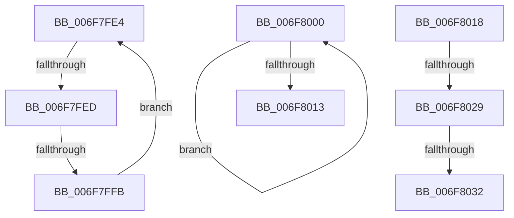

# sub_006F7FE4

- RVA: `0x006F7FE4`–`0x006F8043` (길이 `95` bytes)
- VA: `0x00000001406F7FE4`
- 실행 섹션: `.text`
- PDB 이름 있음: `아니요`; PDB Function 태그: `아니요`
- unwind 정보 RVA: `0x000B4D38`
- 디코드: `25`개 명령, `95/95` bytes 표시
- 미해석 바이트: `0` (있으면 어셈블리에 `.byte`로 보존)

> 이 문서는 커널 이미지의 기계어와 PDB 기호를 분석해 생성했습니다. 4번과 5번은 함수 원형과 자료형을 바이너리 사용 방식에서 추정한 C 해석이며 원본 소스 복구 결과는 아닙니다.

## 1. Dependencies

- 직접 호출 지점: **3**; 고유 호출 대상: **3**
- 직접 호출자로 확인된 함수: **0**
- RIP 상대 이미지 참조: **0**

### Outgoing calls
- `0x006F8006` → [EmpUpdateRuleState](../49/EmpUpdateRuleState_function_0049CD48.md) (function, `0x0049CD48`)
- `0x006F801B` → [EmpSearchTargetRuleList](../45/EmpSearchTargetRuleList_function_00456CE0.md) (function, `0x00456CE0`)
- `0x006F8038` → [EmpEvaluateUpdateRuleEvalState](../58/EmpEvaluateUpdateRuleEvalState_function_00580DC8.md) (function, `0x00580DC8`)

### Direct callers
- 이 함수 시작 RVA로 연결되는 직접 call은 확인되지 않았습니다. 간접 호출은 완전히 역산할 수 없습니다.

### Static image references
- 디코드된 RIP-relative 메모리 참조가 없습니다.

## 2. Other-region calls and transfers

- 다른 실행 섹션으로 향하는 call: **0**
- call이 아닌 외부 분기/꼬리 이동: **6**
  - `0x006F7FE7` → [EmpUpdateRuleState + 0x5B](../49/EmpUpdateRuleState_function_0049CD48.md) (`tail-transfer`)
  - `0x006F7FF5` → [EmpUpdateRuleState + 0x58](../49/EmpUpdateRuleState_function_0049CD48.md) (`tail-transfer`)
  - `0x006F8013` → [EmpUpdateRuleState + 0x61](../49/EmpUpdateRuleState_function_0049CD48.md) (`tail-transfer`)
  - `0x006F8023` → [EmpUpdateRuleState + 0x71](../49/EmpUpdateRuleState_function_0049CD48.md) (`tail-transfer`)
  - `0x006F802C` → [EmpUpdateRuleState + 0x71](../49/EmpUpdateRuleState_function_0049CD48.md) (`tail-transfer`)
  - `0x006F803E` → [EmpUpdateRuleState + 0x71](../49/EmpUpdateRuleState_function_0049CD48.md) (`tail-transfer`)

## 3. Assembly (complete function range)

```asm
006F7FE4  48 85 C9                        test rcx, rcx
006F7FE7  0F 84 B6 4D DA FF               je 0x14049cda3
006F7FED  48 8B 41 F8                     mov rax, qword ptr [rcx - 8]
006F7FF1  80 78 14 00                     cmp byte ptr [rax + 0x14], 0
006F7FF5  0F 84 A5 4D DA FF               je 0x14049cda0
006F7FFB  48 8B 09                        mov rcx, qword ptr [rcx]
006F7FFE  EB E4                           jmp 0x1406f7fe4
006F8000  48 8B 4E F8                     mov rcx, qword ptr [rsi - 8]
006F8004  33 D2                           xor edx, edx
006F8006  E8 3D 4D DA FF                  call 0x14049cd48
006F800B  48 8B 36                        mov rsi, qword ptr [rsi]
006F800E  48 85 F6                        test rsi, rsi
006F8011  75 ED                           jne 0x1406f8000
006F8013  E9 91 4D DA FF                  jmp 0x14049cda9
006F8018  48 8B CB                        mov rcx, rbx
006F801B  E8 C0 EC D5 FF                  call 0x140456ce0
006F8020  48 85 C0                        test rax, rax
006F8023  0F 84 90 4D DA FF               je 0x14049cdb9
006F8029  83 38 00                        cmp dword ptr [rax], 0
006F802C  0F 8E 87 4D DA FF               jle 0x14049cdb9
006F8032  49 8B D6                        mov rdx, r14
006F8035  48 8B C8                        mov rcx, rax
006F8038  E8 8B 8D E8 FF                  call 0x140580dc8
006F803D  90                              nop
006F803E  E9 76 4D DA FF                  jmp 0x14049cdb9
```

## 4. C-style interpretation (structured pseudocode)

```c
__int64 __fastcall sub_006F7FE4(__int64 a1, int a2)
{
    goto loc_006F7FE4;
}
```

## 5. (Beta) C Style

```c
int64_t sub_006F7FE4(int64_t Arg1, int32_t Arg2)
{
    goto loc_006F7FE4;
}
```

## 6. Execution-region graph

[열기: 2D/3D 그래프와 함수 탐색 컨트롤 패널](../../../control-panel.html?section=text&rva=0x006F7FE4&view=graph)

- 2D 그래프는 위에서 아래로 흐르고, 3D 그래프는 빈 공간을 드래그해 회전합니다. Shift+드래그는 이동, 휠은 확대·축소, 함수 노드 선택은 대상 보고서 이동입니다.

### Static fallback


