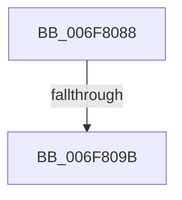

# sub_006F8088

- RVA: `0x006F8088`–`0x006F810A` (길이 `130` bytes)
- VA: `0x00000001406F8088`
- 실행 섹션: `.text`
- PDB 이름 있음: `아니요`; PDB Function 태그: `아니요`
- unwind 정보 RVA: `0x000B4F60`
- 디코드: `23`개 명령, `130/130` bytes 표시
- 미해석 바이트: `0` (있으면 어셈블리에 `.byte`로 보존)

> 이 문서는 커널 이미지의 기계어와 PDB 기호를 분석해 생성했습니다. 4번과 5번은 함수 원형과 자료형을 바이너리 사용 방식에서 추정한 C 해석이며 원본 소스 복구 결과는 아닙니다.

## 1. Dependencies

- 직접 호출 지점: **2**; 고유 호출 대상: **2**
- 직접 호출자로 확인된 함수: **0**
- RIP 상대 이미지 참조: **11**

### Outgoing calls
- `0x006F80EF` → [KiSetTimerEx](../23/KiSetTimerEx_function_00232CB0.md) (function, `0x00232CB0`)
- `0x006F80FF` → [PopSetNotificationWork](../48/PopSetNotificationWork_function_00482C78.md) (function, `0x00482C78`)

### Direct callers
- 이 함수 시작 RVA로 연결되는 직접 call은 확인되지 않았습니다. 간접 호출은 완전히 역산할 수 없습니다.

### Static image references
- `0x006F808D` → RVA `0x00F0CE18` (`.data`; read/write)
- `0x006F809B` → RVA `0x005D5190` (`PopAwayModeUserPresenceDpc`; read)
- `0x006F80A2` → RVA `0x00F0D0C0` (`.data`; write)
- `0x006F80AC` → RVA `0x00F0D0D8` (`.data`; write)
- `0x006F80B3` → RVA `0x00E67730` (`.data`; read)
- `0x006F80BA` → RVA `0x00F0CE18` (`.data`; read)
- `0x006F80C1` → RVA `0x00F0D0F8` (`.data`; write)
- `0x006F80C8` → RVA `0x00F0D0E0` (`.data`; write)
- `0x006F80D2` → RVA `0x00F0D0C0` (`.data`; read)
- `0x006F80D9` → RVA `0x00F0D0D0` (`.data`; write)
- `0x006F80F9` → RVA `0x00F0C68C` (`.data`; write)

## 2. Other-region calls and transfers

- 다른 실행 섹션으로 향하는 call: **0**
- call이 아닌 외부 분기/꼬리 이동: **2**
  - `0x006F8095` → [PopUserPresentSetWorker + 0x8A](../49/PopUserPresentSetWorker_function_0049D4F0.md) (`tail-transfer`)
  - `0x006F8105` → [PopUserPresentSetWorker + 0x8A](../49/PopUserPresentSetWorker_function_0049D4F0.md) (`tail-transfer`)

## 3. Assembly (complete function range)

```asm
006F8088  B8 01 00 00 00                  mov eax, 1
006F808D  87 05 85 4D 81 00               xchg dword ptr [rip + 0x814d85], eax
006F8093  85 C0                           test eax, eax
006F8095  0F 85 DF 54 DA FF               jne 0x14049d57a
006F809B  48 8D 05 EE D0 ED FF            lea rax, [rip - 0x122f12]
006F80A2  C7 05 14 50 81 00 13 01 00 00   mov dword ptr [rip + 0x815014], 0x113
006F80AC  48 89 05 25 50 81 00            mov qword ptr [rip + 0x815025], rax
006F80B3  48 8D 0D 76 F6 76 00            lea rcx, [rip + 0x76f676]
006F80BA  48 8D 05 57 4D 81 00            lea rax, [rip + 0x814d57]
006F80C1  48 89 35 30 50 81 00            mov qword ptr [rip + 0x815030], rsi
006F80C8  48 89 05 11 50 81 00            mov qword ptr [rip + 0x815011], rax
006F80CF  45 33 C9                        xor r9d, r9d
006F80D2  48 8D 05 E7 4F 81 00            lea rax, [rip + 0x814fe7]
006F80D9  48 89 35 F0 4F 81 00            mov qword ptr [rip + 0x814ff0], rsi
006F80E0  45 33 C0                        xor r8d, r8d
006F80E3  48 89 44 24 20                  mov qword ptr [rsp + 0x20], rax
006F80E8  48 C7 C2 80 3C 36 FE            mov rdx, 0xfffffffffe363c80
006F80EF  E8 BC AB B3 FF                  call 0x140232cb0
006F80F4  B9 40 00 00 00                  mov ecx, 0x40
006F80F9  89 3D 8D 45 81 00               mov dword ptr [rip + 0x81458d], edi
006F80FF  E8 74 AB D8 FF                  call 0x140482c78
006F8104  90                              nop
006F8105  E9 70 54 DA FF                  jmp 0x14049d57a
```

## 4. C-style interpretation (structured pseudocode)

```c
__int64 __fastcall sub_006F8088(__int64 a1, __int64 a2, int a3, int a4)
{
    __int64 result;
    unsigned __int64 v_stack_p20;

    *(unsigned int *)(v_rip + 8474644) = 275;
    *(unsigned __int64 *)(v_rip + 8474661) = v_rip - 1191698;
    *(unsigned __int64 *)(v_rip + 8474672) = v_rsi;
    *(unsigned __int64 *)(v_rip + 8474641) = v_rip + 8473943;
    a4 = 0;
    *(unsigned __int64 *)(v_rip + 8474608) = v_rsi;
    a3 = 0;
    v_stack_p20 = v_rip + 8474599;
    result = KiSetTimerEx(v_rip + 7796342, 0xFFFFFFFFFE363C80ULL, a3, a4);
    *(unsigned int *)(v_rip + 8471949) = (unsigned int)(v_rdi);
    result = PopSetNotificationWork(64, 0xFFFFFFFFFE363C80ULL, a3, a4);
}
```

## 5. (Beta) C Style

```c
int64_t sub_006F8088(int64_t Arg1, int64_t Arg2, int32_t Arg3, int32_t Arg4)
{
    int64_t result;
    uint64_t v_stack_p20;

    *(uint32_t *)(v_rip + 0x815014) = 275;
    *(uint64_t *)(v_rip + 0x815025) = v_rip - 1191698;
    *(uint64_t *)(v_rip + 0x815030) = local_rsi;
    *(uint64_t *)(v_rip + 0x815011) = v_rip + 8473943;
    Arg4 = 0;
    *(uint64_t *)(v_rip + 0x814FF0) = local_rsi;
    Arg3 = 0;
    v_stack_p20 = v_rip + 8474599;
    result = KiSetTimerEx(v_rip + 7796342, 0xFFFFFFFFFE363C80ULL, Arg3, Arg4);
    *(uint32_t *)(v_rip + 0x81458D) = (uint32_t)(local_rdi);
    result = PopSetNotificationWork(64, 0xFFFFFFFFFE363C80ULL, Arg3, Arg4);
}
```

## 6. Execution-region graph

[열기: 2D/3D 그래프와 함수 탐색 컨트롤 패널](../../../control-panel.html?section=text&rva=0x006F8088&view=graph)

- 2D 그래프는 위에서 아래로 흐르고, 3D 그래프는 빈 공간을 드래그해 회전합니다. Shift+드래그는 이동, 휠은 확대·축소, 함수 노드 선택은 대상 보고서 이동입니다.

### Static fallback


