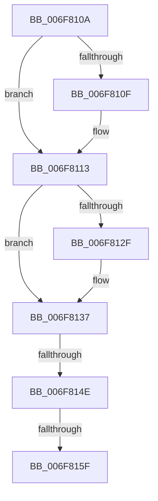

# sub_006F810A

- RVA: `0x006F810A`–`0x006F816A` (길이 `96` bytes)
- VA: `0x00000001406F810A`
- 실행 섹션: `.text`
- PDB 이름 있음: `아니요`; PDB Function 태그: `아니요`
- unwind 정보 RVA: `0x000B5044`
- 디코드: `25`개 명령, `96/96` bytes 표시
- 미해석 바이트: `0` (있으면 어셈블리에 `.byte`로 보존)

> 이 문서는 커널 이미지의 기계어와 PDB 기호를 분석해 생성했습니다. 4번과 5번은 함수 원형과 자료형을 바이너리 사용 방식에서 추정한 C 해석이며 원본 소스 복구 결과는 아닙니다.

## 1. Dependencies

- 직접 호출 지점: **4**; 고유 호출 대상: **4**
- 직접 호출자로 확인된 함수: **0**
- RIP 상대 이미지 참조: **0**

### Outgoing calls
- `0x006F811B` → [MiUpdateControlAreaCommitCount](../45/MiUpdateControlAreaCommitCount_function_004588E8.md) (function, `0x004588E8`)
- `0x006F8132` → [ExfTryToWakePushLock](../26/ExfTryToWakePushLock_function_00265DD0.md) (function, `0x00265DD0`)
- `0x006F813A` → [KeAbPostRelease](../2E/KeAbPostRelease_function_002E1600.md) (function, `0x002E1600`)
- `0x006F815F` → [KiCheckForKernelApcDelivery](../2E/KiCheckForKernelApcDelivery_function_002E2C80.md) (function, `0x002E2C80`)

### Direct callers
- 이 함수 시작 RVA로 연결되는 직접 call은 확인되지 않았습니다. 간접 호출은 완전히 역산할 수 없습니다.

### Static image references
- 디코드된 RIP-relative 메모리 참조가 없습니다.

## 2. Other-region calls and transfers

- 다른 실행 섹션으로 향하는 call: **0**
- call이 아닌 외부 분기/꼬리 이동: **3**
  - `0x006F8148` → [MiSetPagesModified + 0x480](../49/MiSetPagesModified_function_0049DC2C.md) (`tail-transfer`)
  - `0x006F8159` → [MiSetPagesModified + 0x480](../49/MiSetPagesModified_function_0049DC2C.md) (`tail-transfer`)
  - `0x006F8165` → [MiSetPagesModified + 0x480](../49/MiSetPagesModified_function_0049DC2C.md) (`tail-transfer`)

## 3. Assembly (complete function range)

```asm
006F810A  48 85 FF                        test rdi, rdi
006F810D  74 04                           je 0x1406f8113
006F810F  44 88 77 0A                     mov byte ptr [rdi + 0xa], r14b
006F8113  49 8B D7                        mov rdx, r15
006F8116  48 8B 4C 24 40                  mov rcx, qword ptr [rsp + 0x40]
006F811B  E8 C8 07 D6 FF                  call 0x1404588e8
006F8120  48 83 C8 FF                     or rax, 0xffffffffffffffff
006F8124  F0 48 0F C1 03                  lock xadd qword ptr [rbx], rax
006F8129  24 06                           and al, 6
006F812B  3C 02                           cmp al, 2
006F812D  75 08                           jne 0x1406f8137
006F812F  48 8B CB                        mov rcx, rbx
006F8132  E8 99 DC B6 FF                  call 0x140265dd0
006F8137  48 8B CB                        mov rcx, rbx
006F813A  E8 C1 94 BE FF                  call 0x1402e1600
006F813F  90                              nop
006F8140  66 45 01 B5 E6 01 00 00         add word ptr [r13 + 0x1e6], r14w
006F8148  0F 85 5E 5F DA FF               jne 0x14049e0ac
006F814E  90                              nop
006F814F  49 8D 8D 98 00 00 00            lea rcx, [r13 + 0x98]
006F8156  48 39 09                        cmp qword ptr [rcx], rcx
006F8159  0F 84 4D 5F DA FF               je 0x14049e0ac
006F815F  E8 1C AB BE FF                  call 0x1402e2c80
006F8164  90                              nop
006F8165  E9 42 5F DA FF                  jmp 0x14049e0ac
```

## 4. C-style interpretation (structured pseudocode)

```c
__int64 __fastcall sub_006F810A(__int64 a1, __int64 a2, __int64 a3, __int64 a4, __int64 a5, __int64 a6, __int64 a7, __int64 a8)
{
    __int64 result;

    if (v_rdi != 0) {
        *(unsigned __int8 *)(v_rdi + 10) = (unsigned __int8)(v_r14);
    }
    result = MiUpdateControlAreaCommitCount(a8, v_r15, a3, a4);
    result = (result) | (-1);
    result = (unsigned __int8)((result) & (6));
    if (((unsigned __int8)(result)) == 2) {
        a1 = v_rbx;
        result = ExfTryToWakePushLock(a1, v_r15, a3, a4);
    }
    result = KeAbPostRelease(v_rbx, v_r15, a3, a4);
    result = KiCheckForKernelApcDelivery(v_r13 + 152, v_r15, a3, a4);
}
```

## 5. (Beta) C Style

```c
int64_t sub_006F810A(int64_t Arg1, int64_t Arg2, int64_t Arg3, int64_t Arg4, uint64_t Arg5, uint64_t Arg6, uint64_t Arg7, int64_t Arg8)
{
    int64_t result;

    if (local_rdi != 0) {
        *(uint8_t *)(local_rdi + 0xA) = (uint8_t)(local_r14);
    }
    result = MiUpdateControlAreaCommitCount(Arg8, local_r15, Arg3, Arg4);
    result = (result) | (-1);
    result = (uint8_t)((result) & (6));
    if (((uint8_t)(result)) == 2) {
        Arg1 = local_rbx;
        result = ExfTryToWakePushLock(Arg1, local_r15, Arg3, Arg4);
    }
    result = KeAbPostRelease(local_rbx, local_r15, Arg3, Arg4);
    result = KiCheckForKernelApcDelivery(local_r13 + 152, local_r15, Arg3, Arg4);
}
```

## 6. Execution-region graph

[열기: 2D/3D 그래프와 함수 탐색 컨트롤 패널](../../../control-panel.html?section=text&rva=0x006F810A&view=graph)

- 2D 그래프는 위에서 아래로 흐르고, 3D 그래프는 빈 공간을 드래그해 회전합니다. Shift+드래그는 이동, 휠은 확대·축소, 함수 노드 선택은 대상 보고서 이동입니다.

### Static fallback


