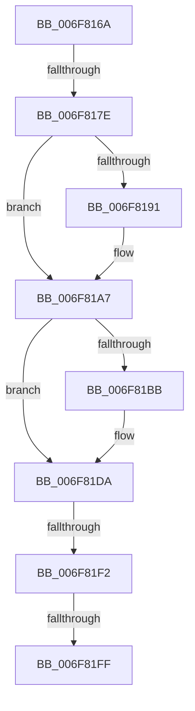

# sub_006F816A

- RVA: `0x006F816A`–`0x006F8228` (길이 `190` bytes)
- VA: `0x00000001406F816A`
- 실행 섹션: `.text`
- PDB 이름 있음: `아니요`; PDB Function 태그: `아니요`
- unwind 정보 RVA: `0x000B506C`
- 디코드: `45`개 명령, `190/190` bytes 표시
- 미해석 바이트: `0` (있으면 어셈블리에 `.byte`로 보존)

> 이 문서는 커널 이미지의 기계어와 PDB 기호를 분석해 생성했습니다. 4번과 5번은 함수 원형과 자료형을 바이너리 사용 방식에서 추정한 C 해석이며 원본 소스 복구 결과는 아닙니다.

## 1. Dependencies

- 직접 호출 지점: **7**; 고유 호출 대상: **1**
- 직접 호출자로 확인된 함수: **0**
- RIP 상대 이미지 참조: **0**

### Outgoing calls
- `0x006F8187` → [IoAddTriageDumpDataBlock](../42/IoAddTriageDumpDataBlock_function_00428374.md) (function, `0x00428374`)
- `0x006F8196` → [IoAddTriageDumpDataBlock](../42/IoAddTriageDumpDataBlock_function_00428374.md) (function, `0x00428374`)
- `0x006F81A2` → [IoAddTriageDumpDataBlock](../42/IoAddTriageDumpDataBlock_function_00428374.md) (function, `0x00428374`)
- `0x006F81BD` → [IoAddTriageDumpDataBlock](../42/IoAddTriageDumpDataBlock_function_00428374.md) (function, `0x00428374`)
- `0x006F81D5` → [IoAddTriageDumpDataBlock](../42/IoAddTriageDumpDataBlock_function_00428374.md) (function, `0x00428374`)
- `0x006F8201` → [IoAddTriageDumpDataBlock](../42/IoAddTriageDumpDataBlock_function_00428374.md) (function, `0x00428374`)
- `0x006F821D` → [IoAddTriageDumpDataBlock](../42/IoAddTriageDumpDataBlock_function_00428374.md) (function, `0x00428374`)

### Direct callers
- 이 함수 시작 RVA로 연결되는 직접 call은 확인되지 않았습니다. 간접 호출은 완전히 역산할 수 없습니다.

### Static image references
- 디코드된 RIP-relative 메모리 참조가 없습니다.

## 2. Other-region calls and transfers

- 다른 실행 섹션으로 향하는 call: **0**
- call이 아닌 외부 분기/꼬리 이동: **4**
  - `0x006F8178` → [IoInvalidateDeviceRelations + 0x8A](../49/IoInvalidateDeviceRelations_function_0049E160.md) (`tail-transfer`)
  - `0x006F81EC` → [IoInvalidateDeviceRelations + 0x8A](../49/IoInvalidateDeviceRelations_function_0049E160.md) (`tail-transfer`)
  - `0x006F81F9` → [IoInvalidateDeviceRelations + 0x8A](../49/IoInvalidateDeviceRelations_function_0049E160.md) (`tail-transfer`)
  - `0x006F8223` → [IoInvalidateDeviceRelations + 0x8A](../49/IoInvalidateDeviceRelations_function_0049E160.md) (`tail-transfer`)

## 3. Assembly (complete function range)

```asm
006F816A  48 8B 83 38 01 00 00            mov rax, qword ptr [rbx + 0x138]
006F8171  48 8B 48 28                     mov rcx, qword ptr [rax + 0x28]
006F8175  48 85 C9                        test rcx, rcx
006F8178  0F 84 6C 60 DA FF               je 0x14049e1ea
006F817E  BA 88 03 00 00                  mov edx, 0x388
006F8183  48 8D 79 28                     lea rdi, [rcx + 0x28]
006F8187  E8 E8 01 D3 FF                  call 0x140428374
006F818C  66 39 37                        cmp word ptr [rdi], si
006F818F  74 16                           je 0x1406f81a7
006F8191  8B D5                           mov edx, ebp
006F8193  48 8B CF                        mov rcx, rdi
006F8196  E8 D9 01 D3 FF                  call 0x140428374
006F819B  0F B7 17                        movzx edx, word ptr [rdi]
006F819E  48 8B 4F 08                     mov rcx, qword ptr [rdi + 8]
006F81A2  E8 CD 01 D3 FF                  call 0x140428374
006F81A7  48 8B 83 38 01 00 00            mov rax, qword ptr [rbx + 0x138]
006F81AE  48 8B 48 28                     mov rcx, qword ptr [rax + 0x28]
006F81B2  48 83 C1 38                     add rcx, 0x38
006F81B6  66 39 31                        cmp word ptr [rcx], si
006F81B9  74 1F                           je 0x1406f81da
006F81BB  8B D5                           mov edx, ebp
006F81BD  E8 B2 01 D3 FF                  call 0x140428374
006F81C2  48 8B 83 38 01 00 00            mov rax, qword ptr [rbx + 0x138]
006F81C9  48 8B 48 28                     mov rcx, qword ptr [rax + 0x28]
006F81CD  0F B7 51 38                     movzx edx, word ptr [rcx + 0x38]
006F81D1  48 8B 49 40                     mov rcx, qword ptr [rcx + 0x40]
006F81D5  E8 9A 01 D3 FF                  call 0x140428374
006F81DA  48 8B 83 38 01 00 00            mov rax, qword ptr [rbx + 0x138]
006F81E1  48 8B 48 28                     mov rcx, qword ptr [rax + 0x28]
006F81E5  48 8B 41 10                     mov rax, qword ptr [rcx + 0x10]
006F81E9  48 85 C0                        test rax, rax
006F81EC  0F 84 F8 5F DA FF               je 0x14049e1ea
006F81F2  48 8D 48 38                     lea rcx, [rax + 0x38]
006F81F6  66 39 31                        cmp word ptr [rcx], si
006F81F9  0F 84 EB 5F DA FF               je 0x14049e1ea
006F81FF  8B D5                           mov edx, ebp
006F8201  E8 6E 01 D3 FF                  call 0x140428374
006F8206  48 8B 83 38 01 00 00            mov rax, qword ptr [rbx + 0x138]
006F820D  48 8B 48 28                     mov rcx, qword ptr [rax + 0x28]
006F8211  48 8B 49 10                     mov rcx, qword ptr [rcx + 0x10]
006F8215  0F B7 51 38                     movzx edx, word ptr [rcx + 0x38]
006F8219  48 8B 49 40                     mov rcx, qword ptr [rcx + 0x40]
006F821D  E8 52 01 D3 FF                  call 0x140428374
006F8222  90                              nop
006F8223  E9 C2 5F DA FF                  jmp 0x14049e1ea
```

## 4. C-style interpretation (structured pseudocode)

```c
__int64 __fastcall sub_006F816A(void)
{
    __int64 result;

    result = IoAddTriageDumpDataBlock(*(unsigned __int64 *)(*(unsigned __int64 *)(v_rbx + 312) + 40), 904, a3, a4);
    if ((*(unsigned __int16 *)(*(unsigned __int64 *)(*(unsigned __int64 *)(v_rbx + 312) + 40) + 40)) != ((unsigned __int16)(v_rsi))) {
        a2 = (unsigned int)(v_rbp);
        a1 = *(unsigned __int64 *)(*(unsigned __int64 *)(v_rbx + 312) + 40) + 40;
        result = IoAddTriageDumpDataBlock(a1, a2, a3, a4);
        a2 = *(unsigned __int16 *)(*(unsigned __int64 *)(*(unsigned __int64 *)(v_rbx + 312) + 40) + 40);
        a1 = *(unsigned __int64 *)(*(unsigned __int64 *)(*(unsigned __int64 *)(v_rbx + 312) + 40) + 40 + 8);
        result = IoAddTriageDumpDataBlock(a1, a2, a3, a4);
    }
    a1 = (*(unsigned __int64 *)(*(unsigned __int64 *)(v_rbx + 312) + 40)) + (56);
    result = *(unsigned __int64 *)(v_rbx + 312);
    if ((*(unsigned __int16 *)(a1)) != ((unsigned __int16)(v_rsi))) {
        a2 = (unsigned int)(v_rbp);
        result = IoAddTriageDumpDataBlock(a1, a2, a3, a4);
        result = *(unsigned __int64 *)(v_rbx + 312);
        a1 = *(unsigned __int64 *)(result + 40);
        a2 = *(unsigned __int16 *)(a1 + 56);
        a1 = *(unsigned __int64 *)(a1 + 64);
        result = IoAddTriageDumpDataBlock(a1, a2, a3, a4);
    }
    result = IoAddTriageDumpDataBlock(*(unsigned __int64 *)(*(unsigned __int64 *)(*(unsigned __int64 *)(v_rbx + 312) + 40) + 16) + 56, (unsigned int)((unsigned int)(v_rbp)), a3, a4);
    result = IoAddTriageDumpDataBlock(*(unsigned __int64 *)(*(unsigned __int64 *)(*(unsigned __int64 *)(*(unsigned __int64 *)(v_rbx + 312) + 40) + 16) + 64), *(unsigned __int16 *)(*(unsigned __int64 *)(*(unsigned __int64 *)(*(unsigned __int64 *)(v_rbx + 312) + 40) + 16) + 56), a3, a4);
}
```

## 5. (Beta) C Style

```c
void sub_006F816A(void)
{
    int64_t result;

    result = IoAddTriageDumpDataBlock(*(uint64_t *)(*(uint64_t *)(local_rbx + 0x138) + 0x28), 904, a3, a4);
    if ((*(uint16_t *)(*(uint64_t *)(*(uint64_t *)(local_rbx + 0x138) + 0x28) + 0x28)) != ((uint16_t)(local_rsi))) {
        a2 = (uint32_t)(local_rbp);
        a1 = *(uint64_t *)(*(uint64_t *)(local_rbx + 0x138) + 0x28) + 40;
        result = IoAddTriageDumpDataBlock(a1, a2, a3, a4);
        a2 = *(uint16_t *)(*(uint64_t *)(*(uint64_t *)(local_rbx + 0x138) + 0x28) + 0x28);
        a1 = *(uint64_t *)(*(uint64_t *)(*(uint64_t *)(local_rbx + 0x138) + 0x28) + 0x28 + 0x8);
        result = IoAddTriageDumpDataBlock(a1, a2, a3, a4);
    }
    a1 = (*(uint64_t *)(*(uint64_t *)(local_rbx + 0x138) + 0x28)) + (56);
    result = *(uint64_t *)(local_rbx + 0x138);
    if ((*(uint16_t *)(a1)) != ((uint16_t)(local_rsi))) {
        a2 = (uint32_t)(local_rbp);
        result = IoAddTriageDumpDataBlock(a1, a2, a3, a4);
        result = *(uint64_t *)(local_rbx + 0x138);
        a1 = *(uint64_t *)(result + 0x28);
        a2 = *(uint16_t *)(a1 + 0x38);
        a1 = *(uint64_t *)(a1 + 0x40);
        result = IoAddTriageDumpDataBlock(a1, a2, a3, a4);
    }
    result = IoAddTriageDumpDataBlock(*(uint64_t *)(*(uint64_t *)(*(uint64_t *)(local_rbx + 0x138) + 0x28) + 0x10) + 56, (uint32_t)((uint32_t)(local_rbp)), a3, a4);
    result = IoAddTriageDumpDataBlock(*(uint64_t *)(*(uint64_t *)(*(uint64_t *)(*(uint64_t *)(local_rbx + 0x138) + 0x28) + 0x10) + 0x40), *(uint16_t *)(*(uint64_t *)(*(uint64_t *)(*(uint64_t *)(local_rbx + 0x138) + 0x28) + 0x10) + 0x38), a3, a4);
}
```

## 6. Execution-region graph

[열기: 2D/3D 그래프와 함수 탐색 컨트롤 패널](../../../control-panel.html?section=text&rva=0x006F816A&view=graph)

- 2D 그래프는 위에서 아래로 흐르고, 3D 그래프는 빈 공간을 드래그해 회전합니다. Shift+드래그는 이동, 휠은 확대·축소, 함수 노드 선택은 대상 보고서 이동입니다.

### Static fallback


