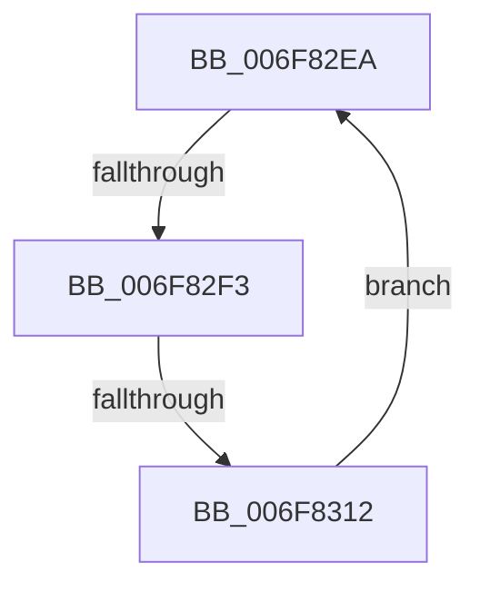

# sub_006F82EA

- RVA: `0x006F82EA`–`0x006F831D` (길이 `51` bytes)
- VA: `0x00000001406F82EA`
- 실행 섹션: `.text`
- PDB 이름 있음: `아니요`; PDB Function 태그: `아니요`
- unwind 정보 RVA: `0x000B51E4`
- 디코드: `13`개 명령, `51/51` bytes 표시
- 미해석 바이트: `0` (있으면 어셈블리에 `.byte`로 보존)

> 이 문서는 커널 이미지의 기계어와 PDB 기호를 분석해 생성했습니다. 4번과 5번은 함수 원형과 자료형을 바이너리 사용 방식에서 추정한 C 해석이며 원본 소스 복구 결과는 아닙니다.

## 1. Dependencies

- 직접 호출 지점: **1**; 고유 호출 대상: **1**
- 직접 호출자로 확인된 함수: **0**
- RIP 상대 이미지 참조: **0**

### Outgoing calls
- `0x006F8302` → [MiZeroPageWrite](../29/MiZeroPageWrite_function_0029F280.md) (function, `0x0029F280`)

### Direct callers
- 이 함수 시작 RVA로 연결되는 직접 call은 확인되지 않았습니다. 간접 호출은 완전히 역산할 수 없습니다.

### Static image references
- 디코드된 RIP-relative 메모리 참조가 없습니다.

## 2. Other-region calls and transfers

- 다른 실행 섹션으로 향하는 call: **0**
- call이 아닌 외부 분기/꼬리 이동: **2**
  - `0x006F82ED` → [MmZeroPageWrite + 0x28](../49/MmZeroPageWrite_function_0049E74C.md) (`tail-transfer`)
  - `0x006F830C` → [MmZeroPageWrite + 0x4F](../49/MmZeroPageWrite_function_0049E74C.md) (`tail-transfer`)

## 3. Assembly (complete function range)

```asm
006F82EA  83 FF 04                        cmp edi, 4
006F82ED  0F 83 81 64 DA FF               jae 0x14049e774
006F82F3  44 8B CE                        mov r9d, esi
006F82F6  41 B8 00 00 00 40               mov r8d, 0x40000000
006F82FC  48 8B D5                        mov rdx, rbp
006F82FF  49 8B CE                        mov rcx, r14
006F8302  E8 79 6F BA FF                  call 0x14029f280
006F8307  44 8B D0                        mov r10d, eax
006F830A  85 C0                           test eax, eax
006F830C  0F 88 89 64 DA FF               js 0x14049e79b
006F8312  48 81 EB 00 00 00 40            sub rbx, 0x40000000
006F8319  FF C7                           inc edi
006F831B  EB CD                           jmp 0x1406f82ea
```

## 4. C-style interpretation (structured pseudocode)

```c
__int64 __fastcall sub_006F82EA(void)
{
    __int64 result;
    __int64 v_rbx;
    __int64 v_rdi;

    result = MiZeroPageWrite(v_r14, v_rbp, (unsigned int)(0x40000000ULL), (unsigned int)((unsigned int)(v_rsi)));
    v_rbx = (v_rbx) - (0x40000000ULL);
    v_rdi = (unsigned int)((v_rdi) + 1);
    goto loc_006F82EA;
}
```

## 5. (Beta) C Style

```c
void sub_006F82EA(void)
{
    int64_t result;
    int64_t local_rbx;
    int64_t local_rdi;

    result = MiZeroPageWrite(local_r14, local_rbp, (uint32_t)(0x40000000ULL), (uint32_t)((uint32_t)(local_rsi)));
    local_rbx = (local_rbx) - (0x40000000ULL);
    local_rdi = (uint32_t)((local_rdi) + 1);
    goto loc_006F82EA;
}
```

## 6. Execution-region graph

[열기: 2D/3D 그래프와 함수 탐색 컨트롤 패널](../../../control-panel.html?section=text&rva=0x006F82EA&view=graph)

- 2D 그래프는 위에서 아래로 흐르고, 3D 그래프는 빈 공간을 드래그해 회전합니다. Shift+드래그는 이동, 휠은 확대·축소, 함수 노드 선택은 대상 보고서 이동입니다.

### Static fallback


