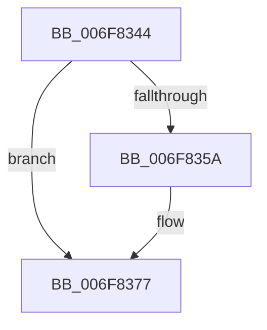

# sub_006F8344

- RVA: `0x006F8344`–`0x006F838A` (길이 `70` bytes)
- VA: `0x00000001406F8344`
- 실행 섹션: `.text`
- PDB 이름 있음: `아니요`; PDB Function 태그: `아니요`
- unwind 정보 RVA: `0x000B5338`
- 디코드: `15`개 명령, `70/70` bytes 표시
- 미해석 바이트: `0` (있으면 어셈블리에 `.byte`로 보존)

> 이 문서는 커널 이미지의 기계어와 PDB 기호를 분석해 생성했습니다. 4번과 5번은 함수 원형과 자료형을 바이너리 사용 방식에서 추정한 C 해석이며 원본 소스 복구 결과는 아닙니다.

## 1. Dependencies

- 직접 호출 지점: **0**; 고유 호출 대상: **0**
- 직접 호출자로 확인된 함수: **0**
- RIP 상대 이미지 참조: **1**

### Outgoing calls
- 직접 디코드된 call 명령이 없습니다.

### Direct callers
- 이 함수 시작 RVA로 연결되는 직접 call은 확인되지 않았습니다. 간접 호출은 완전히 역산할 수 없습니다.

### Static image references
- `0x006F8377` → RVA `0x00E2DBE8` (`.data`; read)

## 2. Other-region calls and transfers

- 다른 실행 섹션으로 향하는 call: **0**
- call이 아닌 외부 분기/꼬리 이동: **1**
  - `0x006F8385` → [MiCreatePageChains + 0x96](../49/MiCreatePageChains_function_0049ECD0.md) (`tail-transfer`)

## 3. Assembly (complete function range)

```asm
006F8344  48 63 C2                        movsxd rax, edx
006F8347  48 69 C8 A8 00 00 00            imul rcx, rax, 0xa8
006F834E  42 8B B4 01 AC 00 00 00         mov esi, dword ptr [rcx + r8 + 0xac]
006F8356  85 F6                           test esi, esi
006F8358  75 1D                           jne 0x1406f8377
006F835A  65 48 8B 04 25 20 00 00 00      mov rax, qword ptr gs:[0x20]
006F8363  41 8B D1                        mov edx, r9d
006F8366  BE 01 00 00 00                  mov esi, 1
006F836B  40 38 B0 08 8A 00 00            cmp byte ptr [rax + 0x8a08], sil
006F8372  0F 95 C2                        setne dl
006F8375  FF C2                           inc edx
006F8377  0F B7 2D 6A 58 73 00            movzx ebp, word ptr [rip + 0x73586a]
006F837E  48 63 C2                        movsxd rax, edx
006F8381  89 74 84 30                     mov dword ptr [rsp + rax*4 + 0x30], esi
006F8385  E9 DC 69 DA FF                  jmp 0x14049ed66
```

## 4. C-style interpretation (structured pseudocode)

```c
__int64 __fastcall sub_006F8344(__int64 a1, int a2, __int64 a3, int a4)
{
    __int64 result;
    __int64 v_rsi;

    a1 = (a1) * ((int)(a2));
    result = (int)(a2);
    v_rsi = (unsigned int)(*(unsigned int *)(a1 + a3 * 1 + 172));
    if ((unsigned int)((unsigned int)(*(unsigned int *)(a1 + a3 * 1 + 172))) == 0) {
        result = *(unsigned __int64 *)(gs_base + (0 + 32));
        a2 = a4;
        v_rsi = 1;
        a2 = ((*(unsigned __int8 *)(result + 35336)) != ((unsigned __int8)(v_rsi))) ? 1 : 0;
        a2 = (unsigned int)((a2) + 1);
    }
    *(unsigned int *)(v_rsp + (int)(a2) * 4 + 48) = (unsigned int)(v_rsi);
}
```

## 5. (Beta) C Style

```c
int64_t sub_006F8344(void *Arg1, int32_t Arg2, int64_t Arg3, int32_t Arg4)
{
    uint8_t *arg1 = (uint8_t *)Arg1;

    int64_t result;
    int64_t local_rsi;

    Arg1 = (Arg1) * ((int32_t)(Arg2));
    result = (int32_t)(Arg2);
    local_rsi = (uint32_t)(*(uint32_t *)(arg1 + Arg3 * 1 + 0xAC));
    if ((uint32_t)((uint32_t)(*(uint32_t *)(arg1 + Arg3 * 1 + 0xAC))) == 0) {
        result = *(uint64_t *)(gs_base + (0 + 0x20));
        Arg2 = Arg4;
        local_rsi = 1;
        Arg2 = ((*(uint8_t *)(result + 0x8A08)) != ((uint8_t)(local_rsi))) ? 1 : 0;
        Arg2 = (uint32_t)((Arg2) + 1);
    }
    *(uint32_t *)(local_rsp + (int32_t)(Arg2) * 4 + 0x30) = (uint32_t)(local_rsi);
}
```

### 관측된 메모리 오프셋

구조체 형식이 확인되지 않은 접근은 인자 기준의 오프셋으로만 기록했습니다.

| 기준 인자 | 오프셋 표현 | 폭 (bit) | 접근 |
|---|---:|---:|---|
| `Arg1` | `+ 0xAC + r8*1` | `32` | `R` |

## 6. Execution-region graph

[열기: 2D/3D 그래프와 함수 탐색 컨트롤 패널](../../../control-panel.html?section=text&rva=0x006F8344&view=graph)

- 2D 그래프는 위에서 아래로 흐르고, 3D 그래프는 빈 공간을 드래그해 회전합니다. Shift+드래그는 이동, 휠은 확대·축소, 함수 노드 선택은 대상 보고서 이동입니다.

### Static fallback


