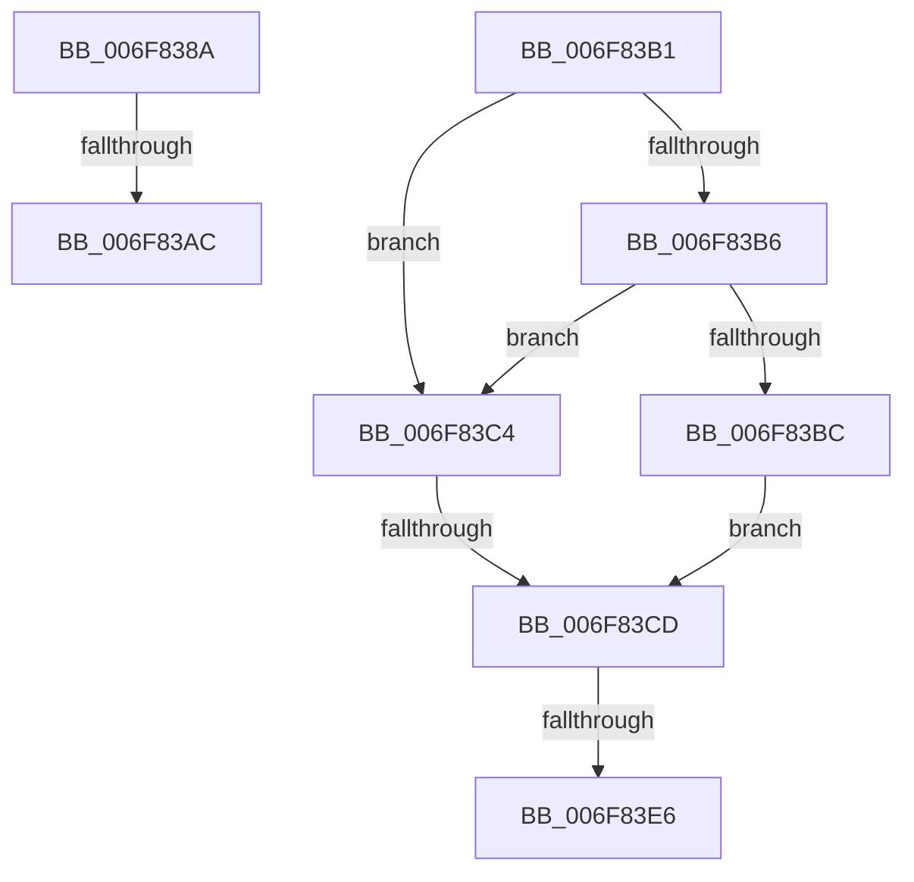

# sub_006F838A

- RVA: `0x006F838A`–`0x006F83EB` (길이 `97` bytes)
- VA: `0x00000001406F838A`
- 실행 섹션: `.text`
- PDB 이름 있음: `아니요`; PDB Function 태그: `아니요`
- unwind 정보 RVA: `0x000B5368`
- 디코드: `27`개 명령, `97/97` bytes 표시
- 미해석 바이트: `0` (있으면 어셈블리에 `.byte`로 보존)

> 이 문서는 커널 이미지의 기계어와 PDB 기호를 분석해 생성했습니다. 4번과 5번은 함수 원형과 자료형을 바이너리 사용 방식에서 추정한 C 해석이며 원본 소스 복구 결과는 아닙니다.

## 1. Dependencies

- 직접 호출 지점: **0**; 고유 호출 대상: **0**
- 직접 호출자로 확인된 함수: **0**
- RIP 상대 이미지 참조: **0**

### Outgoing calls
- 직접 디코드된 call 명령이 없습니다.

### Direct callers
- 이 함수 시작 RVA로 연결되는 직접 call은 확인되지 않았습니다. 간접 호출은 완전히 역산할 수 없습니다.

### Static image references
- 디코드된 RIP-relative 메모리 참조가 없습니다.

## 2. Other-region calls and transfers

- 다른 실행 섹션으로 향하는 call: **0**
- call이 아닌 외부 분기/꼬리 이동: **5**
  - `0x006F83A6` → [MiGetOptimalEngineMix + 0x11C](../49/MiGetOptimalEngineMix_function_0049EF44.md) (`tail-transfer`)
  - `0x006F83AC` → [MiGetOptimalEngineMix + 0x10D](../49/MiGetOptimalEngineMix_function_0049EF44.md) (`tail-transfer`)
  - `0x006F83C7` → [MiGetOptimalEngineMix + 0x181](../49/MiGetOptimalEngineMix_function_0049EF44.md) (`tail-transfer`)
  - `0x006F83E0` → [MiGetOptimalEngineMix + 0x11C](../49/MiGetOptimalEngineMix_function_0049EF44.md) (`tail-transfer`)
  - `0x006F83E6` → [MiGetOptimalEngineMix + 0x181](../49/MiGetOptimalEngineMix_function_0049EF44.md) (`tail-transfer`)

## 3. Assembly (complete function range)

```asm
006F838A  49 8B C2                        mov rax, r10
006F838D  49 2B C0                        sub rax, r8
006F8390  45 85 C9                        test r9d, r9d
006F8393  49 0F 45 C2                     cmovne rax, r10
006F8397  48 3B C1                        cmp rax, rcx
006F839A  48 0F 47 C1                     cmova rax, rcx
006F839E  48 8B C8                        mov rcx, rax
006F83A1  8B DA                           mov ebx, edx
006F83A3  48 85 C9                        test rcx, rcx
006F83A6  0F 84 B4 6C DA FF               je 0x14049f060
006F83AC  E9 A0 6C DA FF                  jmp 0x14049f051
006F83B1  45 85 E4                        test r12d, r12d
006F83B4  74 0E                           je 0x1406f83c4
006F83B6  41 83 F8 01                     cmp r8d, 1
006F83BA  76 08                           jbe 0x1406f83c4
006F83BC  41 B8 01 00 00 00               mov r8d, 1
006F83C2  EB 09                           jmp 0x1406f83cd
006F83C4  45 85 C0                        test r8d, r8d
006F83C7  0F 84 F8 6C DA FF               je 0x14049f0c5
006F83CD  41 8B C0                        mov eax, r8d
006F83D0  41 03 D8                        add ebx, r8d
006F83D3  49 0F AF C2                     imul rax, r10
006F83D7  45 89 03                        mov dword ptr [r11], r8d
006F83DA  48 2B C8                        sub rcx, rax
006F83DD  45 85 E4                        test r12d, r12d
006F83E0  0F 85 7A 6C DA FF               jne 0x14049f060
006F83E6  E9 DA 6C DA FF                  jmp 0x14049f0c5
```

## 4. C-style interpretation (structured pseudocode)

```c
__int64 __fastcall sub_006F838A(__int64 a1, int a2, __int64 a3, int a4)
{
    __int64 result;

    result = (v_r10) - (a3);
    if (a4 != 0) { result = v_r10; }
    if (result > a1) { result = a1; }
}
```

## 5. (Beta) C Style

```c
int64_t sub_006F838A(int64_t Arg1, int32_t Arg2, int64_t Arg3, int32_t Arg4)
{
    int64_t result;

    result = (local_r10) - (Arg3);
    if (Arg4 != 0) { result = local_r10; }
    if (result > Arg1) { result = Arg1; }
}
```

## 6. Execution-region graph

[열기: 2D/3D 그래프와 함수 탐색 컨트롤 패널](../../../control-panel.html?section=text&rva=0x006F838A&view=graph)

- 2D 그래프는 위에서 아래로 흐르고, 3D 그래프는 빈 공간을 드래그해 회전합니다. Shift+드래그는 이동, 휠은 확대·축소, 함수 노드 선택은 대상 보고서 이동입니다.

### Static fallback


