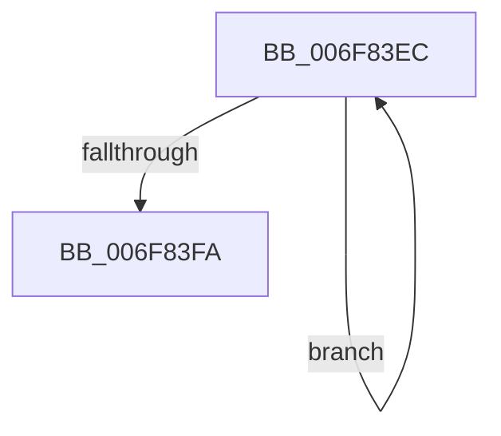

# sub_006F83EC

- RVA: `0x006F83EC`–`0x006F83FF` (길이 `19` bytes)
- VA: `0x00000001406F83EC`
- 실행 섹션: `.text`
- PDB 이름 있음: `아니요`; PDB Function 태그: `아니요`
- unwind 정보 RVA: `0x000B5510`
- 디코드: `6`개 명령, `19/19` bytes 표시
- 미해석 바이트: `0` (있으면 어셈블리에 `.byte`로 보존)

> 이 문서는 커널 이미지의 기계어와 PDB 기호를 분석해 생성했습니다. 4번과 5번은 함수 원형과 자료형을 바이너리 사용 방식에서 추정한 C 해석이며 원본 소스 복구 결과는 아닙니다.

## 1. Dependencies

- 직접 호출 지점: **0**; 고유 호출 대상: **0**
- 직접 호출자로 확인된 함수: **0**
- RIP 상대 이미지 참조: **0**

### Outgoing calls
- 직접 디코드된 call 명령이 없습니다.

### Direct callers
- 이 함수 시작 RVA로 연결되는 직접 call은 확인되지 않았습니다. 간접 호출은 완전히 역산할 수 없습니다.

### Static image references
- 디코드된 RIP-relative 메모리 참조가 없습니다.

## 2. Other-region calls and transfers

- 다른 실행 섹션으로 향하는 call: **0**
- call이 아닌 외부 분기/꼬리 이동: **1**
  - `0x006F83FA` → [KseHookMemcpy_s + 0x43](../49/KseHookMemcpy_s_function_0049F9E0.md) (`tail-transfer`)

## 3. Assembly (complete function range)

```asm
006F83EC  8A 03                           mov al, byte ptr [rbx]
006F83EE  88 04 19                        mov byte ptr [rcx + rbx], al
006F83F1  48 FF C3                        inc rbx
006F83F4  49 83 E9 01                     sub r9, 1
006F83F8  75 F2                           jne 0x1406f83ec
006F83FA  E9 24 76 DA FF                  jmp 0x14049fa23
```

## 4. C-style interpretation (structured pseudocode)

```c
__int64 __fastcall sub_006F83EC(__int64 a1, __int64 a2, __int64 a3, __int64 a4)
{
    __int64 v_rbx;

    *(unsigned __int8 *)(a1 + v_rbx * 1) = (unsigned __int8)(*(unsigned __int8 *)(v_rbx));
    v_rbx = (v_rbx) + 1;
    a4 = (a4) - (1);
    if (condition_is_not_equal) goto loc_006F83EC;
}
```

## 5. (Beta) C Style

```c
int64_t sub_006F83EC(void *Arg1, int64_t Arg2, int64_t Arg3, int64_t Arg4)
{
    uint8_t *arg1 = (uint8_t *)Arg1;

    int64_t local_rbx;

    *(uint8_t *)(arg1 + local_rbx * 1) = (uint8_t)(*(uint8_t *)(local_rbx));
    local_rbx = (local_rbx) + 1;
    Arg4 = (Arg4) - (1);
    if (condition_is_not_equal) goto loc_006F83EC;
}
```

### 관측된 메모리 오프셋

구조체 형식이 확인되지 않은 접근은 인자 기준의 오프셋으로만 기록했습니다.

| 기준 인자 | 오프셋 표현 | 폭 (bit) | 접근 |
|---|---:|---:|---|
| `Arg1` | `+ 0x0 + rbx*1` | `8` | `W` |

## 6. Execution-region graph

[열기: 2D/3D 그래프와 함수 탐색 컨트롤 패널](../../../control-panel.html?section=text&rva=0x006F83EC&view=graph)

- 2D 그래프는 위에서 아래로 흐르고, 3D 그래프는 빈 공간을 드래그해 회전합니다. Shift+드래그는 이동, 휠은 확대·축소, 함수 노드 선택은 대상 보고서 이동입니다.

### Static fallback


