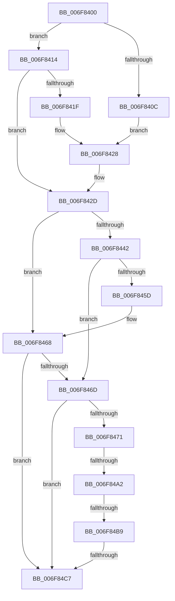

# sub_006F8400

- RVA: `0x006F8400`–`0x006F84D1` (길이 `209` bytes)
- VA: `0x00000001406F8400`
- 실행 섹션: `.text`
- PDB 이름 있음: `아니요`; PDB Function 태그: `아니요`
- unwind 정보 RVA: `0x000B56A0`
- 디코드: `55`개 명령, `209/209` bytes 표시
- 미해석 바이트: `0` (있으면 어셈블리에 `.byte`로 보존)

> 이 문서는 커널 이미지의 기계어와 PDB 기호를 분석해 생성했습니다. 4번과 5번은 함수 원형과 자료형을 바이너리 사용 방식에서 추정한 C 해석이며 원본 소스 복구 결과는 아닙니다.

## 1. Dependencies

- 직접 호출 지점: **1**; 고유 호출 대상: **1**
- 직접 호출자로 확인된 함수: **0**
- RIP 상대 이미지 참조: **0**

### Outgoing calls
- `0x006F8471` → [MiGetSlabCurrentTime](../3B/MiGetSlabCurrentTime_function_003BCBCC.md) (function, `0x003BCBCC`)

### Direct callers
- 이 함수 시작 RVA로 연결되는 직접 call은 확인되지 않았습니다. 간접 호출은 완전히 역산할 수 없습니다.

### Static image references
- 디코드된 RIP-relative 메모리 참조가 없습니다.

## 2. Other-region calls and transfers

- 다른 실행 섹션으로 향하는 call: **0**
- call이 아닌 외부 분기/꼬리 이동: **4**
  - `0x006F849C` → [MiCheckMdlSlabFragmentation + 0xCD](../49/MiCheckMdlSlabFragmentation_function_0049FCF0.md) (`tail-transfer`)
  - `0x006F84B3` → [MiCheckMdlSlabFragmentation + 0xCD](../49/MiCheckMdlSlabFragmentation_function_0049FCF0.md) (`tail-transfer`)
  - `0x006F84C1` → [MiCheckMdlSlabFragmentation + 0xCD](../49/MiCheckMdlSlabFragmentation_function_0049FCF0.md) (`tail-transfer`)
  - `0x006F84CC` → [MiCheckMdlSlabFragmentation + 0xCD](../49/MiCheckMdlSlabFragmentation_function_0049FCF0.md) (`tail-transfer`)

## 3. Assembly (complete function range)

```asm
006F8400  48 8B C6                        mov rax, rsi
006F8403  48 C1 E8 02                     shr rax, 2
006F8407  4C 3B C8                        cmp r9, rax
006F840A  77 08                           ja 0x1406f8414
006F840C  4D 8B DE                        mov r11, r14
006F840F  41 B0 0C                        mov r8b, 0xc
006F8412  EB 14                           jmp 0x1406f8428
006F8414  48 8B C6                        mov rax, rsi
006F8417  48 D1 E8                        shr rax, 1
006F841A  4C 3B C8                        cmp r9, rax
006F841D  77 0E                           ja 0x1406f842d
006F841F  41 BB 00 46 C3 23               mov r11d, 0x23c34600
006F8425  41 B0 0D                        mov r8b, 0xd
006F8428  44 88 44 24 40                  mov byte ptr [rsp + 0x40], r8b
006F842D  49 8B C9                        mov rcx, r9
006F8430  49 8B C1                        mov rax, r9
006F8433  48 C1 E9 02                     shr rcx, 2
006F8437  48 D1 E8                        shr rax, 1
006F843A  48 03 C8                        add rcx, rax
006F843D  48 3B F9                        cmp rdi, rcx
006F8440  72 26                           jb 0x1406f8468
006F8442  4D 3B DE                        cmp r11, r14
006F8445  C6 44 24 40 14                  mov byte ptr [rsp + 0x40], 0x14
006F844A  49 8B C7                        mov rax, r15
006F844D  4D 0F 43 DE                     cmovae r11, r14
006F8451  48 F7 E6                        mul rsi
006F8454  48 C1 EA 04                     shr rdx, 4
006F8458  4C 3B CA                        cmp r9, rdx
006F845B  77 10                           ja 0x1406f846d
006F845D  4D 8B DA                        mov r11, r10
006F8460  41 B0 15                        mov r8b, 0x15
006F8463  44 88 44 24 40                  mov byte ptr [rsp + 0x40], r8b
006F8468  45 84 C0                        test r8b, r8b
006F846B  74 5A                           je 0x1406f84c7
006F846D  85 ED                           test ebp, ebp
006F846F  75 56                           jne 0x1406f84c7
006F8471  E8 56 47 CC FF                  call 0x1403bcbcc
006F8476  4C 8B C0                        mov r8, rax
006F8479  8B 83 84 00 00 00               mov eax, dword ptr [rbx + 0x84]
006F847F  48 69 D0 80 DF 00 00            imul rdx, rax, 0xdf80
006F8486  48 8B 43 18                     mov rax, qword ptr [rbx + 0x18]
006F848A  48 8B 48 10                     mov rcx, qword ptr [rax + 0x10]
006F848E  49 8B C0                        mov rax, r8
006F8491  48 2B 84 0A B8 DE 00 00         sub rax, qword ptr [rdx + rcx + 0xdeb8]
006F8499  49 3B C3                        cmp rax, r11
006F849C  0F 82 1B 79 DA FF               jb 0x14049fdbd
006F84A2  48 8B 83 A8 00 00 00            mov rax, qword ptr [rbx + 0xa8]
006F84A9  4C 2B C0                        sub r8, rax
006F84AC  49 81 F8 80 F0 FA 02            cmp r8, 0x2faf080
006F84B3  0F 82 04 79 DA FF               jb 0x14049fdbd
006F84B9  8B 83 88 00 00 00               mov eax, dword ptr [rbx + 0x88]
006F84BF  A8 01                           test al, 1
006F84C1  0F 85 F6 78 DA FF               jne 0x14049fdbd
006F84C7  44 8B 54 24 40                  mov r10d, dword ptr [rsp + 0x40]
006F84CC  E9 EC 78 DA FF                  jmp 0x14049fdbd
```

## 4. C-style interpretation (structured pseudocode)

```c
__int64 __fastcall sub_006F8400(__int64 a1, __int64 a2, __int64 a3, __int64 a4, __int64 a5, __int64 a6, __int64 a7, unsigned int a8)
{
    __int64 result;
    __int64 v_r11;
    unsigned __int8 v_stack_p40;

    result = (v_rsi) >> (2);
    if (a4 > result) goto loc_006F8414;
    goto loc_006F8428;
loc_006F8414:
    result = (v_rsi) >> (1);
    if (a4 > result) goto loc_006F842D;
loc_006F8428:
    v_stack_p40 = 13;
loc_006F842D:
    a1 = (a4) >> (2);
    result = (a4) >> (1);
    a1 = (a1) + (result);
    if (v_rdi < a1) goto loc_006F8468;
    v_stack_p40 = 20;
    v_r11 = (unsigned int)(0x23C34600ULL);
    if (((unsigned int)(0x23C34600ULL)) >= v_r14) { v_r11 = v_r14; }
    a2 = (a2) >> (4);
    if (a4 > a2) goto loc_006F846D;
    v_stack_p40 = 21;
loc_006F8468:
    if (21 == 0) goto loc_006F84C7;
loc_006F846D:
    if ((unsigned int)(v_rbp) != 0) goto loc_006F84C7;
    result = MiGetSlabCurrentTime(a1, a2, 21, a4);
    a2 = (a2) * ((unsigned int)(*(unsigned int *)(v_rbx + 132)));
    result = (result) - (*(unsigned __int64 *)(a2 + *(unsigned __int64 *)(*(unsigned __int64 *)(v_rbx + 24) + 16) * 1 + 57016));
    a3 = (result) - (*(unsigned __int64 *)(v_rbx + 168));
loc_006F84C7:
}
```

## 5. (Beta) C Style

```c
int64_t sub_006F8400(int64_t Arg1, int64_t Arg2, int64_t Arg3, int64_t Arg4, uint64_t Arg5, uint64_t Arg6, uint64_t Arg7, uint32_t Arg8)
{
    int64_t result;
    int64_t local_r11;
    uint8_t v_stack_p40;

    result = (local_rsi) >> (2);
    if (Arg4 > result) goto loc_006F8414;
    goto loc_006F8428;
loc_006F8414:
    result = (local_rsi) >> (1);
    if (Arg4 > result) goto loc_006F842D;
loc_006F8428:
    v_stack_p40 = 13;
loc_006F842D:
    Arg1 = (Arg4) >> (2);
    result = (Arg4) >> (1);
    Arg1 = (Arg1) + (result);
    if (local_rdi < Arg1) goto loc_006F8468;
    v_stack_p40 = 20;
    local_r11 = (uint32_t)(0x23C34600ULL);
    if (((uint32_t)(0x23C34600ULL)) >= local_r14) { local_r11 = local_r14; }
    Arg2 = (Arg2) >> (4);
    if (Arg4 > Arg2) goto loc_006F846D;
    v_stack_p40 = 21;
loc_006F8468:
    if (21 == 0) goto loc_006F84C7;
loc_006F846D:
    if ((uint32_t)(local_rbp) != 0) goto loc_006F84C7;
    result = MiGetSlabCurrentTime(Arg1, Arg2, 21, Arg4);
    Arg2 = (Arg2) * ((uint32_t)(*(uint32_t *)(local_rbx + 0x84)));
    result = (result) - (*(uint64_t *)(Arg2 + *(uint64_t *)(*(uint64_t *)(local_rbx + 0x18) + 0x10) * 1 + 0xDEB8));
    Arg3 = (result) - (*(uint64_t *)(local_rbx + 0xA8));
loc_006F84C7:
}
```

## 6. Execution-region graph

[열기: 2D/3D 그래프와 함수 탐색 컨트롤 패널](../../../control-panel.html?section=text&rva=0x006F8400&view=graph)

- 2D 그래프는 위에서 아래로 흐르고, 3D 그래프는 빈 공간을 드래그해 회전합니다. Shift+드래그는 이동, 휠은 확대·축소, 함수 노드 선택은 대상 보고서 이동입니다.

### Static fallback


