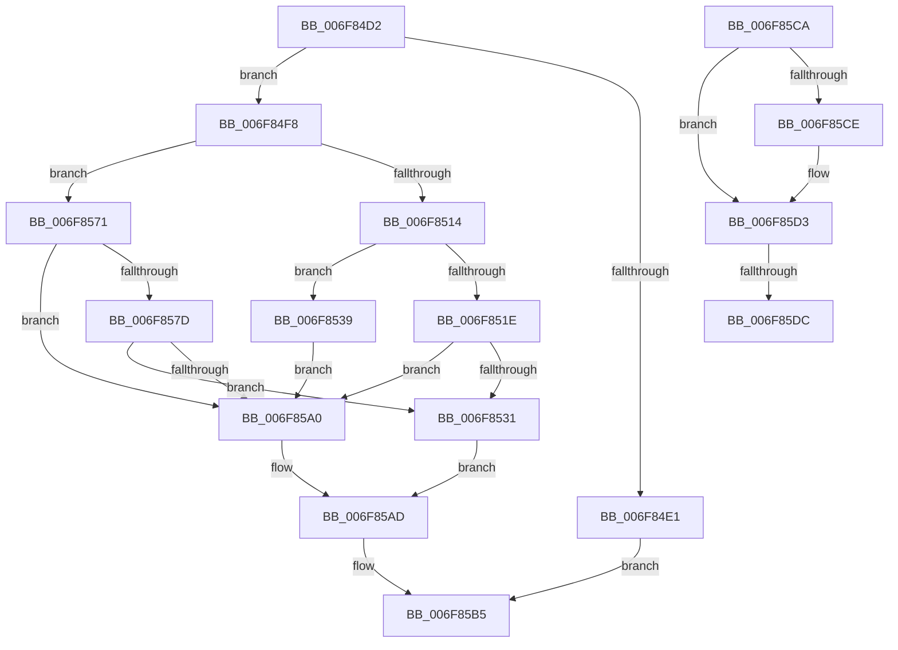

# sub_006F84D2

- RVA: `0x006F84D2`–`0x006F85ED` (길이 `283` bytes)
- VA: `0x00000001406F84D2`
- 실행 섹션: `.text`
- PDB 이름 있음: `아니요`; PDB Function 태그: `아니요`
- unwind 정보 RVA: `0x000B5714`
- 디코드: `73`개 명령, `283/283` bytes 표시
- 미해석 바이트: `0` (있으면 어셈블리에 `.byte`로 보존)

> 이 문서는 커널 이미지의 기계어와 PDB 기호를 분석해 생성했습니다. 4번과 5번은 함수 원형과 자료형을 바이너리 사용 방식에서 추정한 C 해석이며 원본 소스 복구 결과는 아닙니다.

## 1. Dependencies

- 직접 호출 지점: **9**; 고유 호출 대상: **8**
- 직접 호출자로 확인된 함수: **0**
- RIP 상대 이미지 참조: **0**

### Outgoing calls
- `0x006F84D7` → [ST_STORE<SM_TRAITS>::StDmIsCurrentRegion](../4D/ST_STORE_SM_TRAITS_StDmIsCurrentRegion_function_004D3684.md) (function, `0x004D3684`)
- `0x006F84E7` → [ST_STORE<SM_TRAITS>::StDmUpdateRegionLazyCleanup](../4B/ST_STORE_SM_TRAITS_StDmUpdateRegionLazyCleanup_function_004BC8DC.md) (function, `0x004BC8DC`)
- `0x006F8528` → [SMKM_STORE<SM_TRAITS>::SmStReleaseVirtualRegion](../3A/SMKM_STORE_SM_TRAITS_SmStReleaseVirtualRegion_function_003AF338.md) (function, `0x003AF338`)
- `0x006F8553` → [MiFreePagesFromMdl](../3F/MiFreePagesFromMdl_function_003F8300.md) (function, `0x003F8300`)
- `0x006F855D` → [ExFreePoolWithTag](../../poolcode/B8/ExFreePoolWithTag_function_00B82870.md) (function, `0x00B82870`)
- `0x006F8574` → [SMKM_STORE<SM_TRAITS>::SmStIsRegionBusy](../43/SMKM_STORE_SM_TRAITS_SmStIsRegionBusy_function_0043DB80.md) (function, `0x0043DB80`)
- `0x006F8595` → [SMKM_STORE<SM_TRAITS>::SmStMapRegion](../34/SMKM_STORE_SM_TRAITS_SmStMapRegion_function_0034D738.md) (function, `0x0034D738`)
- `0x006F85A8` → [ST_STORE<SM_TRAITS>::StDmUpdateRegionLazyCleanup](../4B/ST_STORE_SM_TRAITS_StDmUpdateRegionLazyCleanup_function_004BC8DC.md) (function, `0x004BC8DC`)
- `0x006F85E2` → [ST_STORE<SM_TRAITS>::StDmLazyWorkItemQueue](../3C/ST_STORE_SM_TRAITS_StDmLazyWorkItemQueue_function_003C2080.md) (function, `0x003C2080`)

### Direct callers
- 이 함수 시작 RVA로 연결되는 직접 call은 확인되지 않았습니다. 간접 호출은 완전히 역산할 수 없습니다.

### Static image references
- 디코드된 RIP-relative 메모리 참조가 없습니다.

## 2. Other-region calls and transfers

- 다른 실행 섹션으로 향하는 call: **1**
  - `0x006F855D` → [ExFreePoolWithTag](../../poolcode/B8/ExFreePoolWithTag_function_00B82870.md) (`.text` → `POOLCODE`)
- call이 아닌 외부 분기/꼬리 이동: **3**
  - `0x006F85C5` → [ST_STORE<SM_TRAITS>::StDmLazyRegionsWorker + 0x131](../49/ST_STORE_SM_TRAITS_StDmLazyRegionsWorker_function_0049FE78.md) (`tail-transfer`)
  - `0x006F85D6` → [ST_STORE<SM_TRAITS>::StDmLazyRegionsWorker + 0x150](../49/ST_STORE_SM_TRAITS_StDmLazyRegionsWorker_function_0049FE78.md) (`tail-transfer`)
  - `0x006F85E8` → [ST_STORE<SM_TRAITS>::StDmLazyRegionsWorker + 0x150](../49/ST_STORE_SM_TRAITS_StDmLazyRegionsWorker_function_0049FE78.md) (`tail-transfer`)

## 3. Assembly (complete function range)

```asm
006F84D2  8B D6                           mov edx, esi
006F84D4  49 8B CF                        mov rcx, r15
006F84D7  E8 A8 B1 DD FF                  call 0x1404d3684
006F84DC  83 F8 08                        cmp eax, 8
006F84DF  74 17                           je 0x1406f84f8
006F84E1  45 33 C0                        xor r8d, r8d
006F84E4  49 8B CF                        mov rcx, r15
006F84E7  E8 F0 43 DC FF                  call 0x1404bc8dc
006F84EC  4D 8D B7 20 03 00 00            lea r14, [r15 + 0x320]
006F84F3  E9 BD 00 00 00                  jmp 0x1406f85b5
006F84F8  49 8B 87 78 05 00 00            mov rax, qword ptr [r15 + 0x578]
006F84FF  4D 8B 0E                        mov r9, qword ptr [r14]
006F8502  44 8B E6                        mov r12d, esi
006F8505  42 0F B7 0C 60                  movzx ecx, word ptr [rax + r12*2]
006F850A  B8 FF 1F 00 00                  mov eax, 0x1fff
006F850F  66 85 C8                        test ax, cx
006F8512  75 5D                           jne 0x1406f8571
006F8514  41 F6 81 95 1A 00 00 04         test byte ptr [r9 + 0x1a95], 4
006F851C  74 1B                           je 0x1406f8539
006F851E  44 8B C7                        mov r8d, edi
006F8521  49 8B C9                        mov rcx, r9
006F8524  41 83 C8 02                     or r8d, 2
006F8528  E8 0B 6E CB FF                  call 0x1403af338
006F852D  85 C0                           test eax, eax
006F852F  79 6F                           jns 0x1406f85a0
006F8531  41 BD 01 00 00 00               mov r13d, 1
006F8537  EB 74                           jmp 0x1406f85ad
006F8539  49 8B B9 68 1B 00 00            mov rdi, qword ptr [r9 + 0x1b68]
006F8540  45 33 C0                        xor r8d, r8d
006F8543  45 33 C9                        xor r9d, r9d
006F8546  33 D2                           xor edx, edx
006F8548  4A 8B 1C E7                     mov rbx, qword ptr [rdi + r12*8]
006F854C  48 83 E3 F8                     and rbx, 0xfffffffffffffff8
006F8550  48 8B CB                        mov rcx, rbx
006F8553  E8 A8 FD CF FF                  call 0x1403f8300
006F8558  33 D2                           xor edx, edx
006F855A  48 8B CB                        mov rcx, rbx
006F855D  E8 0E A3 48 00                  call 0x140b82870
006F8562  33 DB                           xor ebx, ebx
006F8564  4A 89 1C E7                     mov qword ptr [rdi + r12*8], rbx
006F8568  8B BC 24 88 00 00 00            mov edi, dword ptr [rsp + 0x88]
006F856F  EB 2F                           jmp 0x1406f85a0
006F8571  49 8B C9                        mov rcx, r9
006F8574  E8 07 56 D4 FF                  call 0x14043db80
006F8579  85 C0                           test eax, eax
006F857B  74 23                           je 0x1406f85a0
006F857D  49 8B 0E                        mov rcx, qword ptr [r14]
006F8580  45 33 C0                        xor r8d, r8d
006F8583  44 8B 8C 24 90 00 00 00         mov r9d, dword ptr [rsp + 0x90]
006F858B  8B D6                           mov edx, esi
006F858D  C7 44 24 20 08 00 00 00         mov dword ptr [rsp + 0x20], 8
006F8595  E8 9E 51 C5 FF                  call 0x14034d738
006F859A  48 83 F8 03                     cmp rax, 3
006F859E  74 91                           je 0x1406f8531
006F85A0  45 33 C0                        xor r8d, r8d
006F85A3  8B D6                           mov edx, esi
006F85A5  49 8B CF                        mov rcx, r15
006F85A8  E8 2F 43 DC FF                  call 0x1404bc8dc
006F85AD  44 8B A4 24 80 00 00 00         mov r12d, dword ptr [rsp + 0x80]
006F85B5  8B 8C 24 98 00 00 00            mov ecx, dword ptr [rsp + 0x98]
006F85BC  49 8D 87 20 03 00 00            lea rax, [r15 + 0x320]
006F85C3  FF C6                           inc esi
006F85C5  E9 DF 79 DA FF                  jmp 0x14049ffa9
006F85CA  85 C9                           test ecx, ecx
006F85CC  74 05                           je 0x1406f85d3
006F85CE  66 44 09 75 0E                  or word ptr [rbp + 0xe], r14w
006F85D3  66 85 C0                        test ax, ax
006F85D6  0F 85 EC 79 DA FF               jne 0x14049ffc8
006F85DC  48 8B D5                        mov rdx, rbp
006F85DF  49 8B CF                        mov rcx, r15
006F85E2  E8 99 9A CC FF                  call 0x1403c2080
006F85E7  90                              nop
006F85E8  E9 DB 79 DA FF                  jmp 0x14049ffc8
```

## 4. C-style interpretation (structured pseudocode)

```c
__int64 __fastcall sub_006F84D2(__int64 a1, __int64 a2, int a3, __int64 a4, __int64 a5, __int64 a6, __int64 a7, __int64 a8, __int64 a9, __int64 a10, __int64 a11, __int64 a12, __int64 a13, __int64 a14, __int64 a15, unsigned int a16, unsigned int a17, unsigned int a18, unsigned int a19)
{
    __int64 result;
    __int64 v_rbx;
    __int64 v_rsi;
    unsigned int v_stack_p20;

    result = ST_STORE_SM_TRAITS___StDmIsCurrentRegion(v_r15, (unsigned int)((unsigned int)(v_rsi)), a3, a4);
    if (((unsigned int)(result)) == 8) goto loc_006F84F8;
    a3 = 0;
    result = ST_STORE_SM_TRAITS___StDmUpdateRegionLazyCleanup(v_r15, (unsigned int)((unsigned int)(v_rsi)), a3, a4);
    goto loc_006F85B5;
loc_006F84F8:
    if ((((unsigned __int16)((unsigned int)(0x1FFFULL))) & ((unsigned __int16)(*(unsigned __int16 *)(*(unsigned __int64 *)(v_r15 + 1400) + (unsigned int)((unsigned int)(v_rsi)) * 2)))) != 0) goto loc_006F8571;
    if (((*(unsigned __int8 *)(*(unsigned __int64 *)(v_r15 + 800) + 6805)) & (4)) == 0) goto loc_006F8539;
    a3 = (unsigned int)(((unsigned int)((unsigned int)(v_rdi))) | (2));
    result = SMKM_STORE_SM_TRAITS___SmStReleaseVirtualRegion(*(unsigned __int64 *)(v_r15 + 800), (unsigned int)((unsigned int)(v_rsi)), a3, *(unsigned __int64 *)(v_r15 + 800));
    if (!sign_flag) goto loc_006F85A0;
loc_006F8531:
    goto loc_006F85AD;
loc_006F8539:
    a3 = 0;
    a4 = 0;
    a2 = 0;
    v_rbx = (*(unsigned __int64 *)(*(unsigned __int64 *)(*(unsigned __int64 *)(v_r15 + 800) + 7016) + (unsigned int)((unsigned int)(v_rsi)) * 8)) & (-8);
    result = MiFreePagesFromMdl(v_rbx, a2, a3, a4);
    a2 = 0;
    result = ExFreePoolWithTag(v_rbx, a2, a3, a4);
    v_rbx = 0;
    *(unsigned __int64 *)(*(unsigned __int64 *)(*(unsigned __int64 *)(v_r15 + 800) + 7016) + (unsigned int)((unsigned int)(v_rsi)) * 8) = 0;
    goto loc_006F85A0;
loc_006F8571:
    result = SMKM_STORE_SM_TRAITS___SmStIsRegionBusy(0, a2, a3, a4);
    if ((unsigned int)(result) == 0) goto loc_006F85A0;
    a3 = 0;
    v_stack_p20 = 8;
    result = SMKM_STORE_SM_TRAITS___SmStMapRegion(*(unsigned __int64 *)(v_r15 + 800), (unsigned int)((unsigned int)(v_rsi)), a3, (unsigned int)(a18));
    if (result == 3) goto loc_006F8531;
loc_006F85A0:
    a3 = 0;
    result = ST_STORE_SM_TRAITS___StDmUpdateRegionLazyCleanup(v_r15, (unsigned int)((unsigned int)(v_rsi)), a3, (unsigned int)(a18));
loc_006F85AD:
loc_006F85B5:
    v_rsi = (unsigned int)((v_rsi) + 1);
}
```

## 5. (Beta) C Style

```c
int64_t sub_006F84D2(int64_t Arg1, int64_t Arg2, int32_t Arg3, int64_t Arg4, uint64_t Arg5, uint64_t Arg6, uint64_t Arg7, uint64_t Arg8, uint64_t Arg9, uint64_t Arg10, uint64_t Arg11, uint64_t Arg12, uint64_t Arg13, uint64_t Arg14, uint64_t Arg15, uint32_t Arg16, uint32_t Arg17, uint32_t Arg18, uint32_t Arg19)
{
    int64_t result;
    int64_t local_rbx;
    int64_t local_rsi;
    uint32_t v_stack_p20;

    result = ST_STORE_SM_TRAITS___StDmIsCurrentRegion(local_r15, (uint32_t)((uint32_t)(local_rsi)), Arg3, Arg4);
    if (((uint32_t)(result)) == 8) goto loc_006F84F8;
    Arg3 = 0;
    result = ST_STORE_SM_TRAITS___StDmUpdateRegionLazyCleanup(local_r15, (uint32_t)((uint32_t)(local_rsi)), Arg3, Arg4);
    goto loc_006F85B5;
loc_006F84F8:
    if ((((uint16_t)((uint32_t)(0x1FFFULL))) & ((uint16_t)(*(uint16_t *)(*(uint64_t *)(local_r15 + 0x578) + (uint32_t)((uint32_t)(local_rsi)) * 2)))) != 0) goto loc_006F8571;
    if (((*(uint8_t *)(*(uint64_t *)(local_r15 + 0x320) + 0x1A95)) & (4)) == 0) goto loc_006F8539;
    Arg3 = (uint32_t)(((uint32_t)((uint32_t)(local_rdi))) | (2));
    result = SMKM_STORE_SM_TRAITS___SmStReleaseVirtualRegion(*(uint64_t *)(local_r15 + 0x320), (uint32_t)((uint32_t)(local_rsi)), Arg3, *(uint64_t *)(local_r15 + 0x320));
    if (!sign_flag) goto loc_006F85A0;
loc_006F8531:
    goto loc_006F85AD;
loc_006F8539:
    Arg3 = 0;
    Arg4 = 0;
    Arg2 = 0;
    local_rbx = (*(uint64_t *)(*(uint64_t *)(*(uint64_t *)(local_r15 + 0x320) + 0x1B68) + (uint32_t)((uint32_t)(local_rsi)) * 8)) & (-8);
    result = MiFreePagesFromMdl(local_rbx, Arg2, Arg3, Arg4);
    Arg2 = 0;
    result = ExFreePoolWithTag(local_rbx, Arg2, Arg3, Arg4);
    local_rbx = 0;
    *(uint64_t *)(*(uint64_t *)(*(uint64_t *)(local_r15 + 0x320) + 0x1B68) + (uint32_t)((uint32_t)(local_rsi)) * 8) = 0;
    goto loc_006F85A0;
loc_006F8571:
    result = SMKM_STORE_SM_TRAITS___SmStIsRegionBusy(0, Arg2, Arg3, Arg4);
    if ((uint32_t)(result) == 0) goto loc_006F85A0;
    Arg3 = 0;
    v_stack_p20 = 8;
    result = SMKM_STORE_SM_TRAITS___SmStMapRegion(*(uint64_t *)(local_r15 + 0x320), (uint32_t)((uint32_t)(local_rsi)), Arg3, (uint32_t)(Arg18));
    if (result == 3) goto loc_006F8531;
loc_006F85A0:
    Arg3 = 0;
    result = ST_STORE_SM_TRAITS___StDmUpdateRegionLazyCleanup(local_r15, (uint32_t)((uint32_t)(local_rsi)), Arg3, (uint32_t)(Arg18));
loc_006F85AD:
loc_006F85B5:
    local_rsi = (uint32_t)((local_rsi) + 1);
}
```

## 6. Execution-region graph

[열기: 2D/3D 그래프와 함수 탐색 컨트롤 패널](../../../control-panel.html?section=text&rva=0x006F84D2&view=graph)

- 2D 그래프는 위에서 아래로 흐르고, 3D 그래프는 빈 공간을 드래그해 회전합니다. Shift+드래그는 이동, 휠은 확대·축소, 함수 노드 선택은 대상 보고서 이동입니다.

### Static fallback


