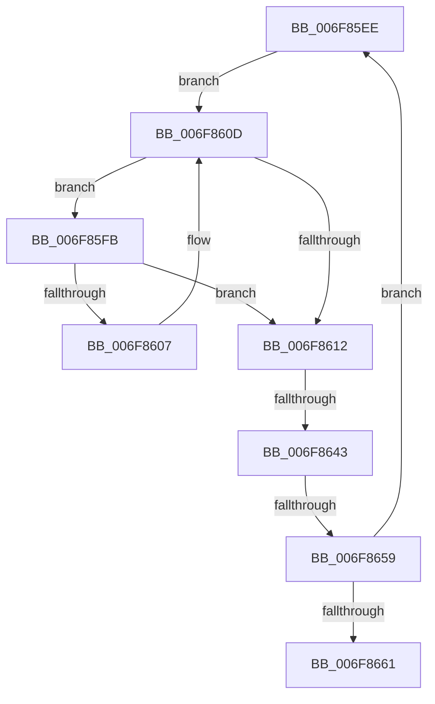

# sub_006F85EE

- RVA: `0x006F85EE`–`0x006F8666` (길이 `120` bytes)
- VA: `0x00000001406F85EE`
- 실행 섹션: `.text`
- PDB 이름 있음: `아니요`; PDB Function 태그: `아니요`
- unwind 정보 RVA: `0x000B5754`
- 디코드: `34`개 명령, `120/120` bytes 표시
- 미해석 바이트: `0` (있으면 어셈블리에 `.byte`로 보존)

> 이 문서는 커널 이미지의 기계어와 PDB 기호를 분석해 생성했습니다. 4번과 5번은 함수 원형과 자료형을 바이너리 사용 방식에서 추정한 C 해석이며 원본 소스 복구 결과는 아닙니다.

## 1. Dependencies

- 직접 호출 지점: **2**; 고유 호출 대상: **2**
- 직접 호출자로 확인된 함수: **0**
- RIP 상대 이미지 참조: **0**

### Outgoing calls
- `0x006F8636` → [HalpIommuUnmapLogicalRange](../30/HalpIommuUnmapLogicalRange_function_00308660.md) (function, `0x00308660`)
- `0x006F864C` → [HalpIommuFlushDomainTbs](../30/HalpIommuFlushDomainTbs_function_003085C0.md) (function, `0x003085C0`)

### Direct callers
- 이 함수 시작 RVA로 연결되는 직접 call은 확인되지 않았습니다. 간접 호출은 완전히 역산할 수 없습니다.

### Static image references
- 디코드된 RIP-relative 메모리 참조가 없습니다.

## 2. Other-region calls and transfers

- 다른 실행 섹션으로 향하는 call: **0**
- call이 아닌 외부 분기/꼬리 이동: **3**
  - `0x006F863D` → [HalpIommuDomainUnmapIdentityRange + 0x5C](../4A/HalpIommuDomainUnmapIdentityRange_function_004A0070.md) (`tail-transfer`)
  - `0x006F8653` → [HalpIommuDomainUnmapIdentityRange + 0x5C](../4A/HalpIommuDomainUnmapIdentityRange_function_004A0070.md) (`tail-transfer`)
  - `0x006F8661` → [HalpIommuDomainUnmapIdentityRange + 0x5C](../4A/HalpIommuDomainUnmapIdentityRange_function_004A0070.md) (`tail-transfer`)

## 3. Assembly (complete function range)

```asm
006F85EE  49 8B 2C CE                     mov rbp, qword ptr [r14 + rcx*8]
006F85F2  48 8D 59 01                     lea rbx, [rcx + 1]
006F85F6  48 8B C5                        mov rax, rbp
006F85F9  EB 12                           jmp 0x1406f860d
006F85FB  49 8B 14 DE                     mov rdx, qword ptr [r14 + rbx*8]
006F85FF  48 FF C0                        inc rax
006F8602  48 3B D0                        cmp rdx, rax
006F8605  75 0B                           jne 0x1406f8612
006F8607  48 8B C2                        mov rax, rdx
006F860A  48 FF C3                        inc rbx
006F860D  48 3B DF                        cmp rbx, rdi
006F8610  72 E9                           jb 0x1406f85fb
006F8612  4C 8B FB                        mov r15, rbx
006F8615  48 C1 E5 0C                     shl rbp, 0xc
006F8619  4C 2B F9                        sub r15, rcx
006F861C  48 8D 54 24 78                  lea rdx, [rsp + 0x78]
006F8621  48 8B 4E 28                     mov rcx, qword ptr [rsi + 0x28]
006F8625  4C 8B C5                        mov r8, rbp
006F8628  4C 89 7C 24 30                  mov qword ptr [rsp + 0x30], r15
006F862D  49 C1 E7 0C                     shl r15, 0xc
006F8631  4C 89 7C 24 78                  mov qword ptr [rsp + 0x78], r15
006F8636  E8 25 00 C1 FF                  call 0x140308660
006F863B  85 C0                           test eax, eax
006F863D  0F 88 89 7A DA FF               js 0x1404a00cc
006F8643  4D 8B C7                        mov r8, r15
006F8646  48 8B D5                        mov rdx, rbp
006F8649  48 8B CE                        mov rcx, rsi
006F864C  E8 6F FF C0 FF                  call 0x1403085c0
006F8651  85 C0                           test eax, eax
006F8653  0F 88 73 7A DA FF               js 0x1404a00cc
006F8659  48 8B CB                        mov rcx, rbx
006F865C  48 3B DF                        cmp rbx, rdi
006F865F  72 8D                           jb 0x1406f85ee
006F8661  E9 66 7A DA FF                  jmp 0x1404a00cc
```

## 4. C-style interpretation (structured pseudocode)

```c
__int64 __fastcall sub_006F85EE(__int64 a1, __int64 a2, __int64 a3, __int64 a4, __int64 a5, __int64 a6, __int64 a7, __int64 a8, __int64 a9, __int64 a10, __int64 a11, __int64 a12, __int64 a13, __int64 a14, __int64 a15)
{
    __int64 result;
    __int64 v_r15;
    __int64 v_rbp;
    __int64 v_rbx;
    unsigned __int64 v_stack_p30;
    unsigned __int64 v_stack_p78;

    goto loc_006F860D;
loc_006F85FB:
    result = (*(unsigned __int64 *)(v_r14 + a1 * 8)) + 1;
    if ((*(unsigned __int64 *)(v_r14 + a1 + 1 * 8)) != result) goto loc_006F8612;
    v_rbx = (a1 + 1) + 1;
loc_006F860D:
    if (v_rbx < v_rdi) goto loc_006F85FB;
loc_006F8612:
    v_rbp = (*(unsigned __int64 *)(v_r14 + a1 * 8)) << (12);
    v_r15 = (v_rbx) - (a1);
    v_stack_p30 = v_r15;
    v_r15 = (v_r15) << (12);
    v_stack_p78 = v_r15;
    result = HalpIommuUnmapLogicalRange(*(unsigned __int64 *)(v_rsi + 40), a15, v_rbp, a4);
    result = HalpIommuFlushDomainTbs(v_rsi, v_rbp, v_r15, a4);
    if (v_rbx < v_rdi) goto loc_006F85EE;
}
```

## 5. (Beta) C Style

```c
int64_t sub_006F85EE(int64_t Arg1, int64_t Arg2, int64_t Arg3, int64_t Arg4, uint64_t Arg5, uint64_t Arg6, uint64_t Arg7, uint64_t Arg8, uint64_t Arg9, uint64_t Arg10, uint64_t Arg11, uint64_t Arg12, uint64_t Arg13, uint64_t Arg14, int64_t Arg15)
{
    int64_t result;
    int64_t local_r15;
    int64_t local_rbp;
    int64_t local_rbx;
    uint64_t v_stack_p30;
    uint64_t v_stack_p78;

    goto loc_006F860D;
loc_006F85FB:
    result = (*(uint64_t *)(local_r14 + Arg1 * 8)) + 1;
    if ((*(uint64_t *)(local_r14 + Arg1 + 0x1 * 8)) != result) goto loc_006F8612;
    local_rbx = (Arg1 + 1) + 1;
loc_006F860D:
    if (local_rbx < local_rdi) goto loc_006F85FB;
loc_006F8612:
    local_rbp = (*(uint64_t *)(local_r14 + Arg1 * 8)) << (12);
    local_r15 = (local_rbx) - (Arg1);
    v_stack_p30 = local_r15;
    local_r15 = (local_r15) << (12);
    v_stack_p78 = local_r15;
    result = HalpIommuUnmapLogicalRange(*(uint64_t *)(local_rsi + 0x28), Arg15, local_rbp, Arg4);
    result = HalpIommuFlushDomainTbs(local_rsi, local_rbp, local_r15, Arg4);
    if (local_rbx < local_rdi) goto loc_006F85EE;
}
```

## 6. Execution-region graph

[열기: 2D/3D 그래프와 함수 탐색 컨트롤 패널](../../../control-panel.html?section=text&rva=0x006F85EE&view=graph)

- 2D 그래프는 위에서 아래로 흐르고, 3D 그래프는 빈 공간을 드래그해 회전합니다. Shift+드래그는 이동, 휠은 확대·축소, 함수 노드 선택은 대상 보고서 이동입니다.

### Static fallback


