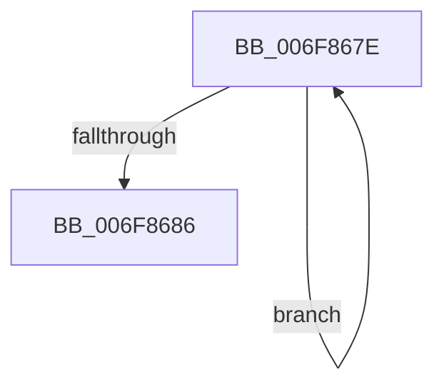

# sub_006F867E

- RVA: `0x006F867E`–`0x006F869A` (길이 `28` bytes)
- VA: `0x00000001406F867E`
- 실행 섹션: `.text`
- PDB 이름 있음: `아니요`; PDB Function 태그: `아니요`
- unwind 정보 RVA: `0x000B577C`
- 디코드: `8`개 명령, `28/28` bytes 표시
- 미해석 바이트: `0` (있으면 어셈블리에 `.byte`로 보존)

> 이 문서는 커널 이미지의 기계어와 PDB 기호를 분석해 생성했습니다. 4번과 5번은 함수 원형과 자료형을 바이너리 사용 방식에서 추정한 C 해석이며 원본 소스 복구 결과는 아닙니다.

## 1. Dependencies

- 직접 호출 지점: **0**; 고유 호출 대상: **0**
- 직접 호출자로 확인된 함수: **0**
- RIP 상대 이미지 참조: **0**

### Outgoing calls
- 직접 디코드된 call 명령이 없습니다.

### Direct callers
- 이 함수 시작 RVA로 연결되는 직접 call은 확인되지 않았습니다. 간접 호출은 완전히 역산할 수 없습니다.

### Static image references
- 디코드된 RIP-relative 메모리 참조가 없습니다.

## 2. Other-region calls and transfers

- 다른 실행 섹션으로 향하는 call: **0**
- call이 아닌 외부 분기/꼬리 이동: **1**
  - `0x006F8695` → [StEtaHelper::StartHelper + 0x80](../4A/StEtaHelper_StartHelper_function_004A0194.md) (`tail-transfer`)

## 3. Assembly (complete function range)

```asm
006F867E  48 83 C0 08                     add rax, 8
006F8682  39 10                           cmp dword ptr [rax], edx
006F8684  72 F8                           jb 0x1406f867e
006F8686  44 89 08                        mov dword ptr [rax], r9d
006F8689  48 8D 45 17                     lea rax, [rbp + 0x17]
006F868D  48 89 45 07                     mov qword ptr [rbp + 7], rax
006F8691  48 8D 45 EF                     lea rax, [rbp - 0x11]
006F8695  E9 7A 7B DA FF                  jmp 0x1404a0214
```

## 4. C-style interpretation (structured pseudocode)

```c
__int64 __fastcall sub_006F867E(__int64 a1, int a2, __int64 a3, int a4)
{
    __int64 result;

    result = (result) + (8);
    if ((*(unsigned int *)(result)) < a2) goto loc_006F867E;
    *(unsigned int *)(result) = a4;
    *(unsigned __int64 *)(v_rbp + 7) = v_rbp + 23;
}
```

## 5. (Beta) C Style

```c
int64_t sub_006F867E(int64_t Arg1, int32_t Arg2, int64_t Arg3, int32_t Arg4)
{
    int64_t result;

    result = (result) + (8);
    if ((*(uint32_t *)(result)) < Arg2) goto loc_006F867E;
    *(uint32_t *)(result) = Arg4;
    *(uint64_t *)(local_rbp + 0x7) = local_rbp + 23;
}
```

## 6. Execution-region graph

[열기: 2D/3D 그래프와 함수 탐색 컨트롤 패널](../../../control-panel.html?section=text&rva=0x006F867E&view=graph)

- 2D 그래프는 위에서 아래로 흐르고, 3D 그래프는 빈 공간을 드래그해 회전합니다. Shift+드래그는 이동, 휠은 확대·축소, 함수 노드 선택은 대상 보고서 이동입니다.

### Static fallback


