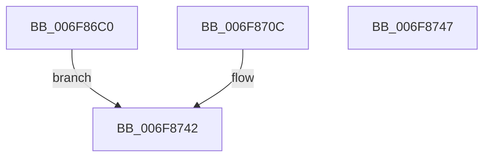

# sub_006F86C0

- RVA: `0x006F86C0`–`0x006F875C` (길이 `156` bytes)
- VA: `0x00000001406F86C0`
- 실행 섹션: `.text`
- PDB 이름 있음: `아니요`; PDB Function 태그: `아니요`
- unwind 정보 RVA: `0x000B5C04`
- 디코드: `31`개 명령, `156/156` bytes 표시
- 미해석 바이트: `0` (있으면 어셈블리에 `.byte`로 보존)

> 이 문서는 커널 이미지의 기계어와 PDB 기호를 분석해 생성했습니다. 4번과 5번은 함수 원형과 자료형을 바이너리 사용 방식에서 추정한 C 해석이며 원본 소스 복구 결과는 아닙니다.

## 1. Dependencies

- 직접 호출 지점: **1**; 고유 호출 대상: **1**
- 직접 호출자로 확인된 함수: **0**
- RIP 상대 이미지 참조: **0**

### Outgoing calls
- `0x006F8704` → [KiCustomAccessRoutine0](../6B/KiCustomAccessRoutine0_function_006BC580.md) (function, `0x006BC580`)

### Direct callers
- 이 함수 시작 RVA로 연결되는 직접 call은 확인되지 않았습니다. 간접 호출은 완전히 역산할 수 없습니다.

### Static image references
- 디코드된 RIP-relative 메모리 참조가 없습니다.

## 2. Other-region calls and transfers

- 다른 실행 섹션으로 향하는 call: **0**
- call이 아닌 외부 분기/꼬리 이동: **2**
  - `0x006F8742` → [ExpTimerDpcRoutine + 0x54](../4A/ExpTimerDpcRoutine_function_004A1570.md) (`tail-transfer`)
  - `0x006F8757` → [ExpTimerDpcRoutine + 0x54](../4A/ExpTimerDpcRoutine_function_004A1570.md) (`tail-transfer`)

## 3. Assembly (complete function range)

```asm
006F86C0  83 64 24 30 00                  and dword ptr [rsp + 0x30], 0
006F86C5  C6 07 00                        mov byte ptr [rdi], 0
006F86C8  49 8B C6                        mov rax, r14
006F86CB  48 C1 E8 08                     shr rax, 8
006F86CF  48 89 47 20                     mov qword ptr [rdi + 0x20], rax
006F86D3  48 89 B4 24 61 01 00 00         mov qword ptr [rsp + 0x161], rsi
006F86DB  8B CE                           mov ecx, esi
006F86DD  48 8B C3                        mov rax, rbx
006F86E0  48 D3 C0                        rol rax, cl
006F86E3  48 89 84 24 11 01 00 00         mov qword ptr [rsp + 0x111], rax
006F86EB  48 8B C7                        mov rax, rdi
006F86EE  48 D3 C8                        ror rax, cl
006F86F1  48 89 84 24 59 01 00 00         mov qword ptr [rsp + 0x159], rax
006F86F9  4C 31 77 28                     xor qword ptr [rdi + 0x28], r14
006F86FD  48 31 77 30                     xor qword ptr [rdi + 0x30], rsi
006F8701  48 8B CB                        mov rcx, rbx
006F8704  E8 77 3E FC FF                  call 0x1406bc580
006F8709  90                              nop
006F870A  EB 36                           jmp 0x1406f8742
006F870C  48 83 A4 24 B0 00 00 00 00      and qword ptr [rsp + 0xb0], 0
006F8715  48 8B 8C 24 61 01 00 00         mov rcx, qword ptr [rsp + 0x161]
006F871D  48 89 8C 24 B0 00 00 00         mov qword ptr [rsp + 0xb0], rcx
006F8725  48 8B 84 24 11 01 00 00         mov rax, qword ptr [rsp + 0x111]
006F872D  48 D3 C8                        ror rax, cl
006F8730  8B 00                           mov eax, dword ptr [rax]
006F8732  48 8B 9C 24 B8 01 00 00         mov rbx, qword ptr [rsp + 0x1b8]
006F873A  48 8B BC 24 B0 01 00 00         mov rdi, qword ptr [rsp + 0x1b0]
006F8742  E9 7D 8E DA FF                  jmp 0x1404a15c4
006F8747  48 8B 9C 24 B8 01 00 00         mov rbx, qword ptr [rsp + 0x1b8]
006F874F  48 8B BC 24 B0 01 00 00         mov rdi, qword ptr [rsp + 0x1b0]
006F8757  E9 68 8E DA FF                  jmp 0x1404a15c4
```

## 4. C-style interpretation (structured pseudocode)

```c
__int64 __fastcall sub_006F86C0(__int64 a1, __int64 a2, __int64 a3, __int64 a4, __int64 a5, unsigned int a6)
{
    __int64 result;
    unsigned __int64 v_stack_p111;
    unsigned __int64 v_stack_p159;
    unsigned __int64 v_stack_p161;
    unsigned __int64 v_stack_p1B0;
    unsigned __int64 v_stack_p1B8;
    unsigned __int64 v_stack_pB0;

    *(unsigned __int8 *)(v_rdi) = 0;
    result = (v_r14) >> (8);
    *(unsigned __int64 *)(v_rdi + 32) = result;
    v_stack_p161 = v_rsi;
    v_stack_p111 = v_rbx;
    v_stack_p159 = v_rdi;
    result = KiCustomAccessRoutine0(v_rbx, a2, a3, a4);
    goto loc_006F8742;
loc_006F8742:
}
```

## 5. (Beta) C Style

```c
int64_t sub_006F86C0(int64_t Arg1, int64_t Arg2, int64_t Arg3, int64_t Arg4, uint64_t Arg5, uint32_t Arg6)
{
    int64_t result;
    uint64_t v_stack_p111;
    uint64_t v_stack_p159;
    uint64_t v_stack_p161;
    uint64_t v_stack_p1B0;
    uint64_t v_stack_p1B8;
    uint64_t v_stack_pB0;

    *(uint8_t *)(local_rdi) = 0;
    result = (local_r14) >> (8);
    *(uint64_t *)(local_rdi + 0x20) = result;
    v_stack_p161 = local_rsi;
    v_stack_p111 = local_rbx;
    v_stack_p159 = local_rdi;
    result = KiCustomAccessRoutine0(local_rbx, Arg2, Arg3, Arg4);
    goto loc_006F8742;
loc_006F8742:
}
```

## 6. Execution-region graph

[열기: 2D/3D 그래프와 함수 탐색 컨트롤 패널](../../../control-panel.html?section=text&rva=0x006F86C0&view=graph)

- 2D 그래프는 위에서 아래로 흐르고, 3D 그래프는 빈 공간을 드래그해 회전합니다. Shift+드래그는 이동, 휠은 확대·축소, 함수 노드 선택은 대상 보고서 이동입니다.

### Static fallback


