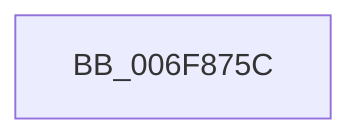

# sub_006F875C

- RVA: `0x006F875C`–`0x006F8781` (길이 `37` bytes)
- VA: `0x00000001406F875C`
- 실행 섹션: `.text`
- PDB 이름 있음: `아니요`; PDB Function 태그: `아니요`
- unwind 정보 RVA: `0x000B5C28`
- 디코드: `7`개 명령, `37/37` bytes 표시
- 미해석 바이트: `0` (있으면 어셈블리에 `.byte`로 보존)

> 이 문서는 커널 이미지의 기계어와 PDB 기호를 분석해 생성했습니다. 4번과 5번은 함수 원형과 자료형을 바이너리 사용 방식에서 추정한 C 해석이며 원본 소스 복구 결과는 아닙니다.

## 1. Dependencies

- 직접 호출 지점: **2**; 고유 호출 대상: **2**
- 직접 호출자로 확인된 함수: **0**
- RIP 상대 이미지 참조: **2**

### Outgoing calls
- `0x006F8763` → [ExAcquireFastMutex](../20/ExAcquireFastMutex_function_0020E5A0.md) (function, `0x0020E5A0`)
- `0x006F8775` → [ExReleaseFastMutex](../25/ExReleaseFastMutex_function_002519C0.md) (function, `0x002519C0`)

### Direct callers
- 이 함수 시작 RVA로 연결되는 직접 call은 확인되지 않았습니다. 간접 호출은 완전히 역산할 수 없습니다.

### Static image references
- `0x006F875C` → RVA `0x00F091A0` (`.data`; read)
- `0x006F8768` → RVA `0x00F091DC` (`.data`; read/write)

## 2. Other-region calls and transfers

- 다른 실행 섹션으로 향하는 call: **0**
- call이 아닌 외부 분기/꼬리 이동: **1**
  - `0x006F877C` → [PopCreateDynamicIrpWorker + 0x40](../4A/PopCreateDynamicIrpWorker_function_004A175C.md) (`tail-transfer`)

## 3. Assembly (complete function range)

```asm
006F875C  48 8D 0D 3D 0A 81 00            lea rcx, [rip + 0x810a3d]
006F8763  E8 38 5E B1 FF                  call 0x14020e5a0
006F8768  FF 0D 6E 0A 81 00               dec dword ptr [rip + 0x810a6e]
006F876E  48 8D 0D 2B 0A 81 00            lea rcx, [rip + 0x810a2b]
006F8775  E8 46 92 B5 FF                  call 0x1402519c0
006F877A  8B DE                           mov ebx, esi
006F877C  E9 1B 90 DA FF                  jmp 0x1404a179c
```

## 4. C-style interpretation (structured pseudocode)

```c
__int64 __fastcall sub_006F875C(void)
{
    __int64 result;

    result = ExAcquireFastMutex(v_rip + 8456765, a2, a3, a4);
    result = ExReleaseFastMutex(v_rip + 8456747, a2, a3, a4);
}
```

## 5. (Beta) C Style

```c
void sub_006F875C(void)
{
    int64_t result;

    result = ExAcquireFastMutex(v_rip + 8456765, a2, a3, a4);
    result = ExReleaseFastMutex(v_rip + 8456747, a2, a3, a4);
}
```

## 6. Execution-region graph

[열기: 2D/3D 그래프와 함수 탐색 컨트롤 패널](../../../control-panel.html?section=text&rva=0x006F875C&view=graph)

- 2D 그래프는 위에서 아래로 흐르고, 3D 그래프는 빈 공간을 드래그해 회전합니다. Shift+드래그는 이동, 휠은 확대·축소, 함수 노드 선택은 대상 보고서 이동입니다.

### Static fallback


