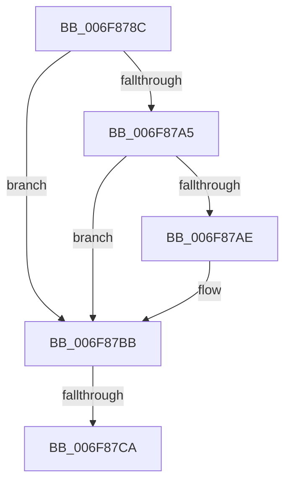

# sub_006F878C

- RVA: `0x006F878C`–`0x006F87D6` (길이 `74` bytes)
- VA: `0x00000001406F878C`
- 실행 섹션: `.text`
- PDB 이름 있음: `아니요`; PDB Function 태그: `아니요`
- unwind 정보 RVA: `0x000B5ECC`
- 디코드: `18`개 명령, `74/74` bytes 표시
- 미해석 바이트: `0` (있으면 어셈블리에 `.byte`로 보존)

> 이 문서는 커널 이미지의 기계어와 PDB 기호를 분석해 생성했습니다. 4번과 5번은 함수 원형과 자료형을 바이너리 사용 방식에서 추정한 C 해석이며 원본 소스 복구 결과는 아닙니다.

## 1. Dependencies

- 직접 호출 지점: **0**; 고유 호출 대상: **0**
- 직접 호출자로 확인된 함수: **0**
- RIP 상대 이미지 참조: **1**

### Outgoing calls
- 직접 디코드된 call 명령이 없습니다.

### Direct callers
- 이 함수 시작 RVA로 연결되는 직접 call은 확인되지 않았습니다. 간접 호출은 완전히 역산할 수 없습니다.

### Static image references
- `0x006F87BB` → RVA `0x00F8F5F0` (`.data`; read)

## 2. Other-region calls and transfers

- 다른 실행 섹션으로 향하는 call: **0**
- call이 아닌 외부 분기/꼬리 이동: **2**
  - `0x006F87C4` → [CcComputeNextScanTime + 0x1C](../4A/CcComputeNextScanTime_function_004A2574.md) (`tail-transfer`)
  - `0x006F87D1` → [CcComputeNextScanTime + 0x1C](../4A/CcComputeNextScanTime_function_004A2574.md) (`tail-transfer`)

## 3. Assembly (complete function range)

```asm
006F878C  4C 8D 81 0C 03 00 00            lea r8, [rcx + 0x30c]
006F8793  48 8B 13                        mov rdx, qword ptr [rbx]
006F8796  49 B9 FF FF FF FF FF FF FF 7F   movabs r9, 0x7fffffffffffffff
006F87A0  49 3B D1                        cmp rdx, r9
006F87A3  74 16                           je 0x1406f87bb
006F87A5  48 8D 0C 02                     lea rcx, [rdx + rax]
006F87A9  49 3B CA                        cmp rcx, r10
006F87AC  7E 0D                           jle 0x1406f87bb
006F87AE  49 2B D2                        sub rdx, r10
006F87B1  48 03 D0                        add rdx, rax
006F87B4  41 83 20 00                     and dword ptr [r8], 0
006F87B8  49 89 13                        mov qword ptr [r11], rdx
006F87BB  8B 05 2F 6E 89 00               mov eax, dword ptr [rip + 0x896e2f]
006F87C1  41 39 00                        cmp dword ptr [r8], eax
006F87C4  0F 82 C6 9D DA FF               jb 0x1404a2590
006F87CA  41 83 20 00                     and dword ptr [r8], 0
006F87CE  4D 89 0B                        mov qword ptr [r11], r9
006F87D1  E9 BA 9D DA FF                  jmp 0x1404a2590
```

## 4. C-style interpretation (structured pseudocode)

```c
__int64 __fastcall sub_006F878C(__int64 a1)
{
    if ((*(unsigned __int64 *)(v_rbx)) == a4) goto loc_006F87BB;
    if ((*(unsigned __int64 *)(v_rbx) + result * 1) >= = v_r10) {
        a2 = (*(unsigned __int64 *)(v_rbx)) - (v_r10);
        a2 = (a2) + (result);
        *(unsigned __int64 *)(v_r11) = a2;
    }
    *(unsigned __int64 *)(v_r11) = a4;
}
```

## 5. (Beta) C Style

```c
int64_t sub_006F878C(void *Arg1)
{
    uint8_t *arg1 = (uint8_t *)Arg1;

    if ((*(uint64_t *)(local_rbx)) == a4) goto loc_006F87BB;
    if ((*(uint64_t *)(local_rbx) + result * 1) >= = local_r10) {
        a2 = (*(uint64_t *)(local_rbx)) - (local_r10);
        a2 = (a2) + (result);
        *(uint64_t *)(local_r11) = a2;
    }
    *(uint64_t *)(local_r11) = a4;
}
```

### 관측된 메모리 오프셋

구조체 형식이 확인되지 않은 접근은 인자 기준의 오프셋으로만 기록했습니다.

| 기준 인자 | 오프셋 표현 | 폭 (bit) | 접근 |
|---|---:|---:|---|
| `Arg1` | `+ 0x0` | `32` | `R` |
| `Arg1` | `+ 0x0` | `32` | `R/W` |
| `Arg1` | `+ 0x30C` | `64` | `R` |

## 6. Execution-region graph

[열기: 2D/3D 그래프와 함수 탐색 컨트롤 패널](../../../control-panel.html?section=text&rva=0x006F878C&view=graph)

- 2D 그래프는 위에서 아래로 흐르고, 3D 그래프는 빈 공간을 드래그해 회전합니다. Shift+드래그는 이동, 휠은 확대·축소, 함수 노드 선택은 대상 보고서 이동입니다.

### Static fallback


