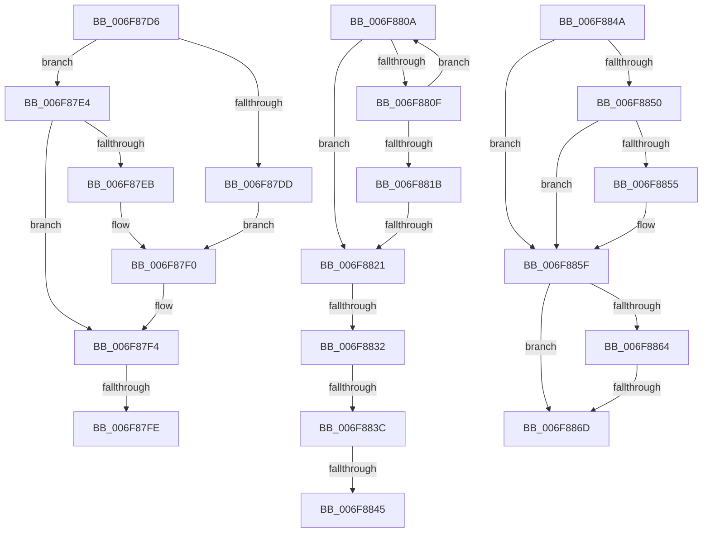

# sub_006F87D6

- RVA: `0x006F87D6`–`0x006F8877` (길이 `161` bytes)
- VA: `0x00000001406F87D6`
- 실행 섹션: `.text`
- PDB 이름 있음: `아니요`; PDB Function 태그: `아니요`
- unwind 정보 RVA: `0x000B5F3C`
- 디코드: `42`개 명령, `161/161` bytes 표시
- 미해석 바이트: `0` (있으면 어셈블리에 `.byte`로 보존)

> 이 문서는 커널 이미지의 기계어와 PDB 기호를 분석해 생성했습니다. 4번과 5번은 함수 원형과 자료형을 바이너리 사용 방식에서 추정한 C 해석이며 원본 소스 복구 결과는 아닙니다.

## 1. Dependencies

- 직접 호출 지점: **0**; 고유 호출 대상: **0**
- 직접 호출자로 확인된 함수: **0**
- RIP 상대 이미지 참조: **0**

### Outgoing calls
- 직접 디코드된 call 명령이 없습니다.

### Direct callers
- 이 함수 시작 RVA로 연결되는 직접 call은 확인되지 않았습니다. 간접 호출은 완전히 역산할 수 없습니다.

### Static image references
- 디코드된 RIP-relative 메모리 참조가 없습니다.

## 2. Other-region calls and transfers

- 다른 실행 섹션으로 향하는 call: **0**
- call이 아닌 외부 분기/꼬리 이동: **9**
  - `0x006F87F8` → [MiValidateMdlAllocationRequest + 0x1D0](../4A/MiValidateMdlAllocationRequest_function_004A280C.md) (`tail-transfer`)
  - `0x006F8805` → [MiValidateMdlAllocationRequest + 0xDA](../4A/MiValidateMdlAllocationRequest_function_004A280C.md) (`tail-transfer`)
  - `0x006F881B` → [MiValidateMdlAllocationRequest + 0x1D0](../4A/MiValidateMdlAllocationRequest_function_004A280C.md) (`tail-transfer`)
  - `0x006F882C` → [MiValidateMdlAllocationRequest + 0x109](../4A/MiValidateMdlAllocationRequest_function_004A280C.md) (`tail-transfer`)
  - `0x006F8836` → [MiValidateMdlAllocationRequest + 0x1D0](../4A/MiValidateMdlAllocationRequest_function_004A280C.md) (`tail-transfer`)
  - `0x006F883F` → [MiValidateMdlAllocationRequest + 0x1D0](../4A/MiValidateMdlAllocationRequest_function_004A280C.md) (`tail-transfer`)
  - `0x006F8845` → [MiValidateMdlAllocationRequest + 0x109](../4A/MiValidateMdlAllocationRequest_function_004A280C.md) (`tail-transfer`)
  - `0x006F8867` → [MiValidateMdlAllocationRequest + 0x143](../4A/MiValidateMdlAllocationRequest_function_004A280C.md) (`tail-transfer`)
  - `0x006F8872` → [MiValidateMdlAllocationRequest + 0x1A2](../4A/MiValidateMdlAllocationRequest_function_004A280C.md) (`tail-transfer`)

## 3. Assembly (complete function range)

```asm
006F87D6  41 0F BA E2 18                  bt r10d, 0x18
006F87DB  73 07                           jae 0x1406f87e4
006F87DD  B9 00 02 00 00                  mov ecx, 0x200
006F87E2  EB 0C                           jmp 0x1406f87f0
006F87E4  41 0F BA E2 19                  bt r10d, 0x19
006F87E9  73 09                           jae 0x1406f87f4
006F87EB  B9 00 00 04 00                  mov ecx, 0x40000
006F87F0  48 89 4B 30                     mov qword ptr [rbx + 0x30], rcx
006F87F4  41 F6 C2 04                     test r10b, 4
006F87F8  0F 85 DE A1 DA FF               jne 0x1404a29dc
006F87FE  83 8B 94 00 00 00 02            or dword ptr [rbx + 0x94], 2
006F8805  E9 DC A0 DA FF                  jmp 0x1404a28e6
006F880A  4C 3B 1A                        cmp r11, qword ptr [rdx]
006F880D  74 12                           je 0x1406f8821
006F880F  41 03 C7                        add eax, r15d
006F8812  48 83 C2 08                     add rdx, 8
006F8816  83 F8 03                        cmp eax, 3
006F8819  72 EF                           jb 0x1406f880a
006F881B  0F 84 BB A1 DA FF               je 0x1404a29dc
006F8821  33 D2                           xor edx, edx
006F8823  48 8B C1                        mov rax, rcx
006F8826  49 F7 F3                        div r11
006F8829  48 85 D2                        test rdx, rdx
006F882C  0F 84 E3 A0 DA FF               je 0x1404a2915
006F8832  41 F6 C2 04                     test r10b, 4
006F8836  0F 85 A0 A1 DA FF               jne 0x1404a29dc
006F883C  49 3B CB                        cmp rcx, r11
006F883F  0F 82 97 A1 DA FF               jb 0x1404a29dc
006F8845  E9 CB A0 DA FF                  jmp 0x1404a2915
006F884A  41 F6 C2 20                     test r10b, 0x20
006F884E  74 0F                           je 0x1406f885f
006F8850  4D 85 DB                        test r11, r11
006F8853  74 0A                           je 0x1406f885f
006F8855  49 8D 43 FF                     lea rax, [r11 - 1]
006F8859  48 F7 D0                        not rax
006F885C  4C 23 C0                        and r8, rax
006F885F  4D 85 C0                        test r8, r8
006F8862  74 09                           je 0x1406f886d
006F8864  4D 3B C3                        cmp r8, r11
006F8867  0F 83 E2 A0 DA FF               jae 0x1404a294f
006F886D  B8 9A 00 00 C0                  mov eax, 0xc000009a
006F8872  E9 37 A1 DA FF                  jmp 0x1404a29ae
```

## 4. C-style interpretation (structured pseudocode)

```c
__int64 __fastcall sub_006F87D6(__int64 a1, __int64 a2, __int64 a3)
{
    if (condition_is_above_or_equal) goto loc_006F87E4;
    goto loc_006F87F0;
loc_006F87E4:
    if (condition_is_above_or_equal) goto loc_006F87F4;
loc_006F87F0:
    *(unsigned __int64 *)(v_rbx + 48) = (unsigned int)(0x40000ULL);
loc_006F87F4:
}
```

## 5. (Beta) C Style

```c
int64_t sub_006F87D6(int64_t Arg1, int64_t Arg2, int64_t Arg3)
{
    if (condition_is_above_or_equal) goto loc_006F87E4;
    goto loc_006F87F0;
loc_006F87E4:
    if (condition_is_above_or_equal) goto loc_006F87F4;
loc_006F87F0:
    *(uint64_t *)(local_rbx + 0x30) = (uint32_t)(0x40000ULL);
loc_006F87F4:
}
```

## 6. Execution-region graph

[열기: 2D/3D 그래프와 함수 탐색 컨트롤 패널](../../../control-panel.html?section=text&rva=0x006F87D6&view=graph)

- 2D 그래프는 위에서 아래로 흐르고, 3D 그래프는 빈 공간을 드래그해 회전합니다. Shift+드래그는 이동, 휠은 확대·축소, 함수 노드 선택은 대상 보고서 이동입니다.

### Static fallback


