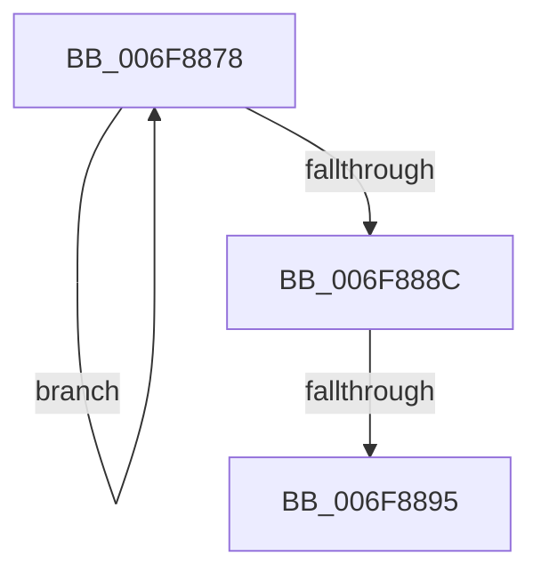

# sub_006F8878

- RVA: `0x006F8878`–`0x006F88AD` (길이 `53` bytes)
- VA: `0x00000001406F8878`
- 실행 섹션: `.text`
- PDB 이름 있음: `아니요`; PDB Function 태그: `아니요`
- unwind 정보 RVA: `0x000B6114`
- 디코드: `13`개 명령, `53/53` bytes 표시
- 미해석 바이트: `0` (있으면 어셈블리에 `.byte`로 보존)

> 이 문서는 커널 이미지의 기계어와 PDB 기호를 분석해 생성했습니다. 4번과 5번은 함수 원형과 자료형을 바이너리 사용 방식에서 추정한 C 해석이며 원본 소스 복구 결과는 아닙니다.

## 1. Dependencies

- 직접 호출 지점: **1**; 고유 호출 대상: **1**
- 직접 호출자로 확인된 함수: **0**
- RIP 상대 이미지 참조: **2**

### Outgoing calls
- `0x006F88A2` → [KeSetEvent](../33/KeSetEvent_function_0033F310.md) (function, `0x0033F310`)

### Direct callers
- 이 함수 시작 RVA로 연결되는 직접 call은 확인되지 않았습니다. 간접 호출은 완전히 역산할 수 없습니다.

### Static image references
- `0x006F887E` → RVA `0x00F22D40` (`.data`; read)
- `0x006F889B` → RVA `0x00F22D80` (`.data`; read)

## 2. Other-region calls and transfers

- 다른 실행 섹션으로 향하는 call: **0**
- call이 아닌 외부 분기/꼬리 이동: **2**
  - `0x006F888F` → [KeRetryOutswapProcess + 0x67](../4A/KeRetryOutswapProcess_function_004A2E20.md) (`tail-transfer`)
  - `0x006F88A8` → [KeRetryOutswapProcess + 0x67](../4A/KeRetryOutswapProcess_function_004A2E20.md) (`tail-transfer`)

## 3. Assembly (complete function range)

```asm
006F8878  48 89 07                        mov qword ptr [rdi], rax
006F887B  48 8B C8                        mov rcx, rax
006F887E  F0 48 0F B1 3D B9 A4 82 00      lock cmpxchg qword ptr [rip + 0x82a4b9], rdi
006F8887  48 3B C1                        cmp rax, rcx
006F888A  75 EC                           jne 0x1406f8878
006F888C  48 85 C0                        test rax, rax
006F888F  0F 85 F2 A5 DA FF               jne 0x1404a2e87
006F8895  45 33 C0                        xor r8d, r8d
006F8898  8D 50 0A                        lea edx, [rax + 0xa]
006F889B  48 8D 0D DE A4 82 00            lea rcx, [rip + 0x82a4de]
006F88A2  E8 69 6A C4 FF                  call 0x14033f310
006F88A7  90                              nop
006F88A8  E9 DA A5 DA FF                  jmp 0x1404a2e87
```

## 4. C-style interpretation (structured pseudocode)

```c
__int64 __fastcall sub_006F8878(__int64 a1, __int64 a2, int a3)
{
    __int64 result;

    *(unsigned __int64 *)(v_rdi) = result;
    if (result != result) goto loc_006F8878;
    a3 = 0;
    result = KeSetEvent(v_rip + 8561886, result + 10, a3, a4);
}
```

## 5. (Beta) C Style

```c
int64_t sub_006F8878(int64_t Arg1, int64_t Arg2, int32_t Arg3)
{
    int64_t result;

    *(uint64_t *)(local_rdi) = result;
    if (result != result) goto loc_006F8878;
    Arg3 = 0;
    result = KeSetEvent(v_rip + 8561886, result + 10, Arg3, a4);
}
```

## 6. Execution-region graph

[열기: 2D/3D 그래프와 함수 탐색 컨트롤 패널](../../../control-panel.html?section=text&rva=0x006F8878&view=graph)

- 2D 그래프는 위에서 아래로 흐르고, 3D 그래프는 빈 공간을 드래그해 회전합니다. Shift+드래그는 이동, 휠은 확대·축소, 함수 노드 선택은 대상 보고서 이동입니다.

### Static fallback


