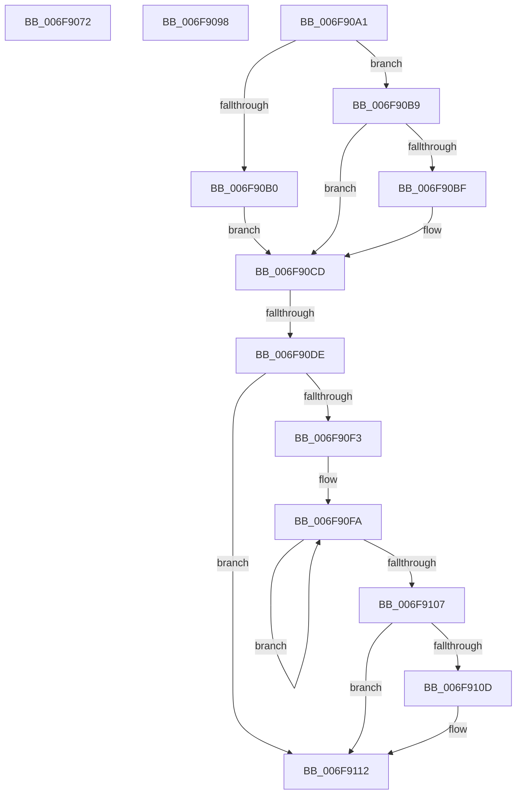

# sub_006F9072

- RVA: `0x006F9072`–`0x006F9118` (길이 `166` bytes)
- VA: `0x00000001406F9072`
- 실행 섹션: `.text`
- PDB 이름 있음: `아니요`; PDB Function 태그: `아니요`
- unwind 정보 RVA: `0x000B63D4`
- 디코드: `37`개 명령, `166/166` bytes 표시
- 미해석 바이트: `0` (있으면 어셈블리에 `.byte`로 보존)

> 이 문서는 커널 이미지의 기계어와 PDB 기호를 분석해 생성했습니다. 4번과 5번은 함수 원형과 자료형을 바이너리 사용 방식에서 추정한 C 해석이며 원본 소스 복구 결과는 아닙니다.

## 1. Dependencies

- 직접 호출 지점: **1**; 고유 호출 대상: **1**
- 직접 호출자로 확인된 함수: **0**
- RIP 상대 이미지 참조: **0**

### Outgoing calls
- `0x006F910D` → [KiRemoveSystemWorkPriorityKick](../26/KiRemoveSystemWorkPriorityKick_function_002631D0.md) (function, `0x002631D0`)

### Direct callers
- 이 함수 시작 RVA로 연결되는 직접 call은 확인되지 않았습니다. 간접 호출은 완전히 역산할 수 없습니다.

### Static image references
- 디코드된 RIP-relative 메모리 참조가 없습니다.

## 2. Other-region calls and transfers

- 다른 실행 섹션으로 향하는 call: **0**
- call이 아닌 외부 분기/꼬리 이동: **4**
  - `0x006F9093` → [HvlLpWriteMultipleMsr + 0xA9](../4A/HvlLpWriteMultipleMsr_function_004A35E0.md) (`tail-transfer`)
  - `0x006F909C` → [HvlLpWriteMultipleMsr + 0x124](../4A/HvlLpWriteMultipleMsr_function_004A35E0.md) (`tail-transfer`)
  - `0x006F90D8` → [HvlLpWriteMultipleMsr + 0x124](../4A/HvlLpWriteMultipleMsr_function_004A35E0.md) (`tail-transfer`)
  - `0x006F9113` → [HvlLpWriteMultipleMsr + 0x124](../4A/HvlLpWriteMultipleMsr_function_004A35E0.md) (`tail-transfer`)

## 3. Assembly (complete function range)

```asm
006F9072  88 45 E0                        mov byte ptr [rbp - 0x20], al
006F9075  65 48 8B 04 25 20 00 00 00      mov rax, qword ptr gs:[0x20]
006F907E  8B 75 D8                        mov esi, dword ptr [rbp - 0x28]
006F9081  48 8B 7D E8                     mov rdi, qword ptr [rbp - 0x18]
006F9085  C7 45 E4 01 00 00 00            mov dword ptr [rbp - 0x1c], 1
006F908C  48 8B 80 00 8C 00 00            mov rax, qword ptr [rax + 0x8c00]
006F9093  E9 F1 A5 DA FF                  jmp 0x1404a3689
006F9098  44 0F 22 C3                     mov cr8, rbx
006F909C  E9 63 A6 DA FF                  jmp 0x1404a3704
006F90A1  65 48 8B 04 25 20 00 00 00      mov rax, qword ptr gs:[0x20]
006F90AA  F6 45 E4 01                     test byte ptr [rbp - 0x1c], 1
006F90AE  74 09                           je 0x1406f90b9
006F90B0  48 8B 88 00 8C 00 00            mov rcx, qword ptr [rax + 0x8c00]
006F90B7  EB 14                           jmp 0x1406f90cd
006F90B9  44 84 45 E4                     test byte ptr [rbp - 0x1c], r8b
006F90BD  74 0E                           je 0x1406f90cd
006F90BF  48 8B 88 00 8C 00 00            mov rcx, qword ptr [rax + 0x8c00]
006F90C6  48 81 C1 00 10 00 00            add rcx, 0x1000
006F90CD  48 8B 45 F0                     mov rax, qword ptr [rbp - 0x10]
006F90D1  48 89 41 10                     mov qword ptr [rcx + 0x10], rax
006F90D5  38 55 E0                        cmp byte ptr [rbp - 0x20], dl
006F90D8  0F 84 26 A6 DA FF               je 0x1404a3704
006F90DE  65 48 8B 0C 25 20 00 00 00      mov rcx, qword ptr gs:[0x20]
006F90E7  4C 8B 81 B8 8E 00 00            mov r8, qword ptr [rcx + 0x8eb8]
006F90EE  4D 85 C0                        test r8, r8
006F90F1  74 1F                           je 0x1406f9112
006F90F3  41 0F 0D 08                     prefetchw byte ptr [r8]
006F90F7  41 8B 00                        mov eax, dword ptr [r8]
006F90FA  8B D0                           mov edx, eax
006F90FC  0F BA F2 15                     btr edx, 0x15
006F9100  F0 41 0F B1 10                  lock cmpxchg dword ptr [r8], edx
006F9105  75 F3                           jne 0x1406f90fa
006F9107  0F BA E0 15                     bt eax, 0x15
006F910B  73 05                           jae 0x1406f9112
006F910D  E8 BE A0 B6 FF                  call 0x1402631d0
006F9112  FB                              sti
006F9113  E9 EC A5 DA FF                  jmp 0x1404a3704
```

## 4. C-style interpretation (structured pseudocode)

```c
__int64 __fastcall sub_006F9072(__int64 a1, unsigned __int8 a2)
{
    *(unsigned __int8 *)(v_rbp - 32) = (unsigned __int8)(result);
    *(unsigned int *)(v_rbp - 28) = 1;
}
```

## 5. (Beta) C Style

```c
int64_t sub_006F9072(int64_t Arg1, uint8_t Arg2)
{
    *(uint8_t *)(local_rbp - 0x20) = (uint8_t)(result);
    *(uint32_t *)(local_rbp - 0x1C) = 1;
}
```

## 6. Execution-region graph

[열기: 2D/3D 그래프와 함수 탐색 컨트롤 패널](../../../control-panel.html?section=text&rva=0x006F9072&view=graph)

- 2D 그래프는 위에서 아래로 흐르고, 3D 그래프는 빈 공간을 드래그해 회전합니다. Shift+드래그는 이동, 휠은 확대·축소, 함수 노드 선택은 대상 보고서 이동입니다.

### Static fallback


