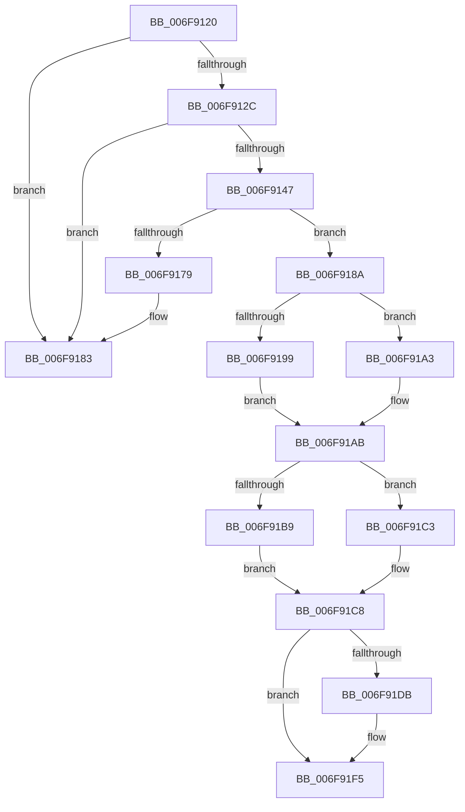

# sub_006F9120

- RVA: `0x006F9120`–`0x006F91FD` (길이 `221` bytes)
- VA: `0x00000001406F9120`
- 실행 섹션: `.text`
- PDB 이름 있음: `아니요`; PDB Function 태그: `아니요`
- unwind 정보 RVA: `0x000B6454`
- 디코드: `57`개 명령, `221/221` bytes 표시
- 미해석 바이트: `0` (있으면 어셈블리에 `.byte`로 보존)

> 이 문서는 커널 이미지의 기계어와 PDB 기호를 분석해 생성했습니다. 4번과 5번은 함수 원형과 자료형을 바이너리 사용 방식에서 추정한 C 해석이며 원본 소스 복구 결과는 아닙니다.

## 1. Dependencies

- 직접 호출 지점: **9**; 고유 호출 대상: **8**
- 직접 호출자로 확인된 함수: **0**
- RIP 상대 이미지 참조: **3**

### Outgoing calls
- `0x006F913A` → [MiAllocatePool](../35/MiAllocatePool_function_0035B540.md) (function, `0x0035B540`)
- `0x006F9157` → [MiInitializePageColorBase](../32/MiInitializePageColorBase_function_00320410.md) (function, `0x00320410`)
- `0x006F9170` → [MiCreateUltraThreadContextHelper](../2C/MiCreateUltraThreadContextHelper_function_002CB380.md) (function, `0x002CB380`)
- `0x006F917E` → [ExFreePoolWithTag](../../poolcode/B8/ExFreePoolWithTag_function_00B82870.md) (function, `0x00B82870`)
- `0x006F919C` → [ExAcquireSpinLockExclusiveAtDpcLevel](../24/ExAcquireSpinLockExclusiveAtDpcLevel_function_00248E80.md) (function, `0x00248E80`)
- `0x006F91A3` → [ExAcquireSpinLockExclusive](../24/ExAcquireSpinLockExclusive_function_00248690.md) (function, `0x00248690`)
- `0x006F91D2` → [MiReleaseSpinLockExclusive](../24/MiReleaseSpinLockExclusive_function_002482C0.md) (function, `0x002482C0`)
- `0x006F91E4` → [MiDeleteUltraMapContext](../2D/MiDeleteUltraMapContext_function_002DC9A4.md) (function, `0x002DC9A4`)
- `0x006F91EE` → [ExFreePoolWithTag](../../poolcode/B8/ExFreePoolWithTag_function_00B82870.md) (function, `0x00B82870`)

### Direct callers
- 이 함수 시작 RVA로 연결되는 직접 call은 확인되지 않았습니다. 간접 호출은 완전히 역산할 수 없습니다.

### Static image references
- `0x006F9120` → RVA `0x00E36020` (`.data`; read)
- `0x006F918C` → RVA `0x00E35FE0` (`.data`; read)
- `0x006F91BB` → RVA `0x00E36020` (`.data`; write)

## 2. Other-region calls and transfers

- 다른 실행 섹션으로 향하는 call: **2**
  - `0x006F917E` → [ExFreePoolWithTag](../../poolcode/B8/ExFreePoolWithTag_function_00B82870.md) (`.text` → `POOLCODE`)
  - `0x006F91EE` → [ExFreePoolWithTag](../../poolcode/B8/ExFreePoolWithTag_function_00B82870.md) (`.text` → `POOLCODE`)
- call이 아닌 외부 분기/꼬리 이동: **2**
  - `0x006F9185` → [MiGetUltraMdlContext + 0x6A](../4A/MiGetUltraMdlContext_function_004A3AAC.md) (`tail-transfer`)
  - `0x006F91F8` → [MiGetUltraMdlContext + 0x6A](../4A/MiGetUltraMdlContext_function_004A3AAC.md) (`tail-transfer`)

## 3. Assembly (complete function range)

```asm
006F9120  81 3D F6 CE 73 00 80 00 00 00   cmp dword ptr [rip + 0x73cef6], 0x80
006F912A  73 57                           jae 0x1406f9183
006F912C  BA 28 00 00 00                  mov edx, 0x28
006F9131  41 B8 4D 69 55 6D               mov r8d, 0x6d55694d
006F9137  8D 4A 18                        lea ecx, [rdx + 0x18]
006F913A  E8 01 24 C6 FF                  call 0x14035b540
006F913F  48 8B F8                        mov rdi, rax
006F9142  48 85 C0                        test rax, rax
006F9145  74 3C                           je 0x1406f9183
006F9147  44 8D 43 01                     lea r8d, [rbx + 1]
006F914B  BA 03 00 00 00                  mov edx, 3
006F9150  4C 8D 4C 24 20                  lea r9, [rsp + 0x20]
006F9155  33 C9                           xor ecx, ecx
006F9157  E8 B4 72 C2 FF                  call 0x140320410
006F915C  44 0F 20 C6                     mov rsi, cr8
006F9160  45 33 C9                        xor r9d, r9d
006F9163  4C 8D 44 24 20                  lea r8, [rsp + 0x20]
006F9168  48 8D 4F 08                     lea rcx, [rdi + 8]
006F916C  41 8D 51 03                     lea edx, [r9 + 3]
006F9170  E8 0B 22 BD FF                  call 0x1402cb380
006F9175  85 C0                           test eax, eax
006F9177  75 11                           jne 0x1406f918a
006F9179  33 D2                           xor edx, edx
006F917B  48 8B CF                        mov rcx, rdi
006F917E  E8 ED 96 48 00                  call 0x140b82870
006F9183  33 C0                           xor eax, eax
006F9185  E9 8C A9 DA FF                  jmp 0x1404a3b16
006F918A  33 DB                           xor ebx, ebx
006F918C  48 8D 0D 4D CE 73 00            lea rcx, [rip + 0x73ce4d]
006F9193  40 80 FE 02                     cmp sil, 2
006F9197  75 0A                           jne 0x1406f91a3
006F9199  40 B6 11                        mov sil, 0x11
006F919C  E8 DF FC B4 FF                  call 0x140248e80
006F91A1  EB 08                           jmp 0x1406f91ab
006F91A3  E8 E8 F4 B4 FF                  call 0x140248690
006F91A8  40 8A F0                        mov sil, al
006F91AB  8B 0D 6F CE 73 00               mov ecx, dword ptr [rip + 0x73ce6f]
006F91B1  81 F9 80 00 00 00               cmp ecx, 0x80
006F91B7  73 0A                           jae 0x1406f91c3
006F91B9  FF C1                           inc ecx
006F91BB  89 0D 5F CE 73 00               mov dword ptr [rip + 0x73ce5f], ecx
006F91C1  EB 05                           jmp 0x1406f91c8
006F91C3  BB 01 00 00 00                  mov ebx, 1
006F91C8  40 8A D6                        mov dl, sil
006F91CB  48 8D 0D 0E CE 73 00            lea rcx, [rip + 0x73ce0e]
006F91D2  E8 E9 F0 B4 FF                  call 0x1402482c0
006F91D7  85 DB                           test ebx, ebx
006F91D9  74 1A                           je 0x1406f91f5
006F91DB  BA 03 00 00 00                  mov edx, 3
006F91E0  48 8D 4F 08                     lea rcx, [rdi + 8]
006F91E4  E8 BB 37 BE FF                  call 0x1402dc9a4
006F91E9  33 D2                           xor edx, edx
006F91EB  48 8B CF                        mov rcx, rdi
006F91EE  E8 7D 96 48 00                  call 0x140b82870
006F91F3  33 FF                           xor edi, edi
006F91F5  48 8B C7                        mov rax, rdi
006F91F8  E9 19 A9 DA FF                  jmp 0x1404a3b16
```

## 4. C-style interpretation (structured pseudocode)

```c
__int64 __fastcall sub_006F9120(void)
{
    __int64 result;
    __int64 v_rbx;
    __int64 v_rdi;
    unsigned __int64 v_stack_p20;

    if ((*(unsigned int *)(v_rip + 7589622)) >= 128) goto loc_006F9183;
    result = MiAllocatePool(40 + 24, 40, (unsigned int)(0x6D55694DULL), a4);
    if (result == 0) goto loc_006F9183;
    a1 = 0;
    result = MiInitializePageColorBase(a1, 3, v_rbx + 1, v_stack_p20);
    a4 = 0;
    result = MiCreateUltraThreadContextHelper(result + 8, a4 + 3, v_stack_p20, a4);
    if ((unsigned int)(result) != 0) goto loc_006F918A;
    a2 = 0;
    result = ExFreePoolWithTag(result, a2, v_stack_p20, a4);
loc_006F9183:
    result = 0;
loc_006F918A:
    v_rbx = 0;
    if (((unsigned __int8)(v_cr8)) != 2) goto loc_006F91A3;
    result = ExAcquireSpinLockExclusiveAtDpcLevel(v_rip + 7589453, a2, v_stack_p20, a4);
    goto loc_006F91AB;
loc_006F91A3:
    result = ExAcquireSpinLockExclusive(v_rip + 7589453, a2, v_stack_p20, a4);
loc_006F91AB:
    if (((unsigned int)((unsigned int)(*(unsigned int *)(v_rip + 7589487)))) >= 128) goto loc_006F91C3;
    a1 = (unsigned int)(((unsigned int)(*(unsigned int *)(v_rip + 7589487))) + 1);
    *(unsigned int *)(v_rip + 7589471) = (unsigned int)(a1);
    goto loc_006F91C8;
loc_006F91C3:
loc_006F91C8:
    result = MiReleaseSpinLockExclusive(v_rip + 7589390, (unsigned __int8)((unsigned __int8)(result)), v_stack_p20, a4);
    v_rdi = result;
    if (1 != 0) {
        a2 = 3;
        a1 = result + 8;
        result = MiDeleteUltraMapContext(a1, a2, v_stack_p20, a4);
        a2 = 0;
        a1 = result;
        result = ExFreePoolWithTag(a1, a2, v_stack_p20, a4);
        v_rdi = 0;
    }
}
```

## 5. (Beta) C Style

```c
void sub_006F9120(void)
{
    int64_t result;
    int64_t local_rbx;
    int64_t local_rdi;
    uint64_t v_stack_p20;

    if ((*(uint32_t *)(v_rip + 0x73CEF6)) >= 128) goto loc_006F9183;
    result = MiAllocatePool(40 + 24, 40, (uint32_t)(0x6D55694DULL), a4);
    if (result == 0) goto loc_006F9183;
    a1 = 0;
    result = MiInitializePageColorBase(a1, 3, local_rbx + 1, v_stack_p20);
    a4 = 0;
    result = MiCreateUltraThreadContextHelper(result + 8, a4 + 3, v_stack_p20, a4);
    if ((uint32_t)(result) != 0) goto loc_006F918A;
    a2 = 0;
    result = ExFreePoolWithTag(result, a2, v_stack_p20, a4);
loc_006F9183:
    result = 0;
loc_006F918A:
    local_rbx = 0;
    if (((uint8_t)(v_cr8)) != 2) goto loc_006F91A3;
    result = ExAcquireSpinLockExclusiveAtDpcLevel(v_rip + 7589453, a2, v_stack_p20, a4);
    goto loc_006F91AB;
loc_006F91A3:
    result = ExAcquireSpinLockExclusive(v_rip + 7589453, a2, v_stack_p20, a4);
loc_006F91AB:
    if (((uint32_t)((uint32_t)(*(uint32_t *)(v_rip + 0x73CE6F)))) >= 128) goto loc_006F91C3;
    a1 = (uint32_t)(((uint32_t)(*(uint32_t *)(v_rip + 0x73CE6F))) + 1);
    *(uint32_t *)(v_rip + 0x73CE5F) = (uint32_t)(a1);
    goto loc_006F91C8;
loc_006F91C3:
loc_006F91C8:
    result = MiReleaseSpinLockExclusive(v_rip + 7589390, (uint8_t)((uint8_t)(result)), v_stack_p20, a4);
    local_rdi = result;
    if (1 != 0) {
        a2 = 3;
        a1 = result + 8;
        result = MiDeleteUltraMapContext(a1, a2, v_stack_p20, a4);
        a2 = 0;
        a1 = result;
        result = ExFreePoolWithTag(a1, a2, v_stack_p20, a4);
        local_rdi = 0;
    }
}
```

## 6. Execution-region graph

[열기: 2D/3D 그래프와 함수 탐색 컨트롤 패널](../../../control-panel.html?section=text&rva=0x006F9120&view=graph)

- 2D 그래프는 위에서 아래로 흐르고, 3D 그래프는 빈 공간을 드래그해 회전합니다. Shift+드래그는 이동, 휠은 확대·축소, 함수 노드 선택은 대상 보고서 이동입니다.

### Static fallback


