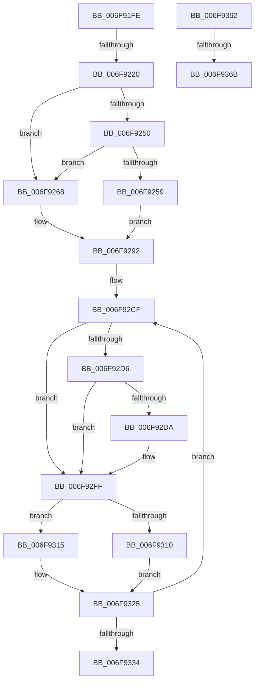

# sub_006F91FE

- RVA: `0x006F91FE`–`0x006F937E` (길이 `384` bytes)
- VA: `0x00000001406F91FE`
- 실행 섹션: `.text`
- PDB 이름 있음: `아니요`; PDB Function 태그: `아니요`
- unwind 정보 RVA: `0x000B64DC`
- 디코드: `95`개 명령, `384/384` bytes 표시
- 미해석 바이트: `0` (있으면 어셈블리에 `.byte`로 보존)

> 이 문서는 커널 이미지의 기계어와 PDB 기호를 분석해 생성했습니다. 4번과 5번은 함수 원형과 자료형을 바이너리 사용 방식에서 추정한 C 해석이며 원본 소스 복구 결과는 아닙니다.

## 1. Dependencies

- 직접 호출 지점: **8**; 고유 호출 대상: **8**
- 직접 호출자로 확인된 함수: **0**
- RIP 상대 이미지 참조: **1**

### Outgoing calls
- `0x006F9261` → [MiInsertLargeTbFlushEntry](../37/MiInsertLargeTbFlushEntry_function_0037827C.md) (function, `0x0037827C`)
- `0x006F928D` → [MiInsertTbFlushEntry](../29/MiInsertTbFlushEntry_function_00293670.md) (function, `0x00293670`)
- `0x006F92DD` → [MiGetLeafVa](../27/MiGetLeafVa_function_0027C0A0.md) (function, `0x0027C0A0`)
- `0x006F92F8` → [MiCaptureWriteWatchDirtyBit](../46/MiCaptureWriteWatchDirtyBit_function_00465224.md) (function, `0x00465224`)
- `0x006F9307` → [MiMakeTransitionPte](../36/MiMakeTransitionPte_function_00363F70.md) (function, `0x00363F70`)
- `0x006F9320` → [MiRewritePteWithLockBit](../32/MiRewritePteWithLockBit_function_00322FEC.md) (function, `0x00322FEC`)
- `0x006F9353` → [MiUpdatePfnProtection](../2C/MiUpdatePfnProtection_function_002C5AD0.md) (function, `0x002C5AD0`)
- `0x006F9371` → [MiUnlockVa](../40/MiUnlockVa_function_00407F24.md) (function, `0x00407F24`)

### Direct callers
- 이 함수 시작 RVA로 연결되는 직접 call은 확인되지 않았습니다. 간접 호출은 완전히 역산할 수 없습니다.

### Static image references
- `0x006F9201` → RVA `0x00000000` (`image boundary/outside`; read)

## 2. Other-region calls and transfers

- 다른 실행 섹션으로 향하는 call: **0**
- call이 아닌 외부 분기/꼬리 이동: **4**
  - `0x006F921A` → [MiMakeVaRangeNoAccess + 0x5B](../4A/MiMakeVaRangeNoAccess_function_004A3CE0.md) (`tail-transfer`)
  - `0x006F935D` → [MiMakeVaRangeNoAccess + 0xE7](../4A/MiMakeVaRangeNoAccess_function_004A3CE0.md) (`tail-transfer`)
  - `0x006F9365` → [MiMakeVaRangeNoAccess + 0x158](../4A/MiMakeVaRangeNoAccess_function_004A3CE0.md) (`tail-transfer`)
  - `0x006F9379` → [MiMakeVaRangeNoAccess + 0x158](../4A/MiMakeVaRangeNoAccess_function_004A3CE0.md) (`tail-transfer`)

## 3. Assembly (complete function range)

```asm
006F91FE  48 8B C2                        mov rax, rdx
006F9201  48 8D 35 F8 6D 90 FF            lea rsi, [rip - 0x6f9208]
006F9208  48 C1 E8 13                     shr rax, 0x13
006F920C  83 E0 03                        and eax, 3
006F920F  4C 8B 84 C6 78 45 01 00         mov r8, qword ptr [rsi + rax*8 + 0x14578]
006F9217  4D 3B C2                        cmp r8, r10
006F921A  0F 84 1B AB DA FF               je 0x1404a3d3b
006F9220  33 C9                           xor ecx, ecx
006F9222  41 B9 00 00 60 00               mov r9d, 0x600000
006F9228  41 23 D1                        and edx, r9d
006F922B  41 BD 10 00 00 00               mov r13d, 0x10
006F9231  41 3B D1                        cmp edx, r9d
006F9234  0F 94 C1                        sete cl
006F9237  4D 3B C5                        cmp r8, r13
006F923A  89 4C 24 30                     mov dword ptr [rsp + 0x30], ecx
006F923E  8B 8C 86 10 3F 01 00            mov ecx, dword ptr [rsi + rax*4 + 0x13f10]
006F9245  4D 0F 45 EA                     cmovne r13, r10
006F9249  33 DB                           xor ebx, ebx
006F924B  41 3B CA                        cmp ecx, r10d
006F924E  77 18                           ja 0x1406f9268
006F9250  BB 02 00 00 00                  mov ebx, 2
006F9255  2B D9                           sub ebx, ecx
006F9257  74 0F                           je 0x1406f9268
006F9259  4C 8B C7                        mov r8, rdi
006F925C  8B D3                           mov edx, ebx
006F925E  48 8B CD                        mov rcx, rbp
006F9261  E8 16 F0 C7 FF                  call 0x14037827c
006F9266  EB 2A                           jmp 0x1406f9292
006F9268  48 8B D7                        mov rdx, rdi
006F926B  48 B8 00 00 00 00 80 F6 FF FF   movabs rax, 0xfffff68000000000
006F9275  48 C1 E2 19                     shl rdx, 0x19
006F9279  48 8B C0                        mov rax, rax
006F927C  48 C1 E0 19                     shl rax, 0x19
006F9280  45 33 C9                        xor r9d, r9d
006F9283  48 2B D0                        sub rdx, rax
006F9286  48 8B CD                        mov rcx, rbp
006F9289  48 C1 FA 10                     sar rdx, 0x10
006F928D  E8 DE A3 B9 FF                  call 0x140293670
006F9292  48 8B 37                        mov rsi, qword ptr [rdi]
006F9295  48 B8 FF FF FF FF FF 00 00 00   movabs rax, 0xffffffffff
006F929F  48 C1 EE 0C                     shr rsi, 0xc
006F92A3  48 23 F0                        and rsi, rax
006F92A6  4C 8D 24 76                     lea r12, [rsi + rsi*2]
006F92AA  49 C1 E4 04                     shl r12, 4
006F92AE  48 B8 00 00 00 00 00 DE FF FF   movabs rax, 0xffffde0000000000
006F92B8  8B 6C 24 30                     mov ebp, dword ptr [rsp + 0x30]
006F92BC  4C 03 E0                        add r12, rax
006F92BF  4C 89 64 24 38                  mov qword ptr [rsp + 0x38], r12
006F92C4  45 33 FF                        xor r15d, r15d
006F92C7  4C 8B A4 24 80 00 00 00         mov r12, qword ptr [rsp + 0x80]
006F92CF  48 8B 07                        mov rax, qword ptr [rdi]
006F92D2  85 ED                           test ebp, ebp
006F92D4  74 29                           je 0x1406f92ff
006F92D6  A8 42                           test al, 0x42
006F92D8  74 25                           je 0x1406f92ff
006F92DA  48 8B CF                        mov rcx, rdi
006F92DD  E8 BE 2D B8 FF                  call 0x14027c0a0
006F92E2  65 48 8B 0C 25 88 01 00 00      mov rcx, qword ptr gs:[0x188]
006F92EB  48 8B D0                        mov rdx, rax
006F92EE  4D 8B C4                        mov r8, r12
006F92F1  48 8B 89 B8 00 00 00            mov rcx, qword ptr [rcx + 0xb8]
006F92F8  E8 27 BF D6 FF                  call 0x140465224
006F92FD  33 ED                           xor ebp, ebp
006F92FF  BA 18 00 00 00                  mov edx, 0x18
006F9304  48 8B CE                        mov rcx, rsi
006F9307  E8 64 AC C6 FF                  call 0x140363f70
006F930C  85 DB                           test ebx, ebx
006F930E  75 05                           jne 0x1406f9315
006F9310  48 89 07                        mov qword ptr [rdi], rax
006F9313  EB 10                           jmp 0x1406f9325
006F9315  4C 8B C8                        mov r9, rax
006F9318  4C 8B C7                        mov r8, rdi
006F931B  33 D2                           xor edx, edx
006F931D  49 8B CE                        mov rcx, r14
006F9320  E8 C7 9C C2 FF                  call 0x140322fec
006F9325  48 83 C7 08                     add rdi, 8
006F9329  48 FF C6                        inc rsi
006F932C  49 FF C7                        inc r15
006F932F  4D 3B FD                        cmp r15, r13
006F9332  72 9B                           jb 0x1406f92cf
006F9334  48 8B AC 24 98 00 00 00         mov rbp, qword ptr [rsp + 0x98]
006F933C  41 B8 18 00 00 00               mov r8d, 0x18
006F9342  48 8B 54 24 38                  mov rdx, qword ptr [rsp + 0x38]
006F9347  48 8B 8C 24 80 00 00 00         mov rcx, qword ptr [rsp + 0x80]
006F934F  83 4D 14 01                     or dword ptr [rbp + 0x14], 1
006F9353  E8 78 C7 BC FF                  call 0x1402c5ad0
006F9358  B8 01 00 00 00                  mov eax, 1
006F935D  E9 65 AA DA FF                  jmp 0x1404a3dc7
006F9362  45 84 E4                        test r12b, r12b
006F9365  0F 84 CD AA DA FF               je 0x1404a3e38
006F936B  48 8B D5                        mov rdx, rbp
006F936E  49 8B CE                        mov rcx, r14
006F9371  E8 AE EB D0 FF                  call 0x140407f24
006F9376  45 32 E4                        xor r12b, r12b
006F9379  E9 BA AA DA FF                  jmp 0x1404a3e38
```

## 4. C-style interpretation (structured pseudocode)

```c
__int64 __fastcall sub_006F91FE(int a1, __int64 a2, __int64 a3, __int64 a4, __int64 a5, unsigned int a6, __int64 a7, __int64 a8, __int64 a9, __int64 a10, __int64 a11, __int64 a12, __int64 a13, __int64 a14, __int64 a15, __int64 a16, __int64 a17, __int64 a18, __int64 a19)
{
    __int64 result;
    __int64 v_r12;
    __int64 v_r13;
    __int64 v_r15;
    __int64 v_rbp;
    __int64 v_rbx;
    __int64 v_rdi;
    __int64 v_rsi;
    unsigned int v_stack_p30;
    unsigned __int64 v_stack_p38;

    result = (a2) >> (19);
    result = (unsigned int)((result) & (3));
    a1 = 0;
    a2 = (unsigned int)((a2) & ((unsigned int)((unsigned int)(0x600000ULL))));
    a1 = (((unsigned int)(a2)) == ((unsigned int)((unsigned int)(0x600000ULL)))) ? 1 : 0;
    v_stack_p30 = a1;
    v_r13 = 16;
    if ((*(unsigned __int64 *)(v_rip - 7311880 + result * 8 + 83320)) != 16) { v_r13 = v_r10; }
    v_rbx = 0;
    if (((unsigned int)((unsigned int)(*(unsigned int *)(v_rip - 7311880 + result * 4 + 81680)))) > ((unsigned int)(v_r10))) goto loc_006F9268;
    v_rbx = (unsigned int)((2) - ((unsigned int)((unsigned int)(*(unsigned int *)(v_rip - 7311880 + result * 4 + 81680)))));
    if (condition_is_equal) goto loc_006F9268;
    result = MiInsertLargeTbFlushEntry(v_rbp, (unsigned int)((unsigned int)(v_rbx)), v_rdi, (unsigned int)(0x600000ULL));
    goto loc_006F9292;
loc_006F9268:
    a2 = (v_rdi) << (25);
    result = (result) << (25);
    a4 = 0;
    a2 = (a2) - (result);
    a2 = (a2) >> (16);
    result = MiInsertTbFlushEntry(v_rbp, a2, v_rdi, a4);
loc_006F9292:
    v_rsi = (*(unsigned __int64 *)(v_rdi)) >> (12);
    v_rsi = (v_rsi) & (result);
    v_r12 = (v_rsi + v_rsi * 2) << (4);
    v_r12 = (v_r12) + (result);
    v_stack_p38 = v_r12;
    v_r15 = 0;
loc_006F92CF:
    if ((unsigned int)((unsigned int)(a6)) == 0) goto loc_006F92FF;
    result = *(unsigned __int64 *)(v_rdi);
    v_rbp = (unsigned int)(a6);
    if ((((unsigned __int8)(*(unsigned __int64 *)(v_rdi))) & (66)) != 0) {
        a1 = v_rdi;
        result = MiGetLeafVa(a1, a2, v_rdi, a4);
        a1 = *(unsigned __int64 *)(gs_base + (0 + 392));
        a2 = result;
        a3 = a16;
        a1 = *(unsigned __int64 *)(a1 + 184);
        result = MiCaptureWriteWatchDirtyBit(a1, a2, a3, a4);
        v_rbp = 0;
    }
    result = MiMakeTransitionPte(v_rsi, 24, a3, a4);
    if ((unsigned int)(v_rbx) != 0) goto loc_006F9315;
    *(unsigned __int64 *)(v_rdi) = result;
    goto loc_006F9325;
loc_006F9315:
    a2 = 0;
    result = MiRewritePteWithLockBit(v_r14, a2, v_rdi, result);
loc_006F9325:
    v_rdi = (v_rdi) + (8);
    v_rsi = (v_rsi) + 1;
    v_r15 = (v_r15) + 1;
    if (v_r15 < v_r13) goto loc_006F92CF;
    result = MiUpdatePfnProtection(a16, a7, 24, result);
}
```

## 5. (Beta) C Style

```c
int64_t sub_006F91FE(int32_t Arg1, int64_t Arg2, int64_t Arg3, int64_t Arg4, uint64_t Arg5, uint32_t Arg6, int64_t Arg7, uint64_t Arg8, uint64_t Arg9, uint64_t Arg10, uint64_t Arg11, uint64_t Arg12, uint64_t Arg13, uint64_t Arg14, uint64_t Arg15, int64_t Arg16, uint64_t Arg17, uint64_t Arg18, void *Arg19)
{
    uint8_t *arg19 = (uint8_t *)Arg19;

    int64_t result;
    int64_t local_r12;
    int64_t local_r13;
    int64_t local_r15;
    int64_t local_rbp;
    int64_t local_rbx;
    int64_t local_rdi;
    int64_t local_rsi;
    uint32_t v_stack_p30;
    uint64_t v_stack_p38;

    result = (Arg2) >> (19);
    result = (uint32_t)((result) & (3));
    Arg1 = 0;
    Arg2 = (uint32_t)((Arg2) & ((uint32_t)((uint32_t)(0x600000ULL))));
    Arg1 = (((uint32_t)(Arg2)) == ((uint32_t)((uint32_t)(0x600000ULL)))) ? 1 : 0;
    v_stack_p30 = Arg1;
    local_r13 = 16;
    if ((*(uint64_t *)(v_rip - 0x6F9208 + result * 8 + 0x14578)) != 16) { local_r13 = local_r10; }
    local_rbx = 0;
    if (((uint32_t)((uint32_t)(*(uint32_t *)(v_rip - 0x6F9208 + result * 4 + 0x13F10)))) > ((uint32_t)(local_r10))) goto loc_006F9268;
    local_rbx = (uint32_t)((2) - ((uint32_t)((uint32_t)(*(uint32_t *)(v_rip - 0x6F9208 + result * 4 + 0x13F10)))));
    if (condition_is_equal) goto loc_006F9268;
    result = MiInsertLargeTbFlushEntry(local_rbp, (uint32_t)((uint32_t)(local_rbx)), local_rdi, (uint32_t)(0x600000ULL));
    goto loc_006F9292;
loc_006F9268:
    Arg2 = (local_rdi) << (25);
    result = (result) << (25);
    Arg4 = 0;
    Arg2 = (Arg2) - (result);
    Arg2 = (Arg2) >> (16);
    result = MiInsertTbFlushEntry(local_rbp, Arg2, local_rdi, Arg4);
loc_006F9292:
    local_rsi = (*(uint64_t *)(local_rdi)) >> (12);
    local_rsi = (local_rsi) & (result);
    local_r12 = (local_rsi + local_rsi * 2) << (4);
    local_r12 = (local_r12) + (result);
    v_stack_p38 = local_r12;
    local_r15 = 0;
loc_006F92CF:
    if ((uint32_t)((uint32_t)(Arg6)) == 0) goto loc_006F92FF;
    result = *(uint64_t *)(local_rdi);
    local_rbp = (uint32_t)(Arg6);
    if ((((uint8_t)(*(uint64_t *)(local_rdi))) & (66)) != 0) {
        Arg1 = local_rdi;
        result = MiGetLeafVa(Arg1, Arg2, local_rdi, Arg4);
        Arg1 = *(uint64_t *)(gs_base + (0 + 0x188));
        Arg2 = result;
        Arg3 = Arg16;
        Arg1 = *(uint64_t *)(Arg1 + 0xB8);
        result = MiCaptureWriteWatchDirtyBit(Arg1, Arg2, Arg3, Arg4);
        local_rbp = 0;
    }
    result = MiMakeTransitionPte(local_rsi, 24, Arg3, Arg4);
    if ((uint32_t)(local_rbx) != 0) goto loc_006F9315;
    *(uint64_t *)(local_rdi) = result;
    goto loc_006F9325;
loc_006F9315:
    Arg2 = 0;
    result = MiRewritePteWithLockBit(local_r14, Arg2, local_rdi, result);
loc_006F9325:
    local_rdi = (local_rdi) + (8);
    local_rsi = (local_rsi) + 1;
    local_r15 = (local_r15) + 1;
    if (local_r15 < local_r13) goto loc_006F92CF;
    result = MiUpdatePfnProtection(Arg16, Arg7, 24, result);
}
```

### 관측된 메모리 오프셋

구조체 형식이 확인되지 않은 접근은 인자 기준의 오프셋으로만 기록했습니다.

| 기준 인자 | 오프셋 표현 | 폭 (bit) | 접근 |
|---|---:|---:|---|
| `Arg19` | `+ 0x14` | `32` | `R/W` |

## 6. Execution-region graph

[열기: 2D/3D 그래프와 함수 탐색 컨트롤 패널](../../../control-panel.html?section=text&rva=0x006F91FE&view=graph)

- 2D 그래프는 위에서 아래로 흐르고, 3D 그래프는 빈 공간을 드래그해 회전합니다. Shift+드래그는 이동, 휠은 확대·축소, 함수 노드 선택은 대상 보고서 이동입니다.

### Static fallback


