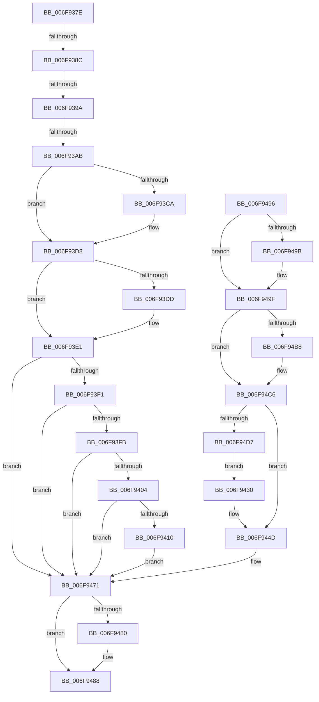

# sub_006F937E

- RVA: `0x006F937E`–`0x006F94DC` (길이 `350` bytes)
- VA: `0x00000001406F937E`
- 실행 섹션: `.text`
- PDB 이름 있음: `아니요`; PDB Function 태그: `아니요`
- unwind 정보 RVA: `0x000B6580`
- 디코드: `77`개 명령, `350/350` bytes 표시
- 미해석 바이트: `0` (있으면 어셈블리에 `.byte`로 보존)

> 이 문서는 커널 이미지의 기계어와 PDB 기호를 분석해 생성했습니다. 4번과 5번은 함수 원형과 자료형을 바이너리 사용 방식에서 추정한 C 해석이며 원본 소스 복구 결과는 아닙니다.

## 1. Dependencies

- 직접 호출 지점: **10**; 고유 호출 대상: **9**
- 직접 호출자로 확인된 함수: **0**
- RIP 상대 이미지 참조: **0**

### Outgoing calls
- `0x006F93BA` → [KeAbPreAcquire](../21/KeAbPreAcquire_function_00210230.md) (function, `0x00210230`)
- `0x006F93D3` → [ExfAcquirePushLockExclusiveEx](../20/ExfAcquirePushLockExclusiveEx_function_0020FC90.md) (function, `0x0020FC90`)
- `0x006F93E4` → [CcIsWriteBehindThreadpoolAtLowPriority](../35/CcIsWriteBehindThreadpoolAtLowPriority_function_003570DC.md) (function, `0x003570DC`)
- `0x006F9423` → [PsSetIoPriorityThread](../3C/PsSetIoPriorityThread_function_003C3FBC.md) (function, `0x003C3FBC`)
- `0x006F943B` → [PsBoostThreadIoEx](../39/PsBoostThreadIoEx_function_00392C00.md) (function, `0x00392C00`)
- `0x006F9448` → [CcUpdateSharedCacheMapFlag](../45/CcUpdateSharedCacheMapFlag_function_0045EC14.md) (function, `0x0045EC14`)
- `0x006F9483` → [ExfTryToWakePushLock](../26/ExfTryToWakePushLock_function_00265DD0.md) (function, `0x00265DD0`)
- `0x006F948B` → [KeAbPostRelease](../2E/KeAbPostRelease_function_002E1600.md) (function, `0x002E1600`)
- `0x006F94A8` → [PsSetIoPriorityThread](../3C/PsSetIoPriorityThread_function_003C3FBC.md) (function, `0x003C3FBC`)
- `0x006F94C1` → [KeSetPriorityThread](../2C/KeSetPriorityThread_function_002C76E0.md) (function, `0x002C76E0`)

### Direct callers
- 이 함수 시작 RVA로 연결되는 직접 call은 확인되지 않았습니다. 간접 호출은 완전히 역산할 수 없습니다.

### Static image references
- 디코드된 RIP-relative 메모리 참조가 없습니다.

## 2. Other-region calls and transfers

- 다른 실행 섹션으로 향하는 call: **0**
- call이 아닌 외부 분기/꼬리 이동: **4**
  - `0x006F9386` → [CcApplyLowIoPriorityToThread + 0x3D](../4A/CcApplyLowIoPriorityToThread_function_004A4210.md) (`tail-transfer`)
  - `0x006F9394` → [CcApplyLowIoPriorityToThread + 0x3D](../4A/CcApplyLowIoPriorityToThread_function_004A4210.md) (`tail-transfer`)
  - `0x006F93A5` → [CcApplyLowIoPriorityToThread + 0x3D](../4A/CcApplyLowIoPriorityToThread_function_004A4210.md) (`tail-transfer`)
  - `0x006F9491` → [CcApplyLowIoPriorityToThread + 0x3D](../4A/CcApplyLowIoPriorityToThread_function_004A4210.md) (`tail-transfer`)

## 3. Assembly (complete function range)

```asm
006F937E  48 83 B9 E8 04 00 00 00         cmp qword ptr [rcx + 0x4e8], 0
006F9386  0F 85 C1 AE DA FF               jne 0x1404a424d
006F938C  41 83 B8 0C 02 00 00 00         cmp dword ptr [r8 + 0x20c], 0
006F9394  0F 85 B3 AE DA FF               jne 0x1404a424d
006F939A  41 F7 80 98 00 00 00 00 00 01 00  test dword ptr [r8 + 0x98], 0x10000
006F93A5  0F 85 A2 AE DA FF               jne 0x1404a424d
006F93AB  48 8D B9 00 05 00 00            lea rdi, [rcx + 0x500]
006F93B2  45 33 C0                        xor r8d, r8d
006F93B5  48 8B CF                        mov rcx, rdi
006F93B8  33 D2                           xor edx, edx
006F93BA  E8 71 6E B1 FF                  call 0x140210230
006F93BF  F0 48 0F BA 2F 00               lock bts qword ptr [rdi], 0
006F93C5  48 8B E8                        mov rbp, rax
006F93C8  73 0E                           jae 0x1406f93d8
006F93CA  4C 8B C7                        mov r8, rdi
006F93CD  48 8B D0                        mov rdx, rax
006F93D0  48 8B CF                        mov rcx, rdi
006F93D3  E8 B8 68 B1 FF                  call 0x14020fc90
006F93D8  48 85 ED                        test rbp, rbp
006F93DB  74 04                           je 0x1406f93e1
006F93DD  C6 45 0A 01                     mov byte ptr [rbp + 0xa], 1
006F93E1  48 8B CB                        mov rcx, rbx
006F93E4  E8 F3 DC C5 FF                  call 0x1403570dc
006F93E9  84 C0                           test al, al
006F93EB  0F 84 80 00 00 00               je 0x1406f9471
006F93F1  48 83 BB E8 04 00 00 00         cmp qword ptr [rbx + 0x4e8], 0
006F93F9  75 76                           jne 0x1406f9471
006F93FB  83 BE 0C 02 00 00 00            cmp dword ptr [rsi + 0x20c], 0
006F9402  75 6D                           jne 0x1406f9471
006F9404  F7 86 98 00 00 00 00 00 01 00   test dword ptr [rsi + 0x98], 0x10000
006F940E  75 61                           jne 0x1406f9471
006F9410  33 D2                           xor edx, edx
006F9412  4C 89 B3 E8 04 00 00            mov qword ptr [rbx + 0x4e8], r14
006F9419  49 8B CE                        mov rcx, r14
006F941C  48 89 B3 F0 04 00 00            mov qword ptr [rbx + 0x4f0], rsi
006F9423  E8 94 AB CC FF                  call 0x1403c3fbc
006F9428  89 83 FC 04 00 00               mov dword ptr [rbx + 0x4fc], eax
006F942E  EB 41                           jmp 0x1406f9471
006F9430  45 33 C9                        xor r9d, r9d
006F9433  45 33 C0                        xor r8d, r8d
006F9436  B2 01                           mov dl, 1
006F9438  49 8B CE                        mov rcx, r14
006F943B  E8 C0 97 C9 FF                  call 0x140392c00
006F9440  45 33 C0                        xor r8d, r8d
006F9443  8B D5                           mov edx, ebp
006F9445  48 8B CE                        mov rcx, rsi
006F9448  E8 C7 57 D6 FF                  call 0x14045ec14
006F944D  48 83 A3 E8 04 00 00 00         and qword ptr [rbx + 0x4e8], 0
006F9455  48 83 A3 F0 04 00 00 00         and qword ptr [rbx + 0x4f0], 0
006F945D  C7 83 FC 04 00 00 05 00 00 00   mov dword ptr [rbx + 0x4fc], 5
006F9467  C7 83 F8 04 00 00 20 00 00 00   mov dword ptr [rbx + 0x4f8], 0x20
006F9471  48 83 C8 FF                     or rax, 0xffffffffffffffff
006F9475  F0 48 0F C1 07                  lock xadd qword ptr [rdi], rax
006F947A  24 06                           and al, 6
006F947C  3C 02                           cmp al, 2
006F947E  75 08                           jne 0x1406f9488
006F9480  48 8B CF                        mov rcx, rdi
006F9483  E8 48 C9 B6 FF                  call 0x140265dd0
006F9488  48 8B CF                        mov rcx, rdi
006F948B  E8 70 81 BE FF                  call 0x1402e1600
006F9490  90                              nop
006F9491  E9 B7 AD DA FF                  jmp 0x1404a424d
006F9496  48 85 ED                        test rbp, rbp
006F9499  74 04                           je 0x1406f949f
006F949B  C6 45 0A 01                     mov byte ptr [rbp + 0xa], 1
006F949F  8B 93 FC 04 00 00               mov edx, dword ptr [rbx + 0x4fc]
006F94A5  49 8B CE                        mov rcx, r14
006F94A8  E8 0F AB CC FF                  call 0x1403c3fbc
006F94AD  8B 93 F8 04 00 00               mov edx, dword ptr [rbx + 0x4f8]
006F94B3  83 FA 20                        cmp edx, 0x20
006F94B6  74 0E                           je 0x1406f94c6
006F94B8  65 48 8B 0C 25 88 01 00 00      mov rcx, qword ptr gs:[0x188]
006F94C1  E8 1A E2 BC FF                  call 0x1402c76e0
006F94C6  BD 00 00 00 20                  mov ebp, 0x20000000
006F94CB  85 AE 98 00 00 00               test dword ptr [rsi + 0x98], ebp
006F94D1  0F 84 76 FF FF FF               je 0x1406f944d
006F94D7  E9 54 FF FF FF                  jmp 0x1406f9430
```

## 4. C-style interpretation (structured pseudocode)

```c
__int64 __fastcall sub_006F937E(__int64 a1, int a2, __int64 a3, int a4)
{
    __int64 result;

    a3 = 0;
    a2 = 0;
    result = KeAbPreAcquire(a1 + 1280, a2, a3, a4);
    if (!(condition_is_above_or_equal)) {
        a3 = a1 + 1280;
        a2 = result;
        a1 = a1 + 1280;
        result = ExfAcquirePushLockExclusiveEx(a1, a2, a3, a4);
    }
    if (result != 0) {
        *(unsigned __int8 *)(result + 10) = 1;
    }
    result = CcIsWriteBehindThreadpoolAtLowPriority(v_rbx, a2, a3, a4);
    if ((unsigned __int8)(result) == 0) goto loc_006F9471;
    if ((*(unsigned __int64 *)(v_rbx + 1256)) != 0) goto loc_006F9471;
    if ((*(unsigned int *)(v_rsi + 524)) != 0) goto loc_006F9471;
    if (((*(unsigned int *)(v_rsi + 152)) & (0x10000ULL)) != 0) goto loc_006F9471;
    a2 = 0;
    *(unsigned __int64 *)(v_rbx + 1256) = v_r14;
    *(unsigned __int64 *)(v_rbx + 1264) = v_rsi;
    result = PsSetIoPriorityThread(v_r14, a2, a3, a4);
    *(unsigned int *)(v_rbx + 1276) = (unsigned int)(result);
    goto loc_006F9471;
loc_006F9471:
    result = (result) | (-1);
    result = (unsigned __int8)((result) & (6));
    if (((unsigned __int8)(result)) == 2) {
        a1 = a1 + 1280;
        result = ExfTryToWakePushLock(a1, a2, a3, a4);
    }
    result = KeAbPostRelease(a1 + 1280, a2, a3, a4);
}
```

## 5. (Beta) C Style

```c
int64_t sub_006F937E(void *Arg1, int32_t Arg2, void *Arg3, int32_t Arg4)
{
    uint8_t *arg1 = (uint8_t *)Arg1;
    uint8_t *arg3 = (uint8_t *)Arg3;

    int64_t result;

    Arg3 = 0;
    Arg2 = 0;
    result = KeAbPreAcquire(Arg1 + 1280, Arg2, Arg3, Arg4);
    if (!(condition_is_above_or_equal)) {
        Arg3 = Arg1 + 1280;
        Arg2 = result;
        Arg1 = Arg1 + 1280;
        result = ExfAcquirePushLockExclusiveEx(Arg1, Arg2, Arg3, Arg4);
    }
    if (result != 0) {
        *(uint8_t *)(result + 0xA) = 1;
    }
    result = CcIsWriteBehindThreadpoolAtLowPriority(local_rbx, Arg2, Arg3, Arg4);
    if ((uint8_t)(result) == 0) goto loc_006F9471;
    if ((*(uint64_t *)(local_rbx + 0x4E8)) != 0) goto loc_006F9471;
    if ((*(uint32_t *)(local_rsi + 0x20C)) != 0) goto loc_006F9471;
    if (((*(uint32_t *)(local_rsi + 0x98)) & (0x10000ULL)) != 0) goto loc_006F9471;
    Arg2 = 0;
    *(uint64_t *)(local_rbx + 0x4E8) = local_r14;
    *(uint64_t *)(local_rbx + 0x4F0) = local_rsi;
    result = PsSetIoPriorityThread(local_r14, Arg2, Arg3, Arg4);
    *(uint32_t *)(local_rbx + 0x4FC) = (uint32_t)(result);
    goto loc_006F9471;
loc_006F9471:
    result = (result) | (-1);
    result = (uint8_t)((result) & (6));
    if (((uint8_t)(result)) == 2) {
        Arg1 = Arg1 + 1280;
        result = ExfTryToWakePushLock(Arg1, Arg2, Arg3, Arg4);
    }
    result = KeAbPostRelease(Arg1 + 1280, Arg2, Arg3, Arg4);
}
```

### 관측된 메모리 오프셋

구조체 형식이 확인되지 않은 접근은 인자 기준의 오프셋으로만 기록했습니다.

| 기준 인자 | 오프셋 표현 | 폭 (bit) | 접근 |
|---|---:|---:|---|
| `Arg1` | `+ 0x0` | `64` | `R/W` |
| `Arg1` | `+ 0x4E8` | `64` | `R` |
| `Arg1` | `+ 0x500` | `64` | `R` |
| `Arg3` | `+ 0x98` | `32` | `R` |
| `Arg3` | `+ 0x20C` | `32` | `R` |

## 6. Execution-region graph

[열기: 2D/3D 그래프와 함수 탐색 컨트롤 패널](../../../control-panel.html?section=text&rva=0x006F937E&view=graph)

- 2D 그래프는 위에서 아래로 흐르고, 3D 그래프는 빈 공간을 드래그해 회전합니다. Shift+드래그는 이동, 휠은 확대·축소, 함수 노드 선택은 대상 보고서 이동입니다.

### Static fallback


