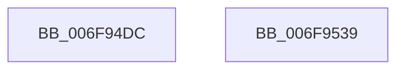

# sub_006F94DC

- RVA: `0x006F94DC`–`0x006F953A` (길이 `94` bytes)
- VA: `0x00000001406F94DC`
- 실행 섹션: `.text`
- PDB 이름 있음: `아니요`; PDB Function 태그: `아니요`
- unwind 정보 RVA: `0x000B6840`
- 디코드: `24`개 명령, `94/94` bytes 표시
- 미해석 바이트: `0` (있으면 어셈블리에 `.byte`로 보존)

> 이 문서는 커널 이미지의 기계어와 PDB 기호를 분석해 생성했습니다. 4번과 5번은 함수 원형과 자료형을 바이너리 사용 방식에서 추정한 C 해석이며 원본 소스 복구 결과는 아닙니다.

## 1. Dependencies

- 직접 호출 지점: **2**; 고유 호출 대상: **2**
- 직접 호출자로 확인된 함수: **0**
- RIP 상대 이미지 참조: **0**

### Outgoing calls
- `0x006F94EF` → [KeAcquireInStackQueuedSpinLock](../27/KeAcquireInStackQueuedSpinLock_function_002757A0.md) (function, `0x002757A0`)
- `0x006F9524` → [KeReleaseInStackQueuedSpinLock](../34/KeReleaseInStackQueuedSpinLock_function_00342CE0.md) (function, `0x00342CE0`)

### Direct callers
- 이 함수 시작 RVA로 연결되는 직접 call은 확인되지 않았습니다. 간접 호출은 완전히 역산할 수 없습니다.

### Static image references
- 디코드된 RIP-relative 메모리 참조가 없습니다.

## 2. Other-region calls and transfers

- 다른 실행 섹션으로 향하는 call: **0**
- 별도 외부 분기/꼬리 이동을 확인하지 못했습니다.

## 3. Assembly (complete function range)

```asm
006F94DC  48 8B 8B 18 02 00 00            mov rcx, qword ptr [rbx + 0x218]
006F94E3  48 8D 54 24 30                  lea rdx, [rsp + 0x30]
006F94E8  48 81 C1 00 03 00 00            add rcx, 0x300
006F94EF  E8 AC C2 B7 FF                  call 0x1402757a0
006F94F4  8B 8B 98 00 00 00               mov ecx, dword ptr [rbx + 0x98]
006F94FA  8B C1                           mov eax, ecx
006F94FC  83 C9 01                        or ecx, 1
006F94FF  83 E0 FE                        and eax, 0xfffffffe
006F9502  40 84 F6                        test sil, sil
006F9505  0F 44 C8                        cmove ecx, eax
006F9508  8B C1                           mov eax, ecx
006F950A  81 C9 02 02 00 00               or ecx, 0x202
006F9510  83 E0 FD                        and eax, 0xfffffffd
006F9513  40 84 FF                        test dil, dil
006F9516  0F 44 C8                        cmove ecx, eax
006F9519  89 8B 98 00 00 00               mov dword ptr [rbx + 0x98], ecx
006F951F  48 8D 4C 24 30                  lea rcx, [rsp + 0x30]
006F9524  E8 B7 97 C4 FF                  call 0x140342ce0
006F9529  48 8B 5C 24 60                  mov rbx, qword ptr [rsp + 0x60]
006F952E  48 8B 74 24 68                  mov rsi, qword ptr [rsp + 0x68]
006F9533  48 83 C4 50                     add rsp, 0x50
006F9537  5F                              pop rdi
006F9538  C3                              ret
006F9539  CC                              int3
```

## 4. C-style interpretation (structured pseudocode)

```c
__int64 __fastcall sub_006F94DC(__int64 a1, __int64 a2, __int64 a3, __int64 a4, __int64 a5, __int64 a6, __int64 a7, __int64 a8, __int64 a9, __int64 a10, __int64 a11, __int64 a12, __int64 a13)
{
    __int64 result;
    __int64 v_rsp;

    a1 = (*(unsigned __int64 *)(v_rbx + 536)) + (768);
    result = KeAcquireInStackQueuedSpinLock(a1, a6, a3, a4);
    a1 = (unsigned int)(((unsigned int)(*(unsigned int *)(v_rbx + 152))) | (1));
    result = (unsigned int)(((unsigned int)((unsigned int)((unsigned int)(*(unsigned int *)(v_rbx + 152))))) & (0xFFFFFFFEULL));
    if ((unsigned __int8)(v_rsi) == 0) { a1 = (unsigned int)(result); }
    a1 = (unsigned int)((a1) | (514));
    result = (unsigned int)(((unsigned int)((unsigned int)(a1))) & (0xFFFFFFFDULL));
    if ((unsigned __int8)(v_rdi) == 0) { a1 = (unsigned int)(result); }
    *(unsigned int *)(v_rbx + 152) = (unsigned int)(a1);
    result = KeReleaseInStackQueuedSpinLock(a6, a6, a3, a4);
    v_rsp = (v_rsp) + (80);
    return result;
}
```

## 5. (Beta) C Style

```c
int64_t sub_006F94DC(int64_t Arg1, int64_t Arg2, int64_t Arg3, int64_t Arg4, uint64_t Arg5, int64_t Arg6, uint64_t Arg7, uint64_t Arg8, uint64_t Arg9, uint64_t Arg10, uint64_t Arg11, int64_t Arg12, int64_t Arg13)
{
    int64_t result;
    int64_t local_rsp;

    Arg1 = (*(uint64_t *)(local_rbx + 0x218)) + (768);
    result = KeAcquireInStackQueuedSpinLock(Arg1, Arg6, Arg3, Arg4);
    Arg1 = (uint32_t)(((uint32_t)(*(uint32_t *)(local_rbx + 0x98))) | (1));
    result = (uint32_t)(((uint32_t)((uint32_t)((uint32_t)(*(uint32_t *)(local_rbx + 0x98))))) & (0xFFFFFFFEULL));
    if ((uint8_t)(local_rsi) == 0) { Arg1 = (uint32_t)(result); }
    Arg1 = (uint32_t)((Arg1) | (514));
    result = (uint32_t)(((uint32_t)((uint32_t)(Arg1))) & (0xFFFFFFFDULL));
    if ((uint8_t)(local_rdi) == 0) { Arg1 = (uint32_t)(result); }
    *(uint32_t *)(local_rbx + 0x98) = (uint32_t)(Arg1);
    result = KeReleaseInStackQueuedSpinLock(Arg6, Arg6, Arg3, Arg4);
    local_rsp = (local_rsp) + (80);
    return result;
}
```

## 6. Execution-region graph

[열기: 2D/3D 그래프와 함수 탐색 컨트롤 패널](../../../control-panel.html?section=text&rva=0x006F94DC&view=graph)

- 2D 그래프는 위에서 아래로 흐르고, 3D 그래프는 빈 공간을 드래그해 회전합니다. Shift+드래그는 이동, 휠은 확대·축소, 함수 노드 선택은 대상 보고서 이동입니다.

### Static fallback


