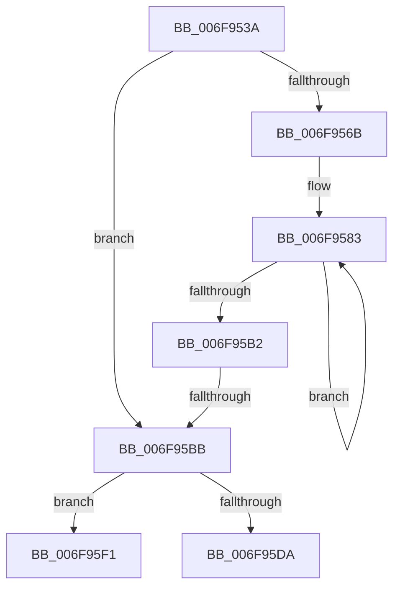

# sub_006F953A

- RVA: `0x006F953A`–`0x006F962D` (길이 `243` bytes)
- VA: `0x00000001406F953A`
- 실행 섹션: `.text`
- PDB 이름 있음: `아니요`; PDB Function 태그: `아니요`
- unwind 정보 RVA: `0x000B6870`
- 디코드: `71`개 명령, `243/243` bytes 표시
- 미해석 바이트: `0` (있으면 어셈블리에 `.byte`로 보존)

> 이 문서는 커널 이미지의 기계어와 PDB 기호를 분석해 생성했습니다. 4번과 5번은 함수 원형과 자료형을 바이너리 사용 방식에서 추정한 C 해석이며 원본 소스 복구 결과는 아닙니다.

## 1. Dependencies

- 직접 호출 지점: **0**; 고유 호출 대상: **0**
- 직접 호출자로 확인된 함수: **0**
- RIP 상대 이미지 참조: **0**

### Outgoing calls
- 직접 디코드된 call 명령이 없습니다.

### Direct callers
- 이 함수 시작 RVA로 연결되는 직접 call은 확인되지 않았습니다. 간접 호출은 완전히 역산할 수 없습니다.

### Static image references
- 디코드된 RIP-relative 메모리 참조가 없습니다.

## 2. Other-region calls and transfers

- 다른 실행 섹션으로 향하는 call: **0**
- call이 아닌 외부 분기/꼬리 이동: **3**
  - `0x006F95B5` → [RtlExtractBitMapEx + 0x73](../4A/RtlExtractBitMapEx_function_004A5170.md) (`tail-transfer`)
  - `0x006F95EC` → [RtlExtractBitMapEx + 0x73](../4A/RtlExtractBitMapEx_function_004A5170.md) (`tail-transfer`)
  - `0x006F9628` → [RtlExtractBitMapEx + 0x73](../4A/RtlExtractBitMapEx_function_004A5170.md) (`tail-transfer`)

## 3. Assembly (complete function range)

```asm
006F953A  48 8B 41 08                     mov rax, qword ptr [rcx + 8]
006F953E  4D 8B D0                        mov r10, r8
006F9541  4C 8B 4A 08                     mov r9, qword ptr [rdx + 8]
006F9545  41 83 E2 3F                     and r10d, 0x3f
006F9549  49 C1 E8 06                     shr r8, 6
006F954D  41 8B CA                        mov ecx, r10d
006F9550  41 BB 40 00 00 00               mov r11d, 0x40
006F9556  BE 01 00 00 00                  mov esi, 1
006F955B  48 D3 E6                        shl rsi, cl
006F955E  4D 2B DA                        sub r11, r10
006F9561  4A 8D 3C C0                     lea rdi, [rax + r8*8]
006F9565  48 83 FB 40                     cmp rbx, 0x40
006F9569  72 50                           jb 0x1406f95bb
006F956B  4C 8B C3                        mov r8, rbx
006F956E  4C 8D 7E FF                     lea r15, [rsi - 1]
006F9572  49 C1 E8 06                     shr r8, 6
006F9576  4D 8B F7                        mov r14, r15
006F9579  49 6B C0 C0                     imul rax, r8, -0x40
006F957D  49 F7 D6                        not r14
006F9580  48 03 D8                        add rbx, rax
006F9583  48 8B 17                        mov rdx, qword ptr [rdi]
006F9586  49 8B CA                        mov rcx, r10
006F9589  49 23 D6                        and rdx, r14
006F958C  48 83 C7 08                     add rdi, 8
006F9590  48 D3 EA                        shr rdx, cl
006F9593  49 8B CB                        mov rcx, r11
006F9596  49 89 11                        mov qword ptr [r9], rdx
006F9599  48 8B 07                        mov rax, qword ptr [rdi]
006F959C  49 23 C7                        and rax, r15
006F959F  48 D3 E0                        shl rax, cl
006F95A2  48 0B C2                        or rax, rdx
006F95A5  49 89 01                        mov qword ptr [r9], rax
006F95A8  49 83 C1 08                     add r9, 8
006F95AC  49 83 E8 01                     sub r8, 1
006F95B0  75 D1                           jne 0x1406f9583
006F95B2  48 85 DB                        test rbx, rbx
006F95B5  0F 84 28 BC DA FF               je 0x1404a51e3
006F95BB  4C 8B 37                        mov r14, qword ptr [rdi]
006F95BE  48 8B CB                        mov rcx, rbx
006F95C1  B8 01 00 00 00                  mov eax, 1
006F95C6  48 D3 E0                        shl rax, cl
006F95C9  48 FF C8                        dec rax
006F95CC  4C 8B C0                        mov r8, rax
006F95CF  49 F7 D0                        not r8
006F95D2  4D 23 01                        and r8, qword ptr [r9]
006F95D5  49 3B DB                        cmp rbx, r11
006F95D8  77 17                           ja 0x1406f95f1
006F95DA  49 8B CA                        mov rcx, r10
006F95DD  48 D3 E0                        shl rax, cl
006F95E0  49 23 C6                        and rax, r14
006F95E3  48 D3 E8                        shr rax, cl
006F95E6  49 0B C0                        or rax, r8
006F95E9  49 89 01                        mov qword ptr [r9], rax
006F95EC  E9 F2 BB DA FF                  jmp 0x1404a51e3
006F95F1  41 8D 8A C0 00 00 00            lea ecx, [r10 + 0xc0]
006F95F8  BA 01 00 00 00                  mov edx, 1
006F95FD  02 CB                           add cl, bl
006F95FF  48 8D 46 FF                     lea rax, [rsi - 1]
006F9603  48 D3 E2                        shl rdx, cl
006F9606  48 F7 D0                        not rax
006F9609  48 FF CA                        dec rdx
006F960C  49 8B CB                        mov rcx, r11
006F960F  48 23 57 08                     and rdx, qword ptr [rdi + 8]
006F9613  49 23 C6                        and rax, r14
006F9616  48 D3 E2                        shl rdx, cl
006F9619  49 8B CA                        mov rcx, r10
006F961C  48 D3 E8                        shr rax, cl
006F961F  48 0B D0                        or rdx, rax
006F9622  4C 0B C2                        or r8, rdx
006F9625  4D 89 01                        mov qword ptr [r9], r8
006F9628  E9 B6 BB DA FF                  jmp 0x1404a51e3
```

## 4. C-style interpretation (structured pseudocode)

```c
__int64 __fastcall sub_006F953A(__int64 a1, __int64 a2, __int64 a3)
{
    __int64 result;
    __int64 v_r10;
    __int64 v_r11;
    __int64 v_r14;
    __int64 v_rbx;
    __int64 v_rdi;
    __int64 v_rsi;

    v_r10 = (unsigned int)((a3) & (63));
    a3 = (a3) >> (6);
    v_rsi = (1) << ((unsigned __int8)((unsigned int)((unsigned int)(v_r10))));
    v_r11 = (64) - (v_r10);
    if (v_rbx < 64) goto loc_006F95BB;
    a3 = (v_rbx) >> (6);
    result = (*(unsigned __int64 *)(a1 + 8)) * (a3);
    v_r14 = ~(v_rsi - 1);
    v_rbx = (v_rbx) + (result);
loc_006F9583:
    a2 = (*(unsigned __int64 *)(*(unsigned __int64 *)(a1 + 8) + a3 * 8)) & (v_r14);
    v_rdi = (*(unsigned __int64 *)(a1 + 8) + a3 * 8) + (8);
    a2 = (a2) >> ((unsigned __int8)(v_r10));
    *(unsigned __int64 *)(*(unsigned __int64 *)(a2 + 8)) = a2;
    result = (*(unsigned __int64 *)(v_rdi)) & (v_rsi - 1);
    result = (result) << ((unsigned __int8)(v_r11));
    result = (result) | (a2);
    *(unsigned __int64 *)(*(unsigned __int64 *)(a2 + 8)) = result;
    a4 = (*(unsigned __int64 *)(a2 + 8)) + (8);
    a3 = (a3) - (1);
    if (condition_is_not_equal) goto loc_006F9583;
loc_006F95BB:
    result = (1) << ((unsigned __int8)(v_rbx));
    result = (result) - 1;
    a3 = ~(result);
    a3 = (a3) & (*(unsigned __int64 *)(a4));
    if (v_rbx > v_r11) goto loc_006F95F1;
    result = (result) << ((unsigned __int8)(v_r10));
    result = (result) & (*(unsigned __int64 *)(v_rdi));
    result = (result) >> ((unsigned __int8)(v_r10));
    result = (result) | (a3);
    *(unsigned __int64 *)(a4) = result;
loc_006F95F1:
    a1 = (unsigned __int8)((v_r10 + 192) + ((unsigned __int8)(v_rbx)));
    a2 = (1) << ((unsigned __int8)(a1));
    result = ~(v_rsi - 1);
    a2 = (a2) - 1;
    a2 = (a2) & (*(unsigned __int64 *)(v_rdi + 8));
    result = (result) & (*(unsigned __int64 *)(v_rdi));
    a2 = (a2) << ((unsigned __int8)(v_r11));
    result = (result) >> ((unsigned __int8)(v_r10));
    a2 = (a2) | (result);
    a3 = (a3) | (a2);
    *(unsigned __int64 *)(a4) = a3;
}
```

## 5. (Beta) C Style

```c
int64_t sub_006F953A(void *Arg1, void *Arg2, void *Arg3)
{
    uint8_t *arg1 = (uint8_t *)Arg1;
    uint8_t *arg2 = (uint8_t *)Arg2;
    uint8_t *arg3 = (uint8_t *)Arg3;

    int64_t result;
    int64_t local_r10;
    int64_t local_r11;
    int64_t local_r14;
    int64_t local_rbx;
    int64_t local_rdi;
    int64_t local_rsi;

    local_r10 = (uint32_t)((Arg3) & (63));
    Arg3 = (Arg3) >> (6);
    local_rsi = (1) << ((uint8_t)((uint32_t)((uint32_t)(local_r10))));
    local_r11 = (64) - (local_r10);
    if (local_rbx < 64) goto loc_006F95BB;
    Arg3 = (local_rbx) >> (6);
    result = (*(uint64_t *)(arg1 + 0x8)) * (Arg3);
    local_r14 = ~(local_rsi - 1);
    local_rbx = (local_rbx) + (result);
loc_006F9583:
    Arg2 = (*(uint64_t *)(*(uint64_t *)(arg1 + 0x8) + arg3 * 8)) & (local_r14);
    local_rdi = (*(uint64_t *)(arg1 + 0x8) + Arg3 * 8) + (8);
    Arg2 = (Arg2) >> ((uint8_t)(local_r10));
    *(void **)(*(uint64_t *)(arg2 + 0x8)) = Arg2;
    result = (*(uint64_t *)(local_rdi)) & (local_rsi - 1);
    result = (result) << ((uint8_t)(local_r11));
    result = (result) | (Arg2);
    *(uint64_t *)(*(uint64_t *)(arg2 + 0x8)) = result;
    a4 = (*(uint64_t *)(arg2 + 0x8)) + (8);
    Arg3 = (Arg3) - (1);
    if (condition_is_not_equal) goto loc_006F9583;
loc_006F95BB:
    result = (1) << ((uint8_t)(local_rbx));
    result = (result) - 1;
    Arg3 = ~(result);
    Arg3 = (Arg3) & (*(uint64_t *)(a4));
    if (local_rbx > local_r11) goto loc_006F95F1;
    result = (result) << ((uint8_t)(local_r10));
    result = (result) & (*(uint64_t *)(local_rdi));
    result = (result) >> ((uint8_t)(local_r10));
    result = (result) | (Arg3);
    *(uint64_t *)(a4) = result;
loc_006F95F1:
    Arg1 = (uint8_t)((local_r10 + 192) + ((uint8_t)(local_rbx)));
    Arg2 = (1) << ((uint8_t)(Arg1));
    result = ~(local_rsi - 1);
    Arg2 = (Arg2) - 1;
    Arg2 = (Arg2) & (*(uint64_t *)(local_rdi + 0x8));
    result = (result) & (*(uint64_t *)(local_rdi));
    Arg2 = (Arg2) << ((uint8_t)(local_r11));
    result = (result) >> ((uint8_t)(local_r10));
    Arg2 = (Arg2) | (result);
    Arg3 = (Arg3) | (Arg2);
    *(void **)(a4) = Arg3;
}
```

### 관측된 메모리 오프셋

구조체 형식이 확인되지 않은 접근은 인자 기준의 오프셋으로만 기록했습니다.

| 기준 인자 | 오프셋 표현 | 폭 (bit) | 접근 |
|---|---:|---:|---|
| `Arg1` | `+ 0x8` | `64` | `R` |
| `Arg2` | `+ 0x8` | `64` | `R` |
| `Arg3` | `+ 0xC0` | `32` | `R` |

## 6. Execution-region graph

[열기: 2D/3D 그래프와 함수 탐색 컨트롤 패널](../../../control-panel.html?section=text&rva=0x006F953A&view=graph)

- 2D 그래프는 위에서 아래로 흐르고, 3D 그래프는 빈 공간을 드래그해 회전합니다. Shift+드래그는 이동, 휠은 확대·축소, 함수 노드 선택은 대상 보고서 이동입니다.

### Static fallback


