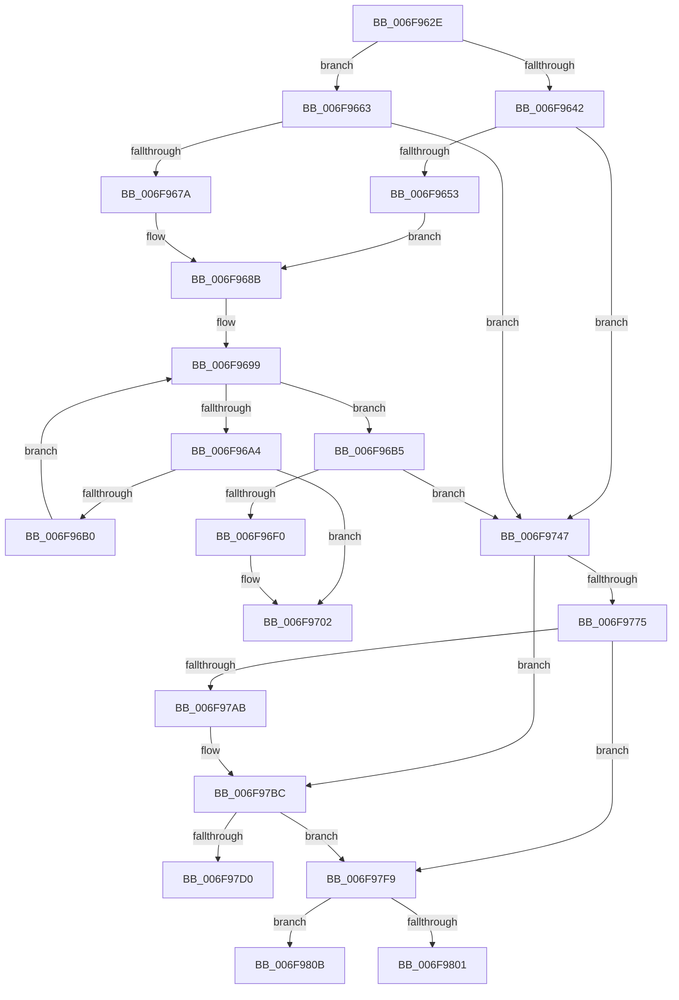

# sub_006F962E

- RVA: `0x006F962E`–`0x006F9815` (길이 `487` bytes)
- VA: `0x00000001406F962E`
- 실행 섹션: `.text`
- PDB 이름 있음: `아니요`; PDB Function 태그: `아니요`
- unwind 정보 RVA: `0x000B694C`
- 디코드: `107`개 명령, `487/487` bytes 표시
- 미해석 바이트: `0` (있으면 어셈블리에 `.byte`로 보존)

> 이 문서는 커널 이미지의 기계어와 PDB 기호를 분석해 생성했습니다. 4번과 5번은 함수 원형과 자료형을 바이너리 사용 방식에서 추정한 C 해석이며 원본 소스 복구 결과는 아닙니다.

## 1. Dependencies

- 직접 호출 지점: **8**; 고유 호출 대상: **5**
- 직접 호출자로 확인된 함수: **0**
- RIP 상대 이미지 참조: **6**

### Outgoing calls
- `0x006F96DE` → [memset](../6C/memset_function_006C6C40.md) (function, `0x006C6C40`)
- `0x006F9715` → [KeSubtractAffinityEx2](../2D/KeSubtractAffinityEx2_function_002D5BA0.md) (function, `0x002D5BA0`)
- `0x006F9736` → [memset](../6C/memset_function_006C6C40.md) (function, `0x006C6C40`)
- `0x006F976C` → [KeCheckProcessorAffinityEx](../30/KeCheckProcessorAffinityEx_function_00305150.md) (function, `0x00305150`)
- `0x006F97A0` → [guard_dispatch_icall](../6B/guard_dispatch_icall_function_006BAAD0.md) (function, `0x006BAAD0`)
- `0x006F97C7` → [KeCheckProcessorAffinityEx](../30/KeCheckProcessorAffinityEx_function_00305150.md) (function, `0x00305150`)
- `0x006F97DA` → [KeInterlockedSetProcessorAffinityEx](../35/KeInterlockedSetProcessorAffinityEx_function_00352560.md) (function, `0x00352560`)
- `0x006F97E7` → [KeInterlockedSetProcessorAffinityEx](../35/KeInterlockedSetProcessorAffinityEx_function_00352560.md) (function, `0x00352560`)

### Direct callers
- 이 함수 시작 RVA로 연결되는 직접 call은 확인되지 않았습니다. 간접 호출은 완전히 역산할 수 없습니다.

### Static image references
- `0x006F9663` → RVA `0x00F22D58` (`.data`; read)
- `0x006F966A` → RVA `0x00F22D50` (`.data`; read)
- `0x006F9684` → RVA `0x00F22D58` (`.data`; write)
- `0x006F968B` → RVA `0x00F22D60` (`.data`; read)
- `0x006F96FB` → RVA `0x00F22D60` (`.data`; write)
- `0x006F9775` → RVA `0x00E00CA8` (`.data`; read)

## 2. Other-region calls and transfers

- 다른 실행 섹션으로 향하는 call: **0**
- call이 아닌 외부 분기/꼬리 이동: **4**
  - `0x006F9742` → [KiStartProfileTarget + 0x4C](../4A/KiStartProfileTarget_function_004A53F0.md) (`tail-transfer`)
  - `0x006F97F4` → [KiStartProfileTarget + 0x65](../4A/KiStartProfileTarget_function_004A53F0.md) (`tail-transfer`)
  - `0x006F9806` → [KiStartProfileTarget + 0x65](../4A/KiStartProfileTarget_function_004A53F0.md) (`tail-transfer`)
  - `0x006F9810` → [KiStartProfileTarget + 0x65](../4A/KiStartProfileTarget_function_004A53F0.md) (`tail-transfer`)

## 3. Assembly (complete function range)

```asm
006F962E  48 8B 4F 18                     mov rcx, qword ptr [rdi + 0x18]
006F9632  48 8D 47 08                     lea rax, [rdi + 8]
006F9636  C6 87 62 02 00 00 01            mov byte ptr [rdi + 0x262], 1
006F963D  48 85 C9                        test rcx, rcx
006F9640  74 21                           je 0x1406f9663
006F9642  48 8B 51 20                     mov rdx, qword ptr [rcx + 0x20]
006F9646  48 83 C1 18                     add rcx, 0x18
006F964A  48 39 0A                        cmp qword ptr [rdx], rcx
006F964D  0F 85 F4 00 00 00               jne 0x1406f9747
006F9653  48 89 08                        mov qword ptr [rax], rcx
006F9656  48 89 50 08                     mov qword ptr [rax + 8], rdx
006F965A  48 89 02                        mov qword ptr [rdx], rax
006F965D  48 89 41 08                     mov qword ptr [rcx + 8], rax
006F9661  EB 28                           jmp 0x1406f968b
006F9663  48 8B 0D EE 96 82 00            mov rcx, qword ptr [rip + 0x8296ee]
006F966A  48 8D 15 DF 96 82 00            lea rdx, [rip + 0x8296df]
006F9671  48 39 11                        cmp qword ptr [rcx], rdx
006F9674  0F 85 CD 00 00 00               jne 0x1406f9747
006F967A  48 89 10                        mov qword ptr [rax], rdx
006F967D  48 89 48 08                     mov qword ptr [rax + 8], rcx
006F9681  48 89 01                        mov qword ptr [rcx], rax
006F9684  48 89 05 CD 96 82 00            mov qword ptr [rip + 0x8296cd], rax
006F968B  48 8B 35 CE 96 82 00            mov rsi, qword ptr [rip + 0x8296ce]
006F9692  48 8D 2D C7 96 82 00            lea rbp, [rip + 0x8296c7]
006F9699  41 BF 00 01 00 00               mov r15d, 0x100
006F969F  48 3B F5                        cmp rsi, rbp
006F96A2  74 11                           je 0x1406f96b5
006F96A4  0F BF 87 60 02 00 00            movsx eax, word ptr [rdi + 0x260]
006F96AB  39 46 10                        cmp dword ptr [rsi + 0x10], eax
006F96AE  74 52                           je 0x1406f9702
006F96B0  48 8B 36                        mov rsi, qword ptr [rsi]
006F96B3  EB E4                           jmp 0x1406f9699
006F96B5  48 8B B3 20 01 00 00            mov rsi, qword ptr [rbx + 0x120]
006F96BC  4D 8B C7                        mov r8, r15
006F96BF  4C 89 AB 20 01 00 00            mov qword ptr [rbx + 0x120], r13
006F96C6  33 D2                           xor edx, edx
006F96C8  0F BF 87 60 02 00 00            movsx eax, word ptr [rdi + 0x260]
006F96CF  89 46 10                        mov dword ptr [rsi + 0x10], eax
006F96D2  48 8D 4E 20                     lea rcx, [rsi + 0x20]
006F96D6  48 C7 46 18 20 00 20 00         mov qword ptr [rsi + 0x18], 0x200020
006F96DE  E8 5D D5 FC FF                  call 0x1406c6c40
006F96E3  48 8B 05 76 96 82 00            mov rax, qword ptr [rip + 0x829676]
006F96EA  48 39 68 08                     cmp qword ptr [rax + 8], rbp
006F96EE  75 57                           jne 0x1406f9747
006F96F0  48 89 06                        mov qword ptr [rsi], rax
006F96F3  48 89 6E 08                     mov qword ptr [rsi + 8], rbp
006F96F7  48 89 70 08                     mov qword ptr [rax + 8], rsi
006F96FB  48 89 35 5E 96 82 00            mov qword ptr [rip + 0x82965e], rsi
006F9702  4C 8D 43 18                     lea r8, [rbx + 0x18]
006F9706  48 89 B3 28 01 00 00            mov qword ptr [rbx + 0x128], rsi
006F970D  48 8D 56 18                     lea rdx, [rsi + 0x18]
006F9711  48 8D 4F 48                     lea rcx, [rdi + 0x48]
006F9715  E8 86 C4 BD FF                  call 0x1402d5ba0
006F971A  F0 44 09 2C 24                  lock or dword ptr [rsp], r13d
006F971F  48 8D 8F 58 01 00 00            lea rcx, [rdi + 0x158]
006F9726  48 C7 87 50 01 00 00 20 00 20 00  mov qword ptr [rdi + 0x150], 0x200020
006F9731  4D 8B C7                        mov r8, r15
006F9734  33 D2                           xor edx, edx
006F9736  E8 05 D5 FC FF                  call 0x1406c6c40
006F973B  C6 83 30 01 00 00 01            mov byte ptr [rbx + 0x130], 1
006F9742  E9 F5 BC DA FF                  jmp 0x1404a543c
006F9747  B9 03 00 00 00                  mov ecx, 3
006F974C  CD 29                           int 0x29
006F974E  65 4C 8B 3C 25 20 00 00 00      mov r15, qword ptr gs:[0x20]
006F9757  48 8D 4B 18                     lea rcx, [rbx + 0x18]
006F975B  48 8B AB 28 01 00 00            mov rbp, qword ptr [rbx + 0x128]
006F9762  41 8B F5                        mov esi, r13d
006F9765  45 8B 77 24                     mov r14d, dword ptr [r15 + 0x24]
006F9769  41 8B D6                        mov edx, r14d
006F976C  E8 DF B9 C0 FF                  call 0x140305150
006F9771  85 C0                           test eax, eax
006F9773  74 47                           je 0x1406f97bc
006F9775  48 8B 05 2C 75 70 00            mov rax, qword ptr [rip + 0x70752c]
006F977C  48 8D 54 24 78                  lea rdx, [rsp + 0x78]
006F9781  48 89 54 24 20                  mov qword ptr [rsp + 0x20], rdx
006F9786  45 33 C9                        xor r9d, r9d
006F9789  C7 44 24 70 4B 50 72 66         mov dword ptr [rsp + 0x70], 0x6672504b
006F9791  48 8D 54 24 70                  lea rdx, [rsp + 0x70]
006F9796  0F BF 8F 60 02 00 00            movsx ecx, word ptr [rdi + 0x260]
006F979D  45 33 C0                        xor r8d, r8d
006F97A0  E8 2B 13 FC FF                  call 0x1406baad0
006F97A5  8B F0                           mov esi, eax
006F97A7  85 C0                           test eax, eax
006F97A9  78 4E                           js 0x1406f97f9
006F97AB  48 8B 4C 24 78                  mov rcx, qword ptr [rsp + 0x78]
006F97B0  48 87 8F 58 02 00 00            xchg qword ptr [rdi + 0x258], rcx
006F97B7  48 89 4C 24 78                  mov qword ptr [rsp + 0x78], rcx
006F97BC  45 8B 6F 24                     mov r13d, dword ptr [r15 + 0x24]
006F97C0  48 8D 4F 48                     lea rcx, [rdi + 0x48]
006F97C4  41 8B D5                        mov edx, r13d
006F97C7  E8 84 B9 C0 FF                  call 0x140305150
006F97CC  85 C0                           test eax, eax
006F97CE  74 29                           je 0x1406f97f9
006F97D0  48 8D 8F 50 01 00 00            lea rcx, [rdi + 0x150]
006F97D7  41 8B D5                        mov edx, r13d
006F97DA  E8 81 8D C5 FF                  call 0x140352560
006F97DF  41 8B 57 24                     mov edx, dword ptr [r15 + 0x24]
006F97E3  48 8D 4D 18                     lea rcx, [rbp + 0x18]
006F97E7  E8 74 8D C5 FF                  call 0x140352560
006F97EC  42 FF 84 B5 20 01 00 00         inc dword ptr [rbp + r14*4 + 0x120]
006F97F4  E9 5C BC DA FF                  jmp 0x1404a5455
006F97F9  81 FE BB 00 00 C0               cmp esi, 0xc00000bb
006F97FF  75 0A                           jne 0x1406f980b
006F9801  F0 83 4B 10 02                  lock or dword ptr [rbx + 0x10], 2
006F9806  E9 4A BC DA FF                  jmp 0x1404a5455
006F980B  F0 83 4B 10 01                  lock or dword ptr [rbx + 0x10], 1
006F9810  E9 40 BC DA FF                  jmp 0x1404a5455
```

## 4. C-style interpretation (structured pseudocode)

```c
__int64 __fastcall sub_006F962E(__int64 a1, __int64 a2, __int64 a3, int a4, __int64 a5, __int64 a6, __int64 a7, __int64 a8, __int64 a9, __int64 a10, __int64 a11, __int64 a12, __int64 a13, __int64 a14, __int64 a15)
{
    __int64 result;
    unsigned int v_stack_p0;
    unsigned __int64 v_stack_p20;
    unsigned int v_stack_p70;
    unsigned __int64 v_stack_p78;

    *(unsigned __int8 *)(v_rdi + 610) = 1;
    if (*(unsigned __int64 *)(v_rdi + 24) == 0) goto loc_006F9663;
    a1 = (*(unsigned __int64 *)(v_rdi + 24)) + (24);
    if ((*(unsigned __int64 *)(*(unsigned __int64 *)(*(unsigned __int64 *)(v_rdi + 24) + 32))) != a1) goto loc_006F9747;
    *(unsigned __int64 *)(v_rdi + 8) = a1;
    *(unsigned __int64 *)(v_rdi + 8 + 8) = *(unsigned __int64 *)(*(unsigned __int64 *)(v_rdi + 24) + 32);
    *(unsigned __int64 *)(*(unsigned __int64 *)(*(unsigned __int64 *)(v_rdi + 24) + 32)) = v_rdi + 8;
    *(unsigned __int64 *)(a1 + 8) = v_rdi + 8;
    goto loc_006F968B;
loc_006F9663:
    if ((*(unsigned __int64 *)(*(unsigned __int64 *)(v_rip + 8558318))) != (v_rip + 8558303)) goto loc_006F9747;
    *(unsigned __int64 *)(v_rdi + 8) = v_rip + 8558303;
    *(unsigned __int64 *)(v_rdi + 8 + 8) = *(unsigned __int64 *)(v_rip + 8558318);
    *(unsigned __int64 *)(*(unsigned __int64 *)(v_rip + 8558318)) = v_rdi + 8;
    *(unsigned __int64 *)(v_rip + 8558285) = v_rdi + 8;
loc_006F968B:
loc_006F9699:
    if ((*(unsigned __int64 *)(v_rip + 8558286)) == (v_rip + 8558279)) goto loc_006F96B5;
    if ((*(unsigned int *)(*(unsigned __int64 *)(v_rip + 8558286) + 16)) == ((unsigned int)((__int16)(*(unsigned __int16 *)(v_rdi + 608))))) goto loc_006F9702;
    goto loc_006F9699;
loc_006F96B5:
    *(unsigned __int64 *)(v_rbx + 288) = v_r13;
    a2 = 0;
    *(unsigned int *)(*(unsigned __int64 *)(v_rbx + 288) + 16) = (unsigned int)((__int16)(*(unsigned __int16 *)(v_rdi + 608)));
    *(unsigned __int64 *)(*(unsigned __int64 *)(v_rbx + 288) + 24) = 0x200020ULL;
    result = memset(*(unsigned __int64 *)(v_rbx + 288) + 32, a2, 256, a4);
    if ((*(unsigned __int64 *)(*(unsigned __int64 *)(v_rip + 8558198) + 8)) != (v_rip + 8558279)) goto loc_006F9747;
    *(unsigned __int64 *)(*(unsigned __int64 *)(v_rbx + 288)) = *(unsigned __int64 *)(v_rip + 8558198);
    *(unsigned __int64 *)(*(unsigned __int64 *)(v_rbx + 288) + 8) = v_rip + 8558279;
    *(unsigned __int64 *)(*(unsigned __int64 *)(v_rip + 8558198) + 8) = *(unsigned __int64 *)(v_rbx + 288);
    *(unsigned __int64 *)(v_rip + 8558174) = *(unsigned __int64 *)(v_rbx + 288);
loc_006F9702:
    *(unsigned __int64 *)(v_rbx + 296) = *(unsigned __int64 *)(v_rbx + 288);
    result = KeSubtractAffinityEx2(v_rdi + 72, *(unsigned __int64 *)(v_rbx + 288) + 24, v_rbx + 24, a4);
    *(unsigned __int64 *)(v_rdi + 336) = 0x200020ULL;
    a2 = 0;
    result = memset(v_rdi + 344, a2, 256, a4);
    *(unsigned __int8 *)(v_rbx + 304) = 1;
loc_006F9747:
    result = KeCheckProcessorAffinityEx(v_rbx + 24, (unsigned int)((unsigned int)((unsigned int)(*(unsigned int *)(*(unsigned __int64 *)(gs_base + (0 + 32)) + 36)))), 256, a4);
    if ((unsigned int)(result) == 0) goto loc_006F97BC;
    v_stack_p20 = a15;
    a4 = 0;
    v_stack_p70 = 0x6672504BULL;
    a3 = 0;
    result = guard_dispatch_icall((__int16)(*(unsigned __int16 *)(v_rdi + 608)), a14, a3, a4);
    if (sign_flag) goto loc_006F97F9;
    v_stack_p78 = a15;
loc_006F97BC:
    result = KeCheckProcessorAffinityEx(v_rdi + 72, (unsigned int)((unsigned int)((unsigned int)(*(unsigned int *)(*(unsigned __int64 *)(gs_base + (0 + 32)) + 36)))), a3, a4);
    if ((unsigned int)(result) == 0) goto loc_006F97F9;
    result = KeInterlockedSetProcessorAffinityEx(v_rdi + 336, (unsigned int)((unsigned int)((unsigned int)(*(unsigned int *)(*(unsigned __int64 *)(gs_base + (0 + 32)) + 36)))), a3, a4);
    result = KeInterlockedSetProcessorAffinityEx(*(unsigned __int64 *)(v_rbx + 296) + 24, (unsigned int)(*(unsigned int *)(*(unsigned __int64 *)(gs_base + (0 + 32)) + 36)), a3, a4);
loc_006F97F9:
    if (((unsigned int)((unsigned int)((unsigned int)(result)))) != 0xC00000BBULL) goto loc_006F980B;
loc_006F980B:
}
```

## 5. (Beta) C Style

```c
int64_t sub_006F962E(int64_t Arg1, int64_t Arg2, int64_t Arg3, int32_t Arg4, uint64_t Arg5, uint64_t Arg6, uint64_t Arg7, uint64_t Arg8, uint64_t Arg9, uint64_t Arg10, uint64_t Arg11, uint64_t Arg12, uint64_t Arg13, int64_t Arg14, int64_t Arg15)
{
    int64_t result;
    uint32_t v_stack_p0;
    uint64_t v_stack_p20;
    uint32_t v_stack_p70;
    uint64_t v_stack_p78;

    *(uint8_t *)(local_rdi + 0x262) = 1;
    if (*(uint64_t *)(local_rdi + 0x18) == 0) goto loc_006F9663;
    Arg1 = (*(uint64_t *)(local_rdi + 0x18)) + (24);
    if ((*(uint64_t *)(*(uint64_t *)(*(uint64_t *)(local_rdi + 0x18) + 0x20))) != Arg1) goto loc_006F9747;
    *(uint64_t *)(local_rdi + 0x8) = Arg1;
    *(uint64_t *)(local_rdi + 0x8 + 0x8) = *(uint64_t *)(*(uint64_t *)(local_rdi + 0x18) + 0x20);
    *(uint64_t *)(*(uint64_t *)(*(uint64_t *)(local_rdi + 0x18) + 0x20)) = local_rdi + 8;
    *(uint64_t *)(Arg1 + 0x8) = local_rdi + 8;
    goto loc_006F968B;
loc_006F9663:
    if ((*(uint64_t *)(*(uint64_t *)(v_rip + 0x8296EE))) != (v_rip + 8558303)) goto loc_006F9747;
    *(uint64_t *)(local_rdi + 0x8) = v_rip + 8558303;
    *(uint64_t *)(local_rdi + 0x8 + 0x8) = *(uint64_t *)(v_rip + 0x8296EE);
    *(uint64_t *)(*(uint64_t *)(v_rip + 0x8296EE)) = local_rdi + 8;
    *(uint64_t *)(v_rip + 0x8296CD) = local_rdi + 8;
loc_006F968B:
loc_006F9699:
    if ((*(uint64_t *)(v_rip + 0x8296CE)) == (v_rip + 8558279)) goto loc_006F96B5;
    if ((*(uint32_t *)(*(uint64_t *)(v_rip + 0x8296CE) + 0x10)) == ((uint32_t)((int16_t)(*(uint16_t *)(local_rdi + 0x260))))) goto loc_006F9702;
    goto loc_006F9699;
loc_006F96B5:
    *(uint64_t *)(local_rbx + 0x120) = local_r13;
    Arg2 = 0;
    *(uint32_t *)(*(uint64_t *)(local_rbx + 0x120) + 0x10) = (uint32_t)((int16_t)(*(uint16_t *)(local_rdi + 0x260)));
    *(uint64_t *)(*(uint64_t *)(local_rbx + 0x120) + 0x18) = 0x200020ULL;
    result = memset(*(uint64_t *)(local_rbx + 0x120) + 32, Arg2, 256, Arg4);
    if ((*(uint64_t *)(*(uint64_t *)(v_rip + 0x829676) + 0x8)) != (v_rip + 8558279)) goto loc_006F9747;
    *(uint64_t *)(*(uint64_t *)(local_rbx + 0x120)) = *(uint64_t *)(v_rip + 0x829676);
    *(uint64_t *)(*(uint64_t *)(local_rbx + 0x120) + 0x8) = v_rip + 8558279;
    *(uint64_t *)(*(uint64_t *)(v_rip + 0x829676) + 0x8) = *(uint64_t *)(local_rbx + 0x120);
    *(uint64_t *)(v_rip + 0x82965E) = *(uint64_t *)(local_rbx + 0x120);
loc_006F9702:
    *(uint64_t *)(local_rbx + 0x128) = *(uint64_t *)(local_rbx + 0x120);
    result = KeSubtractAffinityEx2(local_rdi + 72, *(uint64_t *)(local_rbx + 0x120) + 24, local_rbx + 24, Arg4);
    *(uint64_t *)(local_rdi + 0x150) = 0x200020ULL;
    Arg2 = 0;
    result = memset(local_rdi + 344, Arg2, 256, Arg4);
    *(uint8_t *)(local_rbx + 0x130) = 1;
loc_006F9747:
    result = KeCheckProcessorAffinityEx(local_rbx + 24, (uint32_t)((uint32_t)((uint32_t)(*(uint32_t *)(*(uint64_t *)(gs_base + (0 + 0x20)) + 0x24)))), 256, Arg4);
    if ((uint32_t)(result) == 0) goto loc_006F97BC;
    v_stack_p20 = Arg15;
    Arg4 = 0;
    v_stack_p70 = 0x6672504BULL;
    Arg3 = 0;
    result = guard_dispatch_icall((int16_t)(*(uint16_t *)(local_rdi + 0x260)), Arg14, Arg3, Arg4);
    if (sign_flag) goto loc_006F97F9;
    v_stack_p78 = Arg15;
loc_006F97BC:
    result = KeCheckProcessorAffinityEx(local_rdi + 72, (uint32_t)((uint32_t)((uint32_t)(*(uint32_t *)(*(uint64_t *)(gs_base + (0 + 0x20)) + 0x24)))), Arg3, Arg4);
    if ((uint32_t)(result) == 0) goto loc_006F97F9;
    result = KeInterlockedSetProcessorAffinityEx(local_rdi + 336, (uint32_t)((uint32_t)((uint32_t)(*(uint32_t *)(*(uint64_t *)(gs_base + (0 + 0x20)) + 0x24)))), Arg3, Arg4);
    result = KeInterlockedSetProcessorAffinityEx(*(uint64_t *)(local_rbx + 0x128) + 24, (uint32_t)(*(uint32_t *)(*(uint64_t *)(gs_base + (0 + 0x20)) + 0x24)), Arg3, Arg4);
loc_006F97F9:
    if (((uint32_t)((uint32_t)((uint32_t)(result)))) != 0xC00000BBULL) goto loc_006F980B;
loc_006F980B:
}
```

## 6. Execution-region graph

[열기: 2D/3D 그래프와 함수 탐색 컨트롤 패널](../../../control-panel.html?section=text&rva=0x006F962E&view=graph)

- 2D 그래프는 위에서 아래로 흐르고, 3D 그래프는 빈 공간을 드래그해 회전합니다. Shift+드래그는 이동, 휠은 확대·축소, 함수 노드 선택은 대상 보고서 이동입니다.

### Static fallback


