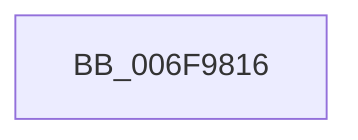

# sub_006F9816

- RVA: `0x006F9816`–`0x006F984A` (길이 `52` bytes)
- VA: `0x00000001406F9816`
- 실행 섹션: `.text`
- PDB 이름 있음: `아니요`; PDB Function 태그: `아니요`
- unwind 정보 RVA: `0x000B6998`
- 디코드: `14`개 명령, `52/52` bytes 표시
- 미해석 바이트: `0` (있으면 어셈블리에 `.byte`로 보존)

> 이 문서는 커널 이미지의 기계어와 PDB 기호를 분석해 생성했습니다. 4번과 5번은 함수 원형과 자료형을 바이너리 사용 방식에서 추정한 C 해석이며 원본 소스 복구 결과는 아닙니다.

## 1. Dependencies

- 직접 호출 지점: **5**; 고유 호출 대상: **5**
- 직접 호출자로 확인된 함수: **0**
- RIP 상대 이미지 참조: **0**

### Outgoing calls
- `0x006F9819` → [MiReferenceVad](../29/MiReferenceVad_function_00295890.md) (function, `0x00295890`)
- `0x006F9824` → [MiUnlockWorkingSetExclusive](../27/MiUnlockWorkingSetExclusive_function_0027EC70.md) (function, `0x0027EC70`)
- `0x006F982F` → [MiLockVadShared](../31/MiLockVadShared_function_00316DE0.md) (function, `0x00316DE0`)
- `0x006F9837` → [MiUnlockAndDereferenceVadShared](../2A/MiUnlockAndDereferenceVadShared_function_002AEF10.md) (function, `0x002AEF10`)
- `0x006F983F` → [MiLockWorkingSetExclusive](../32/MiLockWorkingSetExclusive_function_003238A0.md) (function, `0x003238A0`)

### Direct callers
- 이 함수 시작 RVA로 연결되는 직접 call은 확인되지 않았습니다. 간접 호출은 완전히 역산할 수 없습니다.

### Static image references
- 디코드된 RIP-relative 메모리 참조가 없습니다.

## 2. Other-region calls and transfers

- 다른 실행 섹션으로 향하는 call: **0**
- call이 아닌 외부 분기/꼬리 이동: **1**
  - `0x006F9845` → [MiWaitForRotateToComplete + 0x41](../4A/MiWaitForRotateToComplete_function_004A54F4.md) (`tail-transfer`)

## 3. Assembly (complete function range)

```asm
006F9816  48 8B CB                        mov rcx, rbx
006F9819  E8 72 C0 B9 FF                  call 0x140295890
006F981E  8A 57 0C                        mov dl, byte ptr [rdi + 0xc]
006F9821  49 8B CC                        mov rcx, r12
006F9824  E8 47 54 B8 FF                  call 0x14027ec70
006F9829  48 8B D3                        mov rdx, rbx
006F982C  49 8B CF                        mov rcx, r15
006F982F  E8 AC D5 C1 FF                  call 0x140316de0
006F9834  48 8B CB                        mov rcx, rbx
006F9837  E8 D4 56 BB FF                  call 0x1402aef10
006F983C  49 8B CC                        mov rcx, r12
006F983F  E8 5C A0 C2 FF                  call 0x1403238a0
006F9844  90                              nop
006F9845  E9 EB BC DA FF                  jmp 0x1404a5535
```

## 4. C-style interpretation (structured pseudocode)

```c
__int64 __fastcall sub_006F9816(void)
{
    __int64 result;

    result = MiReferenceVad(v_rbx, a2, a3, a4);
    result = MiUnlockWorkingSetExclusive(v_r12, *(unsigned __int8 *)(v_rdi + 12), a3, a4);
    result = MiLockVadShared(v_r15, v_rbx, a3, a4);
    result = MiUnlockAndDereferenceVadShared(v_rbx, v_rbx, a3, a4);
    result = MiLockWorkingSetExclusive(v_r12, v_rbx, a3, a4);
}
```

## 5. (Beta) C Style

```c
void sub_006F9816(void)
{
    int64_t result;

    result = MiReferenceVad(local_rbx, a2, a3, a4);
    result = MiUnlockWorkingSetExclusive(local_r12, *(uint8_t *)(local_rdi + 0xC), a3, a4);
    result = MiLockVadShared(local_r15, local_rbx, a3, a4);
    result = MiUnlockAndDereferenceVadShared(local_rbx, local_rbx, a3, a4);
    result = MiLockWorkingSetExclusive(local_r12, local_rbx, a3, a4);
}
```

## 6. Execution-region graph

[열기: 2D/3D 그래프와 함수 탐색 컨트롤 패널](../../../control-panel.html?section=text&rva=0x006F9816&view=graph)

- 2D 그래프는 위에서 아래로 흐르고, 3D 그래프는 빈 공간을 드래그해 회전합니다. Shift+드래그는 이동, 휠은 확대·축소, 함수 노드 선택은 대상 보고서 이동입니다.

### Static fallback


