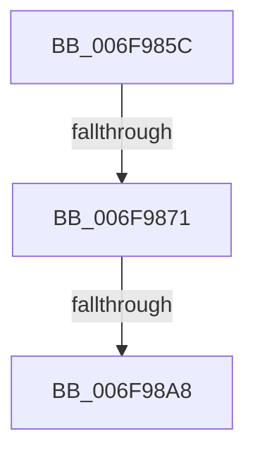

# sub_006F985C

- RVA: `0x006F985C`–`0x006F98C0` (길이 `100` bytes)
- VA: `0x00000001406F985C`
- 실행 섹션: `.text`
- PDB 이름 있음: `아니요`; PDB Function 태그: `아니요`
- unwind 정보 RVA: `0x000B6B88`
- 디코드: `24`개 명령, `100/100` bytes 표시
- 미해석 바이트: `0` (있으면 어셈블리에 `.byte`로 보존)

> 이 문서는 커널 이미지의 기계어와 PDB 기호를 분석해 생성했습니다. 4번과 5번은 함수 원형과 자료형을 바이너리 사용 방식에서 추정한 C 해석이며 원본 소스 복구 결과는 아닙니다.

## 1. Dependencies

- 직접 호출 지점: **4**; 고유 호출 대상: **4**
- 직접 호출자로 확인된 함수: **0**
- RIP 상대 이미지 참조: **0**

### Outgoing calls
- `0x006F9864` → [PopFxScheduleDeviceIdleTimer](../22/PopFxScheduleDeviceIdleTimer_function_0022FF18.md) (function, `0x0022FF18`)
- `0x006F987A` → [PopDiagTraceFxDevicePowerRequirement](../39/PopDiagTraceFxDevicePowerRequirement_function_00391780.md) (function, `0x00391780`)
- `0x006F988D` → [guard_dispatch_icall](../6B/guard_dispatch_icall_function_006BAAD0.md) (function, `0x006BAAD0`)
- `0x006F98B5` → [PopFxAddLogEntry](../39/PopFxAddLogEntry_function_00390B94.md) (function, `0x00390B94`)

### Direct callers
- 이 함수 시작 RVA로 연결되는 직접 call은 확인되지 않았습니다. 간접 호출은 완전히 역산할 수 없습니다.

### Static image references
- 디코드된 RIP-relative 메모리 참조가 없습니다.

## 2. Other-region calls and transfers

- 다른 실행 섹션으로 향하는 call: **0**
- call이 아닌 외부 분기/꼬리 이동: **3**
  - `0x006F986B` → [PopFxUpdateDeviceIdleTimer + 0x1D](../4A/PopFxUpdateDeviceIdleTimer_function_004A5C84.md) (`tail-transfer`)
  - `0x006F98A2` → [PopFxUpdateDeviceIdleTimer + 0x1D](../4A/PopFxUpdateDeviceIdleTimer_function_004A5C84.md) (`tail-transfer`)
  - `0x006F98BB` → [PopFxUpdateDeviceIdleTimer + 0x1D](../4A/PopFxUpdateDeviceIdleTimer_function_004A5C84.md) (`tail-transfer`)

## 3. Assembly (complete function range)

```asm
006F985C  F0 83 63 20 FB                  lock and dword ptr [rbx + 0x20], 0xfffffffb
006F9861  48 8B CB                        mov rcx, rbx
006F9864  E8 AF 66 B3 FF                  call 0x14022ff18
006F9869  84 C0                           test al, al
006F986B  0F 85 30 C4 DA FF               jne 0x1404a5ca1
006F9871  48 8B 4B 30                     mov rcx, qword ptr [rbx + 0x30]
006F9875  45 33 C0                        xor r8d, r8d
006F9878  33 D2                           xor edx, edx
006F987A  E8 01 7F C9 FF                  call 0x140391780
006F987F  48 8B 83 90 00 00 00            mov rax, qword ptr [rbx + 0x90]
006F9886  48 8B 8B C0 00 00 00            mov rcx, qword ptr [rbx + 0xc0]
006F988D  E8 3E 12 FC FF                  call 0x1406baad0
006F9892  F0 83 4B 20 40                  lock or dword ptr [rbx + 0x20], 0x40
006F9897  83 C8 FF                        or eax, 0xffffffff
006F989A  F0 0F C1 43 28                  lock xadd dword ptr [rbx + 0x28], eax
006F989F  83 F8 01                        cmp eax, 1
006F98A2  0F 84 F9 C3 DA FF               je 0x1404a5ca1
006F98A8  48 8B 4B 30                     mov rcx, qword ptr [rbx + 0x30]
006F98AC  45 33 C9                        xor r9d, r9d
006F98AF  33 D2                           xor edx, edx
006F98B1  45 8D 41 11                     lea r8d, [r9 + 0x11]
006F98B5  E8 DA 72 C9 FF                  call 0x140390b94
006F98BA  90                              nop
006F98BB  E9 E1 C3 DA FF                  jmp 0x1404a5ca1
```

## 4. C-style interpretation (structured pseudocode)

```c
__int64 __fastcall sub_006F985C(__int64 a1, int a2, int a3, int a4)
{
    __int64 result;

    result = PopFxScheduleDeviceIdleTimer(v_rbx, a2, a3, a4);
    a3 = 0;
    a2 = 0;
    result = PopDiagTraceFxDevicePowerRequirement(*(unsigned __int64 *)(v_rbx + 48), a2, a3, a4);
    result = guard_dispatch_icall(*(unsigned __int64 *)(v_rbx + 192), a2, a3, a4);
    result = (unsigned int)((result) | (0xFFFFFFFFULL));
    a4 = 0;
    a2 = 0;
    result = PopFxAddLogEntry(*(unsigned __int64 *)(v_rbx + 48), a2, a4 + 17, a4);
}
```

## 5. (Beta) C Style

```c
int64_t sub_006F985C(int64_t Arg1, int32_t Arg2, int32_t Arg3, int32_t Arg4)
{
    int64_t result;

    result = PopFxScheduleDeviceIdleTimer(local_rbx, Arg2, Arg3, Arg4);
    Arg3 = 0;
    Arg2 = 0;
    result = PopDiagTraceFxDevicePowerRequirement(*(uint64_t *)(local_rbx + 0x30), Arg2, Arg3, Arg4);
    result = guard_dispatch_icall(*(uint64_t *)(local_rbx + 0xC0), Arg2, Arg3, Arg4);
    result = (uint32_t)((result) | (0xFFFFFFFFULL));
    Arg4 = 0;
    Arg2 = 0;
    result = PopFxAddLogEntry(*(uint64_t *)(local_rbx + 0x30), Arg2, Arg4 + 17, Arg4);
}
```

## 6. Execution-region graph

[열기: 2D/3D 그래프와 함수 탐색 컨트롤 패널](../../../control-panel.html?section=text&rva=0x006F985C&view=graph)

- 2D 그래프는 위에서 아래로 흐르고, 3D 그래프는 빈 공간을 드래그해 회전합니다. Shift+드래그는 이동, 휠은 확대·축소, 함수 노드 선택은 대상 보고서 이동입니다.

### Static fallback


