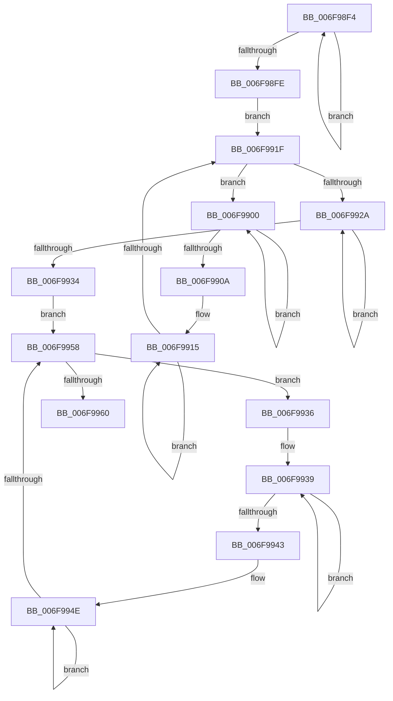

# sub_006F98F4

- RVA: `0x006F98F4`–`0x006F997D` (길이 `137` bytes)
- VA: `0x00000001406F98F4`
- 실행 섹션: `.text`
- PDB 이름 있음: `아니요`; PDB Function 태그: `아니요`
- unwind 정보 RVA: `0x000B6EC0`
- 디코드: `40`개 명령, `137/137` bytes 표시
- 미해석 바이트: `0` (있으면 어셈블리에 `.byte`로 보존)

> 이 문서는 커널 이미지의 기계어와 PDB 기호를 분석해 생성했습니다. 4번과 5번은 함수 원형과 자료형을 바이너리 사용 방식에서 추정한 C 해석이며 원본 소스 복구 결과는 아닙니다.

## 1. Dependencies

- 직접 호출 지점: **1**; 고유 호출 대상: **1**
- 직접 호출자로 확인된 함수: **0**
- RIP 상대 이미지 참조: **0**

### Outgoing calls
- `0x006F9966` → [wcsicmp](../50/wcsicmp_function_00500080.md) (function, `0x00500080`)

### Direct callers
- 이 함수 시작 RVA로 연결되는 직접 call은 확인되지 않았습니다. 간접 호출은 완전히 역산할 수 없습니다.

### Static image references
- 디코드된 RIP-relative 메모리 참조가 없습니다.

## 2. Other-region calls and transfers

- 다른 실행 섹션으로 향하는 call: **0**
- call이 아닌 외부 분기/꼬리 이동: **1**
  - `0x006F9978` → [PiDevCfgGetMigrationDeviceIdScore + 0xD8](../4A/PiDevCfgGetMigrationDeviceIdScore_function_004A6888.md) (`tail-transfer`)

## 3. Assembly (complete function range)

```asm
006F98F4  48 FF C0                        inc rax
006F98F7  66 44 39 2C 47                  cmp word ptr [rdi + rax*2], r13w
006F98FC  75 F6                           jne 0x1406f98f4
006F98FE  EB 1F                           jmp 0x1406f991f
006F9900  48 FF C0                        inc rax
006F9903  66 44 39 2C 47                  cmp word ptr [rdi + rax*2], r13w
006F9908  75 F6                           jne 0x1406f9900
006F990A  48 8D 3C 47                     lea rdi, [rdi + rax*2]
006F990E  48 8B C1                        mov rax, rcx
006F9911  48 83 C7 02                     add rdi, 2
006F9915  48 FF C0                        inc rax
006F9918  66 44 39 2C 47                  cmp word ptr [rdi + rax*2], r13w
006F991D  75 F6                           jne 0x1406f9915
006F991F  66 44 39 6C 47 02               cmp word ptr [rdi + rax*2 + 2], r13w
006F9925  48 8B C1                        mov rax, rcx
006F9928  75 D6                           jne 0x1406f9900
006F992A  48 FF C0                        inc rax
006F992D  66 44 39 2C 43                  cmp word ptr [rbx + rax*2], r13w
006F9932  75 F6                           jne 0x1406f992a
006F9934  EB 22                           jmp 0x1406f9958
006F9936  48 8B C1                        mov rax, rcx
006F9939  48 FF C0                        inc rax
006F993C  66 44 39 2C 43                  cmp word ptr [rbx + rax*2], r13w
006F9941  75 F6                           jne 0x1406f9939
006F9943  48 8D 1C 43                     lea rbx, [rbx + rax*2]
006F9947  48 8B C1                        mov rax, rcx
006F994A  48 83 C3 02                     add rbx, 2
006F994E  48 FF C0                        inc rax
006F9951  66 44 39 2C 43                  cmp word ptr [rbx + rax*2], r13w
006F9956  75 F6                           jne 0x1406f994e
006F9958  66 44 39 6C 43 02               cmp word ptr [rbx + rax*2 + 2], r13w
006F995E  75 D6                           jne 0x1406f9936
006F9960  48 8B D3                        mov rdx, rbx
006F9963  48 8B CF                        mov rcx, rdi
006F9966  E8 15 67 E0 FF                  call 0x140500080
006F996B  0F B7 CE                        movzx ecx, si
006F996E  66 83 C9 01                     or cx, 1
006F9972  85 C0                           test eax, eax
006F9974  66 0F 44 CE                     cmove cx, si
006F9978  E9 E3 CF DA FF                  jmp 0x1404a6960
```

## 4. C-style interpretation (structured pseudocode)

```c
__int64 __fastcall sub_006F98F4(__int64 a1)
{
    __int64 result;
    __int64 v_rbx;
    __int64 v_rdi;

    result = (result) + 1;
    if ((*(unsigned __int16 *)(v_rdi + result * 2)) != ((unsigned __int16)(v_r13))) goto loc_006F98F4;
    goto loc_006F991F;
loc_006F9900:
    result = (result) + 1;
    if ((*(unsigned __int16 *)(v_rdi + result * 2)) != ((unsigned __int16)(v_r13))) goto loc_006F9900;
    v_rdi = (v_rdi + result * 2) + (2);
loc_006F9915:
    result = (a1) + 1;
    if ((*(unsigned __int16 *)(v_rdi + result * 2)) != ((unsigned __int16)(v_r13))) goto loc_006F9915;
loc_006F991F:
    if ((*(unsigned __int16 *)(v_rdi + result * 2 + 2)) != ((unsigned __int16)(v_r13))) goto loc_006F9900;
loc_006F992A:
    result = (a1) + 1;
    if ((*(unsigned __int16 *)(v_rbx + result * 2)) != ((unsigned __int16)(v_r13))) goto loc_006F992A;
    goto loc_006F9958;
loc_006F9936:
loc_006F9939:
    result = (a1) + 1;
    if ((*(unsigned __int16 *)(v_rbx + result * 2)) != ((unsigned __int16)(v_r13))) goto loc_006F9939;
    v_rbx = (v_rbx + result * 2) + (2);
loc_006F994E:
    result = (a1) + 1;
    if ((*(unsigned __int16 *)(v_rbx + result * 2)) != ((unsigned __int16)(v_r13))) goto loc_006F994E;
loc_006F9958:
    if ((*(unsigned __int16 *)(v_rbx + result * 2 + 2)) != ((unsigned __int16)(v_r13))) goto loc_006F9936;
    result = wcsicmp(v_rdi, v_rbx, a3, a4);
    a1 = (unsigned __int16)(((unsigned __int16)(v_rsi)) | (1));
    if ((unsigned int)(result) == 0) { a1 = (unsigned __int16)(v_rsi); }
}
```

## 5. (Beta) C Style

```c
int64_t sub_006F98F4(int64_t Arg1)
{
    int64_t result;
    int64_t local_rbx;
    int64_t local_rdi;

    result = (result) + 1;
    if ((*(uint16_t *)(local_rdi + result * 2)) != ((uint16_t)(local_r13))) goto loc_006F98F4;
    goto loc_006F991F;
loc_006F9900:
    result = (result) + 1;
    if ((*(uint16_t *)(local_rdi + result * 2)) != ((uint16_t)(local_r13))) goto loc_006F9900;
    local_rdi = (local_rdi + result * 2) + (2);
loc_006F9915:
    result = (Arg1) + 1;
    if ((*(uint16_t *)(local_rdi + result * 2)) != ((uint16_t)(local_r13))) goto loc_006F9915;
loc_006F991F:
    if ((*(uint16_t *)(local_rdi + result * 2 + 0x2)) != ((uint16_t)(local_r13))) goto loc_006F9900;
loc_006F992A:
    result = (Arg1) + 1;
    if ((*(uint16_t *)(local_rbx + result * 2)) != ((uint16_t)(local_r13))) goto loc_006F992A;
    goto loc_006F9958;
loc_006F9936:
loc_006F9939:
    result = (Arg1) + 1;
    if ((*(uint16_t *)(local_rbx + result * 2)) != ((uint16_t)(local_r13))) goto loc_006F9939;
    local_rbx = (local_rbx + result * 2) + (2);
loc_006F994E:
    result = (Arg1) + 1;
    if ((*(uint16_t *)(local_rbx + result * 2)) != ((uint16_t)(local_r13))) goto loc_006F994E;
loc_006F9958:
    if ((*(uint16_t *)(local_rbx + result * 2 + 0x2)) != ((uint16_t)(local_r13))) goto loc_006F9936;
    result = wcsicmp(local_rdi, local_rbx, a3, a4);
    Arg1 = (uint16_t)(((uint16_t)(local_rsi)) | (1));
    if ((uint32_t)(result) == 0) { Arg1 = (uint16_t)(local_rsi); }
}
```

## 6. Execution-region graph

[열기: 2D/3D 그래프와 함수 탐색 컨트롤 패널](../../../control-panel.html?section=text&rva=0x006F98F4&view=graph)

- 2D 그래프는 위에서 아래로 흐르고, 3D 그래프는 빈 공간을 드래그해 회전합니다. Shift+드래그는 이동, 휠은 확대·축소, 함수 노드 선택은 대상 보고서 이동입니다.

### Static fallback


