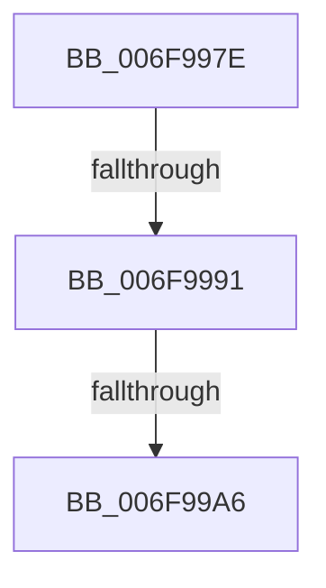

# sub_006F997E

- RVA: `0x006F997E`–`0x006F99DE` (길이 `96` bytes)
- VA: `0x00000001406F997E`
- 실행 섹션: `.text`
- PDB 이름 있음: `아니요`; PDB Function 태그: `아니요`
- unwind 정보 RVA: `0x000B6F0C`
- 디코드: `23`개 명령, `96/96` bytes 표시
- 미해석 바이트: `0` (있으면 어셈블리에 `.byte`로 보존)

> 이 문서는 커널 이미지의 기계어와 PDB 기호를 분석해 생성했습니다. 4번과 5번은 함수 원형과 자료형을 바이너리 사용 방식에서 추정한 C 해석이며 원본 소스 복구 결과는 아닙니다.

## 1. Dependencies

- 직접 호출 지점: **4**; 고유 호출 대상: **3**
- 직접 호출자로 확인된 함수: **0**
- RIP 상대 이미지 참조: **0**

### Outgoing calls
- `0x006F9984` → [IopIrpHasExtensionType](../3F/IopIrpHasExtensionType_function_003F4080.md) (function, `0x003F4080`)
- `0x006F9999` → [IopIrpHasExtensionType](../3F/IopIrpHasExtensionType_function_003F4080.md) (function, `0x003F4080`)
- `0x006F99C5` → [IopProcessIoTracking](../59/IopProcessIoTracking_function_005986C0.md) (function, `0x005986C0`)
- `0x006F99D3` → [IopFreeIrpExtension](../24/IopFreeIrpExtension_function_0024EDB0.md) (function, `0x0024EDB0`)

### Direct callers
- 이 함수 시작 RVA로 연결되는 직접 call은 확인되지 않았습니다. 간접 호출은 완전히 역산할 수 없습니다.

### Static image references
- 디코드된 RIP-relative 메모리 참조가 없습니다.

## 2. Other-region calls and transfers

- 다른 실행 섹션으로 향하는 call: **0**
- call이 아닌 외부 분기/꼬리 이동: **3**
  - `0x006F998B` → [IopPerfCompleteRequest + 0x7E](../4A/IopPerfCompleteRequest_function_004A69B8.md) (`tail-transfer`)
  - `0x006F99A0` → [IopPerfCompleteRequest + 0x7E](../4A/IopPerfCompleteRequest_function_004A69B8.md) (`tail-transfer`)
  - `0x006F99D9` → [IopPerfCompleteRequest + 0x7E](../4A/IopPerfCompleteRequest_function_004A69B8.md) (`tail-transfer`)

## 3. Assembly (complete function range)

```asm
006F997E  41 8B D5                        mov edx, r13d
006F9981  48 8B CF                        mov rcx, rdi
006F9984  E8 F7 A6 CF FF                  call 0x1403f4080
006F9989  84 C0                           test al, al
006F998B  0F 84 A5 D0 DA FF               je 0x1404a6a36
006F9991  BA 04 00 00 00                  mov edx, 4
006F9996  48 8B CF                        mov rcx, rdi
006F9999  E8 E2 A6 CF FF                  call 0x1403f4080
006F999E  84 C0                           test al, al
006F99A0  0F 85 90 D0 DA FF               jne 0x1404a6a36
006F99A6  48 8B 87 C8 00 00 00            mov rax, qword ptr [rdi + 0xc8]
006F99AD  48 B9 14 00 00 00 80 F7 FF FF   movabs rcx, 0xfffff78000000014
006F99B7  48 8B 09                        mov rcx, qword ptr [rcx]
006F99BA  48 8B 53 28                     mov rdx, qword ptr [rbx + 0x28]
006F99BE  48 2B 48 28                     sub rcx, qword ptr [rax + 0x28]
006F99C2  8B 52 48                        mov edx, dword ptr [rdx + 0x48]
006F99C5  E8 F6 EC E9 FF                  call 0x1405986c0
006F99CA  45 8A C5                        mov r8b, r13b
006F99CD  41 8B D5                        mov edx, r13d
006F99D0  48 8B CF                        mov rcx, rdi
006F99D3  E8 D8 53 B5 FF                  call 0x14024edb0
006F99D8  90                              nop
006F99D9  E9 58 D0 DA FF                  jmp 0x1404a6a36
```

## 4. C-style interpretation (structured pseudocode)

```c
__int64 __fastcall sub_006F997E(void)
{
    __int64 result;

    result = IopIrpHasExtensionType(v_rdi, (unsigned int)((unsigned int)(v_r13)), a3, a4);
    result = IopIrpHasExtensionType(v_rdi, 4, a3, a4);
    a1 = (*(unsigned __int64 *)(v_rdi)) - (*(unsigned __int64 *)(*(unsigned __int64 *)(v_rdi + 200) + 40));
    result = IopProcessIoTracking(a1, (unsigned int)(*(unsigned int *)(*(unsigned __int64 *)(v_rbx + 40) + 72)), a3, a4);
    result = IopFreeIrpExtension(v_rdi, (unsigned int)((unsigned int)(v_r13)), (unsigned __int8)(v_r13), a4);
}
```

## 5. (Beta) C Style

```c
void sub_006F997E(void)
{
    int64_t result;

    result = IopIrpHasExtensionType(local_rdi, (uint32_t)((uint32_t)(local_r13)), a3, a4);
    result = IopIrpHasExtensionType(local_rdi, 4, a3, a4);
    a1 = (*(uint64_t *)(local_rdi)) - (*(uint64_t *)(*(uint64_t *)(local_rdi + 0xC8) + 0x28));
    result = IopProcessIoTracking(a1, (uint32_t)(*(uint32_t *)(*(uint64_t *)(local_rbx + 0x28) + 0x48)), a3, a4);
    result = IopFreeIrpExtension(local_rdi, (uint32_t)((uint32_t)(local_r13)), (uint8_t)(local_r13), a4);
}
```

## 6. Execution-region graph

[열기: 2D/3D 그래프와 함수 탐색 컨트롤 패널](../../../control-panel.html?section=text&rva=0x006F997E&view=graph)

- 2D 그래프는 위에서 아래로 흐르고, 3D 그래프는 빈 공간을 드래그해 회전합니다. Shift+드래그는 이동, 휠은 확대·축소, 함수 노드 선택은 대상 보고서 이동입니다.

### Static fallback


