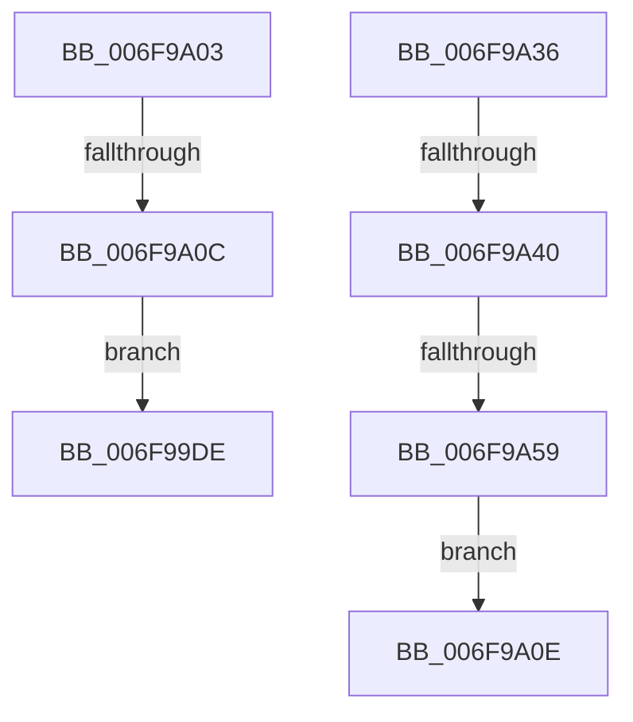

# sub_006F99DE

- RVA: `0x006F99DE`–`0x006F9A5B` (길이 `125` bytes)
- VA: `0x00000001406F99DE`
- 실행 섹션: `.text`
- PDB 이름 있음: `아니요`; PDB Function 태그: `아니요`
- unwind 정보 RVA: `0x000B6F90`
- 디코드: `26`개 명령, `125/125` bytes 표시
- 미해석 바이트: `0` (있으면 어셈블리에 `.byte`로 보존)

> 이 문서는 커널 이미지의 기계어와 PDB 기호를 분석해 생성했습니다. 4번과 5번은 함수 원형과 자료형을 바이너리 사용 방식에서 추정한 C 해석이며 원본 소스 복구 결과는 아닙니다.

## 1. Dependencies

- 직접 호출 지점: **1**; 고유 호출 대상: **1**
- 직접 호출자로 확인된 함수: **0**
- RIP 상대 이미지 참조: **0**

### Outgoing calls
- `0x006F9A49` → [strtol](../4F/strtol_function_004FF358.md) (function, `0x004FF358`)

### Direct callers
- 이 함수 시작 RVA로 연결되는 직접 call은 확인되지 않았습니다. 간접 호출은 완전히 역산할 수 없습니다.

### Static image references
- 디코드된 RIP-relative 메모리 참조가 없습니다.

## 2. Other-region calls and transfers

- 다른 실행 섹션으로 향하는 call: **0**
- call이 아닌 외부 분기/꼬리 이동: **5**
  - `0x006F99FE` → [RtlIpv6StringToAddressA + 0x184](../4A/RtlIpv6StringToAddressA_function_004A6BD0.md) (`tail-transfer`)
  - `0x006F9A06` → [RtlIpv6StringToAddressA + 0xDA](../4A/RtlIpv6StringToAddressA_function_004A6BD0.md) (`tail-transfer`)
  - `0x006F9A31` → [RtlIpv6StringToAddressA + 0xA7](../4A/RtlIpv6StringToAddressA_function_004A6BD0.md) (`tail-transfer`)
  - `0x006F9A3A` → [RtlIpv6StringToAddressA + 0x119](../4A/RtlIpv6StringToAddressA_function_004A6BD0.md) (`tail-transfer`)
  - `0x006F9A53` → [RtlIpv6StringToAddressA + 0x119](../4A/RtlIpv6StringToAddressA_function_004A6BD0.md) (`tail-transfer`)

## 3. Assembly (complete function range)

```asm
006F99DE  BD 01 00 00 00                  mov ebp, 1
006F99E3  44 03 F5                        add r14d, ebp
006F99E6  48 8B B4 24 90 00 00 00         mov rsi, qword ptr [rsp + 0x90]
006F99EE  44 8B E8                        mov r13d, eax
006F99F1  4C 8B 4C 24 28                  mov r9, qword ptr [rsp + 0x28]
006F99F6  44 8B 94 24 98 00 00 00         mov r10d, dword ptr [rsp + 0x98]
006F99FE  E9 51 D3 DA FF                  jmp 0x1404a6d54
006F9A03  83 FF 07                        cmp edi, 7
006F9A06  0F 87 9E D2 DA FF               ja 0x1404a6caa
006F9A0C  EB D0                           jmp 0x1406f99de
006F9A0E  44 8B 94 24 98 00 00 00         mov r10d, dword ptr [rsp + 0x98]
006F9A16  42 8D 0C 55 FF FF FF FF         lea ecx, [r10*2 - 1]
006F9A1E  41 03 CE                        add ecx, r14d
006F9A21  88 04 31                        mov byte ptr [rcx + rsi], al
006F9A24  44 8A 84 24 80 00 00 00         mov r8b, byte ptr [rsp + 0x80]
006F9A2C  4C 8B 4C 24 28                  mov r9, qword ptr [rsp + 0x28]
006F9A31  E9 41 D2 DA FF                  jmp 0x1404a6c77
006F9A36  41 83 FC 03                     cmp r12d, 3
006F9A3A  0F 87 A9 D2 DA FF               ja 0x1404a6ce9
006F9A40  33 D2                           xor edx, edx
006F9A42  49 8B C9                        mov rcx, r9
006F9A45  44 8D 42 0A                     lea r8d, [rdx + 0xa]
006F9A49  E8 0A 59 E0 FF                  call 0x1404ff358
006F9A4E  3D FF 00 00 00                  cmp eax, 0xff
006F9A53  0F 87 90 D2 DA FF               ja 0x1404a6ce9
006F9A59  EB B3                           jmp 0x1406f9a0e
```

## 4. C-style interpretation (structured pseudocode)

```c
__int64 __fastcall sub_006F99DE(__int64 a1, int a2, __int64 a3, __int64 a4, __int64 a5, __int64 a6, __int64 a7, __int64 a8, __int64 a9, __int64 a10, __int64 a11, __int64 a12, __int64 a13, __int64 a14, __int64 a15, __int64 a16, __int64 a17, __int64 a18, unsigned int a19)
{
    __int64 v_r14;
    unsigned __int64 v_stack_p28;
    unsigned __int8 v_stack_p80;
    unsigned int v_stack_p98;

    v_r14 = (unsigned int)((v_r14) + (1));
}
```

## 5. (Beta) C Style

```c
int64_t sub_006F99DE(int64_t Arg1, int32_t Arg2, int64_t Arg3, int64_t Arg4, int64_t Arg5, uint64_t Arg6, uint64_t Arg7, uint64_t Arg8, uint64_t Arg9, uint64_t Arg10, uint64_t Arg11, uint64_t Arg12, uint64_t Arg13, uint64_t Arg14, uint64_t Arg15, uint64_t Arg16, uint64_t Arg17, int64_t Arg18, uint32_t Arg19)
{
    int64_t local_r14;
    uint64_t v_stack_p28;
    uint8_t v_stack_p80;
    uint32_t v_stack_p98;

    local_r14 = (uint32_t)((local_r14) + (1));
}
```

## 6. Execution-region graph

[열기: 2D/3D 그래프와 함수 탐색 컨트롤 패널](../../../control-panel.html?section=text&rva=0x006F99DE&view=graph)

- 2D 그래프는 위에서 아래로 흐르고, 3D 그래프는 빈 공간을 드래그해 회전합니다. Shift+드래그는 이동, 휠은 확대·축소, 함수 노드 선택은 대상 보고서 이동입니다.

### Static fallback


