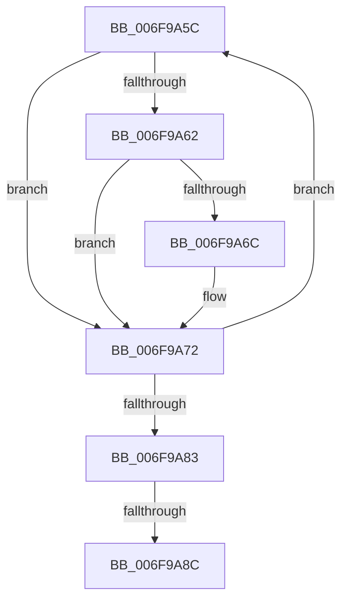

# sub_006F9A5C

- RVA: `0x006F9A5C`–`0x006F9A95` (길이 `57` bytes)
- VA: `0x00000001406F9A5C`
- 실행 섹션: `.text`
- PDB 이름 있음: `아니요`; PDB Function 태그: `아니요`
- unwind 정보 RVA: `0x000B6FC4`
- 디코드: `16`개 명령, `57/57` bytes 표시
- 미해석 바이트: `0` (있으면 어셈블리에 `.byte`로 보존)

> 이 문서는 커널 이미지의 기계어와 PDB 기호를 분석해 생성했습니다. 4번과 5번은 함수 원형과 자료형을 바이너리 사용 방식에서 추정한 C 해석이며 원본 소스 복구 결과는 아닙니다.

## 1. Dependencies

- 직접 호출 지점: **0**; 고유 호출 대상: **0**
- 직접 호출자로 확인된 함수: **0**
- RIP 상대 이미지 참조: **0**

### Outgoing calls
- 직접 디코드된 call 명령이 없습니다.

### Direct callers
- 이 함수 시작 RVA로 연결되는 직접 call은 확인되지 않았습니다. 간접 호출은 완전히 역산할 수 없습니다.

### Static image references
- 디코드된 RIP-relative 메모리 참조가 없습니다.

## 2. Other-region calls and transfers

- 다른 실행 섹션으로 향하는 call: **0**
- call이 아닌 외부 분기/꼬리 이동: **2**
  - `0x006F9A86` → [PopDirectedDripsDiagTraceNotifyDevices + 0x190](../4A/PopDirectedDripsDiagTraceNotifyDevices_function_004A70AC.md) (`tail-transfer`)
  - `0x006F9A90` → [PopDirectedDripsDiagTraceNotifyDevices + 0x190](../4A/PopDirectedDripsDiagTraceNotifyDevices_function_004A70AC.md) (`tail-transfer`)

## 3. Assembly (complete function range)

```asm
006F9A5C  4E 3B 1C 03                     cmp r11, qword ptr [rbx + r8]
006F9A60  72 10                           jb 0x1406f9a72
006F9A62  41 8D 42 01                     lea eax, [r10 + 1]
006F9A66  4D 3B 1C C7                     cmp r11, qword ptr [r15 + rax*8]
006F9A6A  73 06                           jae 0x1406f9a72
006F9A6C  41 FF 01                        inc dword ptr [r9]
006F9A6F  4D 01 18                        add qword ptr [r8], r11
006F9A72  41 FF C2                        inc r10d
006F9A75  49 83 C1 04                     add r9, 4
006F9A79  49 83 C0 08                     add r8, 8
006F9A7D  41 83 FA 05                     cmp r10d, 5
006F9A81  72 D9                           jb 0x1406f9a5c
006F9A83  40 84 FF                        test dil, dil
006F9A86  0F 84 B0 D7 DA FF               je 0x1404a723c
006F9A8C  48 89 72 78                     mov qword ptr [rdx + 0x78], rsi
006F9A90  E9 A7 D7 DA FF                  jmp 0x1404a723c
```

## 4. C-style interpretation (structured pseudocode)

```c
__int64 __fastcall sub_006F9A5C(__int64 a1, __int64 a2, __int64 a3, __int64 a4)
{
    __int64 v_r10;

    if (v_r11 < (*(unsigned __int64 *)(v_rbx + a3 * 1))) goto loc_006F9A72;
    if (v_r11 < (*(unsigned __int64 *)(v_r15 + v_r10 + 1 * 8))) {
    }
    v_r10 = (unsigned int)((v_r10) + 1);
    a4 = (a4) + (4);
    a3 = (a3) + (8);
    if (((unsigned int)(v_r10)) < 5) goto loc_006F9A5C;
    *(unsigned __int64 *)(a2 + 120) = v_rsi;
}
```

## 5. (Beta) C Style

```c
int64_t sub_006F9A5C(int64_t Arg1, void *Arg2, void *Arg3, void *Arg4)
{
    uint8_t *arg2 = (uint8_t *)Arg2;
    uint8_t *arg3 = (uint8_t *)Arg3;
    uint8_t *arg4 = (uint8_t *)Arg4;

    int64_t local_r10;

    if (local_r11 < (*(uint64_t *)(local_rbx + arg3 * 1))) goto loc_006F9A72;
    if (local_r11 < (*(uint64_t *)(local_r15 + local_r10 + 0x1 * 8))) {
    }
    local_r10 = (uint32_t)((local_r10) + 1);
    Arg4 = (Arg4) + (4);
    Arg3 = (Arg3) + (8);
    if (((uint32_t)(local_r10)) < 5) goto loc_006F9A5C;
    *(uint64_t *)(arg2 + 0x78) = local_rsi;
}
```

### 관측된 메모리 오프셋

구조체 형식이 확인되지 않은 접근은 인자 기준의 오프셋으로만 기록했습니다.

| 기준 인자 | 오프셋 표현 | 폭 (bit) | 접근 |
|---|---:|---:|---|
| `Arg2` | `+ 0x78` | `64` | `W` |
| `Arg3` | `+ 0x0` | `64` | `R/W` |
| `Arg4` | `+ 0x0` | `32` | `R/W` |

## 6. Execution-region graph

[열기: 2D/3D 그래프와 함수 탐색 컨트롤 패널](../../../control-panel.html?section=text&rva=0x006F9A5C&view=graph)

- 2D 그래프는 위에서 아래로 흐르고, 3D 그래프는 빈 공간을 드래그해 회전합니다. Shift+드래그는 이동, 휠은 확대·축소, 함수 노드 선택은 대상 보고서 이동입니다.

### Static fallback


