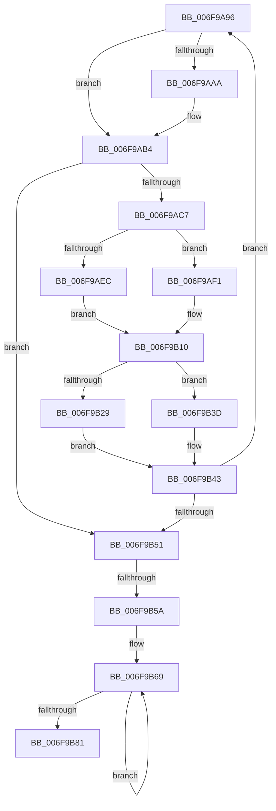

# sub_006F9A96

- RVA: `0x006F9A96`–`0x006F9B91` (길이 `251` bytes)
- VA: `0x00000001406F9A96`
- 실행 섹션: `.text`
- PDB 이름 있음: `아니요`; PDB Function 태그: `아니요`
- unwind 정보 RVA: `0x000B7220`
- 디코드: `64`개 명령, `251/251` bytes 표시
- 미해석 바이트: `0` (있으면 어셈블리에 `.byte`로 보존)

> 이 문서는 커널 이미지의 기계어와 PDB 기호를 분석해 생성했습니다. 4번과 5번은 함수 원형과 자료형을 바이너리 사용 방식에서 추정한 C 해석이며 원본 소스 복구 결과는 아닙니다.

## 1. Dependencies

- 직접 호출 지점: **8**; 고유 호출 대상: **6**
- 직접 호출자로 확인된 함수: **0**
- RIP 상대 이미지 참조: **0**

### Outgoing calls
- `0x006F9A99` → [RtlpHpLfhContextLockExtension](../60/RtlpHpLfhContextLockExtension_function_00604A50.md) (function, `0x00604A50`)
- `0x006F9AB9` → [RtlpHpLfhContextUnlockExtension](../60/RtlpHpLfhContextUnlockExtension_function_00604C1C.md) (function, `0x00604C1C`)
- `0x006F9AE1` → [RtlpHpLfhOwnerFreeListProcess](../2E/RtlpHpLfhOwnerFreeListProcess_function_002E8BA0.md) (function, `0x002E8BA0`)
- `0x006F9AFE` → [RtlpHpLfhHeatMapQuery](../2E/RtlpHpLfhHeatMapQuery_function_002E7790.md) (function, `0x002E7790`)
- `0x006F9B1B` → [RtlpHpLfhBucketAddSubsegment](../2E/RtlpHpLfhBucketAddSubsegment_function_002E8CD8.md) (function, `0x002E8CD8`)
- `0x006F9B36` → [RtlpHpLfhContextMetadataFree](../60/RtlpHpLfhContextMetadataFree_function_00604B04.md) (function, `0x00604B04`)
- `0x006F9B5D` → [RtlpHpLfhContextLockExtension](../60/RtlpHpLfhContextLockExtension_function_00604A50.md) (function, `0x00604A50`)
- `0x006F9B86` → [RtlpHpLfhContextUnlockExtension](../60/RtlpHpLfhContextUnlockExtension_function_00604C1C.md) (function, `0x00604C1C`)

### Direct callers
- 이 함수 시작 RVA로 연결되는 직접 call은 확인되지 않았습니다. 간접 호출은 완전히 역산할 수 없습니다.

### Static image references
- 디코드된 RIP-relative 메모리 참조가 없습니다.

## 2. Other-region calls and transfers

- 다른 실행 섹션으로 향하는 call: **0**
- call이 아닌 외부 분기/꼬리 이동: **2**
  - `0x006F9B54` → [RtlpHpLfhContextSlotStandbyProcess + 0x3E](../4A/RtlpHpLfhContextSlotStandbyProcess_function_004A7538.md) (`tail-transfer`)
  - `0x006F9B8C` → [RtlpHpLfhContextSlotStandbyProcess + 0x3E](../4A/RtlpHpLfhContextSlotStandbyProcess_function_004A7538.md) (`tail-transfer`)

## 3. Assembly (complete function range)

```asm
006F9A96  48 8B CF                        mov rcx, rdi
006F9A99  E8 B2 AF F0 FF                  call 0x140604a50
006F9A9E  48 8B B7 A0 00 00 00            mov rsi, qword ptr [rdi + 0xa0]
006F9AA5  48 85 F6                        test rsi, rsi
006F9AA8  74 0A                           je 0x1406f9ab4
006F9AAA  48 8B 0E                        mov rcx, qword ptr [rsi]
006F9AAD  48 89 8F A0 00 00 00            mov qword ptr [rdi + 0xa0], rcx
006F9AB4  8A D0                           mov dl, al
006F9AB6  48 8B CF                        mov rcx, rdi
006F9AB9  E8 5E B1 F0 FF                  call 0x140604c1c
006F9ABE  48 85 F6                        test rsi, rsi
006F9AC1  0F 84 8A 00 00 00               je 0x1406f9b51
006F9AC7  0F B7 6E F2                     movzx ebp, word ptr [rsi - 0xe]
006F9ACB  4C 8D 44 24 20                  lea r8, [rsp + 0x20]
006F9AD0  48 C1 E5 06                     shl rbp, 6
006F9AD4  48 8D 56 F0                     lea rdx, [rsi - 0x10]
006F9AD8  45 33 C9                        xor r9d, r9d
006F9ADB  48 8B CF                        mov rcx, rdi
006F9ADE  48 03 EF                        add rbp, rdi
006F9AE1  E8 BA F0 BE FF                  call 0x1402e8ba0
006F9AE6  41 F6 C7 01                     test r15b, 1
006F9AEA  74 05                           je 0x1406f9af1
006F9AEC  45 8B CC                        mov r9d, r12d
006F9AEF  EB 1F                           jmp 0x1406f9b10
006F9AF1  48 8D 97 C0 00 00 00            lea rdx, [rdi + 0xc0]
006F9AF8  4C 8B C5                        mov r8, rbp
006F9AFB  48 8B CF                        mov rcx, rdi
006F9AFE  E8 8D DC BE FF                  call 0x1402e7790
006F9B03  83 F8 01                        cmp eax, 1
006F9B06  41 B9 04 00 00 00               mov r9d, 4
006F9B0C  45 0F 4D CC                     cmovge r9d, r12d
006F9B10  4C 8D 44 24 20                  lea r8, [rsp + 0x20]
006F9B15  48 8B D5                        mov rdx, rbp
006F9B18  48 8B CF                        mov rcx, rdi
006F9B1B  E8 B8 F1 BE FF                  call 0x1402e8cd8
006F9B20  48 8D 46 18                     lea rax, [rsi + 0x18]
006F9B24  48 39 00                        cmp qword ptr [rax], rax
006F9B27  75 14                           jne 0x1406f9b3d
006F9B29  41 B8 02 00 00 00               mov r8d, 2
006F9B2F  48 8D 56 F0                     lea rdx, [rsi - 0x10]
006F9B33  48 8B CF                        mov rcx, rdi
006F9B36  E8 C9 AF F0 FF                  call 0x140604b04
006F9B3B  EB 06                           jmp 0x1406f9b43
006F9B3D  48 89 1E                        mov qword ptr [rsi], rbx
006F9B40  48 8B DE                        mov rbx, rsi
006F9B43  48 83 BF A0 00 00 00 00         cmp qword ptr [rdi + 0xa0], 0
006F9B4B  0F 85 45 FF FF FF               jne 0x1406f9a96
006F9B51  48 85 DB                        test rbx, rbx
006F9B54  0F 84 1C DA DA FF               je 0x1404a7576
006F9B5A  48 8B CF                        mov rcx, rdi
006F9B5D  E8 EE AE F0 FF                  call 0x140604a50
006F9B62  48 8B 97 A0 00 00 00            mov rdx, qword ptr [rdi + 0xa0]
006F9B69  48 8B CB                        mov rcx, rbx
006F9B6C  48 8B 1B                        mov rbx, qword ptr [rbx]
006F9B6F  48 89 11                        mov qword ptr [rcx], rdx
006F9B72  48 8B D1                        mov rdx, rcx
006F9B75  48 89 8F A0 00 00 00            mov qword ptr [rdi + 0xa0], rcx
006F9B7C  48 85 DB                        test rbx, rbx
006F9B7F  75 E8                           jne 0x1406f9b69
006F9B81  8A D0                           mov dl, al
006F9B83  48 8B CF                        mov rcx, rdi
006F9B86  E8 91 B0 F0 FF                  call 0x140604c1c
006F9B8B  90                              nop
006F9B8C  E9 E5 D9 DA FF                  jmp 0x1404a7576
```

## 4. C-style interpretation (structured pseudocode)

```c
__int64 __fastcall sub_006F9A96(__int64 a1, __int64 a2, __int64 a3, int a4)
{
    __int64 result;
    __int64 v_rbp;
    unsigned __int64 v_stack_p20;

    result = RtlpHpLfhContextLockExtension(v_rdi, a2, a3, a4);
    if (*(unsigned __int64 *)(v_rdi + 160) != 0) {
        a1 = *(unsigned __int64 *)(*(unsigned __int64 *)(v_rdi + 160));
        *(unsigned __int64 *)(v_rdi + 160) = a1;
    }
    result = RtlpHpLfhContextUnlockExtension(v_rdi, (unsigned __int8)(result), a3, a4);
    if (*(unsigned __int64 *)(v_rdi + 160) == 0) goto loc_006F9B51;
    v_rbp = (*(unsigned __int16 *)(*(unsigned __int64 *)(v_rdi + 160) - 14)) << (6);
    a4 = 0;
    v_rbp = (v_rbp) + (v_rdi);
    result = RtlpHpLfhOwnerFreeListProcess(v_rdi, *(unsigned __int64 *)(v_rdi + 160) - 16, v_stack_p20, a4);
    if ((((unsigned __int8)(v_r15)) & (1)) == 0) goto loc_006F9AF1;
    goto loc_006F9B10;
loc_006F9AF1:
    result = RtlpHpLfhHeatMapQuery(v_rdi, v_rdi + 192, v_rbp, (unsigned int)((unsigned int)(v_r12)));
    a4 = 4;
    if (((unsigned int)(result)) >= 1) { a4 = (unsigned int)(v_r12); }
loc_006F9B10:
    result = RtlpHpLfhBucketAddSubsegment(v_rdi, v_rbp, v_stack_p20, a4);
    if ((*(unsigned __int64 *)(*(unsigned __int64 *)(v_rdi + 160) + 24)) != (*(unsigned __int64 *)(v_rdi + 160) + 24)) goto loc_006F9B3D;
    result = RtlpHpLfhContextMetadataFree(v_rdi, *(unsigned __int64 *)(v_rdi + 160) - 16, 2, a4);
    goto loc_006F9B43;
loc_006F9B3D:
    *(unsigned __int64 *)(*(unsigned __int64 *)(v_rdi + 160)) = v_rbx;
loc_006F9B43:
    if ((*(unsigned __int64 *)(v_rdi + 160)) != 0) goto loc_006F9A96;
loc_006F9B51:
    result = RtlpHpLfhContextLockExtension(v_rdi, *(unsigned __int64 *)(v_rdi + 160) - 16, 2, a4);
loc_006F9B69:
    *(unsigned __int64 *)(*(unsigned __int64 *)(v_rdi + 160)) = *(unsigned __int64 *)(v_rdi + 160);
    *(unsigned __int64 *)(v_rdi + 160) = *(unsigned __int64 *)(v_rdi + 160);
    if (*(unsigned __int64 *)(*(unsigned __int64 *)(v_rdi + 160)) != 0) goto loc_006F9B69;
    result = RtlpHpLfhContextUnlockExtension(v_rdi, (unsigned __int8)(result), 2, a4);
}
```

## 5. (Beta) C Style

```c
int64_t sub_006F9A96(int64_t Arg1, int64_t Arg2, int64_t Arg3, int32_t Arg4)
{
    int64_t result;
    int64_t local_rbp;
    uint64_t v_stack_p20;

    result = RtlpHpLfhContextLockExtension(local_rdi, Arg2, Arg3, Arg4);
    if (*(uint64_t *)(local_rdi + 0xA0) != 0) {
        Arg1 = *(uint64_t *)(*(uint64_t *)(local_rdi + 0xA0));
        *(uint64_t *)(local_rdi + 0xA0) = Arg1;
    }
    result = RtlpHpLfhContextUnlockExtension(local_rdi, (uint8_t)(result), Arg3, Arg4);
    if (*(uint64_t *)(local_rdi + 0xA0) == 0) goto loc_006F9B51;
    local_rbp = (*(uint16_t *)(*(uint64_t *)(local_rdi + 0xA0) - 0xE)) << (6);
    Arg4 = 0;
    local_rbp = (local_rbp) + (local_rdi);
    result = RtlpHpLfhOwnerFreeListProcess(local_rdi, *(uint64_t *)(local_rdi + 0xA0) - 16, v_stack_p20, Arg4);
    if ((((uint8_t)(local_r15)) & (1)) == 0) goto loc_006F9AF1;
    goto loc_006F9B10;
loc_006F9AF1:
    result = RtlpHpLfhHeatMapQuery(local_rdi, local_rdi + 192, local_rbp, (uint32_t)((uint32_t)(local_r12)));
    Arg4 = 4;
    if (((uint32_t)(result)) >= 1) { Arg4 = (uint32_t)(local_r12); }
loc_006F9B10:
    result = RtlpHpLfhBucketAddSubsegment(local_rdi, local_rbp, v_stack_p20, Arg4);
    if ((*(uint64_t *)(*(uint64_t *)(local_rdi + 0xA0) + 0x18)) != (*(uint64_t *)(local_rdi + 0xA0) + 24)) goto loc_006F9B3D;
    result = RtlpHpLfhContextMetadataFree(local_rdi, *(uint64_t *)(local_rdi + 0xA0) - 16, 2, Arg4);
    goto loc_006F9B43;
loc_006F9B3D:
    *(uint64_t *)(*(uint64_t *)(local_rdi + 0xA0)) = local_rbx;
loc_006F9B43:
    if ((*(uint64_t *)(local_rdi + 0xA0)) != 0) goto loc_006F9A96;
loc_006F9B51:
    result = RtlpHpLfhContextLockExtension(local_rdi, *(uint64_t *)(local_rdi + 0xA0) - 16, 2, Arg4);
loc_006F9B69:
    *(uint64_t *)(*(uint64_t *)(local_rdi + 0xA0)) = *(uint64_t *)(local_rdi + 0xA0);
    *(uint64_t *)(local_rdi + 0xA0) = *(uint64_t *)(local_rdi + 0xA0);
    if (*(uint64_t *)(*(uint64_t *)(local_rdi + 0xA0)) != 0) goto loc_006F9B69;
    result = RtlpHpLfhContextUnlockExtension(local_rdi, (uint8_t)(result), 2, Arg4);
}
```

## 6. Execution-region graph

[열기: 2D/3D 그래프와 함수 탐색 컨트롤 패널](../../../control-panel.html?section=text&rva=0x006F9A96&view=graph)

- 2D 그래프는 위에서 아래로 흐르고, 3D 그래프는 빈 공간을 드래그해 회전합니다. Shift+드래그는 이동, 휠은 확대·축소, 함수 노드 선택은 대상 보고서 이동입니다.

### Static fallback


