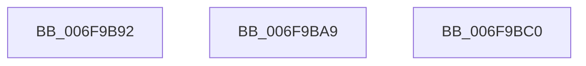

# sub_006F9B92

- RVA: `0x006F9B92`–`0x006F9BD3` (길이 `65` bytes)
- VA: `0x00000001406F9B92`
- 실행 섹션: `.text`
- PDB 이름 있음: `아니요`; PDB Function 태그: `아니요`
- unwind 정보 RVA: `0x000B7294`
- 디코드: `17`개 명령, `65/65` bytes 표시
- 미해석 바이트: `0` (있으면 어셈블리에 `.byte`로 보존)

> 이 문서는 커널 이미지의 기계어와 PDB 기호를 분석해 생성했습니다. 4번과 5번은 함수 원형과 자료형을 바이너리 사용 방식에서 추정한 C 해석이며 원본 소스 복구 결과는 아닙니다.

## 1. Dependencies

- 직접 호출 지점: **3**; 고유 호출 대상: **1**
- 직접 호출자로 확인된 함수: **0**
- RIP 상대 이미지 참조: **0**

### Outgoing calls
- `0x006F9B99` → [MiTrimSystemImagePages](../4B/MiTrimSystemImagePages_function_004B18FC.md) (function, `0x004B18FC`)
- `0x006F9BB0` → [MiTrimSystemImagePages](../4B/MiTrimSystemImagePages_function_004B18FC.md) (function, `0x004B18FC`)
- `0x006F9BC6` → [MiTrimSystemImagePages](../4B/MiTrimSystemImagePages_function_004B18FC.md) (function, `0x004B18FC`)

### Direct callers
- 이 함수 시작 RVA로 연결되는 직접 call은 확인되지 않았습니다. 간접 호출은 완전히 역산할 수 없습니다.

### Static image references
- 디코드된 RIP-relative 메모리 참조가 없습니다.

## 2. Other-region calls and transfers

- 다른 실행 섹션으로 향하는 call: **0**
- call이 아닌 외부 분기/꼬리 이동: **3**
  - `0x006F9BA4` → [MiSetPagingOfDriver + 0x21F](../4A/MiSetPagingOfDriver_function_004A76C4.md) (`tail-transfer`)
  - `0x006F9BBB` → [MiSetPagingOfDriver + 0x1FC](../4A/MiSetPagingOfDriver_function_004A76C4.md) (`tail-transfer`)
  - `0x006F9BCE` → [MiSetPagingOfDriver + 0x104](../4A/MiSetPagingOfDriver_function_004A76C4.md) (`tail-transfer`)

## 3. Assembly (complete function range)

```asm
006F9B92  49 8D 56 F8                     lea rdx, [r14 - 8]
006F9B96  49 8B CF                        mov rcx, r15
006F9B99  E8 5E 7D DB FF                  call 0x1404b18fc
006F9B9E  48 03 E8                        add rbp, rax
006F9BA1  45 33 FF                        xor r15d, r15d
006F9BA4  E9 3A DD DA FF                  jmp 0x1404a78e3
006F9BA9  49 8D 56 F8                     lea rdx, [r14 - 8]
006F9BAD  49 8B CF                        mov rcx, r15
006F9BB0  E8 47 7D DB FF                  call 0x1404b18fc
006F9BB5  48 03 E8                        add rbp, rax
006F9BB8  45 33 FF                        xor r15d, r15d
006F9BBB  E9 00 DD DA FF                  jmp 0x1404a78c0
006F9BC0  49 8B D5                        mov rdx, r13
006F9BC3  49 8B CF                        mov rcx, r15
006F9BC6  E8 31 7D DB FF                  call 0x1404b18fc
006F9BCB  48 03 E8                        add rbp, rax
006F9BCE  E9 F5 DB DA FF                  jmp 0x1404a77c8
```

## 4. C-style interpretation (structured pseudocode)

```c
__int64 __fastcall sub_006F9B92(void)
{
    __int64 result;
    __int64 v_r15;
    __int64 v_rbp;

    result = MiTrimSystemImagePages(v_r15, v_r14 - 8, a3, a4);
    v_rbp = (v_rbp) + (result);
    v_r15 = 0;
}
```

## 5. (Beta) C Style

```c
void sub_006F9B92(void)
{
    int64_t result;
    int64_t local_r15;
    int64_t local_rbp;

    result = MiTrimSystemImagePages(local_r15, local_r14 - 8, a3, a4);
    local_rbp = (local_rbp) + (result);
    local_r15 = 0;
}
```

## 6. Execution-region graph

[열기: 2D/3D 그래프와 함수 탐색 컨트롤 패널](../../../control-panel.html?section=text&rva=0x006F9B92&view=graph)

- 2D 그래프는 위에서 아래로 흐르고, 3D 그래프는 빈 공간을 드래그해 회전합니다. Shift+드래그는 이동, 휠은 확대·축소, 함수 노드 선택은 대상 보고서 이동입니다.

### Static fallback


