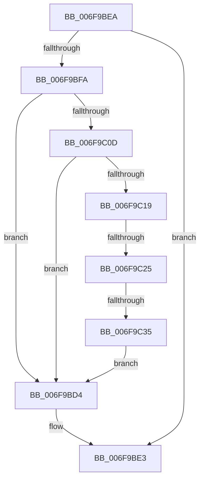

# sub_006F9BD4

- RVA: `0x006F9BD4`–`0x006F9C37` (길이 `99` bytes)
- VA: `0x00000001406F9BD4`
- 실행 섹션: `.text`
- PDB 이름 있음: `아니요`; PDB Function 태그: `아니요`
- unwind 정보 RVA: `0x000B73DC`
- 디코드: `26`개 명령, `99/99` bytes 표시
- 미해석 바이트: `0` (있으면 어셈블리에 `.byte`로 보존)

> 이 문서는 커널 이미지의 기계어와 PDB 기호를 분석해 생성했습니다. 4번과 5번은 함수 원형과 자료형을 바이너리 사용 방식에서 추정한 C 해석이며 원본 소스 복구 결과는 아닙니다.

## 1. Dependencies

- 직접 호출 지점: **5**; 고유 호출 대상: **5**
- 직접 호출자로 확인된 함수: **0**
- RIP 상대 이미지 참조: **0**

### Outgoing calls
- `0x006F9BDE` → [IoFreeAdapterChannelV3](../3D/IoFreeAdapterChannelV3_function_003DAA20.md) (function, `0x003DAA20`)
- `0x006F9BF1` → [HalpDmaRemoveWcb](../53/HalpDmaRemoveWcb_function_0053E450.md) (function, `0x0053E450`)
- `0x006F9C04` → [HalpDmaRemoveFromEmergencyLogicalAddressQueue](../53/HalpDmaRemoveFromEmergencyLogicalAddressQueue_function_0053E3B8.md) (function, `0x0053E3B8`)
- `0x006F9C10` → [HalpDmaRemoveAdapterFromMasterQueue](../53/HalpDmaRemoveAdapterFromMasterQueue_function_0053E2FC.md) (function, `0x0053E2FC`)
- `0x006F9C28` → [HalpDmaRemoveAdapterFromChannelQueue](../55/HalpDmaRemoveAdapterFromChannelQueue_function_00554374.md) (function, `0x00554374`)

### Direct callers
- 이 함수 시작 RVA로 연결되는 직접 call은 확인되지 않았습니다. 간접 호출은 완전히 역산할 수 없습니다.

### Static image references
- 디코드된 RIP-relative 메모리 참조가 없습니다.

## 2. Other-region calls and transfers

- 다른 실행 섹션으로 향하는 call: **0**
- call이 아닌 외부 분기/꼬리 이동: **3**
  - `0x006F9BE5` → [HalCancelAdapterChannelDmaThin + 0x25](../4A/HalCancelAdapterChannelDmaThin_function_004A7CA0.md) (`tail-transfer`)
  - `0x006F9C1F` → [HalCancelAdapterChannelDmaThin + 0x23](../4A/HalCancelAdapterChannelDmaThin_function_004A7CA0.md) (`tail-transfer`)
  - `0x006F9C2F` → [HalCancelAdapterChannelDmaThin + 0x23](../4A/HalCancelAdapterChannelDmaThin_function_004A7CA0.md) (`tail-transfer`)

## 3. Assembly (complete function range)

```asm
006F9BD4  83 A3 F8 00 00 00 00            and dword ptr [rbx + 0xf8], 0
006F9BDB  48 8B CB                        mov rcx, rbx
006F9BDE  E8 3D 0E CE FF                  call 0x1403daa20
006F9BE3  B0 01                           mov al, 1
006F9BE5  E9 DB E0 DA FF                  jmp 0x1404a7cc5
006F9BEA  49 8D 50 10                     lea rdx, [r8 + 0x10]
006F9BEE  48 8B CB                        mov rcx, rbx
006F9BF1  E8 5A 48 E4 FF                  call 0x14053e450
006F9BF6  84 C0                           test al, al
006F9BF8  75 E9                           jne 0x1406f9be3
006F9BFA  48 8D 93 58 02 00 00            lea rdx, [rbx + 0x258]
006F9C01  48 8B CB                        mov rcx, rbx
006F9C04  E8 AF 47 E4 FF                  call 0x14053e3b8
006F9C09  84 C0                           test al, al
006F9C0B  75 C7                           jne 0x1406f9bd4
006F9C0D  48 8B CB                        mov rcx, rbx
006F9C10  E8 E7 46 E4 FF                  call 0x14053e2fc
006F9C15  84 C0                           test al, al
006F9C17  75 BB                           jne 0x1406f9bd4
006F9C19  38 83 B9 01 00 00               cmp byte ptr [rbx + 0x1b9], al
006F9C1F  0F 85 9E E0 DA FF               jne 0x1404a7cc3
006F9C25  48 8B CB                        mov rcx, rbx
006F9C28  E8 47 A7 E5 FF                  call 0x140554374
006F9C2D  84 C0                           test al, al
006F9C2F  0F 84 8E E0 DA FF               je 0x1404a7cc3
006F9C35  EB 9D                           jmp 0x1406f9bd4
```

## 4. C-style interpretation (structured pseudocode)

```c
__int64 __fastcall sub_006F9BD4(__int64 a1, __int64 a2, __int64 a3)
{
    __int64 result;

    result = IoFreeAdapterChannelV3(v_rbx, a2, a3, a4);
loc_006F9BE3:
}
```

## 5. (Beta) C Style

```c
int64_t sub_006F9BD4(int64_t Arg1, int64_t Arg2, int64_t Arg3)
{
    int64_t result;

    result = IoFreeAdapterChannelV3(local_rbx, Arg2, Arg3, a4);
loc_006F9BE3:
}
```

## 6. Execution-region graph

[열기: 2D/3D 그래프와 함수 탐색 컨트롤 패널](../../../control-panel.html?section=text&rva=0x006F9BD4&view=graph)

- 2D 그래프는 위에서 아래로 흐르고, 3D 그래프는 빈 공간을 드래그해 회전합니다. Shift+드래그는 이동, 휠은 확대·축소, 함수 노드 선택은 대상 보고서 이동입니다.

### Static fallback


