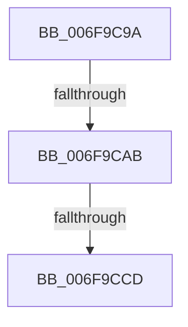

# sub_006F9C9A

- RVA: `0x006F9C9A`–`0x006F9CE8` (길이 `78` bytes)
- VA: `0x00000001406F9C9A`
- 실행 섹션: `.text`
- PDB 이름 있음: `아니요`; PDB Function 태그: `아니요`
- unwind 정보 RVA: `0x000B7588`
- 디코드: `18`개 명령, `78/78` bytes 표시
- 미해석 바이트: `0` (있으면 어셈블리에 `.byte`로 보존)

> 이 문서는 커널 이미지의 기계어와 PDB 기호를 분석해 생성했습니다. 4번과 5번은 함수 원형과 자료형을 바이너리 사용 방식에서 추정한 C 해석이며 원본 소스 복구 결과는 아닙니다.

## 1. Dependencies

- 직접 호출 지점: **3**; 고유 호출 대상: **3**
- 직접 호출자로 확인된 함수: **0**
- RIP 상대 이미지 참조: **0**

### Outgoing calls
- `0x006F9C9A` → [VfTargetDriversGetNode](../3E/VfTargetDriversGetNode_function_003EE174.md) (function, `0x003EE174`)
- `0x006F9CBF` → [ExAllocatePool2](../../poolcode/B8/ExAllocatePool2_function_00B820F0.md) (function, `0x00B820F0`)
- `0x006F9CDC` → [ViDifCaptureDriverEntry](../../pagevrfy/B9/ViDifCaptureDriverEntry_function_00B9A6FC.md) (function, `0x00B9A6FC`)

### Direct callers
- 이 함수 시작 RVA로 연결되는 직접 call은 확인되지 않았습니다. 간접 호출은 완전히 역산할 수 없습니다.

### Static image references
- 디코드된 RIP-relative 메모리 참조가 없습니다.

## 2. Other-region calls and transfers

- 다른 실행 섹션으로 향하는 call: **2**
  - `0x006F9CBF` → [ExAllocatePool2](../../poolcode/B8/ExAllocatePool2_function_00B820F0.md) (`.text` → `POOLCODE`)
  - `0x006F9CDC` → [ViDifCaptureDriverEntry](../../pagevrfy/B9/ViDifCaptureDriverEntry_function_00B9A6FC.md) (`.text` → `PAGEVRFY`)
- call이 아닌 외부 분기/꼬리 이동: **3**
  - `0x006F9CA5` → [VfDifCaptureDriverEntry + 0x1F](../4A/VfDifCaptureDriverEntry_function_004A86F8.md) (`tail-transfer`)
  - `0x006F9CC7` → [VfDifCaptureDriverEntry + 0x1F](../4A/VfDifCaptureDriverEntry_function_004A86F8.md) (`tail-transfer`)
  - `0x006F9CE3` → [VfDifCaptureDriverEntry + 0x21](../4A/VfDifCaptureDriverEntry_function_004A86F8.md) (`tail-transfer`)

## 3. Assembly (complete function range)

```asm
006F9C9A  E8 D5 44 CF FF                  call 0x1403ee174
006F9C9F  48 8B F8                        mov rdi, rax
006F9CA2  48 85 C0                        test rax, rax
006F9CA5  0F 84 6C EA DA FF               je 0x1404a8717
006F9CAB  BA 00 01 00 00                  mov edx, 0x100
006F9CB0  48 89 58 28                     mov qword ptr [rax + 0x28], rbx
006F9CB4  B9 40 00 00 00                  mov ecx, 0x40
006F9CB9  41 B8 56 66 43 62               mov r8d, 0x62436656
006F9CBF  E8 2C 84 48 00                  call 0x140b820f0
006F9CC4  48 85 C0                        test rax, rax
006F9CC7  0F 84 4A EA DA FF               je 0x1404a8717
006F9CCD  48 8B 4B 30                     mov rcx, qword ptr [rbx + 0x30]
006F9CD1  48 89 41 40                     mov qword ptr [rcx + 0x40], rax
006F9CD5  48 8B CB                        mov rcx, rbx
006F9CD8  48 89 47 30                     mov qword ptr [rdi + 0x30], rax
006F9CDC  E8 1B 0A 4A 00                  call 0x140b9a6fc
006F9CE1  B0 01                           mov al, 1
006F9CE3  E9 31 EA DA FF                  jmp 0x1404a8719
```

## 4. C-style interpretation (structured pseudocode)

```c
__int64 __fastcall sub_006F9C9A(void)
{
    __int64 result;

    result = VfTargetDriversGetNode(a1, a2, a3, a4);
    *(unsigned __int64 *)(result + 40) = v_rbx;
    result = ExAllocatePool2(64, 256, (unsigned int)(0x62436656ULL), a4);
    *(unsigned __int64 *)(*(unsigned __int64 *)(v_rbx + 48) + 64) = result;
    *(unsigned __int64 *)(result + 48) = result;
    result = ViDifCaptureDriverEntry(v_rbx, 256, (unsigned int)(0x62436656ULL), a4);
}
```

## 5. (Beta) C Style

```c
void sub_006F9C9A(void)
{
    int64_t result;

    result = VfTargetDriversGetNode(a1, a2, a3, a4);
    *(uint64_t *)(result + 0x28) = local_rbx;
    result = ExAllocatePool2(64, 256, (uint32_t)(0x62436656ULL), a4);
    *(uint64_t *)(*(uint64_t *)(local_rbx + 0x30) + 0x40) = result;
    *(uint64_t *)(result + 0x30) = result;
    result = ViDifCaptureDriverEntry(local_rbx, 256, (uint32_t)(0x62436656ULL), a4);
}
```

## 6. Execution-region graph

[열기: 2D/3D 그래프와 함수 탐색 컨트롤 패널](../../../control-panel.html?section=text&rva=0x006F9C9A&view=graph)

- 2D 그래프는 위에서 아래로 흐르고, 3D 그래프는 빈 공간을 드래그해 회전합니다. Shift+드래그는 이동, 휠은 확대·축소, 함수 노드 선택은 대상 보고서 이동입니다.

### Static fallback


