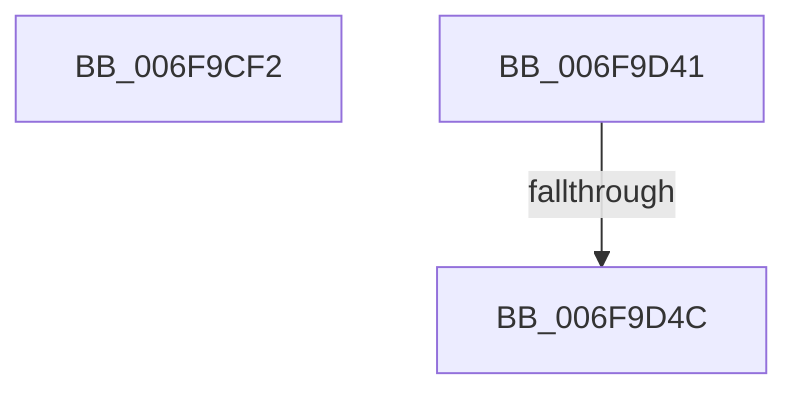

# sub_006F9CF2

- RVA: `0x006F9CF2`–`0x006F9D59` (길이 `103` bytes)
- VA: `0x00000001406F9CF2`
- 실행 섹션: `.text`
- PDB 이름 있음: `아니요`; PDB Function 태그: `아니요`
- unwind 정보 RVA: `0x000B77B4`
- 디코드: `23`개 명령, `103/103` bytes 표시
- 미해석 바이트: `0` (있으면 어셈블리에 `.byte`로 보존)

> 이 문서는 커널 이미지의 기계어와 PDB 기호를 분석해 생성했습니다. 4번과 5번은 함수 원형과 자료형을 바이너리 사용 방식에서 추정한 C 해석이며 원본 소스 복구 결과는 아닙니다.

## 1. Dependencies

- 직접 호출 지점: **1**; 고유 호출 대상: **1**
- 직접 호출자로 확인된 함수: **0**
- RIP 상대 이미지 참조: **0**

### Outgoing calls
- `0x006F9D36` → [KiCustomAccessRoutine5](../6B/KiCustomAccessRoutine5_function_006BC700.md) (function, `0x006BC700`)

### Direct callers
- 이 함수 시작 RVA로 연결되는 직접 call은 확인되지 않았습니다. 간접 호출은 완전히 역산할 수 없습니다.

### Static image references
- 디코드된 RIP-relative 메모리 참조가 없습니다.

## 2. Other-region calls and transfers

- 다른 실행 섹션으로 향하는 call: **0**
- call이 아닌 외부 분기/꼬리 이동: **3**
  - `0x006F9D3C` → [CmpLazyFlushDpcRoutine + 0x4B](../4A/CmpLazyFlushDpcRoutine_function_004A8900.md) (`tail-transfer`)
  - `0x006F9D46` → [CmpLazyFlushDpcRoutine + 0x7D](../4A/CmpLazyFlushDpcRoutine_function_004A8900.md) (`tail-transfer`)
  - `0x006F9D54` → [CmpLazyFlushDpcRoutine + 0x4B](../4A/CmpLazyFlushDpcRoutine_function_004A8900.md) (`tail-transfer`)

## 3. Assembly (complete function range)

```asm
006F9CF2  83 64 24 40 00                  and dword ptr [rsp + 0x40], 0
006F9CF7  C6 07 00                        mov byte ptr [rdi], 0
006F9CFA  49 8B C6                        mov rax, r14
006F9CFD  48 C1 E8 08                     shr rax, 8
006F9D01  48 89 47 20                     mov qword ptr [rdi + 0x20], rax
006F9D05  48 89 B4 24 76 01 00 00         mov qword ptr [rsp + 0x176], rsi
006F9D0D  8B CE                           mov ecx, esi
006F9D0F  48 8B C3                        mov rax, rbx
006F9D12  48 D3 C0                        rol rax, cl
006F9D15  48 89 84 24 4E 01 00 00         mov qword ptr [rsp + 0x14e], rax
006F9D1D  48 8B C7                        mov rax, rdi
006F9D20  48 D3 C8                        ror rax, cl
006F9D23  48 89 84 24 46 01 00 00         mov qword ptr [rsp + 0x146], rax
006F9D2B  4C 31 77 28                     xor qword ptr [rdi + 0x28], r14
006F9D2F  48 31 77 30                     xor qword ptr [rdi + 0x30], rsi
006F9D33  48 8B CB                        mov rcx, rbx
006F9D36  E8 C5 29 FC FF                  call 0x1406bc700
006F9D3B  90                              nop
006F9D3C  E9 0A EC DA FF                  jmp 0x1404a894b
006F9D41  83 7C 24 40 02                  cmp dword ptr [rsp + 0x40], 2
006F9D46  0F 84 31 EC DA FF               je 0x1404a897d
006F9D4C  48 8B 9C 24 98 01 00 00         mov rbx, qword ptr [rsp + 0x198]
006F9D54  E9 F2 EB DA FF                  jmp 0x1404a894b
```

## 4. C-style interpretation (structured pseudocode)

```c
__int64 __fastcall sub_006F9CF2(__int64 a1, __int64 a2, __int64 a3, __int64 a4, __int64 a5, __int64 a6, __int64 a7, unsigned int a8)
{
    __int64 result;
    unsigned __int64 v_stack_p146;
    unsigned __int64 v_stack_p14E;
    unsigned __int64 v_stack_p176;
    unsigned __int64 v_stack_p198;
    unsigned int v_stack_p40;

    *(unsigned __int8 *)(v_rdi) = 0;
    result = (v_r14) >> (8);
    *(unsigned __int64 *)(v_rdi + 32) = result;
    v_stack_p176 = v_rsi;
    v_stack_p14E = v_rbx;
    v_stack_p146 = v_rdi;
    result = KiCustomAccessRoutine5(v_rbx, a2, a3, a4);
}
```

## 5. (Beta) C Style

```c
int64_t sub_006F9CF2(int64_t Arg1, int64_t Arg2, int64_t Arg3, int64_t Arg4, uint64_t Arg5, uint64_t Arg6, uint64_t Arg7, uint32_t Arg8)
{
    int64_t result;
    uint64_t v_stack_p146;
    uint64_t v_stack_p14E;
    uint64_t v_stack_p176;
    uint64_t v_stack_p198;
    uint32_t v_stack_p40;

    *(uint8_t *)(local_rdi) = 0;
    result = (local_r14) >> (8);
    *(uint64_t *)(local_rdi + 0x20) = result;
    v_stack_p176 = local_rsi;
    v_stack_p14E = local_rbx;
    v_stack_p146 = local_rdi;
    result = KiCustomAccessRoutine5(local_rbx, Arg2, Arg3, Arg4);
}
```

## 6. Execution-region graph

[열기: 2D/3D 그래프와 함수 탐색 컨트롤 패널](../../../control-panel.html?section=text&rva=0x006F9CF2&view=graph)

- 2D 그래프는 위에서 아래로 흐르고, 3D 그래프는 빈 공간을 드래그해 회전합니다. Shift+드래그는 이동, 휠은 확대·축소, 함수 노드 선택은 대상 보고서 이동입니다.

### Static fallback


