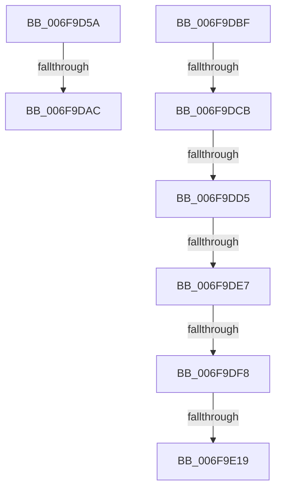

# sub_006F9D5A

- RVA: `0x006F9D5A`–`0x006F9E34` (길이 `218` bytes)
- VA: `0x00000001406F9D5A`
- 실행 섹션: `.text`
- PDB 이름 있음: `아니요`; PDB Function 태그: `아니요`
- unwind 정보 RVA: `0x000B7880`
- 디코드: `51`개 명령, `218/218` bytes 표시
- 미해석 바이트: `0` (있으면 어셈블리에 `.byte`로 보존)

> 이 문서는 커널 이미지의 기계어와 PDB 기호를 분석해 생성했습니다. 4번과 5번은 함수 원형과 자료형을 바이너리 사용 방식에서 추정한 C 해석이며 원본 소스 복구 결과는 아닙니다.

## 1. Dependencies

- 직접 호출 지점: **6**; 고유 호출 대상: **5**
- 직접 호출자로 확인된 함수: **0**
- RIP 상대 이미지 참조: **1**

### Outgoing calls
- `0x006F9D7F` → [MI_PAGE_TO_FULL_COLOR](../33/MI_PAGE_TO_FULL_COLOR_function_00337820.md) (function, `0x00337820`)
- `0x006F9D9D` → [MiGetSlabPage](../37/MiGetSlabPage_function_00376FBC.md) (function, `0x00376FBC`)
- `0x006F9DEA` → [MiGetPfnSlabType](../28/MiGetPfnSlabType_function_0028E2D0.md) (function, `0x0028E2D0`)
- `0x006F9DFB` → [MiGetPfnSlabType](../28/MiGetPfnSlabType_function_0028E2D0.md) (function, `0x0028E2D0`)
- `0x006F9E0C` → [MiReplaceTransitionPage](../2B/MiReplaceTransitionPage_function_002B1120.md) (function, `0x002B1120`)
- `0x006F9E27` → [MiSetOriginalPtePfnFromFreeList](../28/MiSetOriginalPtePfnFromFreeList_function_0028A99C.md) (function, `0x0028A99C`)

### Direct callers
- 이 함수 시작 RVA로 연결되는 직접 call은 확인되지 않았습니다. 간접 호출은 완전히 역산할 수 없습니다.

### Static image references
- `0x006F9E19` → RVA `0x00010880` (`.rdata`; read)

## 2. Other-region calls and transfers

- 다른 실행 섹션으로 향하는 call: **0**
- call이 아닌 외부 분기/꼬리 이동: **8**
  - `0x006F9DA6` → [MiFinalizeImageHeaderPage + 0x86](../4A/MiFinalizeImageHeaderPage_function_004A89A8.md) (`tail-transfer`)
  - `0x006F9DBA` → [MiFinalizeImageHeaderPage + 0x86](../4A/MiFinalizeImageHeaderPage_function_004A89A8.md) (`tail-transfer`)
  - `0x006F9DC5` → [MiFinalizeImageHeaderPage + 0xA2](../4A/MiFinalizeImageHeaderPage_function_004A89A8.md) (`tail-transfer`)
  - `0x006F9DCF` → [MiFinalizeImageHeaderPage + 0xA2](../4A/MiFinalizeImageHeaderPage_function_004A89A8.md) (`tail-transfer`)
  - `0x006F9DE1` → [MiFinalizeImageHeaderPage + 0xA2](../4A/MiFinalizeImageHeaderPage_function_004A89A8.md) (`tail-transfer`)
  - `0x006F9DF2` → [MiFinalizeImageHeaderPage + 0xA2](../4A/MiFinalizeImageHeaderPage_function_004A89A8.md) (`tail-transfer`)
  - `0x006F9E13` → [MiFinalizeImageHeaderPage + 0xA2](../4A/MiFinalizeImageHeaderPage_function_004A89A8.md) (`tail-transfer`)
  - `0x006F9E2F` → [MiFinalizeImageHeaderPage + 0xA2](../4A/MiFinalizeImageHeaderPage_function_004A89A8.md) (`tail-transfer`)

## 3. Assembly (complete function range)

```asm
006F9D5A  49 BC 00 00 00 00 00 DE FF FF   movabs r12, 0xffffde0000000000
006F9D64  49 8B C4                        mov rax, r12
006F9D67  48 8B CB                        mov rcx, rbx
006F9D6A  48 2B C8                        sub rcx, rax
006F9D6D  48 B8 AB AA AA AA AA AA AA AA   movabs rax, 0xaaaaaaaaaaaaaaab
006F9D77  48 C1 F9 04                     sar rcx, 4
006F9D7B  48 0F AF C8                     imul rcx, rax
006F9D7F  E8 9C DA C3 FF                  call 0x140337820
006F9D84  45 33 C9                        xor r9d, r9d
006F9D87  C7 44 24 28 00 00 02 00         mov dword ptr [rsp + 0x28], 0x20000
006F9D8F  48 83 4C 24 20 FF               or qword ptr [rsp + 0x20], 0xffffffffffffffff
006F9D95  44 8B C0                        mov r8d, eax
006F9D98  8B D6                           mov edx, esi
006F9D9A  48 8B CD                        mov rcx, rbp
006F9D9D  E8 1A D2 C7 FF                  call 0x140376fbc
006F9DA2  48 83 F8 FF                     cmp rax, -1
006F9DA6  0F 84 82 EC DA FF               je 0x1404a8a2e
006F9DAC  48 8D 3C 40                     lea rdi, [rax + rax*2]
006F9DB0  48 C1 E7 04                     shl rdi, 4
006F9DB4  49 8B C4                        mov rax, r12
006F9DB7  48 03 F8                        add rdi, rax
006F9DBA  E9 6F EC DA FF                  jmp 0x1404a8a2e
006F9DBF  8B 4B 20                        mov ecx, dword ptr [rbx + 0x20]
006F9DC2  66 85 C9                        test cx, cx
006F9DC5  0F 85 7F EC DA FF               jne 0x1404a8a4a
006F9DCB  44 38 7B 23                     cmp byte ptr [rbx + 0x23], r15b
006F9DCF  0F 8C 75 EC DA FF               jl 0x1404a8a4a
006F9DD5  8A 4B 22                        mov cl, byte ptr [rbx + 0x22]
006F9DD8  80 E1 07                        and cl, 7
006F9DDB  80 E9 02                        sub cl, 2
006F9DDE  80 F9 01                        cmp cl, 1
006F9DE1  0F 87 63 EC DA FF               ja 0x1404a8a4a
006F9DE7  48 8B CF                        mov rcx, rdi
006F9DEA  E8 E1 44 B9 FF                  call 0x14028e2d0
006F9DEF  83 F8 09                        cmp eax, 9
006F9DF2  0F 84 52 EC DA FF               je 0x1404a8a4a
006F9DF8  48 8B CB                        mov rcx, rbx
006F9DFB  E8 D0 44 B9 FF                  call 0x14028e2d0
006F9E00  44 8B C0                        mov r8d, eax
006F9E03  48 8B D7                        mov rdx, rdi
006F9E06  48 8B CB                        mov rcx, rbx
006F9E09  45 33 C9                        xor r9d, r9d
006F9E0C  E8 0F 73 BB FF                  call 0x1402b1120
006F9E11  85 C0                           test eax, eax
006F9E13  0F 84 31 EC DA FF               je 0x1404a8a4a
006F9E19  48 8B 05 60 6A 91 FF            mov rax, qword ptr [rip - 0x6e95a0]
006F9E20  49 8B CE                        mov rcx, r14
006F9E23  48 89 43 10                     mov qword ptr [rbx + 0x10], rax
006F9E27  E8 70 0B B9 FF                  call 0x14028a99c
006F9E2C  48 8B FB                        mov rdi, rbx
006F9E2F  E9 16 EC DA FF                  jmp 0x1404a8a4a
```

## 4. C-style interpretation (structured pseudocode)

```c
__int64 __fastcall sub_006F9D5A(__int64 a1, __int64 a2, __int64 a3, int a4)
{
    __int64 result;
    __int64 v_rdi;
    unsigned __int64 v_stack_p20;
    unsigned int v_stack_p28;

    a1 = (v_rbx) - (v_r12);
    a1 = (a1) >> (4);
    a1 = (a1) * (v_r12);
    result = MI_PAGE_TO_FULL_COLOR(a1, a2, a3, a4);
    a4 = 0;
    v_stack_p28 = 0x20000ULL;
    result = MiGetSlabPage(v_rbp, (unsigned int)((unsigned int)(v_rsi)), (unsigned int)((unsigned int)(result)), a4);
    v_rdi = (result + result * 2) << (4);
    v_rdi = (v_rdi) + (v_r12);
}
```

## 5. (Beta) C Style

```c
int64_t sub_006F9D5A(int64_t Arg1, int64_t Arg2, int64_t Arg3, int32_t Arg4)
{
    int64_t result;
    int64_t local_rdi;
    uint64_t v_stack_p20;
    uint32_t v_stack_p28;

    Arg1 = (local_rbx) - (local_r12);
    Arg1 = (Arg1) >> (4);
    Arg1 = (Arg1) * (local_r12);
    result = MI_PAGE_TO_FULL_COLOR(Arg1, Arg2, Arg3, Arg4);
    Arg4 = 0;
    v_stack_p28 = 0x20000ULL;
    result = MiGetSlabPage(local_rbp, (uint32_t)((uint32_t)(local_rsi)), (uint32_t)((uint32_t)(result)), Arg4);
    local_rdi = (result + result * 2) << (4);
    local_rdi = (local_rdi) + (local_r12);
}
```

## 6. Execution-region graph

[열기: 2D/3D 그래프와 함수 탐색 컨트롤 패널](../../../control-panel.html?section=text&rva=0x006F9D5A&view=graph)

- 2D 그래프는 위에서 아래로 흐르고, 3D 그래프는 빈 공간을 드래그해 회전합니다. Shift+드래그는 이동, 휠은 확대·축소, 함수 노드 선택은 대상 보고서 이동입니다.

### Static fallback


