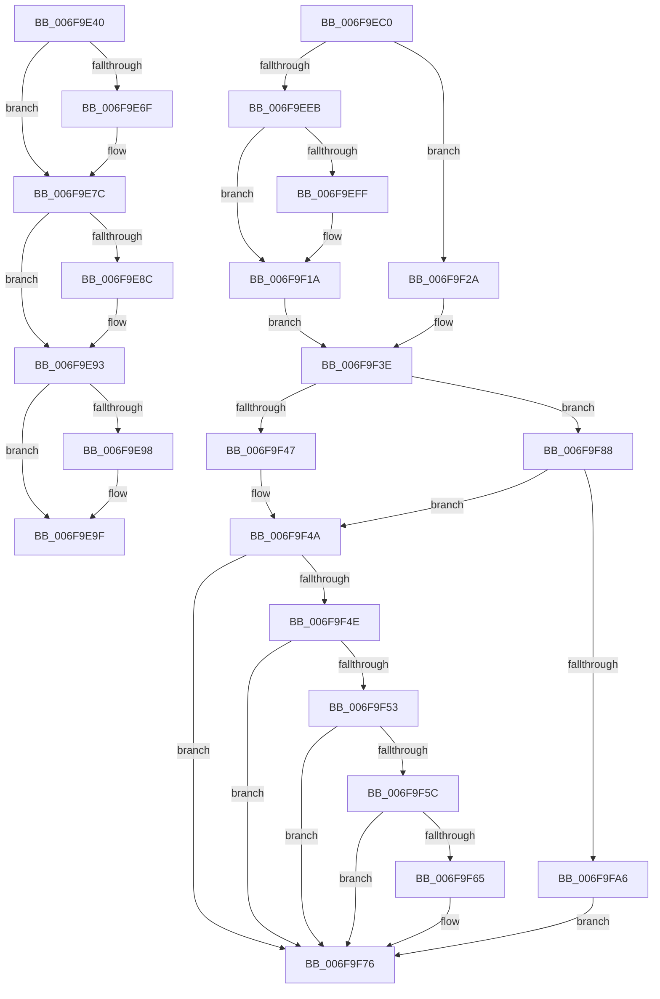

# sub_006F9E40

- RVA: `0x006F9E40`–`0x006F9FB6` (길이 `374` bytes)
- VA: `0x00000001406F9E40`
- 실행 섹션: `.text`
- PDB 이름 있음: `아니요`; PDB Function 태그: `아니요`
- unwind 정보 RVA: `0x000B78FC`
- 디코드: `86`개 명령, `374/374` bytes 표시
- 미해석 바이트: `0` (있으면 어셈블리에 `.byte`로 보존)

> 이 문서는 커널 이미지의 기계어와 PDB 기호를 분석해 생성했습니다. 4번과 5번은 함수 원형과 자료형을 바이너리 사용 방식에서 추정한 C 해석이며 원본 소스 복구 결과는 아닙니다.

## 1. Dependencies

- 직접 호출 지점: **15**; 고유 호출 대상: **12**
- 직접 호출자로 확인된 함수: **0**
- RIP 상대 이미지 참조: **16**

### Outgoing calls
- `0x006F9E65` → [PopThermalWriteShutdownToRegistry](../4C/PopThermalWriteShutdownToRegistry_function_004CDA6C.md) (function, `0x004CDA6C`)
- `0x006F9E77` → [ObfDereferenceObjectWithTag](../2F/ObfDereferenceObjectWithTag_function_002F78E0.md) (function, `0x002F78E0`)
- `0x006F9E83` → [PopAcquireRwLockExclusive](../43/PopAcquireRwLockExclusive_function_00430B44.md) (function, `0x00430B44`)
- `0x006F9EA6` → [PopReleaseRwLock](../2D/PopReleaseRwLock_function_002DFBBC.md) (function, `0x002DFBBC`)
- `0x006F9EB5` → [PopQueueWorkItem](../4A/PopQueueWorkItem_function_004A20F8.md) (function, `0x004A20F8`)
- `0x006F9ECD` → [PopDiagTraceThermalStateChange](../5D/PopDiagTraceThermalStateChange_function_005D702C.md) (function, `0x005D702C`)
- `0x006F9ED9` → [PopAcquireRwLockExclusive](../43/PopAcquireRwLockExclusive_function_00430B44.md) (function, `0x00430B44`)
- `0x006F9F15` → [PopTraceCr3Tripped](../5D/PopTraceCr3Tripped_function_005D78FC.md) (function, `0x005D78FC`)
- `0x006F9F23` → [PopTraceZoneCr3Tripped](../5D/PopTraceZoneCr3Tripped_function_005D82DC.md) (function, `0x005D82DC`)
- `0x006F9F33` → [PopTraceZoneCr3Mitigated](../5D/PopTraceZoneCr3Mitigated_function_005D81B4.md) (function, `0x005D81B4`)
- `0x006F9F68` → [PopThermalStandbyNotify](../5D/PopThermalStandbyNotify_function_005D55A0.md) (function, `0x005D55A0`)
- `0x006F9F7D` → [PopReleaseRwLock](../2D/PopReleaseRwLock_function_002DFBBC.md) (function, `0x002DFBBC`)
- `0x006F9F8D` → [PopThermalStandbyEndTracking](../4D/PopThermalStandbyEndTracking_function_004D1B2C.md) (function, `0x004D1B2C`)
- `0x006F9F98` → [PopTraceCr3Mitigated](../5D/PopTraceCr3Mitigated_function_005D7860.md) (function, `0x005D7860`)
- `0x006F9FA8` → [PopThermalStandbyNotify](../5D/PopThermalStandbyNotify_function_005D55A0.md) (function, `0x005D55A0`)

### Direct callers
- 이 함수 시작 RVA로 연결되는 직접 call은 확인되지 않았습니다. 간접 호출은 완전히 역산할 수 없습니다.

### Static image references
- `0x006F9E7C` → RVA `0x00F0B980` (`.data`; read)
- `0x006F9E8C` → RVA `0x00F0B991` (`.data`; write)
- `0x006F9E98` → RVA `0x00F0B993` (`.data`; write)
- `0x006F9EAE` → RVA `0x00F0B940` (`.data`; read)
- `0x006F9EC4` → RVA `0x00022A30` (`.rdata`; read)
- `0x006F9ED2` → RVA `0x00F0BB00` (`.data`; read)
- `0x006F9EEB` → RVA `0x00F0BB14` (`.data`; read)
- `0x006F9EF4` → RVA `0x00F0BB14` (`.data`; write)
- `0x006F9EFF` → RVA `0x00F0BB18` (`.data`; read)
- `0x006F9F08` → RVA `0x00F0BB1C` (`.data`; write)
- `0x006F9F0F` → RVA `0x00F0BB18` (`.data`; write)
- `0x006F9F38` → RVA `0x00F0BB14` (`.data`; read/write)
- `0x006F9F53` → RVA `0x00F0BB10` (`.data`; read)
- `0x006F9F5C` → RVA `0x00F0BB11` (`.data`; read)
- `0x006F9F6D` → RVA `0x00F0BB10` (`.data`; write)
- `0x006F9FAD` → RVA `0x00F0BB11` (`.data`; write)

## 2. Other-region calls and transfers

- 다른 실행 섹션으로 향하는 call: **0**
- call이 아닌 외부 분기/꼬리 이동: **2**
  - `0x006F9EBB` → [PopCheckAndHandleThermalConditions + 0x47](../4A/PopCheckAndHandleThermalConditions_function_004A8C00.md) (`tail-transfer`)
  - `0x006F9F83` → [PopCheckAndHandleThermalConditions + 0x6A](../4A/PopCheckAndHandleThermalConditions_function_004A8C00.md) (`tail-transfer`)

## 3. Assembly (complete function range)

```asm
006F9E40  4D 8B C6                        mov r8, r14
006F9E43  44 38 B7 E4 00 00 00            cmp byte ptr [rdi + 0xe4], r14b
006F9E4A  49 8D 80 80 00 00 00            lea rax, [r8 + 0x80]
006F9E51  48 8D 97 80 00 00 00            lea rdx, [rdi + 0x80]
006F9E58  49 0F 45 D6                     cmovne rdx, r14
006F9E5C  49 F7 D8                        neg r8
006F9E5F  48 1B C9                        sbb rcx, rcx
006F9E62  48 23 C8                        and rcx, rax
006F9E65  E8 02 3C DD FF                  call 0x1404cda6c
006F9E6A  48 85 ED                        test rbp, rbp
006F9E6D  74 0D                           je 0x1406f9e7c
006F9E6F  BA 50 6F 54 6D                  mov edx, 0x6d546f50
006F9E74  48 8B CD                        mov rcx, rbp
006F9E77  E8 64 DA BF FF                  call 0x1402f78e0
006F9E7C  48 8D 0D FD 1A 81 00            lea rcx, [rip + 0x811afd]
006F9E83  E8 BC 6C D3 FF                  call 0x140430b44
006F9E88  84 DB                           test bl, bl
006F9E8A  74 07                           je 0x1406f9e93
006F9E8C  44 88 3D FE 1A 81 00            mov byte ptr [rip + 0x811afe], r15b
006F9E93  40 84 F6                        test sil, sil
006F9E96  74 07                           je 0x1406f9e9f
006F9E98  44 88 3D F4 1A 81 00            mov byte ptr [rip + 0x811af4], r15b
006F9E9F  48 8D 0D DA 1A 81 00            lea rcx, [rip + 0x811ada]
006F9EA6  E8 11 5D BE FF                  call 0x1402dfbbc
006F9EAB  41 8B D7                        mov edx, r15d
006F9EAE  48 8D 0D 8B 1A 81 00            lea rcx, [rip + 0x811a8b]
006F9EB5  E8 3E 82 DA FF                  call 0x1404a20f8
006F9EBA  90                              nop
006F9EBB  E9 87 ED DA FF                  jmp 0x1404a8c47
006F9EC0  48 8B 4F 30                     mov rcx, qword ptr [rdi + 0x30]
006F9EC4  4C 8D 05 65 8B 92 FF            lea r8, [rip - 0x6d749b]
006F9ECB  8B D0                           mov edx, eax
006F9ECD  E8 5A D1 ED FF                  call 0x1405d702c
006F9ED2  48 8D 0D 27 1C 81 00            lea rcx, [rip + 0x811c27]
006F9ED9  E8 66 6C D3 FF                  call 0x140430b44
006F9EDE  8A 87 D3 00 00 00               mov al, byte ptr [rdi + 0xd3]
006F9EE4  88 47 48                        mov byte ptr [rdi + 0x48], al
006F9EE7  84 C0                           test al, al
006F9EE9  74 3F                           je 0x1406f9f2a
006F9EEB  8B 05 23 1C 81 00               mov eax, dword ptr [rip + 0x811c23]
006F9EF1  41 03 C7                        add eax, r15d
006F9EF4  89 05 1A 1C 81 00               mov dword ptr [rip + 0x811c1a], eax
006F9EFA  41 3B C7                        cmp eax, r15d
006F9EFD  75 1B                           jne 0x1406f9f1a
006F9EFF  8B 0D 13 1C 81 00               mov ecx, dword ptr [rip + 0x811c13]
006F9F05  41 03 CF                        add ecx, r15d
006F9F08  44 88 3D 0D 1C 81 00            mov byte ptr [rip + 0x811c0d], r15b
006F9F0F  89 0D 03 1C 81 00               mov dword ptr [rip + 0x811c03], ecx
006F9F15  E8 E2 D9 ED FF                  call 0x1405d78fc
006F9F1A  8B 0D F8 1B 81 00               mov ecx, dword ptr [rip + 0x811bf8]
006F9F20  48 8B D7                        mov rdx, rdi
006F9F23  E8 B4 E3 ED FF                  call 0x1405d82dc
006F9F28  EB 14                           jmp 0x1406f9f3e
006F9F2A  8B 0D E8 1B 81 00               mov ecx, dword ptr [rip + 0x811be8]
006F9F30  48 8B D7                        mov rdx, rdi
006F9F33  E8 7C E2 ED FF                  call 0x1405d81b4
006F9F38  FF 0D D6 1B 81 00               dec dword ptr [rip + 0x811bd6]
006F9F3E  44 39 35 CF 1B 81 00            cmp dword ptr [rip + 0x811bcf], r14d
006F9F45  76 41                           jbe 0x1406f9f88
006F9F47  41 8A FF                        mov dil, r15b
006F9F4A  84 DB                           test bl, bl
006F9F4C  75 28                           jne 0x1406f9f76
006F9F4E  40 84 FF                        test dil, dil
006F9F51  74 23                           je 0x1406f9f76
006F9F53  44 38 35 B6 1B 81 00            cmp byte ptr [rip + 0x811bb6], r14b
006F9F5A  74 1A                           je 0x1406f9f76
006F9F5C  44 38 35 AE 1B 81 00            cmp byte ptr [rip + 0x811bae], r14b
006F9F63  75 11                           jne 0x1406f9f76
006F9F65  41 8A CF                        mov cl, r15b
006F9F68  E8 33 B6 ED FF                  call 0x1405d55a0
006F9F6D  66 C7 05 9A 1B 81 00 00 01      mov word ptr [rip + 0x811b9a], 0x100
006F9F76  48 8D 0D 83 1B 81 00            lea rcx, [rip + 0x811b83]
006F9F7D  E8 3A 5C BE FF                  call 0x1402dfbbc
006F9F82  90                              nop
006F9F83  E9 E2 EC DA FF                  jmp 0x1404a8c6a
006F9F88  33 C9                           xor ecx, ecx
006F9F8A  41 8A FE                        mov dil, r14b
006F9F8D  E8 9A 7B DD FF                  call 0x1404d1b2c
006F9F92  8B 0D 80 1B 81 00               mov ecx, dword ptr [rip + 0x811b80]
006F9F98  E8 C3 D8 ED FF                  call 0x1405d7860
006F9F9D  44 38 35 6D 1B 81 00            cmp byte ptr [rip + 0x811b6d], r14b
006F9FA4  74 A4                           je 0x1406f9f4a
006F9FA6  33 C9                           xor ecx, ecx
006F9FA8  E8 F3 B5 ED FF                  call 0x1405d55a0
006F9FAD  44 88 35 5D 1B 81 00            mov byte ptr [rip + 0x811b5d], r14b
006F9FB4  EB C0                           jmp 0x1406f9f76
```

## 4. C-style interpretation (structured pseudocode)

```c
__int64 __fastcall sub_006F9E40(__int64 a1)
{
    __int64 result;

    a2 = v_rdi + 128;
    if ((*(unsigned __int8 *)(v_rdi + 228)) != ((unsigned __int8)(v_r14))) { a2 = v_r14; }
    a3 = -(v_r14);
    a1 = (a1) & (v_r14 + 128);
    result = PopThermalWriteShutdownToRegistry(a1, a2, a3, a4);
    if (v_rbp != 0) {
        a2 = 0x6D546F50ULL;
        a1 = v_rbp;
        result = ObfDereferenceObjectWithTag(a1, a2, a3, a4);
    }
    result = PopAcquireRwLockExclusive(v_rip + 8461053, a2, a3, a4);
    if ((unsigned __int8)(v_rbx) != 0) {
        *(unsigned __int8 *)(v_rip + 8461054) = (unsigned __int8)(v_r15);
    }
    if ((unsigned __int8)(v_rsi) != 0) {
        *(unsigned __int8 *)(v_rip + 8461044) = (unsigned __int8)(v_r15);
    }
    result = PopReleaseRwLock(v_rip + 8461018, a2, a3, a4);
    result = PopQueueWorkItem(v_rip + 8460939, (unsigned int)((unsigned int)(v_r15)), a3, a4);
}
```

## 5. (Beta) C Style

```c
int64_t sub_006F9E40(int64_t Arg1)
{
    int64_t result;

    a2 = local_rdi + 128;
    if ((*(uint8_t *)(local_rdi + 0xE4)) != ((uint8_t)(local_r14))) { a2 = local_r14; }
    a3 = -(local_r14);
    Arg1 = (Arg1) & (local_r14 + 128);
    result = PopThermalWriteShutdownToRegistry(Arg1, a2, a3, a4);
    if (local_rbp != 0) {
        a2 = 0x6D546F50ULL;
        Arg1 = local_rbp;
        result = ObfDereferenceObjectWithTag(Arg1, a2, a3, a4);
    }
    result = PopAcquireRwLockExclusive(v_rip + 8461053, a2, a3, a4);
    if ((uint8_t)(local_rbx) != 0) {
        *(uint8_t *)(v_rip + 0x811AFE) = (uint8_t)(local_r15);
    }
    if ((uint8_t)(local_rsi) != 0) {
        *(uint8_t *)(v_rip + 0x811AF4) = (uint8_t)(local_r15);
    }
    result = PopReleaseRwLock(v_rip + 8461018, a2, a3, a4);
    result = PopQueueWorkItem(v_rip + 8460939, (uint32_t)((uint32_t)(local_r15)), a3, a4);
}
```

## 6. Execution-region graph

[열기: 2D/3D 그래프와 함수 탐색 컨트롤 패널](../../../control-panel.html?section=text&rva=0x006F9E40&view=graph)

- 2D 그래프는 위에서 아래로 흐르고, 3D 그래프는 빈 공간을 드래그해 회전합니다. Shift+드래그는 이동, 휠은 확대·축소, 함수 노드 선택은 대상 보고서 이동입니다.

### Static fallback


