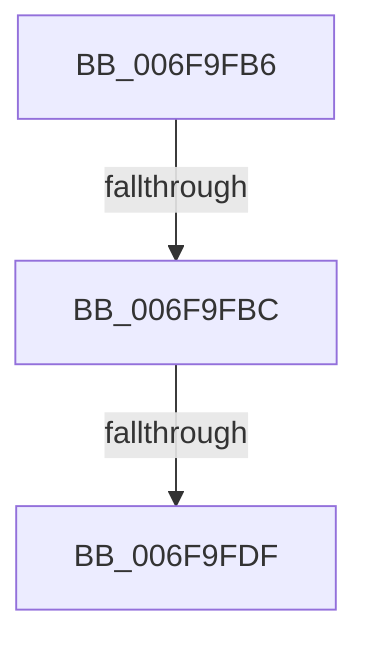

# sub_006F9FB6

- RVA: `0x006F9FB6`–`0x006F9FE6` (길이 `48` bytes)
- VA: `0x00000001406F9FB6`
- 실행 섹션: `.text`
- PDB 이름 있음: `아니요`; PDB Function 태그: `아니요`
- unwind 정보 RVA: `0x000B792C`
- 디코드: `12`개 명령, `48/48` bytes 표시
- 미해석 바이트: `0` (있으면 어셈블리에 `.byte`로 보존)

> 이 문서는 커널 이미지의 기계어와 PDB 기호를 분석해 생성했습니다. 4번과 5번은 함수 원형과 자료형을 바이너리 사용 방식에서 추정한 C 해석이며 원본 소스 복구 결과는 아닙니다.

## 1. Dependencies

- 직접 호출 지점: **1**; 고유 호출 대상: **1**
- 직접 호출자로 확인된 함수: **0**
- RIP 상대 이미지 참조: **0**

### Outgoing calls
- `0x006F9FD2` → [SepSidInToken](../3D/SepSidInToken_function_003D0430.md) (function, `0x003D0430`)

### Direct callers
- 이 함수 시작 RVA로 연결되는 직접 call은 확인되지 않았습니다. 간접 호출은 완전히 역산할 수 없습니다.

### Static image references
- 디코드된 RIP-relative 메모리 참조가 없습니다.

## 2. Other-region calls and transfers

- 다른 실행 섹션으로 향하는 call: **0**
- call이 아닌 외부 분기/꼬리 이동: **3**
  - `0x006F9FB6` → [SeMaximumAuditMask + 0x59](../4A/SeMaximumAuditMask_function_004A8D2C.md) (`tail-transfer`)
  - `0x006F9FD9` → [SeMaximumAuditMask + 0x59](../4A/SeMaximumAuditMask_function_004A8D2C.md) (`tail-transfer`)
  - `0x006F9FE1` → [SeMaximumAuditMask + 0x59](../4A/SeMaximumAuditMask_function_004A8D2C.md) (`tail-transfer`)

## 3. Assembly (complete function range)

```asm
006F9FB6  0F 84 C9 ED DA FF               je 0x1404a8d85
006F9FBC  44 88 64 24 28                  mov byte ptr [rsp + 0x28], r12b
006F9FC1  4C 8D 43 08                     lea r8, [rbx + 8]
006F9FC5  41 B1 01                        mov r9b, 1
006F9FC8  44 88 64 24 20                  mov byte ptr [rsp + 0x20], r12b
006F9FCD  33 D2                           xor edx, edx
006F9FCF  49 8B CF                        mov rcx, r15
006F9FD2  E8 59 64 CD FF                  call 0x1403d0430
006F9FD7  84 C0                           test al, al
006F9FD9  0F 84 A6 ED DA FF               je 0x1404a8d85
006F9FDF  09 37                           or dword ptr [rdi], esi
006F9FE1  E9 9F ED DA FF                  jmp 0x1404a8d85
```

## 4. C-style interpretation (structured pseudocode)

```c
__int64 __fastcall sub_006F9FB6(__int64 a1, int a2)
{
    __int64 result;
    unsigned __int8 v_stack_p20;
    unsigned __int8 v_stack_p28;

    v_stack_p28 = (unsigned __int8)(v_r12);
    v_stack_p20 = (unsigned __int8)(v_r12);
    a2 = 0;
    result = SepSidInToken(v_r15, a2, v_rbx + 8, 1);
}
```

## 5. (Beta) C Style

```c
int64_t sub_006F9FB6(int64_t Arg1, int32_t Arg2)
{
    int64_t result;
    uint8_t v_stack_p20;
    uint8_t v_stack_p28;

    v_stack_p28 = (uint8_t)(local_r12);
    v_stack_p20 = (uint8_t)(local_r12);
    Arg2 = 0;
    result = SepSidInToken(local_r15, Arg2, local_rbx + 8, 1);
}
```

## 6. Execution-region graph

[열기: 2D/3D 그래프와 함수 탐색 컨트롤 패널](../../../control-panel.html?section=text&rva=0x006F9FB6&view=graph)

- 2D 그래프는 위에서 아래로 흐르고, 3D 그래프는 빈 공간을 드래그해 회전합니다. Shift+드래그는 이동, 휠은 확대·축소, 함수 노드 선택은 대상 보고서 이동입니다.

### Static fallback


