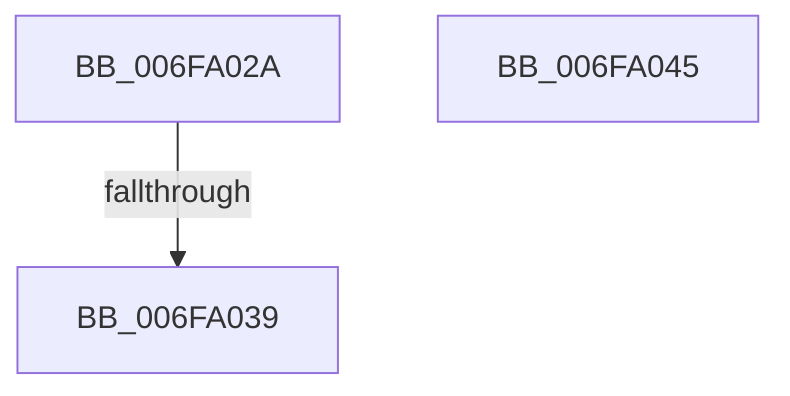

# sub_006FA02A

- RVA: `0x006FA02A`–`0x006FA051` (길이 `39` bytes)
- VA: `0x00000001406FA02A`
- 실행 섹션: `.text`
- PDB 이름 있음: `아니요`; PDB Function 태그: `아니요`
- unwind 정보 RVA: `0x000B7BE8`
- 디코드: `7`개 명령, `39/39` bytes 표시
- 미해석 바이트: `0` (있으면 어셈블리에 `.byte`로 보존)

> 이 문서는 커널 이미지의 기계어와 PDB 기호를 분석해 생성했습니다. 4번과 5번은 함수 원형과 자료형을 바이너리 사용 방식에서 추정한 C 해석이며 원본 소스 복구 결과는 아닙니다.

## 1. Dependencies

- 직접 호출 지점: **0**; 고유 호출 대상: **0**
- 직접 호출자로 확인된 함수: **0**
- RIP 상대 이미지 참조: **3**

### Outgoing calls
- 직접 디코드된 call 명령이 없습니다.

### Direct callers
- 이 함수 시작 RVA로 연결되는 직접 call은 확인되지 않았습니다. 간접 호출은 완전히 역산할 수 없습니다.

### Static image references
- `0x006FA02A` → RVA `0x00F23434` (`.data`; write)
- `0x006FA039` → RVA `0x00F2343C` (`.data`; write)
- `0x006FA045` → RVA `0x00F23438` (`.data`; read/write)

## 2. Other-region calls and transfers

- 다른 실행 섹션으로 향하는 call: **0**
- call이 아닌 외부 분기/꼬리 이동: **3**
  - `0x006FA033` → [KiUpdateMinimumWeight + 0x87](../4A/KiUpdateMinimumWeight_function_004A9DCC.md) (`tail-transfer`)
  - `0x006FA040` → [KiUpdateMinimumWeight + 0x87](../4A/KiUpdateMinimumWeight_function_004A9DCC.md) (`tail-transfer`)
  - `0x006FA04C` → [KiUpdateMinimumWeight + 0x87](../4A/KiUpdateMinimumWeight_function_004A9DCC.md) (`tail-transfer`)

## 3. Assembly (complete function range)

```asm
006FA02A  89 0D 04 94 82 00               mov dword ptr [rip + 0x829404], ecx
006FA030  40 84 FF                        test dil, dil
006FA033  0F 84 1A FE DA FF               je 0x1404a9e53
006FA039  44 89 15 FC 93 82 00            mov dword ptr [rip + 0x8293fc], r10d
006FA040  E9 0E FE DA FF                  jmp 0x1404a9e53
006FA045  83 25 EC 93 82 00 00            and dword ptr [rip + 0x8293ec], 0
006FA04C  E9 02 FE DA FF                  jmp 0x1404a9e53
```

## 4. C-style interpretation (structured pseudocode)

```c
void __fastcall sub_006FA02A(int a1)
{
    *(unsigned int *)(v_rip + 8557572) = a1;
    *(unsigned int *)(v_rip + 8557564) = (unsigned int)(v_r10);
}
```

## 5. (Beta) C Style

```c
void sub_006FA02A(int32_t Arg1)
{
    *(uint32_t *)(v_rip + 0x829404) = Arg1;
    *(uint32_t *)(v_rip + 0x8293FC) = (uint32_t)(local_r10);
}
```

## 6. Execution-region graph

[열기: 2D/3D 그래프와 함수 탐색 컨트롤 패널](../../../control-panel.html?section=text&rva=0x006FA02A&view=graph)

- 2D 그래프는 위에서 아래로 흐르고, 3D 그래프는 빈 공간을 드래그해 회전합니다. Shift+드래그는 이동, 휠은 확대·축소, 함수 노드 선택은 대상 보고서 이동입니다.

### Static fallback


