# sub_006FA0AE

- RVA: `0x006FA0AE`–`0x006FA441` (길이 `915` bytes)
- VA: `0x00000001406FA0AE`
- 실행 섹션: `.text`
- PDB 이름 있음: `아니요`; PDB Function 태그: `아니요`
- unwind 정보 RVA: `0x000B7E70`
- 디코드: `224`개 명령, `915/915` bytes 표시
- 미해석 바이트: `0` (있으면 어셈블리에 `.byte`로 보존)

> 이 문서는 커널 이미지의 기계어와 PDB 기호를 분석해 생성했습니다. 4번과 5번은 함수 원형과 자료형을 바이너리 사용 방식에서 추정한 C 해석이며 원본 소스 복구 결과는 아닙니다.

## 1. Dependencies

- 직접 호출 지점: **12**; 고유 호출 대상: **7**
- 직접 호출자로 확인된 함수: **0**
- RIP 상대 이미지 참조: **6**

### Outgoing calls
- `0x006FA13A` → [KeGetPrcb](../2D/KeGetPrcb_function_002D85D0.md) (function, `0x002D85D0`)
- `0x006FA155` → [PpmHeteroUtilityToNormalizedUtility](../41/PpmHeteroUtilityToNormalizedUtility_function_00413394.md) (function, `0x00413394`)
- `0x006FA165` → [PpmHeteroUtilityToNormalizedUtility](../41/PpmHeteroUtilityToNormalizedUtility_function_00413394.md) (function, `0x00413394`)
- `0x006FA182` → [KeEnumerateNextProcessor](../41/KeEnumerateNextProcessor_function_00415480.md) (function, `0x00415480`)
- `0x006FA19F` → [qsort](../50/qsort_function_005009F0.md) (function, `0x005009F0`)
- `0x006FA1B9` → [qsort](../50/qsort_function_005009F0.md) (function, `0x005009F0`)
- `0x006FA27A` → [PpmHeteroUtilityGreaterThanOrEqualThreshold](../41/PpmHeteroUtilityGreaterThanOrEqualThreshold_function_004124A0.md) (function, `0x004124A0`)
- `0x006FA293` → [PpmHeteroUtilityGreaterThanOrEqualThreshold](../41/PpmHeteroUtilityGreaterThanOrEqualThreshold_function_004124A0.md) (function, `0x004124A0`)
- `0x006FA300` → [PpmHeteroUtilityGreaterThanOrEqualThreshold](../41/PpmHeteroUtilityGreaterThanOrEqualThreshold_function_004124A0.md) (function, `0x004124A0`)
- `0x006FA31C` → [PpmHeteroUtilityGreaterThanOrEqualThreshold](../41/PpmHeteroUtilityGreaterThanOrEqualThreshold_function_004124A0.md) (function, `0x004124A0`)
- `0x006FA41A` → [PpmEventTraceHeteroResponse](../41/PpmEventTraceHeteroResponse_function_004133AC.md) (function, `0x004133AC`)
- `0x006FA435` → [PpmParkCalculateUnparkCount](../41/PpmParkCalculateUnparkCount_function_00413750.md) (function, `0x00413750`)

### Direct callers
- 이 함수 시작 RVA로 연결되는 직접 call은 확인되지 않았습니다. 간접 호출은 완전히 역산할 수 없습니다.

### Static image references
- `0x006FA0B1` → RVA `0x00F083E0` (`.data`; read)
- `0x006FA0CD` → RVA `0x00F083D8` (`.data`; read)
- `0x006FA0D4` → RVA `0x00FC6A86` (`ALMOSTRO`; read)
- `0x006FA0F3` → RVA `0x00FC5038` (`ALMOSTRO`; read)
- `0x006FA13F` → RVA `0x00F0B244` (`.data`; read)
- `0x006FA18B` → RVA `0x0047F870` (`PpmUtilityComparer`; read)

## 2. Other-region calls and transfers

- 다른 실행 섹션으로 향하는 call: **0**
- call이 아닌 외부 분기/꼬리 이동: **1**
  - `0x006FA43C` → [PpmCheckComputeHeteroResponse + 0x57](../4A/PpmCheckComputeHeteroResponse_function_004AACD0.md) (`tail-transfer`)

## 3. Assembly (complete function range)

```asm
006FA0AE  41 8B CD                        mov ecx, r13d
006FA0B1  39 0D 29 E3 80 00               cmp dword ptr [rip + 0x80e329], ecx
006FA0B7  89 4C 24 38                     mov dword ptr [rsp + 0x38], ecx
006FA0BB  0F 84 74 03 00 00               je 0x1406fa435
006FA0C1  8B C1                           mov eax, ecx
006FA0C3  41 8B F5                        mov esi, r13d
006FA0C6  48 69 F8 10 05 00 00            imul rdi, rax, 0x510
006FA0CD  48 03 3D 04 E3 80 00            add rdi, qword ptr [rip + 0x80e304]
006FA0D4  44 38 2D AB C9 8C 00            cmp byte ptr [rip + 0x8cc9ab], r13b
006FA0DB  48 89 7C 24 60                  mov qword ptr [rsp + 0x60], rdi
006FA0E0  74 1E                           je 0x1406fa100
006FA0E2  48 8B 87 08 05 00 00            mov rax, qword ptr [rdi + 0x508]
006FA0E9  66 44 39 A8 80 02 00 00         cmp word ptr [rax + 0x280], r13w
006FA0F1  75 0D                           jne 0x1406fa100
006FA0F3  44 39 2D 3E AF 8C 00            cmp dword ptr [rip + 0x8caf3e], r13d
006FA0FA  0F 84 23 03 00 00               je 0x1406fa423
006FA100  48 8B 87 08 05 00 00            mov rax, qword ptr [rdi + 0x508]
006FA107  4D 8B F5                        mov r14, r13
006FA10A  0F B7 4F 04                     movzx ecx, word ptr [rdi + 4]
006FA10E  4D 8B E5                        mov r12, r13
006FA111  48 8B 57 10                     mov rdx, qword ptr [rdi + 0x10]
006FA115  44 89 6C 24 30                  mov dword ptr [rsp + 0x30], r13d
006FA11A  44 0F B7 B8 88 02 00 00         movzx r15d, word ptr [rax + 0x288]
006FA122  41 8B DD                        mov ebx, r13d
006FA125  66 89 4C 24 58                  mov word ptr [rsp + 0x58], cx
006FA12A  48 89 54 24 50                  mov qword ptr [rsp + 0x50], rdx
006FA12F  4C 89 6C 24 48                  mov qword ptr [rsp + 0x48], r13
006FA134  EB 42                           jmp 0x1406fa178
006FA136  8B 4C 24 30                     mov ecx, dword ptr [rsp + 0x30]
006FA13A  E8 91 E4 BD FF                  call 0x1402d85d0
006FA13F  83 3D FE 10 81 00 05            cmp dword ptr [rip + 0x8110fe], 5
006FA146  48 8D 88 B0 89 00 00            lea rcx, [rax + 0x89b0]
006FA14D  8B 51 28                        mov edx, dword ptr [rcx + 0x28]
006FA150  74 03                           je 0x1406fa155
006FA152  2B 51 30                        sub edx, dword ptr [rcx + 0x30]
006FA155  E8 3A 92 D1 FF                  call 0x140413394
006FA15A  44 8B C8                        mov r9d, eax
006FA15D  44 89 4C 9D 70                  mov dword ptr [rbp + rbx*4 + 0x70], r9d
006FA162  8B 51 34                        mov edx, dword ptr [rcx + 0x34]
006FA165  E8 2A 92 D1 FF                  call 0x140413394
006FA16A  8B C8                           mov ecx, eax
006FA16C  4D 03 E1                        add r12, r9
006FA16F  4C 03 F1                        add r14, rcx
006FA172  89 4C 9C 70                     mov dword ptr [rsp + rbx*4 + 0x70], ecx
006FA176  FF C3                           inc ebx
006FA178  48 8D 54 24 48                  lea rdx, [rsp + 0x48]
006FA17D  48 8D 4C 24 30                  lea rcx, [rsp + 0x30]
006FA182  E8 F9 B2 D1 FF                  call 0x140415480
006FA187  85 C0                           test eax, eax
006FA189  74 AB                           je 0x1406fa136
006FA18B  4C 8D 0D DE 56 D8 FF            lea r9, [rip - 0x27a922]
006FA192  41 B8 04 00 00 00               mov r8d, 4
006FA198  48 8B D3                        mov rdx, rbx
006FA19B  48 8D 4D 70                     lea rcx, [rbp + 0x70]
006FA19F  E8 4C 68 E0 FF                  call 0x1405009f0
006FA1A4  4C 8D 0D C5 56 D8 FF            lea r9, [rip - 0x27a93b]
006FA1AB  41 B8 04 00 00 00               mov r8d, 4
006FA1B1  48 8B D3                        mov rdx, rbx
006FA1B4  48 8D 4C 24 70                  lea rcx, [rsp + 0x70]
006FA1B9  E8 32 68 E0 FF                  call 0x1405009f0
006FA1BE  0F B7 4F 0A                     movzx ecx, word ptr [rdi + 0xa]
006FA1C2  4D 8B D5                        mov r10, r13
006FA1C5  48 8B 87 68 04 00 00            mov rax, qword ptr [rdi + 0x468]
006FA1CC  4D 8B CD                        mov r9, r13
006FA1CF  4C 89 6C 24 30                  mov qword ptr [rsp + 0x30], r13
006FA1D4  85 C9                           test ecx, ecx
006FA1D6  74 34                           je 0x1406fa20c
006FA1D8  8B D1                           mov edx, ecx
006FA1DA  4C 8D 04 C8                     lea r8, [rax + rcx*8]
006FA1DE  49 8B C4                        mov rax, r12
006FA1E1  49 0F AF 00                     imul rax, qword ptr [r8]
006FA1E5  4C 03 C8                        add r9, rax
006FA1E8  48 8B C2                        mov rax, rdx
006FA1EB  FF C9                           dec ecx
006FA1ED  48 FF CA                        dec rdx
006FA1F0  4C 89 8C CD 70 01 00 00         mov qword ptr [rbp + rcx*8 + 0x170], r9
006FA1F8  49 0F AF 00                     imul rax, qword ptr [r8]
006FA1FC  4D 8D 40 F8                     lea r8, [r8 - 8]
006FA200  4C 03 D0                        add r10, rax
006FA203  85 C9                           test ecx, ecx
006FA205  75 D7                           jne 0x1406fa1de
006FA207  4C 89 54 24 30                  mov qword ptr [rsp + 0x30], r10
006FA20C  45 85 FF                        test r15d, r15d
006FA20F  74 17                           je 0x1406fa228
006FA211  48 8D 4C 24 70                  lea rcx, [rsp + 0x70]
006FA216  49 8B D7                        mov rdx, r15
006FA219  8B 01                           mov eax, dword ptr [rcx]
006FA21B  48 8D 49 04                     lea rcx, [rcx + 4]
006FA21F  4C 2B F0                        sub r14, rax
006FA222  48 83 EA 01                     sub rdx, 1
006FA226  75 F1                           jne 0x1406fa219
006FA228  44 38 2D 57 C8 8C 00            cmp byte ptr [rip + 0x8cc857], r13b
006FA22F  48 8B 87 08 05 00 00            mov rax, qword ptr [rdi + 0x508]
006FA236  8A 88 80 02 00 00               mov cl, byte ptr [rax + 0x280]
006FA23C  74 03                           je 0x1406fa241
006FA23E  8A 4F 0A                        mov cl, byte ptr [rdi + 0xa]
006FA241  44 0F B6 E9                     movzx r13d, cl
006FA245  41 8B DF                        mov ebx, r15d
006FA248  45 3B FD                        cmp r15d, r13d
006FA24B  73 77                           jae 0x1406fa2c4
006FA24D  48 8B 7C 24 40                  mov rdi, qword ptr [rsp + 0x40]
006FA252  EB 05                           jmp 0x1406fa259
006FA254  4C 8B 54 24 30                  mov r10, qword ptr [rsp + 0x30]
006FA259  83 64 24 20 00                  and dword ptr [rsp + 0x20], 0
006FA25E  49 8B CA                        mov rcx, r10
006FA261  44 8B E3                        mov r12d, ebx
006FA264  45 0F B6 8C 3C 33 01 00 00      movzx r9d, byte ptr [r12 + rdi + 0x133]
006FA26D  42 8B 54 A5 70                  mov edx, dword ptr [rbp + r12*4 + 0x70]
006FA272  4E 8B 84 E5 70 01 00 00         mov r8, qword ptr [rbp + r12*8 + 0x170]
006FA27A  E8 21 82 D1 FF                  call 0x1404124a0
006FA27F  85 C0                           test eax, eax
006FA281  74 28                           je 0x1406fa2ab
006FA283  48 8B 4C 24 30                  mov rcx, qword ptr [rsp + 0x30]
006FA288  45 33 C0                        xor r8d, r8d
006FA28B  83 64 24 20 00                  and dword ptr [rsp + 0x20], 0
006FA290  49 8B D6                        mov rdx, r14
006FA293  E8 08 82 D1 FF                  call 0x1404124a0
006FA298  85 C0                           test eax, eax
006FA29A  74 0F                           je 0x1406fa2ab
006FA29C  42 8B 44 A4 70                  mov eax, dword ptr [rsp + r12*4 + 0x70]
006FA2A1  FF C3                           inc ebx
006FA2A3  4C 2B F0                        sub r14, rax
006FA2A6  41 3B DD                        cmp ebx, r13d
006FA2A9  72 A9                           jb 0x1406fa254
006FA2AB  48 8B 7C 24 60                  mov rdi, qword ptr [rsp + 0x60]
006FA2B0  41 3B DF                        cmp ebx, r15d
006FA2B3  76 0A                           jbe 0x1406fa2bf
006FA2B5  B9 02 00 00 00                  mov ecx, 2
006FA2BA  45 33 ED                        xor r13d, r13d
006FA2BD  EB 72                           jmp 0x1406fa331
006FA2BF  4C 8B 54 24 30                  mov r10, qword ptr [rsp + 0x30]
006FA2C4  45 33 ED                        xor r13d, r13d
006FA2C7  EB 05                           jmp 0x1406fa2ce
006FA2C9  4C 8B 54 24 30                  mov r10, qword ptr [rsp + 0x30]
006FA2CE  44 8B E3                        mov r12d, ebx
006FA2D1  85 DB                           test ebx, ebx
006FA2D3  74 53                           je 0x1406fa328
006FA2D5  FF CB                           dec ebx
006FA2D7  44 89 6C 24 20                  mov dword ptr [rsp + 0x20], r13d
006FA2DC  49 8B CA                        mov rcx, r10
006FA2DF  8B 44 9C 70                     mov eax, dword ptr [rsp + rbx*4 + 0x70]
006FA2E3  8B 54 9D 70                     mov edx, dword ptr [rbp + rbx*4 + 0x70]
006FA2E7  4C 03 F0                        add r14, rax
006FA2EA  48 8B 44 24 40                  mov rax, qword ptr [rsp + 0x40]
006FA2EF  4C 8B 84 DD 70 01 00 00         mov r8, qword ptr [rbp + rbx*8 + 0x170]
006FA2F7  44 0F B6 8C 03 B3 00 00 00      movzx r9d, byte ptr [rbx + rax + 0xb3]
006FA300  E8 9B 81 D1 FF                  call 0x1404124a0
006FA305  4C 8B 54 24 30                  mov r10, qword ptr [rsp + 0x30]
006FA30A  85 C0                           test eax, eax
006FA30C  74 C0                           je 0x1406fa2ce
006FA30E  45 33 C0                        xor r8d, r8d
006FA311  44 89 6C 24 20                  mov dword ptr [rsp + 0x20], r13d
006FA316  49 8B D6                        mov rdx, r14
006FA319  49 8B CA                        mov rcx, r10
006FA31C  E8 7F 81 D1 FF                  call 0x1404124a0
006FA321  85 C0                           test eax, eax
006FA323  74 A4                           je 0x1406fa2c9
006FA325  41 8B DC                        mov ebx, r12d
006FA328  41 3B DF                        cmp ebx, r15d
006FA32B  41 8B CD                        mov ecx, r13d
006FA32E  0F 92 C1                        setb cl
006FA331  0F BE 87 A4 04 00 00            movsx eax, byte ptr [rdi + 0x4a4]
006FA338  3B C1                           cmp eax, ecx
006FA33A  75 13                           jne 0x1406fa34f
006FA33C  8A 87 A2 04 00 00               mov al, byte ptr [rdi + 0x4a2]
006FA342  FE C0                           inc al
006FA344  0F B6 D0                        movzx edx, al
006FA347  88 97 A2 04 00 00               mov byte ptr [rdi + 0x4a2], dl
006FA34D  EB 15                           jmp 0x1406fa364
006FA34F  BA 01 00 00 00                  mov edx, 1
006FA354  88 8F A4 04 00 00               mov byte ptr [rdi + 0x4a4], cl
006FA35A  C6 87 A2 04 00 00 01            mov byte ptr [rdi + 0x4a2], 1
006FA361  8D 72 03                        lea esi, [rdx + 3]
006FA364  83 3D D9 0E 81 00 05            cmp dword ptr [rip + 0x810ed9], 5
006FA36B  75 05                           jne 0x1406fa372
006FA36D  83 CE 10                        or esi, 0x10
006FA370  EB 32                           jmp 0x1406fa3a4
006FA372  83 F9 02                        cmp ecx, 2
006FA375  75 15                           jne 0x1406fa38c
006FA377  48 8B 44 24 40                  mov rax, qword ptr [rsp + 0x40]
006FA37C  0F B6 80 B2 00 00 00            movzx eax, byte ptr [rax + 0xb2]
006FA383  3B D0                           cmp edx, eax
006FA385  72 2E                           jb 0x1406fa3b5
006FA387  83 CE 20                        or esi, 0x20
006FA38A  EB 18                           jmp 0x1406fa3a4
006FA38C  83 F9 01                        cmp ecx, 1
006FA38F  75 24                           jne 0x1406fa3b5
006FA391  48 8B 44 24 40                  mov rax, qword ptr [rsp + 0x40]
006FA396  0F B6 80 B1 00 00 00            movzx eax, byte ptr [rax + 0xb1]
006FA39D  3B D0                           cmp edx, eax
006FA39F  72 14                           jb 0x1406fa3b5
006FA3A1  83 CE 40                        or esi, 0x40
006FA3A4  48 8B 87 08 05 00 00            mov rax, qword ptr [rdi + 0x508]
006FA3AB  0F B6 CB                        movzx ecx, bl
006FA3AE  66 89 88 86 02 00 00            mov word ptr [rax + 0x286], cx
006FA3B5  8A 87 A0 04 00 00               mov al, byte ptr [rdi + 0x4a0]
006FA3BB  24 FD                           and al, 0xfd
006FA3BD  0C 04                           or al, 4
006FA3BF  44 38 2D C0 C6 8C 00            cmp byte ptr [rip + 0x8cc6c0], r13b
006FA3C6  88 87 A0 04 00 00               mov byte ptr [rdi + 0x4a0], al
006FA3CC  74 2E                           je 0x1406fa3fc
006FA3CE  48 8B 97 08 05 00 00            mov rdx, qword ptr [rdi + 0x508]
006FA3D5  0F BA EE 07                     bts esi, 7
006FA3D9  0F B7 82 86 02 00 00            movzx eax, word ptr [rdx + 0x286]
006FA3E0  66 89 82 88 02 00 00            mov word ptr [rdx + 0x288], ax
006FA3E7  48 8B 87 08 05 00 00            mov rax, qword ptr [rdi + 0x508]
006FA3EE  0F B7 90 86 02 00 00            movzx edx, word ptr [rax + 0x286]
006FA3F5  66 89 97 F0 04 00 00            mov word ptr [rdi + 0x4f0], dx
006FA3FC  4C 8B 4C 24 30                  mov r9, qword ptr [rsp + 0x30]
006FA401  4C 8D 85 70 01 00 00            lea r8, [rbp + 0x170]
006FA408  83 CE 01                        or esi, 1
006FA40B  48 8D 55 70                     lea rdx, [rbp + 0x70]
006FA40F  89 74 24 28                     mov dword ptr [rsp + 0x28], esi
006FA413  48 8B CF                        mov rcx, rdi
006FA416  88 5C 24 20                     mov byte ptr [rsp + 0x20], bl
006FA41A  E8 8D 8F D1 FF                  call 0x1404133ac
006FA41F  8B 4C 24 38                     mov ecx, dword ptr [rsp + 0x38]
006FA423  FF C1                           inc ecx
006FA425  3B 0D B5 DF 80 00               cmp ecx, dword ptr [rip + 0x80dfb5]
006FA42B  89 4C 24 38                     mov dword ptr [rsp + 0x38], ecx
006FA42F  0F 82 8C FC FF FF               jb 0x1406fa0c1
006FA435  E8 16 93 D1 FF                  call 0x140413750
006FA43A  B0 01                           mov al, 1
006FA43C  E9 E6 08 DB FF                  jmp 0x1404aad27
```

## 4. C-style interpretation (structured pseudocode)

```c
__int64 __fastcall sub_006FA0AE(__int64 a1, __int64 a2, __int64 a3, __int64 a4, __int64 a5, unsigned int a6, unsigned int a7, __int64 a8, __int64 a9, __int64 a10, __int64 a11, __int64 a12, __int64 a13, unsigned int a14)
{
    __int64 result;
    __int64 v_r10;
    __int64 v_r12;
    __int64 v_r13;
    __int64 v_r14;
    __int64 v_rbx;
    __int64 v_rdi;
    __int64 v_rsi;
    unsigned int v_stack_p20;
    unsigned int v_stack_p28;
    unsigned int v_stack_p30;
    unsigned int v_stack_p38;
    unsigned __int64 v_stack_p48;
    unsigned __int64 v_stack_p50;
    unsigned __int16 v_stack_p58;
    unsigned __int64 v_stack_p60;

    v_stack_p38 = (unsigned int)((unsigned int)((unsigned int)(v_r13)));
    if ((*(unsigned int *)(v_rip + 8446761)) == ((unsigned int)((unsigned int)((unsigned int)(v_r13))))) goto loc_006FA435;
loc_006FA0C1:
    v_rdi = (v_rdi) * ((unsigned int)((unsigned int)((unsigned int)((unsigned int)(v_r13)))));
    v_rdi = (v_rdi) + (*(unsigned __int64 *)(v_rip + 8446724));
    v_stack_p60 = v_rdi;
    if ((*(unsigned __int8 *)(v_rip + 9226667)) == ((unsigned __int8)(v_r13))) goto loc_006FA100;
    if ((*(unsigned __int16 *)(*(unsigned __int64 *)(v_rdi + 1288) + 640)) != ((unsigned __int16)(v_r13))) goto loc_006FA100;
    if ((*(unsigned int *)(v_rip + 9219902)) == ((unsigned int)(v_r13))) goto loc_006FA423;
loc_006FA100:
    v_stack_p30 = (unsigned int)(v_r13);
    v_stack_p58 = (unsigned __int16)(*(unsigned __int16 *)(v_rdi + 4));
    v_stack_p50 = *(unsigned __int64 *)(v_rdi + 16);
    v_stack_p48 = v_r13;
    goto loc_006FA178;
loc_006FA136:
    result = KeGetPrcb((unsigned int)(a6), *(unsigned __int64 *)(v_rdi + 16), a3, a4);
    if ((*(unsigned int *)(v_rip + 8458494)) != 5) {
        a2 = (unsigned int)(((unsigned int)(*(unsigned int *)(result + 35248 + 40))) - (*(unsigned int *)(result + 35248 + 48)));
    }
    result = PpmHeteroUtilityToNormalizedUtility(result + 35248, a2, a3, a4);
    *(unsigned int *)(v_rbp + (unsigned int)((unsigned int)(v_r13)) * 4 + 112) = (unsigned int)((unsigned int)((unsigned int)(result)));
    result = PpmHeteroUtilityToNormalizedUtility(result + 35248, (unsigned int)(*(unsigned int *)(result + 35248 + 52)), a3, (unsigned int)((unsigned int)(result)));
    v_r12 = (v_r13) + ((unsigned int)((unsigned int)(result)));
    v_r14 = (v_r13) + ((unsigned int)((unsigned int)(result)));
    *(unsigned int *)(v_rsp + (unsigned int)((unsigned int)(v_r13)) * 4 + 112) = (unsigned int)((unsigned int)((unsigned int)(result)));
    v_rbx = (unsigned int)(((unsigned int)((unsigned int)(v_r13))) + 1);
loc_006FA178:
    result = KeEnumerateNextProcessor(a6, a9, a3, (unsigned int)((unsigned int)(result)));
    if ((unsigned int)(result) == 0) goto loc_006FA136;
    result = qsort(v_rbp + 112, v_rbx, 4, v_rip - 2599202);
    result = qsort(a14, v_rbx, 4, v_rip - 2599227);
    v_stack_p30 = v_r13;
    if ((unsigned int)(*(unsigned __int16 *)(v_rdi + 10)) == 0) goto loc_006FA20C;
loc_006FA1DE:
    result = (v_r12) * (*(unsigned __int64 *)(*(unsigned __int64 *)(v_rdi + 1128) + *(unsigned __int16 *)(v_rdi + 10) * 8));
    a4 = (v_r13) + (result);
    a1 = (unsigned int)((*(unsigned __int16 *)(v_rdi + 10)) - 1);
    a2 = ((unsigned int)((unsigned int)(*(unsigned __int16 *)(v_rdi + 10)))) - 1;
    *(unsigned __int64 *)(v_rbp + a1 * 8 + 368) = a4;
    result = ((unsigned int)((unsigned int)(*(unsigned __int16 *)(v_rdi + 10)))) * (*(unsigned __int64 *)(*(unsigned __int64 *)(v_rdi + 1128) + *(unsigned __int16 *)(v_rdi + 10) * 8));
    v_r10 = (v_r13) + (result);
    if ((unsigned int)(a1) != 0) goto loc_006FA1DE;
    v_stack_p30 = v_r10;
loc_006FA20C:
    if ((unsigned int)(*(unsigned __int16 *)(*(unsigned __int64 *)(v_rdi + 1288) + 648)) == 0) goto loc_006FA228;
loc_006FA219:
    v_r14 = (v_r14) - ((unsigned int)(*(unsigned int *)(a14)));
    a2 = (*(unsigned __int16 *)(*(unsigned __int64 *)(v_rdi + 1288) + 648)) - (1);
    if (condition_is_not_equal) goto loc_006FA219;
loc_006FA228:
    if ((*(unsigned __int8 *)(v_rip + 9226327)) != ((unsigned __int8)(v_r13))) {
        a1 = *(unsigned __int8 *)(v_rdi + 10);
    }
    if (((unsigned int)(*(unsigned __int16 *)(*(unsigned __int64 *)(v_rdi + 1288) + 648))) >= ((unsigned int)((unsigned __int8)(a1)))) goto loc_006FA2C4;
    goto loc_006FA259;
loc_006FA254:
loc_006FA259:
    result = PpmHeteroUtilityGreaterThanOrEqualThreshold(a6, (unsigned int)(*(unsigned int *)(v_rbp + (unsigned int)((unsigned int)((unsigned int)((unsigned int)(*(unsigned __int16 *)(*(unsigned __int64 *)(v_rdi + 1288) + 648))))) * 4 + 112)), *(unsigned __int64 *)(v_rbp + (unsigned int)((unsigned int)((unsigned int)((unsigned int)(*(unsigned __int16 *)(*(unsigned __int64 *)(v_rdi + 1288) + 648))))) * 8 + 368), *(unsigned __int8 *)((unsigned int)((unsigned int)((unsigned int)((unsigned int)(*(unsigned __int16 *)(*(unsigned __int64 *)(v_rdi + 1288) + 648))))) + a8 * 1 + 307));
    if ((unsigned int)(result) == 0) goto loc_006FA2AB;
    a3 = 0;
    result = PpmHeteroUtilityGreaterThanOrEqualThreshold(a6, v_r14, a3, *(unsigned __int8 *)((unsigned int)((unsigned int)((unsigned int)((unsigned int)(*(unsigned __int16 *)(*(unsigned __int64 *)(v_rdi + 1288) + 648))))) + a8 * 1 + 307));
    if ((unsigned int)(result) == 0) goto loc_006FA2AB;
    v_rbx = (unsigned int)(((unsigned int)((unsigned int)(*(unsigned __int16 *)(*(unsigned __int64 *)(v_rdi + 1288) + 648)))) + 1);
    v_r14 = (v_r14) - ((unsigned int)(*(unsigned int *)(v_rsp + (unsigned int)((unsigned int)((unsigned int)((unsigned int)(*(unsigned __int16 *)(*(unsigned __int64 *)(v_rdi + 1288) + 648))))) * 4 + 112)));
    if (((unsigned int)(v_rbx)) < ((unsigned int)((unsigned __int8)(a1)))) goto loc_006FA254;
loc_006FA2AB:
    if (((unsigned int)(v_rbx)) <= ((unsigned int)(*(unsigned __int16 *)(*(unsigned __int64 *)(v_rdi + 1288) + 648)))) goto loc_006FA2BF;
    v_r13 = 0;
    goto loc_006FA331;
loc_006FA2BF:
loc_006FA2C4:
    v_r13 = 0;
    goto loc_006FA2CE;
loc_006FA2C9:
loc_006FA2CE:
    if ((unsigned int)(v_rbx) == 0) goto loc_006FA328;
    v_rbx = (unsigned int)((v_rbx) - 1);
    v_stack_p20 = 0;
    v_r14 = (v_r14) + ((unsigned int)(*(unsigned int *)(v_rsp + v_rbx * 4 + 112)));
    result = PpmHeteroUtilityGreaterThanOrEqualThreshold(a6, (unsigned int)(*(unsigned int *)(v_rbp + v_rbx * 4 + 112)), *(unsigned __int64 *)(v_rbp + v_rbx * 8 + 368), *(unsigned __int8 *)(v_rbx + a8 * 1 + 179));
    if ((unsigned int)(result) == 0) goto loc_006FA2CE;
    a3 = 0;
    v_stack_p20 = 0;
    result = PpmHeteroUtilityGreaterThanOrEqualThreshold(a6, v_r14, a3, *(unsigned __int8 *)(v_rbx + a8 * 1 + 179));
    if ((unsigned int)(result) == 0) goto loc_006FA2C9;
loc_006FA328:
    a1 = (((unsigned int)((unsigned int)((unsigned int)((unsigned int)((unsigned int)(v_rbx)))))) < ((unsigned int)(*(unsigned __int16 *)(*(unsigned __int64 *)(v_rdi + 1288) + 648)))) ? 1 : 0;
loc_006FA331:
    if (((unsigned int)((__int8)(*(unsigned __int8 *)(a12 + 1188)))) != ((unsigned int)(a1))) goto loc_006FA34F;
    result = (unsigned __int8)((*(unsigned __int8 *)(a12 + 1186)) + 1);
    *(unsigned __int8 *)(a12 + 1186) = (unsigned __int8)((unsigned __int8)(result));
    goto loc_006FA364;
loc_006FA34F:
    *(unsigned __int8 *)(a12 + 1188) = (unsigned __int8)(a1);
    *(unsigned __int8 *)(a12 + 1186) = 1;
loc_006FA364:
    if ((*(unsigned int *)(v_rip + 8457945)) != 5) goto loc_006FA372;
    v_rsi = (unsigned int)((1 + 3) | (16));
    goto loc_006FA3A4;
loc_006FA372:
    if (((unsigned int)(a1)) != 2) goto loc_006FA38C;
    if (1 < ((unsigned int)(*(unsigned __int8 *)(a8 + 178)))) goto loc_006FA3B5;
    v_rsi = (unsigned int)((v_rsi) | (32));
    goto loc_006FA3A4;
loc_006FA38C:
    if (((unsigned int)(a1)) != 1) goto loc_006FA3B5;
    if (1 < ((unsigned int)(*(unsigned __int8 *)(a8 + 177)))) goto loc_006FA3B5;
    v_rsi = (unsigned int)((v_rsi) | (64));
loc_006FA3A4:
    *(unsigned __int16 *)(*(unsigned __int64 *)(a12 + 1288) + 646) = (unsigned __int16)((unsigned __int8)((unsigned int)((unsigned int)((unsigned int)((unsigned int)(v_rbx))))));
loc_006FA3B5:
    result = (unsigned __int8)((*(unsigned __int8 *)(a12 + 1184)) & (253));
    result = (unsigned __int8)((result) | (4));
    *(unsigned __int8 *)(a12 + 1184) = (unsigned __int8)(result);
    if ((*(unsigned __int8 *)(v_rip + 9225920)) != 0) {
        a2 = *(unsigned __int64 *)(a12 + 1288);
        result = *(unsigned __int16 *)(a2 + 646);
        *(unsigned __int16 *)(a2 + 648) = (unsigned __int16)(result);
        result = *(unsigned __int64 *)(a12 + 1288);
        a2 = *(unsigned __int16 *)(result + 646);
        *(unsigned __int16 *)(a12 + 1264) = (unsigned __int16)(a2);
    }
    v_rsi = (unsigned int)((v_rsi) | (1));
    v_stack_p28 = (unsigned int)(v_rsi);
    v_stack_p20 = (unsigned __int8)((unsigned int)((unsigned int)((unsigned int)((unsigned int)(v_rbx)))));
    result = PpmEventTraceHeteroResponse(a12, v_rbp + 112, v_rbp + 368, a6);
loc_006FA423:
    a1 = (unsigned int)(((unsigned int)(a7)) + 1);
    v_stack_p38 = (unsigned int)(a1);
    if (((unsigned int)(a1)) < (*(unsigned int *)(v_rip + 8445877))) goto loc_006FA0C1;
loc_006FA435:
    result = PpmParkCalculateUnparkCount(a1, v_rbp + 112, v_rbp + 368, a6);
}
```

## 5. (Beta) C Style

```c
int64_t sub_006FA0AE(int64_t Arg1, int64_t Arg2, int64_t Arg3, int64_t Arg4, uint64_t Arg5, uint32_t Arg6, uint32_t Arg7, void *Arg8, int64_t Arg9, uint64_t Arg10, uint64_t Arg11, int64_t Arg12, uint64_t Arg13, uint32_t Arg14)
{
    uint8_t *arg8 = (uint8_t *)Arg8;

    int64_t result;
    int64_t local_r10;
    int64_t local_r12;
    int64_t local_r13;
    int64_t local_r14;
    int64_t local_rbx;
    int64_t local_rdi;
    int64_t local_rsi;
    uint32_t v_stack_p20;
    uint32_t v_stack_p28;
    uint32_t v_stack_p30;
    uint32_t v_stack_p38;
    uint64_t v_stack_p48;
    uint64_t v_stack_p50;
    uint16_t v_stack_p58;
    uint64_t v_stack_p60;

    v_stack_p38 = (uint32_t)((uint32_t)((uint32_t)(local_r13)));
    if ((*(uint32_t *)(v_rip + 0x80E329)) == ((uint32_t)((uint32_t)((uint32_t)(local_r13))))) goto loc_006FA435;
loc_006FA0C1:
    local_rdi = (local_rdi) * ((uint32_t)((uint32_t)((uint32_t)((uint32_t)(local_r13)))));
    local_rdi = (local_rdi) + (*(uint64_t *)(v_rip + 0x80E304));
    v_stack_p60 = local_rdi;
    if ((*(uint8_t *)(v_rip + 0x8CC9AB)) == ((uint8_t)(local_r13))) goto loc_006FA100;
    if ((*(uint16_t *)(*(uint64_t *)(local_rdi + 0x508) + 0x280)) != ((uint16_t)(local_r13))) goto loc_006FA100;
    if ((*(uint32_t *)(v_rip + 0x8CAF3E)) == ((uint32_t)(local_r13))) goto loc_006FA423;
loc_006FA100:
    v_stack_p30 = (uint32_t)(local_r13);
    v_stack_p58 = (uint16_t)(*(uint16_t *)(local_rdi + 0x4));
    v_stack_p50 = *(uint64_t *)(local_rdi + 0x10);
    v_stack_p48 = local_r13;
    goto loc_006FA178;
loc_006FA136:
    result = KeGetPrcb((uint32_t)(Arg6), *(uint64_t *)(local_rdi + 0x10), Arg3, Arg4);
    if ((*(uint32_t *)(v_rip + 0x8110FE)) != 5) {
        Arg2 = (uint32_t)(((uint32_t)(*(uint32_t *)(result + 0x89B0 + 0x28))) - (*(uint32_t *)(result + 0x89B0 + 0x30)));
    }
    result = PpmHeteroUtilityToNormalizedUtility(result + 35248, Arg2, Arg3, Arg4);
    *(uint32_t *)(local_rbp + (uint32_t)((uint32_t)(local_r13)) * 4 + 0x70) = (uint32_t)((uint32_t)((uint32_t)(result)));
    result = PpmHeteroUtilityToNormalizedUtility(result + 35248, (uint32_t)(*(uint32_t *)(result + 0x89B0 + 0x34)), Arg3, (uint32_t)((uint32_t)(result)));
    local_r12 = (local_r13) + ((uint32_t)((uint32_t)(result)));
    local_r14 = (local_r13) + ((uint32_t)((uint32_t)(result)));
    *(uint32_t *)(local_rsp + (uint32_t)((uint32_t)(local_r13)) * 4 + 0x70) = (uint32_t)((uint32_t)((uint32_t)(result)));
    local_rbx = (uint32_t)(((uint32_t)((uint32_t)(local_r13))) + 1);
loc_006FA178:
    result = KeEnumerateNextProcessor(Arg6, Arg9, Arg3, (uint32_t)((uint32_t)(result)));
    if ((uint32_t)(result) == 0) goto loc_006FA136;
    result = qsort(local_rbp + 112, local_rbx, 4, v_rip - 2599202);
    result = qsort(Arg14, local_rbx, 4, v_rip - 2599227);
    v_stack_p30 = local_r13;
    if ((uint32_t)(*(uint16_t *)(local_rdi + 0xA)) == 0) goto loc_006FA20C;
loc_006FA1DE:
    result = (local_r12) * (*(uint64_t *)(*(uint64_t *)(local_rdi + 0x468) + *(uint16_t *)(local_rdi + 0xA) * 8));
    Arg4 = (local_r13) + (result);
    Arg1 = (uint32_t)((*(uint16_t *)(local_rdi + 0xA)) - 1);
    Arg2 = ((uint32_t)((uint32_t)(*(uint16_t *)(local_rdi + 0xA)))) - 1;
    *(uint64_t *)(local_rbp + Arg1 * 8 + 0x170) = Arg4;
    result = ((uint32_t)((uint32_t)(*(uint16_t *)(local_rdi + 0xA)))) * (*(uint64_t *)(*(uint64_t *)(local_rdi + 0x468) + *(uint16_t *)(local_rdi + 0xA) * 8));
    local_r10 = (local_r13) + (result);
    if ((uint32_t)(Arg1) != 0) goto loc_006FA1DE;
    v_stack_p30 = local_r10;
loc_006FA20C:
    if ((uint32_t)(*(uint16_t *)(*(uint64_t *)(local_rdi + 0x508) + 0x288)) == 0) goto loc_006FA228;
loc_006FA219:
    local_r14 = (local_r14) - ((uint32_t)(*(uint32_t *)(Arg14)));
    Arg2 = (*(uint16_t *)(*(uint64_t *)(local_rdi + 0x508) + 0x288)) - (1);
    if (condition_is_not_equal) goto loc_006FA219;
loc_006FA228:
    if ((*(uint8_t *)(v_rip + 0x8CC857)) != ((uint8_t)(local_r13))) {
        Arg1 = *(uint8_t *)(local_rdi + 0xA);
    }
    if (((uint32_t)(*(uint16_t *)(*(uint64_t *)(local_rdi + 0x508) + 0x288))) >= ((uint32_t)((uint8_t)(Arg1)))) goto loc_006FA2C4;
    goto loc_006FA259;
loc_006FA254:
loc_006FA259:
    result = PpmHeteroUtilityGreaterThanOrEqualThreshold(Arg6, (uint32_t)(*(uint32_t *)(local_rbp + (uint32_t)((uint32_t)((uint32_t)((uint32_t)(*(uint16_t *)(*(uint64_t *)(local_rdi + 0x508) + 0x288))))) * 4 + 0x70)), *(uint64_t *)(local_rbp + (uint32_t)((uint32_t)((uint32_t)((uint32_t)(*(uint16_t *)(*(uint64_t *)(local_rdi + 0x508) + 0x288))))) * 8 + 0x170), *(uint8_t *)((uint32_t)((uint32_t)((uint32_t)((uint32_t)(*(uint16_t *)(*(uint64_t *)(local_rdi + 0x508) + 0x288))))) + arg8 * 1 + 0x133));
    if ((uint32_t)(result) == 0) goto loc_006FA2AB;
    Arg3 = 0;
    result = PpmHeteroUtilityGreaterThanOrEqualThreshold(Arg6, local_r14, Arg3, *(uint8_t *)((uint32_t)((uint32_t)((uint32_t)((uint32_t)(*(uint16_t *)(*(uint64_t *)(local_rdi + 0x508) + 0x288))))) + arg8 * 1 + 0x133));
    if ((uint32_t)(result) == 0) goto loc_006FA2AB;
    local_rbx = (uint32_t)(((uint32_t)((uint32_t)(*(uint16_t *)(*(uint64_t *)(local_rdi + 0x508) + 0x288)))) + 1);
    local_r14 = (local_r14) - ((uint32_t)(*(uint32_t *)(local_rsp + (uint32_t)((uint32_t)((uint32_t)((uint32_t)(*(uint16_t *)(*(uint64_t *)(local_rdi + 0x508) + 0x288))))) * 4 + 0x70)));
    if (((uint32_t)(local_rbx)) < ((uint32_t)((uint8_t)(Arg1)))) goto loc_006FA254;
loc_006FA2AB:
    if (((uint32_t)(local_rbx)) <= ((uint32_t)(*(uint16_t *)(*(uint64_t *)(local_rdi + 0x508) + 0x288)))) goto loc_006FA2BF;
    local_r13 = 0;
    goto loc_006FA331;
loc_006FA2BF:
loc_006FA2C4:
    local_r13 = 0;
    goto loc_006FA2CE;
loc_006FA2C9:
loc_006FA2CE:
    if ((uint32_t)(local_rbx) == 0) goto loc_006FA328;
    local_rbx = (uint32_t)((local_rbx) - 1);
    v_stack_p20 = 0;
    local_r14 = (local_r14) + ((uint32_t)(*(uint32_t *)(local_rsp + local_rbx * 4 + 0x70)));
    result = PpmHeteroUtilityGreaterThanOrEqualThreshold(Arg6, (uint32_t)(*(uint32_t *)(local_rbp + local_rbx * 4 + 0x70)), *(uint64_t *)(local_rbp + local_rbx * 8 + 0x170), *(uint8_t *)(local_rbx + arg8 * 1 + 0xB3));
    if ((uint32_t)(result) == 0) goto loc_006FA2CE;
    Arg3 = 0;
    v_stack_p20 = 0;
    result = PpmHeteroUtilityGreaterThanOrEqualThreshold(Arg6, local_r14, Arg3, *(uint8_t *)(local_rbx + arg8 * 1 + 0xB3));
    if ((uint32_t)(result) == 0) goto loc_006FA2C9;
loc_006FA328:
    Arg1 = (((uint32_t)((uint32_t)((uint32_t)((uint32_t)((uint32_t)(local_rbx)))))) < ((uint32_t)(*(uint16_t *)(*(uint64_t *)(local_rdi + 0x508) + 0x288)))) ? 1 : 0;
loc_006FA331:
    if (((uint32_t)((int8_t)(*(uint8_t *)(Arg12 + 0x4A4)))) != ((uint32_t)(Arg1))) goto loc_006FA34F;
    result = (uint8_t)((*(uint8_t *)(Arg12 + 0x4A2)) + 1);
    *(uint8_t *)(Arg12 + 0x4A2) = (uint8_t)((uint8_t)(result));
    goto loc_006FA364;
loc_006FA34F:
    *(uint8_t *)(Arg12 + 0x4A4) = (uint8_t)(Arg1);
    *(uint8_t *)(Arg12 + 0x4A2) = 1;
loc_006FA364:
    if ((*(uint32_t *)(v_rip + 0x810ED9)) != 5) goto loc_006FA372;
    local_rsi = (uint32_t)((1 + 3) | (16));
    goto loc_006FA3A4;
loc_006FA372:
    if (((uint32_t)(Arg1)) != 2) goto loc_006FA38C;
    if (1 < ((uint32_t)(*(uint8_t *)(arg8 + 0xB2)))) goto loc_006FA3B5;
    local_rsi = (uint32_t)((local_rsi) | (32));
    goto loc_006FA3A4;
loc_006FA38C:
    if (((uint32_t)(Arg1)) != 1) goto loc_006FA3B5;
    if (1 < ((uint32_t)(*(uint8_t *)(arg8 + 0xB1)))) goto loc_006FA3B5;
    local_rsi = (uint32_t)((local_rsi) | (64));
loc_006FA3A4:
    *(uint16_t *)(*(uint64_t *)(Arg12 + 0x508) + 0x286) = (uint16_t)((uint8_t)((uint32_t)((uint32_t)((uint32_t)((uint32_t)(local_rbx))))));
loc_006FA3B5:
    result = (uint8_t)((*(uint8_t *)(Arg12 + 0x4A0)) & (253));
    result = (uint8_t)((result) | (4));
    *(uint8_t *)(Arg12 + 0x4A0) = (uint8_t)(result);
    if ((*(uint8_t *)(v_rip + 0x8CC6C0)) != 0) {
        Arg2 = *(uint64_t *)(Arg12 + 0x508);
        result = *(uint16_t *)(Arg2 + 0x286);
        *(uint16_t *)(Arg2 + 0x288) = (uint16_t)(result);
        result = *(uint64_t *)(Arg12 + 0x508);
        Arg2 = *(uint16_t *)(result + 0x286);
        *(uint16_t *)(Arg12 + 0x4F0) = (uint16_t)(Arg2);
    }
    local_rsi = (uint32_t)((local_rsi) | (1));
    v_stack_p28 = (uint32_t)(local_rsi);
    v_stack_p20 = (uint8_t)((uint32_t)((uint32_t)((uint32_t)((uint32_t)(local_rbx)))));
    result = PpmEventTraceHeteroResponse(Arg12, local_rbp + 112, local_rbp + 368, Arg6);
loc_006FA423:
    Arg1 = (uint32_t)(((uint32_t)(Arg7)) + 1);
    v_stack_p38 = (uint32_t)(Arg1);
    if (((uint32_t)(Arg1)) < (*(uint32_t *)(v_rip + 0x80DFB5))) goto loc_006FA0C1;
loc_006FA435:
    result = PpmParkCalculateUnparkCount(Arg1, local_rbp + 112, local_rbp + 368, Arg6);
}
```

### 관측된 메모리 오프셋

구조체 형식이 확인되지 않은 접근은 인자 기준의 오프셋으로만 기록했습니다.

| 기준 인자 | 오프셋 표현 | 폭 (bit) | 접근 |
|---|---:|---:|---|
| `Arg8` | `+ 0xB1` | `8` | `R` |
| `Arg8` | `+ 0xB2` | `8` | `R` |

## 6. Execution-region graph

[열기: 2D/3D 그래프와 함수 탐색 컨트롤 패널](../../../control-panel.html?section=text&rva=0x006FA0AE&view=graph)

- 2D 그래프는 위에서 아래로 흐르고, 3D 그래프는 빈 공간을 드래그해 회전합니다. Shift+드래그는 이동, 휠은 확대·축소, 함수 노드 선택은 대상 보고서 이동입니다.

### Static fallback

```mermaid
flowchart TD
  bb_006FA0AE[BB_006FA0AE]
  bb_006FA0C1[BB_006FA0C1]
  bb_006FA0E2[BB_006FA0E2]
  bb_006FA0F3[BB_006FA0F3]
  bb_006FA100[BB_006FA100]
  bb_006FA136[BB_006FA136]
  bb_006FA152[BB_006FA152]
  bb_006FA155[BB_006FA155]
  bb_006FA178[BB_006FA178]
  bb_006FA18B[BB_006FA18B]
  bb_006FA1D8[BB_006FA1D8]
  bb_006FA1DE[BB_006FA1DE]
  bb_006FA207[BB_006FA207]
  bb_006FA20C[BB_006FA20C]
  bb_006FA211[BB_006FA211]
  bb_006FA219[BB_006FA219]
  bb_006FA228[BB_006FA228]
  bb_006FA23E[BB_006FA23E]
  bb_006FA241[BB_006FA241]
  bb_006FA24D[BB_006FA24D]
  bb_006FA254[BB_006FA254]
  bb_006FA259[BB_006FA259]
  bb_006FA283[BB_006FA283]
  bb_006FA29C[BB_006FA29C]
  bb_006FA2AB[BB_006FA2AB]
  bb_006FA2B5[BB_006FA2B5]
  bb_006FA2BF[BB_006FA2BF]
  bb_006FA2C4[BB_006FA2C4]
  bb_006FA2C9[BB_006FA2C9]
  bb_006FA2CE[BB_006FA2CE]
  bb_006FA2D5[BB_006FA2D5]
  bb_006FA30E[BB_006FA30E]
  bb_006FA325[BB_006FA325]
  bb_006FA328[BB_006FA328]
  bb_006FA331[BB_006FA331]
  bb_006FA33C[BB_006FA33C]
  bb_006FA34F[BB_006FA34F]
  bb_006FA364[BB_006FA364]
  bb_006FA36D[BB_006FA36D]
  bb_006FA372[BB_006FA372]
  bb_006FA377[BB_006FA377]
  bb_006FA387[BB_006FA387]
  bb_006FA38C[BB_006FA38C]
  bb_006FA391[BB_006FA391]
  bb_006FA3A1[BB_006FA3A1]
  bb_006FA3A4[BB_006FA3A4]
  bb_006FA3B5[BB_006FA3B5]
  bb_006FA3CE[BB_006FA3CE]
  bb_006FA3FC[BB_006FA3FC]
  bb_006FA423[BB_006FA423]
  bb_006FA435[BB_006FA435]
  bb_006FA0AE -->|branch| bb_006FA435
  bb_006FA0AE -->|fallthrough| bb_006FA0C1
  bb_006FA0C1 -->|branch| bb_006FA100
  bb_006FA0C1 -->|fallthrough| bb_006FA0E2
  bb_006FA0E2 -->|branch| bb_006FA100
  bb_006FA0E2 -->|fallthrough| bb_006FA0F3
  bb_006FA0F3 -->|branch| bb_006FA423
  bb_006FA0F3 -->|fallthrough| bb_006FA100
  bb_006FA100 -->|branch| bb_006FA178
  bb_006FA136 -->|branch| bb_006FA155
  bb_006FA136 -->|fallthrough| bb_006FA152
  bb_006FA152 -->|flow| bb_006FA155
  bb_006FA155 -->|flow| bb_006FA178
  bb_006FA178 -->|branch| bb_006FA136
  bb_006FA178 -->|fallthrough| bb_006FA18B
  bb_006FA18B -->|branch| bb_006FA20C
  bb_006FA18B -->|fallthrough| bb_006FA1D8
  bb_006FA1D8 -->|flow| bb_006FA1DE
  bb_006FA1DE -->|branch| bb_006FA1DE
  bb_006FA1DE -->|fallthrough| bb_006FA207
  bb_006FA207 -->|flow| bb_006FA20C
  bb_006FA20C -->|branch| bb_006FA228
  bb_006FA20C -->|fallthrough| bb_006FA211
  bb_006FA211 -->|flow| bb_006FA219
  bb_006FA219 -->|branch| bb_006FA219
  bb_006FA219 -->|fallthrough| bb_006FA228
  bb_006FA228 -->|branch| bb_006FA241
  bb_006FA228 -->|fallthrough| bb_006FA23E
  bb_006FA23E -->|flow| bb_006FA241
  bb_006FA241 -->|branch| bb_006FA2C4
  bb_006FA241 -->|fallthrough| bb_006FA24D
  bb_006FA24D -->|branch| bb_006FA259
  bb_006FA254 -->|flow| bb_006FA259
  bb_006FA259 -->|branch| bb_006FA2AB
  bb_006FA259 -->|fallthrough| bb_006FA283
  bb_006FA283 -->|branch| bb_006FA2AB
  bb_006FA283 -->|fallthrough| bb_006FA29C
  bb_006FA29C -->|branch| bb_006FA254
  bb_006FA29C -->|fallthrough| bb_006FA2AB
  bb_006FA2AB -->|branch| bb_006FA2BF
  bb_006FA2AB -->|fallthrough| bb_006FA2B5
  bb_006FA2B5 -->|branch| bb_006FA331
  bb_006FA2BF -->|flow| bb_006FA2C4
  bb_006FA2C4 -->|branch| bb_006FA2CE
  bb_006FA2C9 -->|flow| bb_006FA2CE
  bb_006FA2CE -->|branch| bb_006FA328
  bb_006FA2CE -->|fallthrough| bb_006FA2D5
  bb_006FA2D5 -->|branch| bb_006FA2CE
  bb_006FA2D5 -->|fallthrough| bb_006FA30E
  bb_006FA30E -->|branch| bb_006FA2C9
  bb_006FA30E -->|fallthrough| bb_006FA325
  bb_006FA325 -->|flow| bb_006FA328
  bb_006FA328 -->|flow| bb_006FA331
  bb_006FA331 -->|branch| bb_006FA34F
  bb_006FA331 -->|fallthrough| bb_006FA33C
  bb_006FA33C -->|branch| bb_006FA364
  bb_006FA34F -->|flow| bb_006FA364
  bb_006FA364 -->|branch| bb_006FA372
  bb_006FA364 -->|fallthrough| bb_006FA36D
  bb_006FA36D -->|branch| bb_006FA3A4
  bb_006FA372 -->|branch| bb_006FA38C
  bb_006FA372 -->|fallthrough| bb_006FA377
  bb_006FA377 -->|branch| bb_006FA3B5
  bb_006FA377 -->|fallthrough| bb_006FA387
  bb_006FA387 -->|branch| bb_006FA3A4
  bb_006FA38C -->|branch| bb_006FA3B5
  bb_006FA38C -->|fallthrough| bb_006FA391
  bb_006FA391 -->|branch| bb_006FA3B5
  bb_006FA391 -->|fallthrough| bb_006FA3A1
  bb_006FA3A1 -->|flow| bb_006FA3A4
  bb_006FA3A4 -->|flow| bb_006FA3B5
  bb_006FA3B5 -->|branch| bb_006FA3FC
  bb_006FA3B5 -->|fallthrough| bb_006FA3CE
  bb_006FA3CE -->|flow| bb_006FA3FC
  bb_006FA3FC -->|flow| bb_006FA423
  bb_006FA423 -->|branch| bb_006FA0C1
  bb_006FA423 -->|fallthrough| bb_006FA435
```


