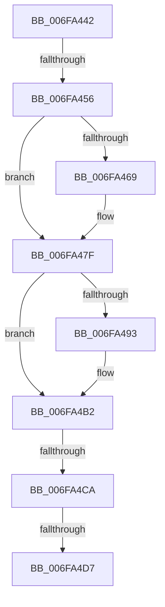

# sub_006FA442

- RVA: `0x006FA442`–`0x006FA500` (길이 `190` bytes)
- VA: `0x00000001406FA442`
- 실행 섹션: `.text`
- PDB 이름 있음: `아니요`; PDB Function 태그: `아니요`
- unwind 정보 RVA: `0x000B7E98`
- 디코드: `45`개 명령, `190/190` bytes 표시
- 미해석 바이트: `0` (있으면 어셈블리에 `.byte`로 보존)

> 이 문서는 커널 이미지의 기계어와 PDB 기호를 분석해 생성했습니다. 4번과 5번은 함수 원형과 자료형을 바이너리 사용 방식에서 추정한 C 해석이며 원본 소스 복구 결과는 아닙니다.

## 1. Dependencies

- 직접 호출 지점: **7**; 고유 호출 대상: **1**
- 직접 호출자로 확인된 함수: **0**
- RIP 상대 이미지 참조: **0**

### Outgoing calls
- `0x006FA45F` → [IoAddTriageDumpDataBlock](../42/IoAddTriageDumpDataBlock_function_00428374.md) (function, `0x00428374`)
- `0x006FA46E` → [IoAddTriageDumpDataBlock](../42/IoAddTriageDumpDataBlock_function_00428374.md) (function, `0x00428374`)
- `0x006FA47A` → [IoAddTriageDumpDataBlock](../42/IoAddTriageDumpDataBlock_function_00428374.md) (function, `0x00428374`)
- `0x006FA495` → [IoAddTriageDumpDataBlock](../42/IoAddTriageDumpDataBlock_function_00428374.md) (function, `0x00428374`)
- `0x006FA4AD` → [IoAddTriageDumpDataBlock](../42/IoAddTriageDumpDataBlock_function_00428374.md) (function, `0x00428374`)
- `0x006FA4D9` → [IoAddTriageDumpDataBlock](../42/IoAddTriageDumpDataBlock_function_00428374.md) (function, `0x00428374`)
- `0x006FA4F5` → [IoAddTriageDumpDataBlock](../42/IoAddTriageDumpDataBlock_function_00428374.md) (function, `0x00428374`)

### Direct callers
- 이 함수 시작 RVA로 연결되는 직접 call은 확인되지 않았습니다. 간접 호출은 완전히 역산할 수 없습니다.

### Static image references
- 디코드된 RIP-relative 메모리 참조가 없습니다.

## 2. Other-region calls and transfers

- 다른 실행 섹션으로 향하는 call: **0**
- call이 아닌 외부 분기/꼬리 이동: **4**
  - `0x006FA450` → [IoGetDeviceInstanceName + 0x64](../4A/IoGetDeviceInstanceName_function_004AADA4.md) (`tail-transfer`)
  - `0x006FA4C4` → [IoGetDeviceInstanceName + 0x64](../4A/IoGetDeviceInstanceName_function_004AADA4.md) (`tail-transfer`)
  - `0x006FA4D1` → [IoGetDeviceInstanceName + 0x64](../4A/IoGetDeviceInstanceName_function_004AADA4.md) (`tail-transfer`)
  - `0x006FA4FB` → [IoGetDeviceInstanceName + 0x64](../4A/IoGetDeviceInstanceName_function_004AADA4.md) (`tail-transfer`)

## 3. Assembly (complete function range)

```asm
006FA442  48 8B 83 38 01 00 00            mov rax, qword ptr [rbx + 0x138]
006FA449  48 8B 48 28                     mov rcx, qword ptr [rax + 0x28]
006FA44D  48 85 C9                        test rcx, rcx
006FA450  0F 84 B2 09 DB FF               je 0x1404aae08
006FA456  BA 88 03 00 00                  mov edx, 0x388
006FA45B  48 8D 79 28                     lea rdi, [rcx + 0x28]
006FA45F  E8 10 DF D2 FF                  call 0x140428374
006FA464  66 39 37                        cmp word ptr [rdi], si
006FA467  74 16                           je 0x1406fa47f
006FA469  8B D5                           mov edx, ebp
006FA46B  48 8B CF                        mov rcx, rdi
006FA46E  E8 01 DF D2 FF                  call 0x140428374
006FA473  0F B7 17                        movzx edx, word ptr [rdi]
006FA476  48 8B 4F 08                     mov rcx, qword ptr [rdi + 8]
006FA47A  E8 F5 DE D2 FF                  call 0x140428374
006FA47F  48 8B 83 38 01 00 00            mov rax, qword ptr [rbx + 0x138]
006FA486  48 8B 48 28                     mov rcx, qword ptr [rax + 0x28]
006FA48A  48 83 C1 38                     add rcx, 0x38
006FA48E  66 39 31                        cmp word ptr [rcx], si
006FA491  74 1F                           je 0x1406fa4b2
006FA493  8B D5                           mov edx, ebp
006FA495  E8 DA DE D2 FF                  call 0x140428374
006FA49A  48 8B 83 38 01 00 00            mov rax, qword ptr [rbx + 0x138]
006FA4A1  48 8B 48 28                     mov rcx, qword ptr [rax + 0x28]
006FA4A5  0F B7 51 38                     movzx edx, word ptr [rcx + 0x38]
006FA4A9  48 8B 49 40                     mov rcx, qword ptr [rcx + 0x40]
006FA4AD  E8 C2 DE D2 FF                  call 0x140428374
006FA4B2  48 8B 83 38 01 00 00            mov rax, qword ptr [rbx + 0x138]
006FA4B9  48 8B 48 28                     mov rcx, qword ptr [rax + 0x28]
006FA4BD  48 8B 41 10                     mov rax, qword ptr [rcx + 0x10]
006FA4C1  48 85 C0                        test rax, rax
006FA4C4  0F 84 3E 09 DB FF               je 0x1404aae08
006FA4CA  48 8D 48 38                     lea rcx, [rax + 0x38]
006FA4CE  66 39 31                        cmp word ptr [rcx], si
006FA4D1  0F 84 31 09 DB FF               je 0x1404aae08
006FA4D7  8B D5                           mov edx, ebp
006FA4D9  E8 96 DE D2 FF                  call 0x140428374
006FA4DE  48 8B 83 38 01 00 00            mov rax, qword ptr [rbx + 0x138]
006FA4E5  48 8B 48 28                     mov rcx, qword ptr [rax + 0x28]
006FA4E9  48 8B 49 10                     mov rcx, qword ptr [rcx + 0x10]
006FA4ED  0F B7 51 38                     movzx edx, word ptr [rcx + 0x38]
006FA4F1  48 8B 49 40                     mov rcx, qword ptr [rcx + 0x40]
006FA4F5  E8 7A DE D2 FF                  call 0x140428374
006FA4FA  90                              nop
006FA4FB  E9 08 09 DB FF                  jmp 0x1404aae08
```

## 4. C-style interpretation (structured pseudocode)

```c
__int64 __fastcall sub_006FA442(void)
{
    __int64 result;

    result = IoAddTriageDumpDataBlock(*(unsigned __int64 *)(*(unsigned __int64 *)(v_rbx + 312) + 40), 904, a3, a4);
    if ((*(unsigned __int16 *)(*(unsigned __int64 *)(*(unsigned __int64 *)(v_rbx + 312) + 40) + 40)) != ((unsigned __int16)(v_rsi))) {
        a2 = (unsigned int)(v_rbp);
        a1 = *(unsigned __int64 *)(*(unsigned __int64 *)(v_rbx + 312) + 40) + 40;
        result = IoAddTriageDumpDataBlock(a1, a2, a3, a4);
        a2 = *(unsigned __int16 *)(*(unsigned __int64 *)(*(unsigned __int64 *)(v_rbx + 312) + 40) + 40);
        a1 = *(unsigned __int64 *)(*(unsigned __int64 *)(*(unsigned __int64 *)(v_rbx + 312) + 40) + 40 + 8);
        result = IoAddTriageDumpDataBlock(a1, a2, a3, a4);
    }
    a1 = (*(unsigned __int64 *)(*(unsigned __int64 *)(v_rbx + 312) + 40)) + (56);
    result = *(unsigned __int64 *)(v_rbx + 312);
    if ((*(unsigned __int16 *)(a1)) != ((unsigned __int16)(v_rsi))) {
        a2 = (unsigned int)(v_rbp);
        result = IoAddTriageDumpDataBlock(a1, a2, a3, a4);
        result = *(unsigned __int64 *)(v_rbx + 312);
        a1 = *(unsigned __int64 *)(result + 40);
        a2 = *(unsigned __int16 *)(a1 + 56);
        a1 = *(unsigned __int64 *)(a1 + 64);
        result = IoAddTriageDumpDataBlock(a1, a2, a3, a4);
    }
    result = IoAddTriageDumpDataBlock(*(unsigned __int64 *)(*(unsigned __int64 *)(*(unsigned __int64 *)(v_rbx + 312) + 40) + 16) + 56, (unsigned int)((unsigned int)(v_rbp)), a3, a4);
    result = IoAddTriageDumpDataBlock(*(unsigned __int64 *)(*(unsigned __int64 *)(*(unsigned __int64 *)(*(unsigned __int64 *)(v_rbx + 312) + 40) + 16) + 64), *(unsigned __int16 *)(*(unsigned __int64 *)(*(unsigned __int64 *)(*(unsigned __int64 *)(v_rbx + 312) + 40) + 16) + 56), a3, a4);
}
```

## 5. (Beta) C Style

```c
void sub_006FA442(void)
{
    int64_t result;

    result = IoAddTriageDumpDataBlock(*(uint64_t *)(*(uint64_t *)(local_rbx + 0x138) + 0x28), 904, a3, a4);
    if ((*(uint16_t *)(*(uint64_t *)(*(uint64_t *)(local_rbx + 0x138) + 0x28) + 0x28)) != ((uint16_t)(local_rsi))) {
        a2 = (uint32_t)(local_rbp);
        a1 = *(uint64_t *)(*(uint64_t *)(local_rbx + 0x138) + 0x28) + 40;
        result = IoAddTriageDumpDataBlock(a1, a2, a3, a4);
        a2 = *(uint16_t *)(*(uint64_t *)(*(uint64_t *)(local_rbx + 0x138) + 0x28) + 0x28);
        a1 = *(uint64_t *)(*(uint64_t *)(*(uint64_t *)(local_rbx + 0x138) + 0x28) + 0x28 + 0x8);
        result = IoAddTriageDumpDataBlock(a1, a2, a3, a4);
    }
    a1 = (*(uint64_t *)(*(uint64_t *)(local_rbx + 0x138) + 0x28)) + (56);
    result = *(uint64_t *)(local_rbx + 0x138);
    if ((*(uint16_t *)(a1)) != ((uint16_t)(local_rsi))) {
        a2 = (uint32_t)(local_rbp);
        result = IoAddTriageDumpDataBlock(a1, a2, a3, a4);
        result = *(uint64_t *)(local_rbx + 0x138);
        a1 = *(uint64_t *)(result + 0x28);
        a2 = *(uint16_t *)(a1 + 0x38);
        a1 = *(uint64_t *)(a1 + 0x40);
        result = IoAddTriageDumpDataBlock(a1, a2, a3, a4);
    }
    result = IoAddTriageDumpDataBlock(*(uint64_t *)(*(uint64_t *)(*(uint64_t *)(local_rbx + 0x138) + 0x28) + 0x10) + 56, (uint32_t)((uint32_t)(local_rbp)), a3, a4);
    result = IoAddTriageDumpDataBlock(*(uint64_t *)(*(uint64_t *)(*(uint64_t *)(*(uint64_t *)(local_rbx + 0x138) + 0x28) + 0x10) + 0x40), *(uint16_t *)(*(uint64_t *)(*(uint64_t *)(*(uint64_t *)(local_rbx + 0x138) + 0x28) + 0x10) + 0x38), a3, a4);
}
```

## 6. Execution-region graph

[열기: 2D/3D 그래프와 함수 탐색 컨트롤 패널](../../../control-panel.html?section=text&rva=0x006FA442&view=graph)

- 2D 그래프는 위에서 아래로 흐르고, 3D 그래프는 빈 공간을 드래그해 회전합니다. Shift+드래그는 이동, 휠은 확대·축소, 함수 노드 선택은 대상 보고서 이동입니다.

### Static fallback


