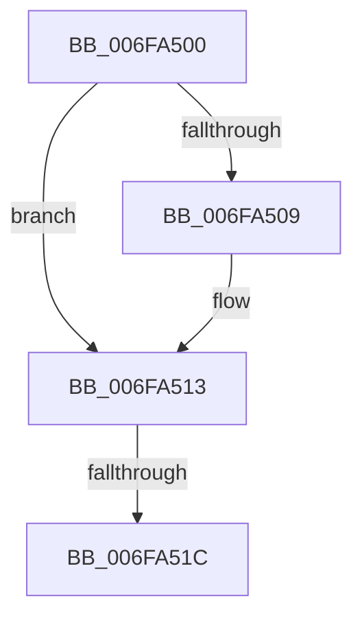

# sub_006FA500

- RVA: `0x006FA500`–`0x006FA52A` (길이 `42` bytes)
- VA: `0x00000001406FA500`
- 실행 섹션: `.text`
- PDB 이름 있음: `아니요`; PDB Function 태그: `아니요`
- unwind 정보 RVA: `0x000B7EC8`
- 디코드: `11`개 명령, `42/42` bytes 표시
- 미해석 바이트: `0` (있으면 어셈블리에 `.byte`로 보존)

> 이 문서는 커널 이미지의 기계어와 PDB 기호를 분석해 생성했습니다. 4번과 5번은 함수 원형과 자료형을 바이너리 사용 방식에서 추정한 C 해석이며 원본 소스 복구 결과는 아닙니다.

## 1. Dependencies

- 직접 호출 지점: **2**; 고유 호출 대상: **2**
- 직접 호출자로 확인된 함수: **0**
- RIP 상대 이미지 참조: **0**

### Outgoing calls
- `0x006FA50E` → [ObfDereferenceObjectWithTag](../2F/ObfDereferenceObjectWithTag_function_002F78E0.md) (function, `0x002F78E0`)
- `0x006FA51F` → [SepDeReferenceLogonSessionDirect](../44/SepDeReferenceLogonSessionDirect_function_0044EDCC.md) (function, `0x0044EDCC`)

### Direct callers
- 이 함수 시작 RVA로 연결되는 직접 call은 확인되지 않았습니다. 간접 호출은 완전히 역산할 수 없습니다.

### Static image references
- 디코드된 RIP-relative 메모리 참조가 없습니다.

## 2. Other-region calls and transfers

- 다른 실행 섹션으로 향하는 call: **0**
- call이 아닌 외부 분기/꼬리 이동: **2**
  - `0x006FA516` → [SepLinkLogonSessions + 0x166](../4A/SepLinkLogonSessions_function_004AAE78.md) (`tail-transfer`)
  - `0x006FA525` → [SepLinkLogonSessions + 0x166](../4A/SepLinkLogonSessions_function_004AAE78.md) (`tail-transfer`)

## 3. Assembly (complete function range)

```asm
006FA500  48 8B 4D 7F                     mov rcx, qword ptr [rbp + 0x7f]
006FA504  48 85 C9                        test rcx, rcx
006FA507  74 0A                           je 0x1406fa513
006FA509  BA 44 66 6C 74                  mov edx, 0x746c6644
006FA50E  E8 CD D3 BF FF                  call 0x1402f78e0
006FA513  4D 85 F6                        test r14, r14
006FA516  0F 84 C2 0A DB FF               je 0x1404aafde
006FA51C  49 8B CE                        mov rcx, r14
006FA51F  E8 A8 48 D5 FF                  call 0x14044edcc
006FA524  90                              nop
006FA525  E9 B4 0A DB FF                  jmp 0x1404aafde
```

## 4. C-style interpretation (structured pseudocode)

```c
__int64 __fastcall sub_006FA500(void)
{
    __int64 result;

    if (*(unsigned __int64 *)(v_rbp + 127) != 0) {
        a2 = 0x746C6644ULL;
        result = ObfDereferenceObjectWithTag(*(unsigned __int64 *)(v_rbp + 127), a2, a3, a4);
    }
    result = SepDeReferenceLogonSessionDirect(v_r14, a2, a3, a4);
}
```

## 5. (Beta) C Style

```c
void sub_006FA500(void)
{
    int64_t result;

    if (*(uint64_t *)(local_rbp + 0x7F) != 0) {
        a2 = 0x746C6644ULL;
        result = ObfDereferenceObjectWithTag(*(uint64_t *)(local_rbp + 0x7F), a2, a3, a4);
    }
    result = SepDeReferenceLogonSessionDirect(local_r14, a2, a3, a4);
}
```

## 6. Execution-region graph

[열기: 2D/3D 그래프와 함수 탐색 컨트롤 패널](../../../control-panel.html?section=text&rva=0x006FA500&view=graph)

- 2D 그래프는 위에서 아래로 흐르고, 3D 그래프는 빈 공간을 드래그해 회전합니다. Shift+드래그는 이동, 휠은 확대·축소, 함수 노드 선택은 대상 보고서 이동입니다.

### Static fallback


