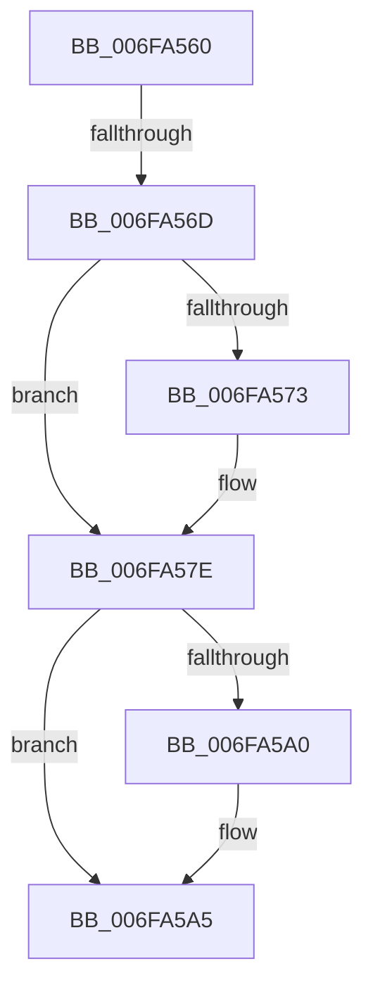

# sub_006FA560

- RVA: `0x006FA560`–`0x006FA5DB` (길이 `123` bytes)
- VA: `0x00000001406FA560`
- 실행 섹션: `.text`
- PDB 이름 있음: `아니요`; PDB Function 태그: `아니요`
- unwind 정보 RVA: `0x000B803C`
- 디코드: `30`개 명령, `123/123` bytes 표시
- 미해석 바이트: `0` (있으면 어셈블리에 `.byte`로 보존)

> 이 문서는 커널 이미지의 기계어와 PDB 기호를 분석해 생성했습니다. 4번과 5번은 함수 원형과 자료형을 바이너리 사용 방식에서 추정한 C 해석이며 원본 소스 복구 결과는 아닙니다.

## 1. Dependencies

- 직접 호출 지점: **3**; 고유 호출 대상: **3**
- 직접 호출자로 확인된 함수: **0**
- RIP 상대 이미지 참조: **0**

### Outgoing calls
- `0x006FA560` → [Feature_EtwThreadStackRundownPriority__private_IsEnabledDeviceUsageNoInline](../4F/Feature_EtwThreadStackRundownPriority__private_IsEnabledDeviceUsageNoInline_function_004F3B5C.md) (function, `0x004F3B5C`)
- `0x006FA579` → [KeSetPriorityThread](../2C/KeSetPriorityThread_function_002C76E0.md) (function, `0x002C76E0`)
- `0x006FA5D0` → [EtwTraceKernelEvent](../23/EtwTraceKernelEvent_function_00235350.md) (function, `0x00235350`)

### Direct callers
- 이 함수 시작 RVA로 연결되는 직접 call은 확인되지 않았습니다. 간접 호출은 완전히 역산할 수 없습니다.

### Static image references
- 디코드된 RIP-relative 메모리 참조가 없습니다.

## 2. Other-region calls and transfers

- 다른 실행 섹션으로 향하는 call: **0**
- call이 아닌 외부 분기/꼬리 이동: **2**
  - `0x006FA567` → [EtwpTraceThreadRundownWithStack + 0x1B3](../4A/EtwpTraceThreadRundownWithStack_function_004AB5A0.md) (`tail-transfer`)
  - `0x006FA5D6` → [EtwpTraceThreadRundownWithStack + 0x1B3](../4A/EtwpTraceThreadRundownWithStack_function_004AB5A0.md) (`tail-transfer`)

## 3. Assembly (complete function range)

```asm
006FA560  E8 F7 95 DF FF                  call 0x1404f3b5c
006FA565  85 C0                           test eax, eax
006FA567  0F 84 E6 11 DB FF               je 0x1404ab753
006FA56D  44 38 73 4C                     cmp byte ptr [rbx + 0x4c], r14b
006FA571  74 0B                           je 0x1406fa57e
006FA573  8B 53 48                        mov edx, dword ptr [rbx + 0x48]
006FA576  48 8B CF                        mov rcx, rdi
006FA579  E8 62 D1 BC FF                  call 0x1402c76e0
006FA57E  8B 87 10 05 00 00               mov eax, dword ptr [rdi + 0x510]
006FA584  89 45 17                        mov dword ptr [rbp + 0x17], eax
006FA587  8B 87 08 05 00 00               mov eax, dword ptr [rdi + 0x508]
006FA58D  89 45 1B                        mov dword ptr [rbp + 0x1b], eax
006FA590  8B 43 48                        mov eax, dword ptr [rbx + 0x48]
006FA593  89 45 1F                        mov dword ptr [rbp + 0x1f], eax
006FA596  44 89 75 23                     mov dword ptr [rbp + 0x23], r14d
006FA59A  44 38 73 4C                     cmp byte ptr [rbx + 0x4c], r14b
006FA59E  74 05                           je 0x1406fa5a5
006FA5A0  2B F0                           sub esi, eax
006FA5A2  89 75 23                        mov dword ptr [rbp + 0x23], esi
006FA5A5  BA 01 00 00 00                  mov edx, 1
006FA5AA  48 C7 45 2F 10 00 00 00         mov qword ptr [rbp + 0x2f], 0x10
006FA5B2  48 8D 45 17                     lea rax, [rbp + 0x17]
006FA5B6  C7 44 24 20 00 01 00 00         mov dword ptr [rsp + 0x20], 0x100
006FA5BE  41 B9 68 05 00 00               mov r9d, 0x568
006FA5C4  48 89 45 27                     mov qword ptr [rbp + 0x27], rax
006FA5C8  48 8D 4D 27                     lea rcx, [rbp + 0x27]
006FA5CC  44 8D 42 01                     lea r8d, [rdx + 1]
006FA5D0  E8 7B AD B3 FF                  call 0x140235350
006FA5D5  90                              nop
006FA5D6  E9 78 11 DB FF                  jmp 0x1404ab753
```

## 4. C-style interpretation (structured pseudocode)

```c
__int64 __fastcall sub_006FA560(void)
{
    __int64 result;
    __int64 v_rsi;
    unsigned int v_stack_p20;

    result = Feature_EtwThreadStackRundownPriority__private_IsEnabledDeviceUsageNoInline(a1, a2, a3, a4);
    if ((*(unsigned __int8 *)(v_rbx + 76)) != ((unsigned __int8)(v_r14))) {
        a2 = *(unsigned int *)(v_rbx + 72);
        a1 = v_rdi;
        result = KeSetPriorityThread(a1, a2, a3, a4);
    }
    *(unsigned int *)(v_rbp + 23) = (unsigned int)((unsigned int)(*(unsigned int *)(v_rdi + 1296)));
    *(unsigned int *)(v_rbp + 27) = (unsigned int)((unsigned int)(*(unsigned int *)(v_rdi + 1288)));
    *(unsigned int *)(v_rbp + 31) = (unsigned int)((unsigned int)(*(unsigned int *)(v_rbx + 72)));
    *(unsigned int *)(v_rbp + 35) = (unsigned int)(v_r14);
    if ((*(unsigned __int8 *)(v_rbx + 76)) != ((unsigned __int8)(v_r14))) {
        v_rsi = (unsigned int)((v_rsi) - ((unsigned int)((unsigned int)(*(unsigned int *)(v_rbx + 72)))));
        *(unsigned int *)(v_rbp + 35) = (unsigned int)(v_rsi);
    }
    *(unsigned __int64 *)(v_rbp + 47) = 16;
    v_stack_p20 = 256;
    *(unsigned __int64 *)(v_rbp + 39) = v_rbp + 23;
    result = EtwTraceKernelEvent(v_rbp + 39, 1, 1 + 1, (unsigned int)(0x568ULL));
}
```

## 5. (Beta) C Style

```c
void sub_006FA560(void)
{
    int64_t result;
    int64_t local_rsi;
    uint32_t v_stack_p20;

    result = Feature_EtwThreadStackRundownPriority__private_IsEnabledDeviceUsageNoInline(a1, a2, a3, a4);
    if ((*(uint8_t *)(local_rbx + 0x4C)) != ((uint8_t)(local_r14))) {
        a2 = *(uint32_t *)(local_rbx + 0x48);
        a1 = local_rdi;
        result = KeSetPriorityThread(a1, a2, a3, a4);
    }
    *(uint32_t *)(local_rbp + 0x17) = (uint32_t)((uint32_t)(*(uint32_t *)(local_rdi + 0x510)));
    *(uint32_t *)(local_rbp + 0x1B) = (uint32_t)((uint32_t)(*(uint32_t *)(local_rdi + 0x508)));
    *(uint32_t *)(local_rbp + 0x1F) = (uint32_t)((uint32_t)(*(uint32_t *)(local_rbx + 0x48)));
    *(uint32_t *)(local_rbp + 0x23) = (uint32_t)(local_r14);
    if ((*(uint8_t *)(local_rbx + 0x4C)) != ((uint8_t)(local_r14))) {
        local_rsi = (uint32_t)((local_rsi) - ((uint32_t)((uint32_t)(*(uint32_t *)(local_rbx + 0x48)))));
        *(uint32_t *)(local_rbp + 0x23) = (uint32_t)(local_rsi);
    }
    *(uint64_t *)(local_rbp + 0x2F) = 16;
    v_stack_p20 = 256;
    *(uint64_t *)(local_rbp + 0x27) = local_rbp + 23;
    result = EtwTraceKernelEvent(local_rbp + 39, 1, 1 + 1, (uint32_t)(0x568ULL));
}
```

## 6. Execution-region graph

[열기: 2D/3D 그래프와 함수 탐색 컨트롤 패널](../../../control-panel.html?section=text&rva=0x006FA560&view=graph)

- 2D 그래프는 위에서 아래로 흐르고, 3D 그래프는 빈 공간을 드래그해 회전합니다. Shift+드래그는 이동, 휠은 확대·축소, 함수 노드 선택은 대상 보고서 이동입니다.

### Static fallback


