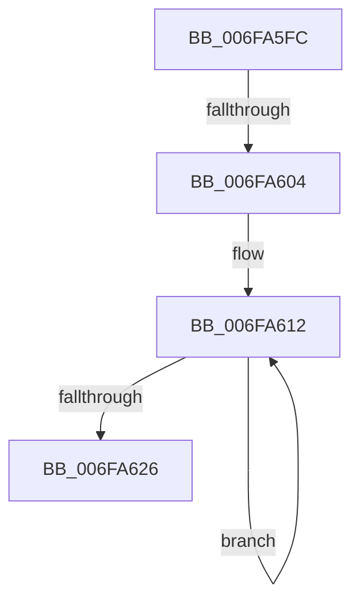

# sub_006FA5FC

- RVA: `0x006FA5FC`–`0x006FA62B` (길이 `47` bytes)
- VA: `0x00000001406FA5FC`
- 실행 섹션: `.text`
- PDB 이름 있음: `아니요`; PDB Function 태그: `아니요`
- unwind 정보 RVA: `0x000B80F4`
- 디코드: `12`개 명령, `47/47` bytes 표시
- 미해석 바이트: `0` (있으면 어셈블리에 `.byte`로 보존)

> 이 문서는 커널 이미지의 기계어와 PDB 기호를 분석해 생성했습니다. 4번과 5번은 함수 원형과 자료형을 바이너리 사용 방식에서 추정한 C 해석이며 원본 소스 복구 결과는 아닙니다.

## 1. Dependencies

- 직접 호출 지점: **1**; 고유 호출 대상: **1**
- 직접 호출자로 확인된 함수: **0**
- RIP 상대 이미지 참조: **0**

### Outgoing calls
- `0x006FA618` → [PnpUpdateExtensionFlags](../4B/PnpUpdateExtensionFlags_function_004B9DAC.md) (function, `0x004B9DAC`)

### Direct callers
- 이 함수 시작 RVA로 연결되는 직접 call은 확인되지 않았습니다. 간접 호출은 완전히 역산할 수 없습니다.

### Static image references
- 디코드된 RIP-relative 메모리 참조가 없습니다.

## 2. Other-region calls and transfers

- 다른 실행 섹션으로 향하는 call: **0**
- call이 아닌 외부 분기/꼬리 이동: **2**
  - `0x006FA5FE` → [PnpIsChainDereferenced + 0xCA](../4A/PnpIsChainDereferenced_function_004ABAE8.md) (`tail-transfer`)
  - `0x006FA626` → [PnpIsChainDereferenced + 0xCA](../4A/PnpIsChainDereferenced_function_004ABAE8.md) (`tail-transfer`)

## 3. Assembly (complete function range)

```asm
006FA5FC  85 FF                           test edi, edi
006FA5FE  0F 88 AE 15 DB FF               js 0x1404abbb2
006FA604  48 63 C7                        movsxd rax, edi
006FA607  48 8D 14 C5 00 00 00 00         lea rdx, [rax*8]
006FA60F  49 03 D5                        add rdx, r13
006FA612  45 33 C9                        xor r9d, r9d
006FA615  48 8B CA                        mov rcx, rdx
006FA618  E8 8F F7 DB FF                  call 0x1404b9dac
006FA61D  48 83 EA 08                     sub rdx, 8
006FA621  41 2B FA                        sub edi, r10d
006FA624  79 EC                           jns 0x1406fa612
006FA626  E9 87 15 DB FF                  jmp 0x1404abbb2
```

## 4. C-style interpretation (structured pseudocode)

```c
__int64 __fastcall sub_006FA5FC(__int64 a1, __int64 a2, __int64 a3, int a4)
{
    __int64 result;
    __int64 v_rdi;

    a2 = ((int)((unsigned int)(v_rdi)) * 8) + (v_r13);
loc_006FA612:
    a4 = 0;
    result = PnpUpdateExtensionFlags(a2, a2, a3, a4);
    a2 = (a2) - (8);
    v_rdi = (unsigned int)((v_rdi) - ((unsigned int)(v_r10)));
    if (!sign_flag) goto loc_006FA612;
}
```

## 5. (Beta) C Style

```c
int64_t sub_006FA5FC(int64_t Arg1, int64_t Arg2, int64_t Arg3, int32_t Arg4)
{
    int64_t result;
    int64_t local_rdi;

    Arg2 = ((int32_t)((uint32_t)(local_rdi)) * 8) + (local_r13);
loc_006FA612:
    Arg4 = 0;
    result = PnpUpdateExtensionFlags(Arg2, Arg2, Arg3, Arg4);
    Arg2 = (Arg2) - (8);
    local_rdi = (uint32_t)((local_rdi) - ((uint32_t)(local_r10)));
    if (!sign_flag) goto loc_006FA612;
}
```

## 6. Execution-region graph

[열기: 2D/3D 그래프와 함수 탐색 컨트롤 패널](../../../control-panel.html?section=text&rva=0x006FA5FC&view=graph)

- 2D 그래프는 위에서 아래로 흐르고, 3D 그래프는 빈 공간을 드래그해 회전합니다. Shift+드래그는 이동, 휠은 확대·축소, 함수 노드 선택은 대상 보고서 이동입니다.

### Static fallback


