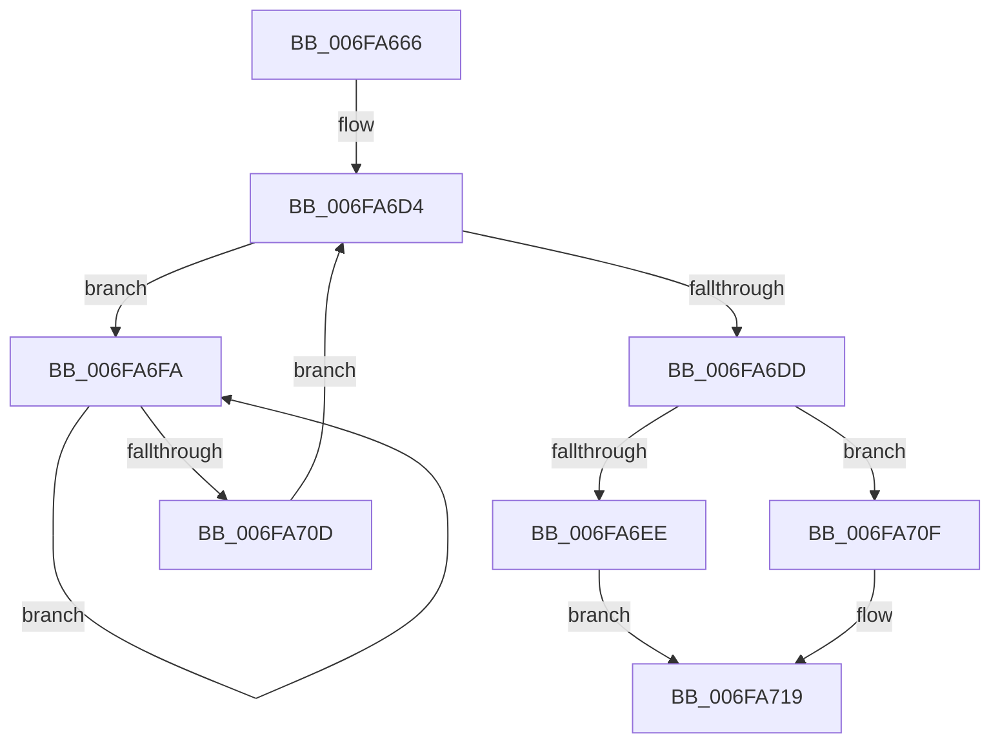

# sub_006FA666

- RVA: `0x006FA666`–`0x006FA72F` (길이 `201` bytes)
- VA: `0x00000001406FA666`
- 실행 섹션: `.text`
- PDB 이름 있음: `아니요`; PDB Function 태그: `아니요`
- unwind 정보 RVA: `0x000B8328`
- 디코드: `53`개 명령, `201/201` bytes 표시
- 미해석 바이트: `0` (있으면 어셈블리에 `.byte`로 보존)

> 이 문서는 커널 이미지의 기계어와 PDB 기호를 분석해 생성했습니다. 4번과 5번은 함수 원형과 자료형을 바이너리 사용 방식에서 추정한 C 해석이며 원본 소스 복구 결과는 아닙니다.

## 1. Dependencies

- 직접 호출 지점: **8**; 고유 호출 대상: **7**
- 직접 호출자로 확인된 함수: **0**
- RIP 상대 이미지 참조: **0**

### Outgoing calls
- `0x006FA669` → [MiPageToNode](../33/MiPageToNode_function_00338CD0.md) (function, `0x00338CD0`)
- `0x006FA68A` → [MiUpdatePageMoveInProgressInternal](../43/MiUpdatePageMoveInProgressInternal_function_0043F5A0.md) (function, `0x0043F5A0`)
- `0x006FA697` → [MiUnlinkFreeOrZeroedPage](../33/MiUnlinkFreeOrZeroedPage_function_00336C40.md) (function, `0x00336C40`)
- `0x006FA6B5` → [MiChangePageAttribute](../33/MiChangePageAttribute_function_00332ECC.md) (function, `0x00332ECC`)
- `0x006FA6EE` → [MiInsertPageInFreeOrZeroedList](../33/MiInsertPageInFreeOrZeroedList_function_00334D20.md) (function, `0x00334D20`)
- `0x006FA6FF` → [KeYieldProcessorEx](../3F/KeYieldProcessorEx_function_003FBD00.md) (function, `0x003FBD00`)
- `0x006FA714` → [MiInsertPossiblyBadPage](../68/MiInsertPossiblyBadPage_function_00689DF0.md) (function, `0x00689DF0`)
- `0x006FA724` → [MiUpdatePageMoveInProgressInternal](../43/MiUpdatePageMoveInProgressInternal_function_0043F5A0.md) (function, `0x0043F5A0`)

### Direct callers
- 이 함수 시작 RVA로 연결되는 직접 call은 확인되지 않았습니다. 간접 호출은 완전히 역산할 수 없습니다.

### Static image references
- 디코드된 RIP-relative 메모리 참조가 없습니다.

## 2. Other-region calls and transfers

- 다른 실행 섹션으로 향하는 call: **0**
- call이 아닌 외부 분기/꼬리 이동: **1**
  - `0x006FA72A` → [MiChangePageAttributeLargeFreeZeroPage + 0xC6](../4A/MiChangePageAttributeLargeFreeZeroPage_function_004ACC10.md) (`tail-transfer`)

## 3. Assembly (complete function range)

```asm
006FA666  48 8B CF                        mov rcx, rdi
006FA669  E8 62 E6 C3 FF                  call 0x140338cd0
006FA66E  8B C8                           mov ecx, eax
006FA670  45 33 C9                        xor r9d, r9d
006FA673  4C 69 E1 80 DF 00 00            imul r12, rcx, 0xdf80
006FA67A  41 8D 71 01                     lea esi, [r9 + 1]
006FA67E  4C 03 65 10                     add r12, qword ptr [rbp + 0x10]
006FA682  44 8B C6                        mov r8d, esi
006FA685  49 8B CC                        mov rcx, r12
006FA688  8B D6                           mov edx, esi
006FA68A  E8 11 4F D4 FF                  call 0x14043f5a0
006FA68F  33 D2                           xor edx, edx
006FA691  48 8B CF                        mov rcx, rdi
006FA694  45 33 C0                        xor r8d, r8d
006FA697  E8 A4 C5 C3 FF                  call 0x140336c40
006FA69C  48 BD FF FF FF FF FF FF FF 7F   movabs rbp, 0x7fffffffffffffff
006FA6A6  F0 48 21 6B 18                  lock and qword ptr [rbx + 0x18], rbp
006FA6AB  44 8D 46 0F                     lea r8d, [rsi + 0xf]
006FA6AF  41 8B D7                        mov edx, r15d
006FA6B2  48 8B CB                        mov rcx, rbx
006FA6B5  E8 12 88 C3 FF                  call 0x140332ecc
006FA6BA  48 8B 43 10                     mov rax, qword ptr [rbx + 0x10]
006FA6BE  25 E0 03 00 00                  and eax, 0x3e0
006FA6C3  48 F7 D8                        neg rax
006FA6C6  45 1B FF                        sbb r15d, r15d
006FA6C9  41 F7 DF                        neg r15d
006FA6CC  44 03 FE                        add r15d, esi
006FA6CF  83 64 24 68 00                  and dword ptr [rsp + 0x68], 0
006FA6D4  F0 48 0F BA 6B 18 3F            lock bts qword ptr [rbx + 0x18], 0x3f
006FA6DB  72 1D                           jb 0x1406fa6fa
006FA6DD  48 8B 43 28                     mov rax, qword ptr [rbx + 0x28]
006FA6E1  41 8B D7                        mov edx, r15d
006FA6E4  48 0F BA E0 29                  bt rax, 0x29
006FA6E9  48 8B CF                        mov rcx, rdi
006FA6EC  72 21                           jb 0x1406fa70f
006FA6EE  E8 2D A6 C3 FF                  call 0x140334d20
006FA6F3  F0 48 21 6B 18                  lock and qword ptr [rbx + 0x18], rbp
006FA6F8  EB 1F                           jmp 0x1406fa719
006FA6FA  48 8D 4C 24 68                  lea rcx, [rsp + 0x68]
006FA6FF  E8 FC 15 D0 FF                  call 0x1403fbd00
006FA704  48 8B 43 18                     mov rax, qword ptr [rbx + 0x18]
006FA708  48 85 C0                        test rax, rax
006FA70B  78 ED                           js 0x1406fa6fa
006FA70D  EB C5                           jmp 0x1406fa6d4
006FA70F  F0 48 21 6B 18                  lock and qword ptr [rbx + 0x18], rbp
006FA714  E8 D7 F6 F8 FF                  call 0x140689df0
006FA719  45 33 C9                        xor r9d, r9d
006FA71C  45 33 C0                        xor r8d, r8d
006FA71F  8B D6                           mov edx, esi
006FA721  49 8B CC                        mov rcx, r12
006FA724  E8 77 4E D4 FF                  call 0x14043f5a0
006FA729  90                              nop
006FA72A  E9 A7 25 DB FF                  jmp 0x1404accd6
```

## 4. C-style interpretation (structured pseudocode)

```c
__int64 __fastcall sub_006FA666(__int64 a1, __int64 a2, __int64 a3, int a4, __int64 a5, __int64 a6, __int64 a7, __int64 a8, __int64 a9, __int64 a10, __int64 a11, __int64 a12, unsigned int a13)
{
    __int64 result;
    __int64 v_r12;
    __int64 v_r15;

    result = MiPageToNode(v_rdi, a2, a3, a4);
    a4 = 0;
    v_r12 = (v_r12) * ((unsigned int)((unsigned int)(result)));
    v_r12 = (v_r12) + (*(unsigned __int64 *)(v_rbp + 16));
    result = MiUpdatePageMoveInProgressInternal(v_r12, (unsigned int)((unsigned int)(a4 + 1)), (unsigned int)((unsigned int)(a4 + 1)), a4);
    a2 = 0;
    a3 = 0;
    result = MiUnlinkFreeOrZeroedPage(v_rdi, a2, a3, a4);
    result = MiChangePageAttribute(v_rbx, (unsigned int)((unsigned int)(v_r15)), a4 + 1 + 15, a4);
    result = (unsigned int)((*(unsigned __int64 *)(v_rbx + 16)) & (992));
    result = -(result);
    v_r15 = (unsigned int)(-(v_r15));
    v_r15 = (unsigned int)((v_r15) + ((unsigned int)(a4 + 1)));
loc_006FA6D4:
    if (condition_is_below) goto loc_006FA6FA;
    if (condition_is_below) goto loc_006FA70F;
    result = MiInsertPageInFreeOrZeroedList(v_rdi, (unsigned int)((unsigned int)(v_r15)), a4 + 1 + 15, a4);
    goto loc_006FA719;
loc_006FA6FA:
    result = KeYieldProcessorEx(a13, (unsigned int)((unsigned int)(v_r15)), a4 + 1 + 15, a4);
    if (sign_flag) goto loc_006FA6FA;
    goto loc_006FA6D4;
loc_006FA70F:
    result = MiInsertPossiblyBadPage(a13, (unsigned int)((unsigned int)(v_r15)), a4 + 1 + 15, a4);
loc_006FA719:
    a4 = 0;
    a3 = 0;
    result = MiUpdatePageMoveInProgressInternal(v_r12, (unsigned int)((unsigned int)(a4 + 1)), a3, a4);
}
```

## 5. (Beta) C Style

```c
int64_t sub_006FA666(int64_t Arg1, int64_t Arg2, int64_t Arg3, int32_t Arg4, uint64_t Arg5, uint64_t Arg6, uint64_t Arg7, uint64_t Arg8, uint64_t Arg9, uint64_t Arg10, uint64_t Arg11, uint64_t Arg12, uint32_t Arg13)
{
    int64_t result;
    int64_t local_r12;
    int64_t local_r15;

    result = MiPageToNode(local_rdi, Arg2, Arg3, Arg4);
    Arg4 = 0;
    local_r12 = (local_r12) * ((uint32_t)((uint32_t)(result)));
    local_r12 = (local_r12) + (*(uint64_t *)(local_rbp + 0x10));
    result = MiUpdatePageMoveInProgressInternal(local_r12, (uint32_t)((uint32_t)(Arg4 + 1)), (uint32_t)((uint32_t)(Arg4 + 1)), Arg4);
    Arg2 = 0;
    Arg3 = 0;
    result = MiUnlinkFreeOrZeroedPage(local_rdi, Arg2, Arg3, Arg4);
    result = MiChangePageAttribute(local_rbx, (uint32_t)((uint32_t)(local_r15)), Arg4 + 1 + 15, Arg4);
    result = (uint32_t)((*(uint64_t *)(local_rbx + 0x10)) & (992));
    result = -(result);
    local_r15 = (uint32_t)(-(local_r15));
    local_r15 = (uint32_t)((local_r15) + ((uint32_t)(Arg4 + 1)));
loc_006FA6D4:
    if (condition_is_below) goto loc_006FA6FA;
    if (condition_is_below) goto loc_006FA70F;
    result = MiInsertPageInFreeOrZeroedList(local_rdi, (uint32_t)((uint32_t)(local_r15)), Arg4 + 1 + 15, Arg4);
    goto loc_006FA719;
loc_006FA6FA:
    result = KeYieldProcessorEx(Arg13, (uint32_t)((uint32_t)(local_r15)), Arg4 + 1 + 15, Arg4);
    if (sign_flag) goto loc_006FA6FA;
    goto loc_006FA6D4;
loc_006FA70F:
    result = MiInsertPossiblyBadPage(Arg13, (uint32_t)((uint32_t)(local_r15)), Arg4 + 1 + 15, Arg4);
loc_006FA719:
    Arg4 = 0;
    Arg3 = 0;
    result = MiUpdatePageMoveInProgressInternal(local_r12, (uint32_t)((uint32_t)(Arg4 + 1)), Arg3, Arg4);
}
```

## 6. Execution-region graph

[열기: 2D/3D 그래프와 함수 탐색 컨트롤 패널](../../../control-panel.html?section=text&rva=0x006FA666&view=graph)

- 2D 그래프는 위에서 아래로 흐르고, 3D 그래프는 빈 공간을 드래그해 회전합니다. Shift+드래그는 이동, 휠은 확대·축소, 함수 노드 선택은 대상 보고서 이동입니다.

### Static fallback


