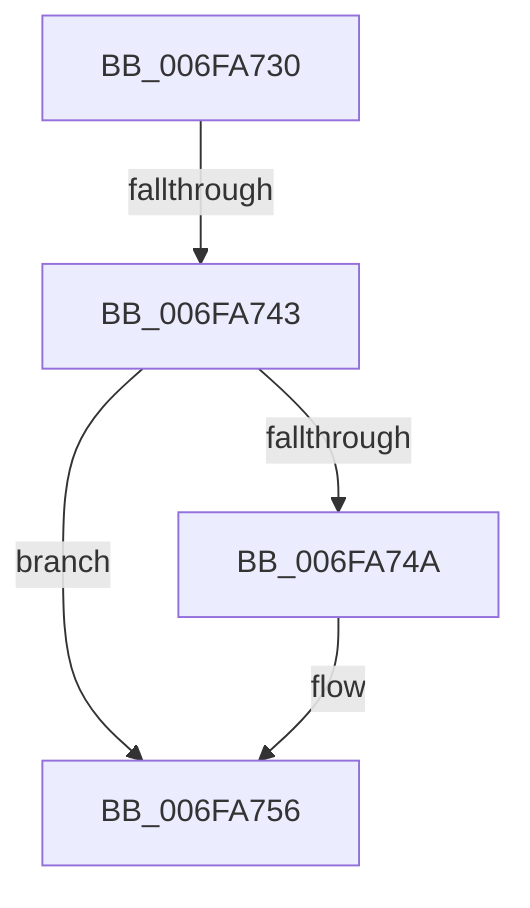

# sub_006FA730

- RVA: `0x006FA730`–`0x006FA76F` (길이 `63` bytes)
- VA: `0x00000001406FA730`
- 실행 섹션: `.text`
- PDB 이름 있음: `아니요`; PDB Function 태그: `아니요`
- unwind 정보 RVA: `0x000B837C`
- 디코드: `14`개 명령, `63/63` bytes 표시
- 미해석 바이트: `0` (있으면 어셈블리에 `.byte`로 보존)

> 이 문서는 커널 이미지의 기계어와 PDB 기호를 분석해 생성했습니다. 4번과 5번은 함수 원형과 자료형을 바이너리 사용 방식에서 추정한 C 해석이며 원본 소스 복구 결과는 아닙니다.

## 1. Dependencies

- 직접 호출 지점: **1**; 고유 호출 대상: **1**
- 직접 호출자로 확인된 함수: **0**
- RIP 상대 이미지 참조: **0**

### Outgoing calls
- `0x006FA751` → [MiAcquirePrcbAgeTrimLists](../29/MiAcquirePrcbAgeTrimLists_function_002918B0.md) (function, `0x002918B0`)

### Direct callers
- 이 함수 시작 RVA로 연결되는 직접 call은 확인되지 않았습니다. 간접 호출은 완전히 역산할 수 없습니다.

### Static image references
- 디코드된 RIP-relative 메모리 참조가 없습니다.

## 2. Other-region calls and transfers

- 다른 실행 섹션으로 향하는 call: **0**
- call이 아닌 외부 분기/꼬리 이동: **2**
  - `0x006FA73D` → [MiSimpleAgePte + 0xC0](../4A/MiSimpleAgePte_function_004ACD40.md) (`tail-transfer`)
  - `0x006FA76A` → [MiSimpleAgePte + 0xDE](../4A/MiSimpleAgePte_function_004ACD40.md) (`tail-transfer`)

## 3. Assembly (complete function range)

```asm
006FA730  48 B8 FF FF FE FF FF 7F 00 00   movabs rax, 0x7ffffffeffff
006FA73A  48 3B F8                        cmp rdi, rax
006FA73D  0F 87 BD 26 DB FF               ja 0x1404ace00
006FA743  48 83 7B 48 01                  cmp qword ptr [rbx + 0x48], 1
006FA748  75 0C                           jne 0x1406fa756
006FA74A  48 8D 53 38                     lea rdx, [rbx + 0x38]
006FA74E  48 8B CE                        mov rcx, rsi
006FA751  E8 5A 71 B9 FF                  call 0x1402918b0
006FA756  48 8B 4B 48                     mov rcx, qword ptr [rbx + 0x48]
006FA75A  48 81 E7 00 F0 FF FF            and rdi, 0xfffffffffffff000
006FA761  8B 01                           mov eax, dword ptr [rcx]
006FA763  48 89 7C C1 08                  mov qword ptr [rcx + rax*8 + 8], rdi
006FA768  FF 01                           inc dword ptr [rcx]
006FA76A  E9 AF 26 DB FF                  jmp 0x1404ace1e
```

## 4. C-style interpretation (structured pseudocode)

```c
__int64 __fastcall sub_006FA730(void)
{
    __int64 result;
    __int64 v_rdi;

    if ((*(unsigned __int64 *)(v_rbx + 72)) == 1) {
        a2 = v_rbx + 56;
        a1 = v_rsi;
        result = MiAcquirePrcbAgeTrimLists(a1, a2, a3, a4);
    }
    v_rdi = (v_rdi) & (0xFFFFFFFFFFFFF000ULL);
    *(unsigned __int64 *)(*(unsigned __int64 *)(v_rbx + 72) + (unsigned int)(*(unsigned int *)(*(unsigned __int64 *)(v_rbx + 72))) * 8 + 8) = v_rdi;
}
```

## 5. (Beta) C Style

```c
void sub_006FA730(void)
{
    int64_t result;
    int64_t local_rdi;

    if ((*(uint64_t *)(local_rbx + 0x48)) == 1) {
        a2 = local_rbx + 56;
        a1 = local_rsi;
        result = MiAcquirePrcbAgeTrimLists(a1, a2, a3, a4);
    }
    local_rdi = (local_rdi) & (0xFFFFFFFFFFFFF000ULL);
    *(uint64_t *)(*(uint64_t *)(local_rbx + 0x48) + (uint32_t)(*(uint32_t *)(*(uint64_t *)(local_rbx + 0x48))) * 8 + 0x8) = local_rdi;
}
```

## 6. Execution-region graph

[열기: 2D/3D 그래프와 함수 탐색 컨트롤 패널](../../../control-panel.html?section=text&rva=0x006FA730&view=graph)

- 2D 그래프는 위에서 아래로 흐르고, 3D 그래프는 빈 공간을 드래그해 회전합니다. Shift+드래그는 이동, 휠은 확대·축소, 함수 노드 선택은 대상 보고서 이동입니다.

### Static fallback


