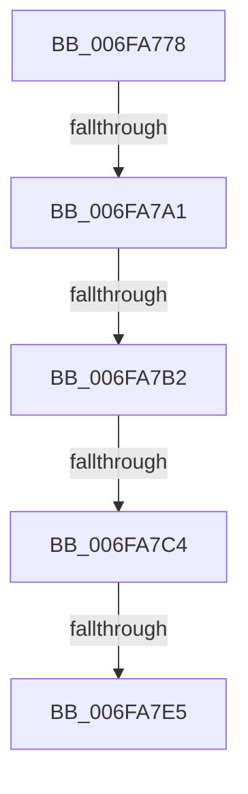

# sub_006FA778

- RVA: `0x006FA778`–`0x006FA7F7` (길이 `127` bytes)
- VA: `0x00000001406FA778`
- 실행 섹션: `.text`
- PDB 이름 있음: `아니요`; PDB Function 태그: `아니요`
- unwind 정보 RVA: `0x000B8400`
- 디코드: `23`개 명령, `127/127` bytes 표시
- 미해석 바이트: `0` (있으면 어셈블리에 `.byte`로 보존)

> 이 문서는 커널 이미지의 기계어와 PDB 기호를 분석해 생성했습니다. 4번과 5번은 함수 원형과 자료형을 바이너리 사용 방식에서 추정한 C 해석이며 원본 소스 복구 결과는 아닙니다.

## 1. Dependencies

- 직접 호출 지점: **1**; 고유 호출 대상: **1**
- 직접 호출자로 확인된 함수: **0**
- RIP 상대 이미지 참조: **2**

### Outgoing calls
- `0x006FA78B` → [MiMakeValidPte](../2C/MiMakeValidPte_function_002C5590.md) (function, `0x002C5590`)

### Direct callers
- 이 함수 시작 RVA로 연결되는 직접 call은 확인되지 않았습니다. 간접 호출은 완전히 역산할 수 없습니다.

### Static image references
- `0x006FA7A1` → RVA `0x00FC6A88` (`ALMOSTRO`; read)
- `0x006FA7D8` → RVA `0x00E2EE85` (`.data`; read)

## 2. Other-region calls and transfers

- 다른 실행 섹션으로 향하는 call: **0**
- call이 아닌 외부 분기/꼬리 이동: **5**
  - `0x006FA79B` → [MiBuildForkPageTable + 0x203](../4A/MiBuildForkPageTable_function_004ACF5C.md) (`tail-transfer`)
  - `0x006FA7AC` → [MiBuildForkPageTable + 0x203](../4A/MiBuildForkPageTable_function_004ACF5C.md) (`tail-transfer`)
  - `0x006FA7BE` → [MiBuildForkPageTable + 0x203](../4A/MiBuildForkPageTable_function_004ACF5C.md) (`tail-transfer`)
  - `0x006FA7DF` → [MiBuildForkPageTable + 0x203](../4A/MiBuildForkPageTable_function_004ACF5C.md) (`tail-transfer`)
  - `0x006FA7F2` → [MiBuildForkPageTable + 0x203](../4A/MiBuildForkPageTable_function_004ACF5C.md) (`tail-transfer`)

## 3. Assembly (complete function range)

```asm
006FA778  4C 8B 7C 24 48                  mov r15, qword ptr [rsp + 0x48]
006FA77D  41 B8 04 00 00 80               mov r8d, 0x80000004
006FA783  48 8B 54 24 50                  mov rdx, qword ptr [rsp + 0x50]
006FA788  49 8B CF                        mov rcx, r15
006FA78B  E8 00 AE BC FF                  call 0x1402c5590
006FA790  48 8B D8                        mov rbx, rax
006FA793  48 83 CB 04                     or rbx, 4
006FA797  41 83 FD 03                     cmp r13d, 3
006FA79B  0F 85 BE 29 DB FF               jne 0x1404ad15f
006FA7A1  48 F7 05 DC C2 8C 00 00 00 60 00  test qword ptr [rip + 0x8cc2dc], 0x600000
006FA7AC  0F 84 AD 29 DB FF               je 0x1404ad15f
006FA7B2  48 8B 44 24 68                  mov rax, qword ptr [rsp + 0x68]
006FA7B7  80 B8 60 01 00 00 01            cmp byte ptr [rax + 0x160], 1
006FA7BE  0F 84 9B 29 DB FF               je 0x1404ad15f
006FA7C4  48 8B 80 08 05 00 00            mov rax, qword ptr [rax + 0x508]
006FA7CB  49 8B CF                        mov rcx, r15
006FA7CE  81 E1 FF 0F 00 00               and ecx, 0xfff
006FA7D4  48 89 1C 01                     mov qword ptr [rcx + rax], rbx
006FA7D8  80 3D A6 46 73 00 00            cmp byte ptr [rip + 0x7346a6], 0
006FA7DF  0F 85 7A 29 DB FF               jne 0x1404ad15f
006FA7E5  48 B8 00 00 00 00 00 00 00 80   movabs rax, 0x8000000000000000
006FA7EF  48 0B D8                        or rbx, rax
006FA7F2  E9 68 29 DB FF                  jmp 0x1404ad15f
```

## 4. C-style interpretation (structured pseudocode)

```c
__int64 __fastcall sub_006FA778(__int64 a1, __int64 a2, __int64 a3, __int64 a4, __int64 a5, __int64 a6, __int64 a7, __int64 a8, __int64 a9, __int64 a10, __int64 a11, __int64 a12, __int64 a13)
{
    __int64 result;
    __int64 v_rbx;

    result = MiMakeValidPte(a9, a10, (unsigned int)(0x80000004ULL), a4);
    v_rbx = (result) | (4);
    a1 = (unsigned int)((a9) & (0xFFFULL));
    *(unsigned __int64 *)(a1 + *(unsigned __int64 *)(a13 + 1288) * 1) = v_rbx;
    v_rbx = (v_rbx) | (*(unsigned __int64 *)(a13 + 1288));
}
```

## 5. (Beta) C Style

```c
int64_t sub_006FA778(int64_t Arg1, int64_t Arg2, int64_t Arg3, int64_t Arg4, uint64_t Arg5, uint64_t Arg6, uint64_t Arg7, uint64_t Arg8, void *Arg9, int64_t Arg10, uint64_t Arg11, uint64_t Arg12, void *Arg13)
{
    uint8_t *arg9 = (uint8_t *)Arg9;
    uint8_t *arg13 = (uint8_t *)Arg13;

    int64_t result;
    int64_t local_rbx;

    result = MiMakeValidPte(Arg9, Arg10, (uint32_t)(0x80000004ULL), Arg4);
    local_rbx = (result) | (4);
    Arg1 = (uint32_t)((Arg9) & (0xFFFULL));
    *(uint64_t *)(Arg1 + *(uint64_t *)(arg13 + 0x508) * 1) = local_rbx;
    local_rbx = (local_rbx) | (*(uint64_t *)(arg13 + 0x508));
}
```

### 관측된 메모리 오프셋

구조체 형식이 확인되지 않은 접근은 인자 기준의 오프셋으로만 기록했습니다.

| 기준 인자 | 오프셋 표현 | 폭 (bit) | 접근 |
|---|---:|---:|---|
| `Arg9` | `+ 0x0 + rax*1` | `64` | `W` |
| `Arg13` | `+ 0x160` | `8` | `R` |
| `Arg13` | `+ 0x508` | `64` | `R` |

## 6. Execution-region graph

[열기: 2D/3D 그래프와 함수 탐색 컨트롤 패널](../../../control-panel.html?section=text&rva=0x006FA778&view=graph)

- 2D 그래프는 위에서 아래로 흐르고, 3D 그래프는 빈 공간을 드래그해 회전합니다. Shift+드래그는 이동, 휠은 확대·축소, 함수 노드 선택은 대상 보고서 이동입니다.

### Static fallback


