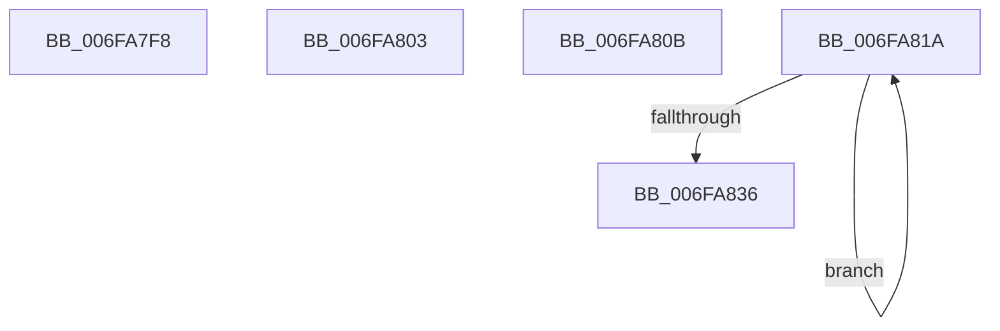

# sub_006FA7F8

- RVA: `0x006FA7F8`–`0x006FA83B` (길이 `67` bytes)
- VA: `0x00000001406FA7F8`
- 실행 섹션: `.text`
- PDB 이름 있음: `아니요`; PDB Function 태그: `아니요`
- unwind 정보 RVA: `0x000B842C`
- 디코드: `17`개 명령, `67/67` bytes 표시
- 미해석 바이트: `0` (있으면 어셈블리에 `.byte`로 보존)

> 이 문서는 커널 이미지의 기계어와 PDB 기호를 분석해 생성했습니다. 4번과 5번은 함수 원형과 자료형을 바이너리 사용 방식에서 추정한 C 해석이며 원본 소스 복구 결과는 아닙니다.

## 1. Dependencies

- 직접 호출 지점: **2**; 고유 호출 대상: **2**
- 직접 호출자로 확인된 함수: **0**
- RIP 상대 이미지 참조: **1**

### Outgoing calls
- `0x006FA80F` → [KiAssignSchedulingGroupWeights](../46/KiAssignSchedulingGroupWeights_function_0046D260.md) (function, `0x0046D260`)
- `0x006FA820` → [KiFlushScbReferences](../5C/KiFlushScbReferences_function_005C89E8.md) (function, `0x005C89E8`)

### Direct callers
- 이 함수 시작 RVA로 연결되는 직접 call은 확인되지 않았습니다. 간접 호출은 완전히 역산할 수 없습니다.

### Static image references
- `0x006FA7F8` → RVA `0x00F2343C` (`.data`; read/write)

## 2. Other-region calls and transfers

- 다른 실행 섹션으로 향하는 call: **0**
- call이 아닌 외부 분기/꼬리 이동: **4**
  - `0x006FA7FE` → [KeRemoveSchedulingGroup + 0x16C](../4A/KeRemoveSchedulingGroup_function_004AD328.md) (`tail-transfer`)
  - `0x006FA806` → [KeRemoveSchedulingGroup + 0x17F](../4A/KeRemoveSchedulingGroup_function_004AD328.md) (`tail-transfer`)
  - `0x006FA815` → [KeRemoveSchedulingGroup + 0x1A7](../4A/KeRemoveSchedulingGroup_function_004AD328.md) (`tail-transfer`)
  - `0x006FA836` → [KeRemoveSchedulingGroup + 0x1B6](../4A/KeRemoveSchedulingGroup_function_004AD328.md) (`tail-transfer`)

## 3. Assembly (complete function range)

```asm
006FA7F8  29 05 3E 8C 82 00               sub dword ptr [rip + 0x828c3e], eax
006FA7FE  E9 91 2C DB FF                  jmp 0x1404ad494
006FA803  4C 8B C7                        mov r8, rdi
006FA806  E9 9C 2C DB FF                  jmp 0x1404ad4a7
006FA80B  33 D2                           xor edx, edx
006FA80D  8B CB                           mov ecx, ebx
006FA80F  E8 4C 2A D7 FF                  call 0x14046d260
006FA814  90                              nop
006FA815  E9 B5 2C DB FF                  jmp 0x1404ad4cf
006FA81A  49 8B 0F                        mov rcx, qword ptr [r15]
006FA81D  48 8B D3                        mov rdx, rbx
006FA820  E8 C3 E1 EC FF                  call 0x1405c89e8
006FA825  48 81 C3 B8 01 00 00            add rbx, 0x1b8
006FA82C  4D 8D 7F 08                     lea r15, [r15 + 8]
006FA830  48 83 EF 01                     sub rdi, 1
006FA834  75 E4                           jne 0x1406fa81a
006FA836  E9 A3 2C DB FF                  jmp 0x1404ad4de
```

## 4. C-style interpretation (structured pseudocode)

```c
__int64 __fastcall sub_006FA7F8(__int64 a1, int a2)
{
}
```

## 5. (Beta) C Style

```c
int64_t sub_006FA7F8(int64_t Arg1, int32_t Arg2)
{
}
```

## 6. Execution-region graph

[열기: 2D/3D 그래프와 함수 탐색 컨트롤 패널](../../../control-panel.html?section=text&rva=0x006FA7F8&view=graph)

- 2D 그래프는 위에서 아래로 흐르고, 3D 그래프는 빈 공간을 드래그해 회전합니다. Shift+드래그는 이동, 휠은 확대·축소, 함수 노드 선택은 대상 보고서 이동입니다.

### Static fallback


