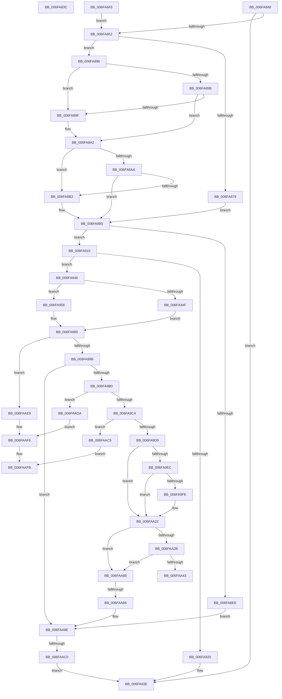

# sub_006FA83C

- RVA: `0x006FA83C`–`0x006FAB11` (길이 `725` bytes)
- VA: `0x00000001406FA83C`
- 실행 섹션: `.text`
- PDB 이름 있음: `아니요`; PDB Function 태그: `아니요`
- unwind 정보 RVA: `0x000B84C8`
- 디코드: `183`개 명령, `725/725` bytes 표시
- 미해석 바이트: `0` (있으면 어셈블리에 `.byte`로 보존)

> 이 문서는 커널 이미지의 기계어와 PDB 기호를 분석해 생성했습니다. 4번과 5번은 함수 원형과 자료형을 바이너리 사용 방식에서 추정한 C 해석이며 원본 소스 복구 결과는 아닙니다.

## 1. Dependencies

- 직접 호출 지점: **11**; 고유 호출 대상: **9**
- 직접 호출자로 확인된 함수: **0**
- RIP 상대 이미지 참조: **5**

### Outgoing calls
- `0x006FA917` → [HalpInterruptGsiToLine](../2D/HalpInterruptGsiToLine_function_002D2DD0.md) (function, `0x002D2DD0`)
- `0x006FA939` → [HalpInterruptSetProblemEx](../48/HalpInterruptSetProblemEx_function_0048AC8C.md) (function, `0x0048AC8C`)
- `0x006FA98D` → [HalpInterruptFindLines](../2D/HalpInterruptFindLines_function_002D2C88.md) (function, `0x002D2C88`)
- `0x006FA9B3` → [HalpInterruptLookupController](../2D/HalpInterruptLookupController_function_002D20D4.md) (function, `0x002D20D4`)
- `0x006FA9CC` → [HalpInterruptDestinationToTarget](../48/HalpInterruptDestinationToTarget_function_0048AA54.md) (function, `0x0048AA54`)
- `0x006FAA0E` → [HalpIommuUpdateRemappingTableEntry](../48/HalpIommuUpdateRemappingTableEntry_function_0048ABC8.md) (function, `0x0048ABC8`)
- `0x006FAA38` → [HalpHvMapIoApicDeviceInterrupt](../../pagelk/B5/HalpHvMapIoApicDeviceInterrupt_function_00B5C858.md) (function, `0x00B5C858`)
- `0x006FAA5D` → [HalpInterruptSetProblemEx](../48/HalpInterruptSetProblemEx_function_0048AC8C.md) (function, `0x0048AC8C`)
- `0x006FAA77` → [HalpInterruptSetRemappedLineStateInternal](../54/HalpInterruptSetRemappedLineStateInternal_function_00542F48.md) (function, `0x00542F48`)
- `0x006FAAB1` → [HalpInterruptSetLineState](../48/HalpInterruptSetLineState_function_0048A0C8.md) (function, `0x0048A0C8`)
- `0x006FAB02` → [HalpInterruptSetProblemEx](../48/HalpInterruptSetProblemEx_function_0048AC8C.md) (function, `0x0048AC8C`)

### Direct callers
- 이 함수 시작 RVA로 연결되는 직접 call은 확인되지 않았습니다. 간접 호출은 완전히 역산할 수 없습니다.

### Static image references
- `0x006FA8EE` → RVA `0x00E101F0` (`.data`; read)
- `0x006FA920` → RVA `0x00023C30` (`.rdata`; read)
- `0x006FA946` → RVA `0x00E10204` (`.data`; read)
- `0x006FA958` → RVA `0x00F231B0` (`.data`; read)
- `0x006FAA22` → RVA `0x00FC1CA8` (`.data`; read)

## 2. Other-region calls and transfers

- 다른 실행 섹션으로 향하는 call: **1**
  - `0x006FAA38` → [HalpHvMapIoApicDeviceInterrupt](../../pagelk/B5/HalpHvMapIoApicDeviceInterrupt_function_00B5C858.md) (`.text` → `PAGELK`)
- call이 아닌 외부 분기/꼬리 이동: **6**
  - `0x006FA83E` → [HalpInterruptEnableNmi + 0x8B](../4A/HalpInterruptEnableNmi_function_004AD9E0.md) (`tail-transfer`)
  - `0x006FA941` → [HalpInterruptEnableNmi + 0x9F](../4A/HalpInterruptEnableNmi_function_004AD9E0.md) (`tail-transfer`)
  - `0x006FAA63` → [HalpInterruptEnableNmi + 0xAB](../4A/HalpInterruptEnableNmi_function_004AD9E0.md) (`tail-transfer`)
  - `0x006FAA80` → [HalpInterruptEnableNmi + 0xAB](../4A/HalpInterruptEnableNmi_function_004AD9E0.md) (`tail-transfer`)
  - `0x006FAABA` → [HalpInterruptEnableNmi + 0xAB](../4A/HalpInterruptEnableNmi_function_004AD9E0.md) (`tail-transfer`)
  - `0x006FAB0C` → [HalpInterruptEnableNmi + 0xAB](../4A/HalpInterruptEnableNmi_function_004AD9E0.md) (`tail-transfer`)

## 3. Assembly (complete function range)

```asm
006FA83C  03 CE                           add ecx, esi
006FA83E  E9 28 32 DB FF                  jmp 0x1404ada6b
006FA843  40 8A D6                        mov dl, sil
006FA846  EB 0A                           jmp 0x1406fa852
006FA848  45 39 6F 24                     cmp dword ptr [r15 + 0x24], r13d
006FA84C  0F 85 EC 00 00 00               jne 0x1406fa93e
006FA852  0F 57 C0                        xorps xmm0, xmm0
006FA855  33 C0                           xor eax, eax
006FA857  0F 11 45 CF                     movups xmmword ptr [rbp - 0x31], xmm0
006FA85B  48 89 45 FF                     mov qword ptr [rbp - 1], rax
006FA85F  0F 11 45 DF                     movups xmmword ptr [rbp - 0x21], xmm0
006FA863  0F 11 45 EF                     movups xmmword ptr [rbp - 0x11], xmm0
006FA867  0F 11 45 07                     movups xmmword ptr [rbp + 7], xmm0
006FA86B  8B 47 10                        mov eax, dword ptr [rdi + 0x10]
006FA86E  8B C8                           mov ecx, eax
006FA870  83 E1 0C                        and ecx, 0xc
006FA873  44 38 6F 08                     cmp byte ptr [rdi + 8], r13b
006FA877  74 1D                           je 0x1406fa896
006FA879  8B 45 D7                        mov eax, dword ptr [rbp - 0x29]
006FA87C  83 F9 0C                        cmp ecx, 0xc
006FA87F  41 8B DD                        mov ebx, r13d
006FA882  0F 45 C6                        cmovne eax, esi
006FA885  89 45 D7                        mov dword ptr [rbp - 0x29], eax
006FA888  8A 47 10                        mov al, byte ptr [rdi + 0x10]
006FA88B  24 03                           and al, 3
006FA88D  3C 03                           cmp al, 3
006FA88F  0F 94 C3                        sete bl
006FA892  03 DE                           add ebx, esi
006FA894  EB 1F                           jmp 0x1406fa8b5
006FA896  83 F9 04                        cmp ecx, 4
006FA899  74 04                           je 0x1406fa89f
006FA89B  A8 0C                           test al, 0xc
006FA89D  75 03                           jne 0x1406fa8a2
006FA89F  89 75 D7                        mov dword ptr [rbp - 0x29], esi
006FA8A2  8B 47 10                        mov eax, dword ptr [rdi + 0x10]
006FA8A5  83 E0 03                        and eax, 3
006FA8A8  74 09                           je 0x1406fa8b3
006FA8AA  BB 02 00 00 00                  mov ebx, 2
006FA8AF  3B C6                           cmp eax, esi
006FA8B1  75 02                           jne 0x1406fa8b5
006FA8B3  8B DE                           mov ebx, esi
006FA8B5  8B 45 07                        mov eax, dword ptr [rbp + 7]
006FA8B8  83 4D DF FF                     or dword ptr [rbp - 0x21], 0xffffffff
006FA8BC  25 02 00 00 C0                  and eax, 0xc0000002
006FA8C1  0D 02 00 00 40                  or eax, 0x40000002
006FA8C6  89 5D CF                        mov dword ptr [rbp - 0x31], ebx
006FA8C9  89 45 07                        mov dword ptr [rbp + 7], eax
006FA8CC  48 8D 45 07                     lea rax, [rbp + 7]
006FA8D0  48 89 45 C7                     mov qword ptr [rbp - 0x39], rax
006FA8D4  4C 89 6D B7                     mov qword ptr [rbp - 0x49], r13
006FA8D8  4C 89 6D BF                     mov qword ptr [rbp - 0x41], r13
006FA8DC  C7 45 DB 10 00 00 00            mov dword ptr [rbp - 0x25], 0x10
006FA8E3  C7 45 E3 02 00 00 00            mov dword ptr [rbp - 0x1d], 2
006FA8EA  84 D2                           test dl, dl
006FA8EC  74 22                           je 0x1406fa910
006FA8EE  48 8B 05 FB 58 71 00            mov rax, qword ptr [rip + 0x7158fb]
006FA8F5  C7 45 B7 05 00 00 00            mov dword ptr [rbp - 0x49], 5
006FA8FC  8B 88 00 01 00 00               mov ecx, dword ptr [rax + 0x100]
006FA902  8B 47 14                        mov eax, dword ptr [rdi + 0x14]
006FA905  89 45 AB                        mov dword ptr [rbp - 0x55], eax
006FA908  89 4D A7                        mov dword ptr [rbp - 0x59], ecx
006FA90B  E9 7E 01 00 00                  jmp 0x1406faa8e
006FA910  8B 4F 14                        mov ecx, dword ptr [rdi + 0x14]
006FA913  48 8D 55 A7                     lea rdx, [rbp - 0x59]
006FA917  E8 B4 84 BD FF                  call 0x1402d2dd0
006FA91C  85 C0                           test eax, eax
006FA91E  79 26                           jns 0x1406fa946
006FA920  4C 8D 0D 09 93 92 FF            lea r9, [rip - 0x6d6cf7]
006FA927  C7 44 24 20 62 06 00 00         mov dword ptr [rsp + 0x20], 0x662
006FA92F  44 8B C0                        mov r8d, eax
006FA932  BA 12 00 00 00                  mov edx, 0x12
006FA937  33 C9                           xor ecx, ecx
006FA939  E8 4E 03 D9 FF                  call 0x14048ac8c
006FA93E  48 8B 3F                        mov rdi, qword ptr [rdi]
006FA941  E9 39 31 DB FF                  jmp 0x1404ada7f
006FA946  44 38 2D B7 58 71 00            cmp byte ptr [rip + 0x7158b7], r13b
006FA94D  74 09                           je 0x1406fa958
006FA94F  C7 45 B7 03 00 00 00            mov dword ptr [rbp - 0x49], 3
006FA956  EB 2D                           jmp 0x1406fa985
006FA958  48 8B 05 51 88 82 00            mov rax, qword ptr [rip + 0x828851]
006FA95F  0F 11 45 17                     movups xmmword ptr [rbp + 0x17], xmm0
006FA963  41 8B 4F 24                     mov ecx, dword ptr [r15 + 0x24]
006FA967  89 75 B7                        mov dword ptr [rbp - 0x49], esi
006FA96A  8B 0C 88                        mov ecx, dword ptr [rax + rcx*4]
006FA96D  66 48 0F 7E C0                  movq rax, xmm0
006FA972  83 E1 3F                        and ecx, 0x3f
006FA975  48 0F AB C8                     bts rax, rcx
006FA979  48 89 45 17                     mov qword ptr [rbp + 0x17], rax
006FA97D  48 8D 45 17                     lea rax, [rbp + 0x17]
006FA981  48 89 45 BF                     mov qword ptr [rbp - 0x41], rax
006FA985  48 8D 55 AF                     lea rdx, [rbp - 0x51]
006FA989  48 8D 4D A7                     lea rcx, [rbp - 0x59]
006FA98D  E8 F6 82 BD FF                  call 0x1402d2c88
006FA992  48 85 C0                        test rax, rax
006FA995  0F 84 4E 01 00 00               je 0x1406faae9
006FA99B  8B 4D AF                        mov ecx, dword ptr [rbp - 0x51]
006FA99E  48 8B 40 30                     mov rax, qword ptr [rax + 0x30]
006FA9A2  48 03 C9                        add rcx, rcx
006FA9A5  44 38 6C C8 0C                  cmp byte ptr [rax + rcx*8 + 0xc], r13b
006FA9AA  0F 85 DE 00 00 00               jne 0x1406faa8e
006FA9B0  8B 4D A7                        mov ecx, dword ptr [rbp - 0x59]
006FA9B3  E8 1C 77 BD FF                  call 0x1402d20d4
006FA9B8  48 8B F0                        mov rsi, rax
006FA9BB  48 85 C0                        test rax, rax
006FA9BE  0F 84 16 01 00 00               je 0x1406faada
006FA9C4  4C 8D 45 E7                     lea r8, [rbp - 0x19]
006FA9C8  48 8D 55 B7                     lea rdx, [rbp - 0x49]
006FA9CC  E8 83 00 D9 FF                  call 0x14048aa54
006FA9D1  85 C0                           test eax, eax
006FA9D3  0F 88 EC 00 00 00               js 0x1406faac5
006FA9D9  48 8B 0D 10 58 71 00            mov rcx, qword ptr [rip + 0x715810]
006FA9E0  F7 81 F4 00 00 00 00 01 00 00   test dword ptr [rcx + 0xf4], 0x100
006FA9EA  74 36                           je 0x1406faa22
006FA9EC  65 48 8B 04 25 20 00 00 00      mov rax, qword ptr gs:[0x20]
006FA9F5  80 B8 8D 00 00 00 01            cmp byte ptr [rax + 0x8d], 1
006FA9FC  74 24                           je 0x1406faa22
006FA9FE  8B 55 07                        mov edx, dword ptr [rbp + 7]
006FAA01  4C 8D 45 CF                     lea r8, [rbp - 0x31]
006FAA05  BB FF FF FF 3F                  mov ebx, 0x3fffffff
006FAA0A  33 C9                           xor ecx, ecx
006FAA0C  23 D3                           and edx, ebx
006FAA0E  E8 B5 01 D9 FF                  call 0x14048abc8
006FAA13  8B 45 07                        mov eax, dword ptr [rbp + 7]
006FAA16  23 C3                           and eax, ebx
006FAA18  C7 45 E7 07 00 00 00            mov dword ptr [rbp - 0x19], 7
006FAA1F  89 45 EF                        mov dword ptr [rbp - 0x11], eax
006FAA22  4C 39 2D 7F 72 8C 00            cmp qword ptr [rip + 0x8c727f], r13
006FAA29  74 3D                           je 0x1406faa68
006FAA2B  8B 8E 00 01 00 00               mov ecx, dword ptr [rsi + 0x100]
006FAA31  48 8D 55 CF                     lea rdx, [rbp - 0x31]
006FAA35  45 33 C0                        xor r8d, r8d
006FAA38  E8 1B 1E 46 00                  call 0x140b5c858
006FAA3D  8B D8                           mov ebx, eax
006FAA3F  85 C0                           test eax, eax
006FAA41  79 25                           jns 0x1406faa68
006FAA43  4C 8D 0D E6 91 92 FF            lea r9, [rip - 0x6d6e1a]
006FAA4A  C7 44 24 20 D1 06 00 00         mov dword ptr [rsp + 0x20], 0x6d1
006FAA52  44 8B C0                        mov r8d, eax
006FAA55  BA 1F 00 00 00                  mov edx, 0x1f
006FAA5A  48 8B CE                        mov rcx, rsi
006FAA5D  E8 2A 02 D9 FF                  call 0x14048ac8c
006FAA62  90                              nop
006FAA63  E9 23 30 DB FF                  jmp 0x1404ada8b
006FAA68  83 65 DB EF                     and dword ptr [rbp - 0x25], 0xffffffef
006FAA6C  4C 8D 45 CF                     lea r8, [rbp - 0x31]
006FAA70  48 8D 55 A7                     lea rdx, [rbp - 0x59]
006FAA74  48 8B CE                        mov rcx, rsi
006FAA77  E8 CC 84 E4 FF                  call 0x140542f48
006FAA7C  8B D8                           mov ebx, eax
006FAA7E  85 C0                           test eax, eax
006FAA80  0F 88 05 30 DB FF               js 0x1404ada8b
006FAA86  8B 5D CF                        mov ebx, dword ptr [rbp - 0x31]
006FAA89  BE 01 00 00 00                  mov esi, 1
006FAA8E  44 8B 4D D7                     mov r9d, dword ptr [rbp - 0x29]
006FAA92  48 8D 45 DF                     lea rax, [rbp - 0x21]
006FAA96  48 89 44 24 30                  mov qword ptr [rsp + 0x30], rax
006FAA9B  48 8D 4D A7                     lea rcx, [rbp - 0x59]
006FAA9F  48 8D 45 B7                     lea rax, [rbp - 0x49]
006FAAA3  41 B0 0F                        mov r8b, 0xf
006FAAA6  48 89 44 24 28                  mov qword ptr [rsp + 0x28], rax
006FAAAB  33 D2                           xor edx, edx
006FAAAD  89 5C 24 20                     mov dword ptr [rsp + 0x20], ebx
006FAAB1  E8 12 F6 D8 FF                  call 0x14048a0c8
006FAAB6  8B D8                           mov ebx, eax
006FAAB8  85 C0                           test eax, eax
006FAABA  0F 88 CB 2F DB FF               js 0x1404ada8b
006FAAC0  E9 79 FE FF FF                  jmp 0x1406fa93e
006FAAC5  C7 44 24 20 9E 06 00 00         mov dword ptr [rsp + 0x20], 0x69e
006FAACD  44 8B C0                        mov r8d, eax
006FAAD0  BA 13 00 00 00                  mov edx, 0x13
006FAAD5  48 8B CE                        mov rcx, rsi
006FAAD8  EB 21                           jmp 0x1406faafb
006FAADA  C7 44 24 20 89 06 00 00         mov dword ptr [rsp + 0x20], 0x689
006FAAE2  BA 11 00 00 00                  mov edx, 0x11
006FAAE7  EB 0D                           jmp 0x1406faaf6
006FAAE9  C7 44 24 20 79 06 00 00         mov dword ptr [rsp + 0x20], 0x679
006FAAF1  BA 12 00 00 00                  mov edx, 0x12
006FAAF6  45 33 C0                        xor r8d, r8d
006FAAF9  33 C9                           xor ecx, ecx
006FAAFB  4C 8D 0D 2E 91 92 FF            lea r9, [rip - 0x6d6ed2]
006FAB02  E8 85 01 D9 FF                  call 0x14048ac8c
006FAB07  BB 25 02 00 C0                  mov ebx, 0xc0000225
006FAB0C  E9 7A 2F DB FF                  jmp 0x1404ada8b
```

## 4. C-style interpretation (structured pseudocode)

```c
__int64 __fastcall sub_006FA83C(int a1)
{
    unsigned int v_stack_p20;
    unsigned __int64 v_stack_p28;
    unsigned __int64 v_stack_p30;

    a1 = (unsigned int)((a1) + ((unsigned int)(v_rsi)));
}
```

## 5. (Beta) C Style

```c
int64_t sub_006FA83C(int32_t Arg1)
{
    uint32_t v_stack_p20;
    uint64_t v_stack_p28;
    uint64_t v_stack_p30;

    Arg1 = (uint32_t)((Arg1) + ((uint32_t)(local_rsi)));
}
```

## 6. Execution-region graph

[열기: 2D/3D 그래프와 함수 탐색 컨트롤 패널](../../../control-panel.html?section=text&rva=0x006FA83C&view=graph)

- 2D 그래프는 위에서 아래로 흐르고, 3D 그래프는 빈 공간을 드래그해 회전합니다. Shift+드래그는 이동, 휠은 확대·축소, 함수 노드 선택은 대상 보고서 이동입니다.

### Static fallback


