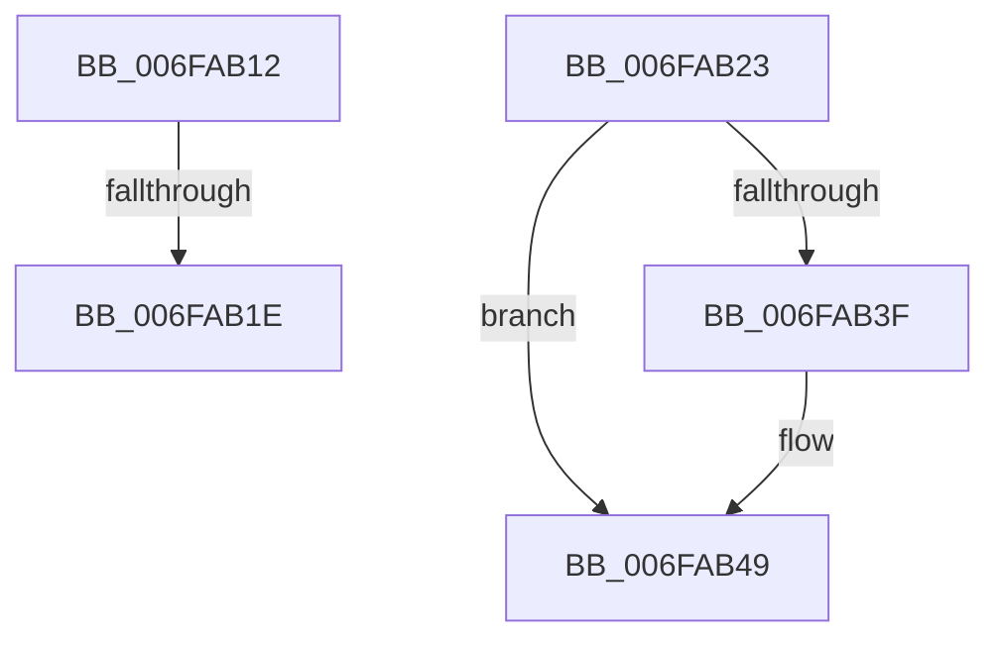

# sub_006FAB12

- RVA: `0x006FAB12`–`0x006FAB55` (길이 `67` bytes)
- VA: `0x00000001406FAB12`
- 실행 섹션: `.text`
- PDB 이름 있음: `아니요`; PDB Function 태그: `아니요`
- unwind 정보 RVA: `0x000B8500`
- 디코드: `16`개 명령, `67/67` bytes 표시
- 미해석 바이트: `0` (있으면 어셈블리에 `.byte`로 보존)

> 이 문서는 커널 이미지의 기계어와 PDB 기호를 분석해 생성했습니다. 4번과 5번은 함수 원형과 자료형을 바이너리 사용 방식에서 추정한 C 해석이며 원본 소스 복구 결과는 아닙니다.

## 1. Dependencies

- 직접 호출 지점: **2**; 고유 호출 대상: **2**
- 직접 호출자로 확인된 함수: **0**
- RIP 상대 이미지 참조: **0**

### Outgoing calls
- `0x006FAB36` → [KeUpdateProcessorRestrictions](../5B/KeUpdateProcessorRestrictions_function_005B6208.md) (function, `0x005B6208`)
- `0x006FAB44` → [PpmEventTraceHeteroSets](../42/PpmEventTraceHeteroSets_function_00426DB4.md) (function, `0x00426DB4`)

### Direct callers
- 이 함수 시작 RVA로 연결되는 직접 call은 확인되지 않았습니다. 간접 호출은 완전히 역산할 수 없습니다.

### Static image references
- 디코드된 RIP-relative 메모리 참조가 없습니다.

## 2. Other-region calls and transfers

- 다른 실행 섹션으로 향하는 call: **0**
- call이 아닌 외부 분기/꼬리 이동: **3**
  - `0x006FAB18` → [PpmParkEvaluateRestriction + 0xA9](../4A/PpmParkEvaluateRestriction_function_004ADE0C.md) (`tail-transfer`)
  - `0x006FAB1E` → [PpmParkEvaluateRestriction + 0x2A](../4A/PpmParkEvaluateRestriction_function_004ADE0C.md) (`tail-transfer`)
  - `0x006FAB50` → [PpmParkEvaluateRestriction + 0x33](../4A/PpmParkEvaluateRestriction_function_004ADE0C.md) (`tail-transfer`)

## 3. Assembly (complete function range)

```asm
006FAB12  33 C9                           xor ecx, ecx
006FAB14  48 85 4B 10                     test qword ptr [rbx + 0x10], rcx
006FAB18  0F 85 97 33 DB FF               jne 0x1404adeb5
006FAB1E  E9 13 33 DB FF                  jmp 0x1404ade36
006FAB23  41 8A 02                        mov al, byte ptr [r10]
006FAB26  4C 8D 4C 24 40                  lea r9, [rsp + 0x40]
006FAB2B  0F B7 4B 08                     movzx ecx, word ptr [rbx + 8]
006FAB2F  41 8B D3                        mov edx, r11d
006FAB32  88 44 24 40                     mov byte ptr [rsp + 0x40], al
006FAB36  E8 CD B6 EB FF                  call 0x1405b6208
006FAB3B  84 C0                           test al, al
006FAB3D  74 0A                           je 0x1406fab49
006FAB3F  B9 02 00 00 00                  mov ecx, 2
006FAB44  E8 6B C2 D2 FF                  call 0x140426db4
006FAB49  C6 83 D4 04 00 00 00            mov byte ptr [rbx + 0x4d4], 0
006FAB50  E9 EA 32 DB FF                  jmp 0x1404ade3f
```

## 4. C-style interpretation (structured pseudocode)

```c
__int64 __fastcall sub_006FAB12(int a1)
{
    unsigned __int64 v_stack_p40;

    a1 = 0;
}
```

## 5. (Beta) C Style

```c
int64_t sub_006FAB12(int32_t Arg1)
{
    uint64_t v_stack_p40;

    Arg1 = 0;
}
```

## 6. Execution-region graph

[열기: 2D/3D 그래프와 함수 탐색 컨트롤 패널](../../../control-panel.html?section=text&rva=0x006FAB12&view=graph)

- 2D 그래프는 위에서 아래로 흐르고, 3D 그래프는 빈 공간을 드래그해 회전합니다. Shift+드래그는 이동, 휠은 확대·축소, 함수 노드 선택은 대상 보고서 이동입니다.

### Static fallback


